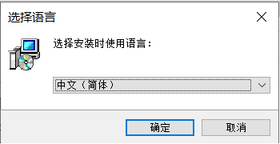
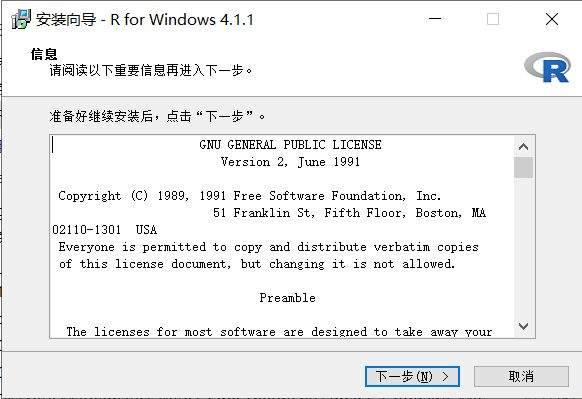
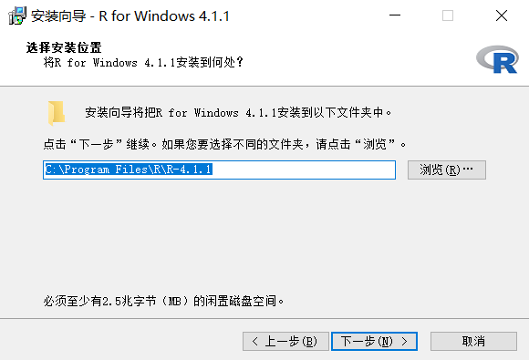
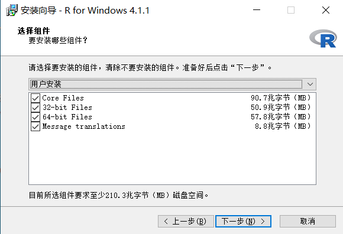
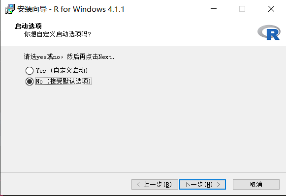
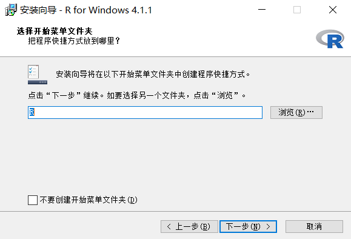
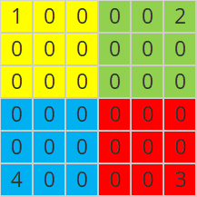
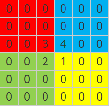

output: html_document
editor_options: 
  chunk_output_type: console


# R基础 {#RBasis}

## R的安装

步骤1  官网（https://www.r-project.org/）下载R的安装包，根据自己的系统下载相应程序。R版本更新较快。尽量下载最新版本。
 
步骤2 双击运行安装程序。选择需要使用的语言。



 
步骤3 进入安装向导，点击下一步。


 
 
步骤4 选择安装位置。


 
步骤5 选择组件，可以根据自己的计算机选择相应的选项，也可以全部选择。


 
步骤6 启动选项，可以选择接受默认选项。


 
步骤7 选择开始菜单创建的文件夹时，可以直接点击下一步即可。


 
步骤8 安装完成后，在安装目录中的bin\\x64目录中，双击Rgui.exe可以出现R语言的图形界面。


## 向量操作

### 生成向量

* 直接输入方式

已知一个钢材抗张力样本数据（见下表）

|      |      |      |      |      |      |      |      |      |      |      |      |      |
| - | - | - | - | - | - | - | - | - | - | - | - | - |
|      | 41   | 37   | 33   | 44.2 | 30.5 | 27   | 45   | 28.5 | 31.2 | 33.5 | 38.5 | 41.5 |
|      | 42   | 45.5 | 42.5 | 39   | 38.8 | 35.5 | 32.5 | 29.6 | 32.6 | 34.5 | 37.5 | 39.5 |
|      | 42.8 | 45.1 | 42.8 | 45.8 | 39.8 | 37.2 | 33.8 | 31.2 | 29   | 35.2 | 37.8 | 41.2 |
|      | 43.8 | 48   | 43.6 | 41.8 | 36.6 | 34.8 | 31   | 32   | 33.5 | 37.4 | 40.8 | 44.7 |
|      | 40.2 | 41.3 | 38.8 | 34.1 | 31.8 | 34.6 | 38.3 | 41.3 | 30   | 35.2 | 37.5 | 40.5 |
|      | 38.1 | 37.3 | 37.1 | 41.5 | 29.5 | 29.1 | 27.5 | 34.8 | 36.5 | 44.2 | 40   | 44.5 |
|      | 40.6 | 36.2 | 35.8 | 31.5 |      |      |      |      |      |      |      |      |


在R语言中，可以将表中的钢材抗张力样本数据“抽象”为一个向量，利用**c**构造符来实现。

```{r}
dt <- c(
41.0, 37.0, 33.0, 44.2, 30.5, 27.0, 45.0, 28.5, 31.2, 33.5, 38.5, 41.5,
42.0, 45.5, 42.5, 39.0, 38.8, 35.5, 32.5, 29.6, 32.6, 34.5, 37.5, 39.5,
42.8, 45.1, 42.8, 45.8, 39.8, 37.2, 33.8, 31.2, 29.0, 35.2, 37.8, 41.2,
43.8, 48.0, 43.6, 41.8, 36.6, 34.8, 31.0, 32.0, 33.5, 37.4, 40.8, 44.7,
40.2, 41.3, 38.8, 34.1, 31.8, 34.6, 38.3, 41.3, 30.0, 35.2, 37.5, 40.5,
38.1, 37.3, 37.1, 41.5, 29.5, 29.1, 27.5, 34.8, 36.5, 44.2, 40.0, 44.5,
40.6, 36.2, 35.8, 31.5
)
```


如果总是手工录入数据，且待录入的数据很多时，是比较麻烦的事情。这里，可以替代的方法包括：随机模拟数据方式、冒号方式、seq方式、rep方式和文件读入方式。

* 随机模拟方式

**随机模拟数据 — 模拟有放回抽样操作**

```{r}
#设定随机种子
set.seed(123)
#依据元素为27、28.5、31、32、34.5、37、40和48的向量，进行有放回抽样，
#形成一个容量为76的样本，抽样结果保存在dt.sample中
dt.sample = sample(c(27,28.5,31,32,34.5,37,40,48),76,replace = T)
#查看抽样结果
dt.sample
```

**随机模拟数据 — 模拟无放回抽样操作**

```{r}
#设定随机种子
set.seed(123)
#依据元素为27、28.5、31、32、34.5、37、40和48的向量，进行无放回抽样，
#生成一个容量为5的样本，抽样结果保存在dt.sample中
dt.sample = sample(c(27,28.5,31,32,34.5,37,40,48),5,replace = F)
#查看抽样结果
dt.sample
```


**随机模拟数据 — 模拟均匀分布数据**

```{r}
#设定随机种子
set.seed(123)
#生成一个在[27,48]区间服从均匀分布的容量为76的样本，保存在dt.runif中
dt.runif <- runif(76,27,48)
#查看模拟结果
dt.runif
```


**随机模拟数据 — 模拟正态分布数据**

```{r}
#设定随机种子
set.seed(123)
#生成一个服从均值为32，标准差为5的正态分布样本，容量为76，保存在dt.rnorm中
dt.rnorm <- rnorm(76,mean = 35,sd=5)
#查看模拟结果
dt.rnorm
```


**随机模拟数据 — 模拟卡方分布数据**

```{r}
#设定随机种子
set.seed(123)
#生成一个服从自由度为6的卡方分布样本，容量为76，保存在dt.chisq中
dt.chisq <- rchisq(76,df=6)
#查看模拟结果
dt.chisq
```


**随机模拟数据 — 模拟T分布数据**

```{r}
#设定随机种子
set.seed(123)
#生成一个服从自由度为6的卡方分布样本，容量为76，保存在dt.t中
dt.t <- rt(76,df=10)
#查看模拟结果
dt.t
```


**随机模拟数据 — 模拟F分布数据据**

```{r}
#设定随机种子
set.seed(123)
#生成一个服从第一自由度为10、第二自由度为4的F方分布样本，容量为76，
#保存在dt.f中
dt.f <- rf(76,df1=10,df2=4)
#查看模拟结果
dt.f
```


**随机模拟数据 — 模拟泊松分布数据**

```{r}
#设定随机种子
set.seed(123)
#生成一个lambdaa=5的泊松方分布样本，容量为76，保存在dt.pois中
dt.pois <- rpois(76, lambda = 5)
#查看模拟结果
dt.pois
```


* 冒号方式

```{r}
#生成元素为1,2,3,...,10的向量
1:10

#生成元素为-1,0,1,2,3,4的向量
-1:4

#生成元素为110,109,108,107,...,101的向量
110:101
```


* seq方式

```{r}
#生成从1开始，每次递增1，直至递增到10的向量
seq(1,10,by=1)

#生成从-1开始，每次递增1，直至递增到4的向量
seq(-1,4,by=1)

#生成从110开始，每次递减1，直至递减到101的向量
seq(110,101,by=-1)

#生成从1开始，每次递增2，直至递增到9的向量
seq(1,10,by=2)

#生成从2开始，每次递增2，直至递增到10的向量
seq(2,10,by=2)

#生成从1开始，每次递增0.5，直至递增到10的向量
seq(1,10,by=0.5)

#将区间[1,10]等分为5-1=4部分，并将等分后的端点形成一个向量
seq(1,10,length.out = 5)

#将区间[2,10]等分为5-1=4部分，并将等分后的端点形成一个向量
seq(2,10,length.out = 5)

#将区间[1,10]等分为19-1=18部分，并将等分后的端点形成一个向量
seq(1,10,length.out = 19)
```


* rep方式

```{r}
#将元素为1、2、3、4、5的向量整体重复3次
rep(1:5,times=3)

#将元素为1、2、3、4、5的向量的每个元素依次重复3次
rep(1:5,each=3)

#将元素为a、b、d的向量整体重复3次
rep(c('a','b','d'),times=3)

#将元素为a、b、d的向量的每个元素依次重复3次
rep(c('a','b','d'),each=3)
```


### 读写向量的元素

```{r}
#生成向量x
x = c(1,3,5,11,20,30,8,9,2)

#读出x第1个元素
x[1] 

#读取x第2-4个元素
x[2:4] 

#读取x第2、5、7个元素
x[c(2,5,7)] 

#读取x第2-4以及6-8个元素
x[c(2:4,6:8)] 

#将x第1个元素变为101
x[1] = 101 
x

#将x第2-4个元素分别变为102、103和104
x[2:4] = 102:104 
x

#将x第2、5、7个元素都变为105
x[c(2,5,7)] = 105 
x

#将x第2-4以及6-8个元素分别变为原来元素的2倍
x[c(2:4,6:8)] <- x[c(2:4,6:8)]*2
x
```

### 向量的运算

**向量的加法运算**

```{r}
#用冒号方式生成向量x，元素为1、2、3、4、5、6
x = 1:6
#用seq方式生成向量y，元素为2、2.5、3.0、3.5、4.0、4.5
y = seq(2,4.5,by=0.5)

#两个向量相加，结果是对应元素相加
x + y

#运算之前，会先依据x的元素个数将1重复6次，形成元素为6个1的向量，
#而后再与x的对应元素相加
x + 1

#运算之前，会先依据x的元素个数向量1:2整体重复3次，
#形成元素为1、2、1、2、1、2的向量，而后再与x的对应元素相加
x + 1:2

#运算之前，会先依据x的元素个数向量1:3整体重复2次，
#形成元素为1、2、3、1、2、3的向量，而后再与x的对应元素相加
x + 1:3


#运算之前，会先依据x的元素个数扩展向量1:4，
#形成元素为1、2、3、4、1、2的向量，而后再与x的对应元素相加
x + 1:4

#运算之前，会先依据x的元素个数扩展向量1:5，
#形成元素为1、2、3、4、5、1的向量，而后再与x的对应元素相加
x + 1:5

#运算之前，会先依据向量1:12将x整体重复1次，
#形成元素为1、2、3、4、5、6、1、2、3、4、5、6的向量，
#而后再与向量1:12的对应元素相加
x + 1:12
```


**向量的数乘运算**

```{r}
#用seq方式生成向量x
x = seq(1,5,length.out = 5)
#向量x的每个元素乘以2
2*x
#向量x的每个元素乘以1.2
1.2*x
#向量x的每个元素乘以-1
(-1)*x
```


**向量的减法运算**
```{r}
#生成向量x和y
x = 1:6
y = seq(2,4.5,by=0.5)

#向量x前去向量y，结果是对应元素相减
x - y
#向量相减，可以视为向量加法与向量数乘的联合运算
x + (-1)*y

#运算之前，会先依据x的元素个数将1重复6次，形成元素为6个1的向量，
#而后再与x的对应元素相减
x - 1

#运算之前，会先依据x的元素个数将向量1:2整体重复3次，
#形成元素为1、2、1、2、1、2的向量，而后再与x的对应元素相减
x - 1:2

#运算之前，会先依据x的元素个数将向量1:3整体重复2次，
#形成元素为1、2、3、1、2、3的向量，而后再与x的对应元素相减
x - 1:3

#运算之前，会先依据x的元素个数扩展向量1:4，
#形成元素为1、2、3、4、1、2的向量，而后再与x的对应元素相减
x - 1:4

#运算之前，会先依据x的元素个数扩展向量1:5，
#形成元素为1、2、3、4、5、1的向量，而后再与x的对应元素相减
x - 1:5

#运算之前，会先依据向量1:12将x整体重复1次，
#形成元素为1、2、3、4、5、6、1、2、3、4、5、6的向量，
#而后再与向量1:12的对应元素相减
x - 1:12
```


**向量的乘法运算**

```{r}
#生成向量x和y
x = 1:3
y = 6:4
#计算x与y的对应元素的乘积
x * y
```

**向量的内积运算**

```{r}
#生成向量x和y
x <- 1:3
y <- 6:4
#计算x与y的内积
x %*% y
```

**向量的转置运算**

```{r}
#生成向量x
x <- 1:3
#默认情况下，向量都是列向量模式
x

#x转置之后，得到1行3列的矩阵
t(x)
```


**向量元素的个数**

```{r}
#生成向量x
x = seq(1,10.2,by=0.31)
x

#获取x包含的向量个数
length(x)
```


**向量元素求和运算**

```{r}
#生成向量x
x = 1:100
#计算x所有元素的和
sum(x)
```

**向量元素均值运算**

```{r}
#生成向量x
x = 1:100
#通过mean计算x的元素均值
mean(x)
#也可以用如下方式计算x的元素均值
sum(x) / length(x)
```


**向量元素最大值运算**

```{r}
#设置随机种子
set.seed(123)
#生成服从均值为3、标准差为2.5的正态分布样本x（容量为100）
x = rnorm(100,mean = 3, sd=2.5)
#获取x的元素的最大值
max(x)
```

**向量元素最小值运算**

```{r}
#设置随机种子
set.seed(123)
#生成服从区间[2.5,3]上的均匀分布样本x（容量为100）
x = runif(100, 2.5, 3)
#获取x的元素的最小值
min(x)
```


**向量元素排序运算 — 升序**

```{r}
#设置随机种子
set.seed(123)
#按有放回抽样方式从向量1:30中抽取10个元素，形成向量x
x = sample(1:30,10,replace = T)
x

#以sort方式对x的元素按按从小到大进行排序
sort(x)

#或者以order方式获得x按从小到大顺序排列的角标位置
order(x)
#依据order返回的结果对x的元素按从小到大的顺序排列
x[order(x)]
```


**向量元素排序运算 — 降序**

```{r}
#设置随机种子
set.seed(123)
#按有放回抽样方式从向量1:30中抽取10个元素，形成向量x
x <- sample(1:30,10,replace = T)
x

#以sort方式对x的元素按从大到小进行排序
sort(x,decreasing = T)
```


**向量元素排序运算**
```{r}
#设置随机种子
set.seed(123)
#按有放回抽样方式从向量1:30中抽取10个元素，形成向量x
x = sample(1:30,10,replace = T)
x

#或者以order方式获得x按从大到小顺序排列的角标位置
order(x, decreasing = T)
#依据order返回的结果对x的元素按从大到小的顺序排列
x[order(x, decreasing = T)] 
```


**向量元素的取值范围**

```{r}
#设置随机种子
set.seed(123)
#生成服从标准正态分布的样本x（容量为10）
x = rnorm(10)
#计算x的元素的取值范围（计算结果的第一个元素为x的最小值，
#第二个元素为x的最大值）
range(x)
```


**向量元素倒序运算**

```{r}
#生成向量x
x = seq(1,10,by=3)
x

#x的元素倒序排列
rev(x)
```


**向量元素幂运算**

```{r}
#生成向量x
x = 1:12
#计算x中每个元素的平方
x^2
#计算x中每个元素的平方根
x^(1/2)
#计算x中每个元素的倒数
x^(-1)
```

**向量元素指数运算**

```{r}
#生成向量x
x = 1:10
#计算以2为底，以x的每个元素为指数的值
2^x
```


**向量元素对数运算**

```{r}
#生成向量x
x <- 2^(1:10)
#计算x的每个元素的以2为底的对数值
log(x,base = 2)
#计算x的每个元素的自然对数值
log(x)
#计算x的每个元素的常用对数值
log(x,base = 10)
```


**向量元素三角运算**

```{r}
#生成向量x
x = seq(0,2*pi,by=pi/4)
x

#计算x的每个元素的正弦
sin(x)
#计算x的每个元素的余弦
cos(x)
```

**向量元素的包含运算**

```{r}
#生成向量x，y
x = 1:3
y = 2:6
#查看x的哪些向量包含于y
x %in% y
```


**向量元素比较运算**

```{r}
#生成向量x
x = 1:11
#计算x的元素均值，保存在m中
m = mean(x)

#判断x的元素是否大于均值m，返回的结果为TRUE，则表明相应元素大于均值，
#反之表明相应元素不大于均值
x > m

#判断x的元素是否等于均值m，返回的结果为TRUE，则表明相应元素等于均值，
#反之表明相应元素不等于均值
x == m

#判断x的元素是否不等于均值m，返回的结果为TRUE，则表明相应元素不等于均值，
#反之表明相应元素等于均值
x != m

#判断x的元素是否小于均值m，返回的结果为TRUE，则表明相应元素小于均值，
#反之表明相应元素不小于均值
x < m

#生成向量x
x = 1:10
#判断x的元素是否小于3，若小于3则结果为不合格，反之结果为合格
ifelse(x<3,"不合格","合格")

#判断x的元素是否小于3，结果为不合格，若元素在[3,6)区间，结果为及格，
#若元素大于等于6，结果为良好
ifelse(x<3,"不及格",ifelse(x<6,"及格","良好"))
```


**向量元素条件查询**

```{r}
#生成向量x
x = 1:11
#计算x的元素的均值m
m = mean(x)

#查询x的哪些元素大于均值m
which(x>m)
#查询x的哪些元素等于均值m
which(x==m)
#查询x的哪些元素不等于均值m
which(x!=m)
#查询x的哪些元素小于均值m
which(x<m)
```


```{r}
#设定随机种子
set.seed(123)
#生成向量x（结果是1、2、...、11的一个排列）
x = sample(1:11)
#计算x的元素的均值
m <- mean(x)

#查询x的哪些元素大于均值m，并获取这些元素
idx <- which(x>m)
x[idx]

#查询x的哪些元素等于均值m，并获取这些元素
idx <- which(x==m)
x[idx]

#查询x的哪些元素不等于均值m，并获取这些元素
idx <- which(x!=m)
x[idx]

#查询x的哪些元素小于均值m，并获取这些元素
idx <- which(x<m)
x[idx]
```


**逻辑向量求和**

对于元素为逻辑值的向量求和，可以统计其中值为TRUE的元素个数。

```{r}
#设定随机种子
set.seed(123)
#生成向量x（结果是1、2、...、11的一个排列）
x = sample(1:11)
#计算x的元素的均值
m <- mean(x)

#计算有多少个数超过平均值
sum(x > m)
```

利用逻辑向量求和，可以统计一个向量vec2中有多少个元素属于另一个向量vec1：

```{r}
#指定vec1
vec1 = 1:20
#设定随机种子
set.seed(123)
#在向量1:30中无放回抽取10个数，形成vec2
vec2 = sample(1:30,10)
#查看vec2中的元素
vec2
#统计vec2中有多少个元素属于vec1
sum(vec2 %in% vec1)
```

**统计向量各元素取值的频数**

```{r}
#生成向量x
set.seed(123)
x = sample(letters[1:5],15,replace = T)
#提出x中不重复的元素取值
unique(x)
#统计x中各元素取值出现的频数
table(x)
```


**向量的直方图**

```{r}
#生成向量x
set.seed(123)
x = rnorm(30,mean=60,sd=10)
#对x的取值范围均分为8个区间
x.cut1 = cut(x,breaks = 8)
#统计x的元素在各个区间的分布数量，即直方图
table(x.cut1)

#对x的取值范围进行区间划分，各区间端点为：
#40、45、50、55、60、65、70、75和80
x.cut2 = cut(x,breaks = seq(40,80,by=5))
#统计x的元素在各个区间的分布数量，即直方图
table(x.cut2)

#对x的取值范围进行区间划分，各区间端点为：40、50、60、70和80，
#并设定为左闭右开区间模式
x.cut3 = cut(x,breaks = seq(40,80,by=10), right = F)
#统计x的元素在各个区间的分布数量，即直方图
table(x.cut3)
```


对一组数划分区间，统计频次数？在后面的直方图中有用

将矩阵f的如下运算变成向量操作：
$$
m_{ji} = \sum_{x,y} f(x,y)*x^j*y^i
$$

## Factors操作

因子Factors是一种特殊向量，可以用来表示一些具前后、层级顺序（体现为因子水平）的分类变量，。

```{r}
#生成一个因子型向量gender，表示3个人的性别
#默认情况下，因子水平是自动依据因子向量的元素生成的，且按照字母顺序
#排列因子水平，比如，以下的gender向量的因子水平为：FEMALE和MALE
gender = factor(c("MALE", "FEMALE", "MALE")) 
gender


#生成一个因子型向量gender1，表示3个人的性别，
#同时指定因子水平为：MALE和FEMALE
gender1 = factor(c("MALE", "FEMALE", "MALE"),
                 levels = c("MALE","FEMALE")
                )
gender1

#生成一个因子型向量blood，表示3个人的血型，
#同时指定因子水平为：A、B、AB和O
blood <- factor(
  c("O", "AB", "A"), 
  levels = c("A", "B", "AB", "O")
)
#统计向量blood中各血型出现的人数
table(blood)

#模拟生成40个同学的某课程的成绩向量score，并统计各成绩等级的人数
score = sample(c("优","良","中","及格","不及格"),40,repl=T)
table(score)

#模拟生成40个同学的某课程的成绩向量，并指定因子水平为：
#优、良、中、及格和不及格，然后统计各成绩等级的人数
score1 = factor(
  sample(c("优","良","中","及格","不及格"),40,repl=T),
  levels=c("优","良","中","及格","不及格")
)
table(score1)

#生成包含5个字母a、b、c、d和e的因子型向量tmp
tmp = factor(letters[1:5])
#更改tmp的第二个元素为e
tmp[2] = "e"
tmp

#若待更改的值不在因子水平中，更改操作会达不到预期
tmp[3] <- "z"
tmp
```

## 列表操作

```{r}
#生成一个列表patients，包含3个病人的姓名、体温、性别、血型
patients = list(
  subject.name = c("John","Peter","Alice"),
  temperature = c(98.1, 98.6, 101.4),
  gender = factor(c("MALE", "FEMALE", "MALE"),
                  levels = c("MALE","FEMALE")),
  blood = factor(c("O", "AB", "A"), 
                 levels = c("A", "B", "AB", "O"))
)
patients

#查询三个病人的姓名
patients$subject.name

#查询三个病人的体温和性别
patients[2:3]
#或者
patients[c("temperature","gender")]

#查询第二个病人的血型
patients$blood[2]

#查询是否有姓名为Alice的病人
any(patients$subject.name=="Alice")
```


```{r}
#生成一个列表pnts：包含10个点的横、纵坐标
pnts = vector("list",10)
for(i in 1:10){
  set.seed(i*100)
  pnts[[i]] = round(rnorm(2),2)
}
pnts

#取出pnts中10个点的横坐标
x = sapply(pnts,'[[',1)
#取出pnts中10个点的纵坐标
y = sapply(pnts,'[[',2)
#绘制这10个点形成的多边形
rng = range(c(x,y))
plot((rng[1]-1):(rng[2]+1),(rng[1]-1):(rng[2]+1),
     type="n",xlab="",ylab="")
polygon(x,y,col="red")
```


## 数据框操作

```{r}
#生成一个数据框PtData，包含9个病人的姓名、体温、流感状态、性别、血型
subject.name = c("John","Peter","Alice","Philip",
                 "Jack","Green","Mark","Lili","Ama")
temperature = c(98.1,98.6,101.4,90.0,95.2,96.6,97.8,95.1,98.9)
flu.status = c(TRUE,FALSE,FALSE,TRUE,FALSE,FALSE,TRUE,FALSE,FALSE)
gender = factor(rep(c("MALE", "FEMALE", "MALE"),3),
                levels = c("MALE","FEMALE"))
blood = factor(rep(c("O", "AB", "A"),each=3), 
               levels = c("A", "B", "AB", "O"))

PtData = data.frame(subject.name, temperature, flu.status, 
                      gender, blood, stringsAsFactors = FALSE)

#查看PtData的数据结构
str(PtData)

#获取PtData的列名称
names(PtData)

#查看PtData的前5个病人的数据
head(PtData,5)

#查询第一个病人的姓名
PtData$subject.name[1]
#或者
PtData[1,"subject.name"]
#或者
PtData[1,1]

#查询九个病人的姓名
PtData$subject.name #返回的是向量
#或者
PtData[,1] #返回的是向量
#或者
PtData[1] #返回的不是向量，而是数据框


#查询九个病人的姓名和体温
PtData[c("subject.name","temperature")]
#或者
PtData[c(1,2)]

#查询第1-3个病人的姓名和流感状态
PtData[1:3,c("subject.name","flu.status")]
#或者
PtData[1:3,c(1,3)]

#查询第一个病人信息
PtData[1,]
#查询姓名为Alice的病人信息
PtData[PtData$subject.name=="Alice",]

#查询第一个、第三个病人的体温和性别信息
PtData[c(1, 3), c("temperature", "gender")]
#或者
PtData[c(-2), -c(1,3,5)]

#查询数据框的行数和列数
dim(PtData) #同时返回行数和列数
nrow(PtData) #只返回行数
ncol(PtData) #只返回列数
```

## 矩阵操作

留意如何生成像素横坐标和纵坐标映射矩阵

对矩阵元素进行order排序，找到最大的10个（用于后面的模板匹配）

```{r}
set.seed(123)
m = matrix(sample(1:12),nr=4,nc=3)
m
ord = order(m,decreasing = T)

#(cc-1)*nrow(m)+rr=pos
for(pos in ord){
  rr = pos %% nrow(m)
  if(rr==0) rr=nrow(m)
  cc = (pos - rr) / nrow(m) +1
  cat(rr,cc,"\n")
}
```


### 生成矩阵

**示例**

生成如下矩阵：

$$
\left[
\begin{matrix}
3 & 10 & 9 \\
4 & 7  & 8 \\
2 & 1  & 5
\end{matrix}
\right]
$$

```{r}
matrix(c(3,10,9,4,7,8,2,1,5),nr=3,nc=3,byrow=T)
```

若不要**byrow=T**，会生成如下的矩阵：

$$
\left[
\begin{matrix}
3 & 4 & 2 \\
10 & 7  & 1 \\
9 & 8  & 5
\end{matrix}
\right]
$$
**示例**

生成如下矩阵：

$$
\left[
\begin{matrix}
1 & 4 & 7 \\
2 & 5 & 8 \\
3 & 6 & 9
\end{matrix}
\right]
$$

```{r}
matrix(1:9,nr=3,nc=3)
```


再生成如下矩阵：

$$
\left[
\begin{matrix}
a & b & c & d \\
e & f & g & h \\
i & j & k & l
\end{matrix}
\right]
$$

```{r}
matrix(letters[1:12],nr=3,byrow = T)
```

**示例**

生成随机矩阵：

```{r}
#通过无放回抽样方式生成随机矩阵
matrix(sample(1:12,9),nr=3)

#通过模拟正态分布生成随机矩阵
matrix(rnorm(9,mean=75,sd=10),nr=3)

#通过模拟均匀分布生成随机矩阵
matrix(rnorm(9,30,50),nr=3)
```

**示例**

用outer方式生成矩阵：

```{r}
x <- 1:3
y <- 4:7
outer(x,y,"*")
```


**示例**

用修改维度方式的从向量生成矩阵

```{r}
#设定随机种子
set.seed(123)
#生成服从标准正态分布的向量（包含64个元素，每个元素保留2位小数）
v = round(rnorm(64),2)
#更改v的维度为8行、8列
dim(v) = c(8,8)
#维度更改后，v从向量转变为8行、8列矩阵
v
```


### 读写矩阵的元素

已知一个3行5列矩阵：

$$
m = \left[
\begin{matrix}
3.9  & 2.2  & 4.1  & 3.2  & 3.8 \\
2.7  & 2.6  & 2.6  & 2.5  & 3.8 \\
4.9  & 2.4  & 4.7  & 3.9  & 2.9 \\
\end{matrix}
\right]
$$

解决如下问题：

* 读出**m**第1行的第1列元素
* 读取**m**第2行的第2-4列元素
* 读取**m**第1-2行的第2列元素
* 读取**m**第2-3行的第3-5列元素
* 读取**m**第2-3行的第1-2列以及第5列元素
* 将**m**第1行的第1列元素变为0
* 将**m**第2行的第2-4列元素分别变为1.1,1.2,1.3
* 将**m**第1-2行的第2列元素变为它们各自的相反数
* 将**m**第2-3行的第3-5列元素变为-1
* 将**m**第2-3行的第1-2列以及第5列元素变为它们各自的倒数
* 将**m**第1行的第1列元素变为0
* 将**m**第2行的第2-4列元素分别变为1.1,1.2,1.3
* 将**m**第1-2行的第2列元素变为它们各自的相反数
* 将**m**第2-3行的第3-5列元素变为-1
* 将**m**第2-3行的第1-2列以及第5列元素变为它们各自的倒数


```{r}
m <- matrix(
  c(3.9,2.2,4.1,3.2,3.8,2.7,2.6,2.6,2.5,3.8,4.9,2.4,4.7,3.9,2.9),
  nr=3,byrow=T)

#读出m第1行的第1列元素
m[1,1]
#读取m第2行的第2-4列元素
m[2,2:4]
#读取m第1-2行的第2列元素
m[1:2,2]
#读取m第2-3行的第3-5列元素
m[2:3,3:5]
#读取m第2-3行的第1-2列以及第5列元素
m[2:3,c(1:2,5)]

#将m第1行的第1列元素变为0
m[1,1] = 0
#将m第2行的第2-4列元素分别变为1.1,1.2,1.3
m[2,2:4] = seq(1.1,1.3,by=0.1)
#将m第1-2行的第2列元素变为它们各自的相反数
m[1:2,2] = -m[1:2,2]
#将m第2-3行的第3-5列元素变为-1
m[2:3,3:5] = -1
#将m第2-3行的第1-2列以及第5列元素变为它们各自的倒数
m[2:3,c(1:2,5)] = 1/m[2:3,c(1:2,5)]
```


### 矩阵的运算

**矩阵的加法运算**

```{r}
#生成2行3列矩阵m
m = matrix(sample(1:6),nr=2)
#生成3行3列矩阵k
k = matrix(sample(7:12),nr=2)
#计算m与k的和
m + k

#m的每个数都加上3，其中有一个隐含的操作：
#R语言会自动依据m的行数和列数生成2行3列的元素全为3的矩阵
m + 3
```

**矩阵的数乘运算**

```{r}
#生成2行3列矩阵m
m = matrix(sample(1:6),nr=2)
#计算1.2乘以m
1.2*m
```

**矩阵的减法运算**

```{r}
#生成2行3列矩阵m
m = matrix(sample(1:6),nr=2)
#生成3行3列矩阵k
k = matrix(sample(7:12),nr=2)
#计算m与k的差
m - k
```

**矩阵的乘法运算**

```{r}
#生成2行3列矩阵m
m = matrix(sample(1:6),nr=2)
#生成3行4列矩阵k
k = matrix(sample(1:12),nr=3)
#计算m与k的乘积
m %*% k
```

**矩阵元素的取值范围**

```{r}
#生成2行3列矩阵m
set.seed(123)
m = matrix(round(rnorm(6,mean=10,sd=5),2),nr=2)
#获取矩阵元素的取值范围：第1个元素为最小值，第2个元素为最大值
range(m)
```


**将矩阵元素取值映射到新的取值区间**

设矩阵元素的最小值和最大值分别为$minV$、$maxV$，可以依据如下公式将其元素取值映射到$[a,b]$区间上：
$$
newV = oldV \times \frac{b-a}{maxV-minV} - minV \times \frac{b-a}{maxV-minV}+a
$$

```{r}
#生成2行3列矩阵m
set.seed(123)
m = matrix(round(rnorm(6,mean=10,sd=5),2),nr=2)
#获取矩阵元素的的最小值和最大值
minV = min(m)
maxV = max(m)
#将矩阵元素的取值映射到[0,255]区间
a = 0
b = 255
m.new = round(m*(b-a)/(maxV-minV)-minV*(b-a)/(maxV-minV)+a)
m.new
```


**矩阵的转置运算**

```{r}
#生成2行3列矩阵m
m <- matrix(sample(1:6),nr=2)
#计算m的转置
t(m)
```


**矩阵的行数与列数**

```{r}
#生成5行20列的随机矩阵m
m = matrix(round(rnorm(100),2),nr=5)
#查看m的行数和列数
dim(m)
#只查看m的行数
nrow(m)
#只查看m的列数
ncol(m)
```

**矩阵的行（列）向量操作**


```{r}
#生成3行5列矩阵m
m <- matrix(1:15,nr=3,byrow=T)

#计算m的第一行元素（视为一个行向量）的均值
mean(m[1,])

#求矩阵各行元素的均值  
apply(m,1,mean)

#求矩阵第一列元素的均值
mean(m[,1])

#求矩阵各列元素的均值 
apply(m,2,mean)

#求矩阵各行元素的最大值、最小值、和
apply(m,1,max)
apply(m,1,min)
apply(m,1,sum)

#求矩阵各列元素的最大值、最小值、和
apply(m,2,max)
apply(m,2,min)
apply(m,2,sum)
```


**矩阵的拼接**

**示例**

已知如下方程组：

$$
\begin{cases}
2x_1+x_2-5x_3+x_4=8\\
x_1-3x_2-6x_4=9\\
2x_2-x_3+2x_4=-5\\
x_1+4x_2-7x_3+6x_4=0
\end{cases}
$$
可以通过如下代码生成方程组的增广矩阵：

```{r}
#生成方程组的系数矩阵A
A = matrix(c(2,1,-5,1,1,-3,0,-6,0,2,-1,2,1,4,-7,6),nr=4,byrow = T)
#生成方程组等号右边的值向量b
b <- c(8,9,-5,0)
#按列模式拼接矩阵A和b，形成增广矩阵A|b
cbind(A,b) 
```

**示例**

已知矩阵：

$$
m = \left[
\begin{matrix}
1  & 2  & 3 \\
1  & 1  & 2  \\
0  & 1  & 1  \\
\end{matrix}
\right]
$$

可以通过如下代码在$m$右边拼接一个3阶单位矩阵：

```{r}
#生成矩阵m
m = matrix(c(1,1,0, 2,1,1, 3,2,1),nr=3)
#生成3阶单位阵E
E = diag(3)
##按列模式拼接矩阵m和E
cbind(m,E) 
```


也可以通过如下代码在$m$的下边拼接一个3阶单位矩阵：

```{r}
#生成矩阵m
m = matrix(c(1,1,0, 2,1,1, 3,2,1),nr=3)
#生成3阶单位阵E
E = diag(3)
#按行模式拼接矩阵m和E
rbind(m,E) 
```


* 矩阵的秩  

$$
\left[
\begin{matrix}
2 & -1 & -1 & 1 & 2 \\
1 & 1 & -2 & 1 & 4 \\
4 & -6 & 2 & -2 & 4 \\
3 & 6 & -9 & 7 & 9
\end{matrix}
\right]
$$

```{r}
#生成矩阵m
m <- matrix(
  c(2,-1,-1,1,2,1,1,-2,1,4,4,-6,2,-2,4,3,6,-9,7,9),
  nr=4,byrow = T)
#对m进行qr分解，分解结果中的rank元素即为矩阵的秩
qr(m)
#也可以直接提取出rank元素的值
qr(m)$rank
```


**方阵的行列与逆**

已知如下方程组：

$$
\begin{cases}
2x_1+x_2-5x_3+x_4=8\\
x_1-3x_2-6x_4=9\\
2x_2-x_3+2x_4=-5\\
x_1+4x_2-7x_3+6x_4=0
\end{cases}
$$
可以通过如下代码求系数矩阵（方阵）的行列式：

```{r}
#生成方程组的系数矩阵A
A <- matrix(c(2,1,-5,1,1,-3,0,-6,0,2,-1,2,1,4,-7,6),nr=4,byrow = T)
#计算A的行列式
det(A)
#由于A的行列式不为0，则A存在逆矩阵，可以用如下代码求A的逆
solve(A)
#验证A与A的逆矩阵的乘积为单位阵
round(A %*% solve(A))
```

**矩阵的特征值与特征向量**  

已知矩阵：

$$
\left[
\begin{matrix}
2 & -1 & -1 & 1  \\
1 & 1 & -2 & 1  \\
4 & -6 & 2 & -2  \\
3 & 6 & -9 & 7 
\end{matrix}
\right]
$$

```{r}
#生成矩阵m
m <- matrix(c(2,-1,-1,1,1,1,-2,1,4,-6,2,-2,3,6,-9,7),nr=4,byrow = T)
#计算矩阵m的特征值以及对应的特征向量
eigen(m)
```


**求方程组**  

$$
\begin{cases}
2x_1+x_2-5x_3+x_4=8\\
x_1-3x_2-6x_4=9\\
2x_2-x_3+2x_4=-5\\
x_1+4x_2-7x_3+6x_4=0
\end{cases}
$$

```{r}
#生成系数矩阵m
m = matrix(c(2,1,-5,1,1,-3,0,-6,0,2,-1,2,1,4,-7,6),nr=4,nc=4,byrow=T)
#m的行列式不为0
det(m) != 0
#生成方程组等号右边的值向量
b = c(8,9,-5,0)

#求方程组的解(当系数矩阵为奇异的，则如下代码会报错，即不能求解)
solve(m,b)
#或者
solve(m) %*% b
```

**矩阵元素的比较**

```{r}
#生成矩阵x
x = matrix(1:10,nr=2,nc=5)
#x的元素小于3时，取值为不合格，否则取值为合格
ifelse(x<3,"不合格","合格")
#x的元素小于3时，取值为不合格，当元素在[3,6)区间上取值为及格，
#否则取值为良好
ifelse(x<3,"不及格",ifelse(x<6,"及格","良好"))
```


**查询表运算**

```{r}
#生成查询表
lookuptbl = rep(1:2,each=4)
#生成数组
set.seed(123)
x = matrix(1:8,nr=2,nc=4)
#查看x
x

#利用查询表，将x中属于[1,4]的数对应到1，属于[5-8]的数对应到2
lookuptbl[x]

#若需要对应结果也展现为矩阵x的形式，可采用如下命令：
matrix(lookuptbl[x],nr=nrow(x),nc=ncol(x))
```

**矩阵的对数运算**
```{r}
#生成矩阵x
x = matrix(1:10,nr=2,nc=5)
#计算x的每个元素的对数值
log(x)
```

**矩阵元素均一化**

```{r}
#生成矩阵x
x = matrix(1:10,nr=2,nc=5)
#x中的元素均一化
x/sum(x)
```

**矩阵元素的最大最小值方式归一化**

```{r}
#生成矩阵x
x = matrix(1:10,nr=2,nc=5)
#最大最小值方式归一化
(x-min(x))/(max(x)-min(x))
```

**分块矩阵对角换位**

<!-- 已知一个矩阵： -->

<!-- $$ -->
<!-- \begin{aligned} -->
<!-- \left[ -->
<!-- \begin{matrix} -->
<!-- 1&0&0&0&0&2 \\ -->
<!-- 0&0&0&0&0&0 \\ -->
<!-- 0&0&0&0&0&0 \\ -->
<!-- 0&0&0&0&0&0 \\ -->
<!-- 0&0&0&0&0&0 \\ -->
<!-- 4&0&0&0&0&3 \\ -->
<!-- \end{matrix} -->
<!-- \right] -->
<!-- \end{aligned} -->
<!-- $$ -->

已知一个划分为四块的矩阵：



将其转变为：

<!-- $$ -->
<!-- \begin{aligned} -->
<!-- \left[ -->
<!-- \begin{matrix} -->
<!-- 0&0&0&0&0&0 \\ -->
<!-- 0&0&0&0&0&0 \\ -->
<!-- 0&0&3&4&0&0 \\ -->
<!-- 0&0&2&1&0&0 \\ -->
<!-- 0&0&0&0&0&0 \\ -->
<!-- 0&0&0&0&0&0 \\ -->
<!-- \end{matrix} -->
<!-- \right] -->
<!-- \end{aligned} -->
<!-- $$ -->



```{r}
#生成矩阵
m = matrix(0,nr=6,nc=6)
m[1,1] = 1
m[1,6] = 2
m[6,6] = 3
m[6,1] = 4
m

#将矩阵均分成4块
block1 = m[1:3,1:3]
block2 = m[1:3,4:6]
block3 = m[4:6,4:6]
block4 = m[4:6,1:3]

#对按对角线方式互换两块位置，即block1与block3换位位置、
#block2与block4互换位置，结果保留在m1中
m1 = m
m1[1:3,1:3] = block3
m1[4:6,4:6] = block1
m1[1:3,4:6] = block4
m1[4:6,1:3] = block2
m1
```

<!-- $$ -->
<!-- I_1(i,j) = \sum_{r=0} ^{2} \sum_{c=0}^{2} I(i-anchor_y+r,j-anchor_x+c) \otimes M(r,c)  -->
<!-- $$ -->
<!-- 怎样从这个公式看出向量运算（取出子矩阵） -->

## 数组操作

### 生成数组

```{r}
#生成一维数组（如同向量）
ar1 = array(1:24)
ar1

#生成二维数组（如同矩阵）
arr2 = array(1:24,dim=c(2,12))
arr2

#生成三维数组
arr3 = array(1:24,dim=c(2,4,3))
arr3
```

**arr3** 可以被视为包括3个矩阵，每个矩阵都有2行、3列。

### 数组元素的访问

当需要单独提取出数组的每个矩阵时，可以用如下代码：

```{r}
#可以单独提取出arr3的第1个矩阵
arr3[,,1]
#或者单独提取出arr3的第2个矩阵
arr3[,,2]
#或者单独提取出arr3的第3个矩阵
arr3[,,3]
```

当需要同时提取出三个矩阵的第1行元素，并按矩阵模式返回结果时，可以使用如下代码：

```{r}
#提取出3个矩阵的第1行元素，且按矩阵模式返回结果：
#第1、2、3个矩阵的第1行分别位于结果矩阵的第1、2、3列
arr3[1,,]
```

当需要同时提取出三个矩阵的第1列元素，并按矩阵模式返回结果时，可以使用如下代码：

```{r}
#提取出3个矩阵的第1列元素，且按矩阵模式返回结果：
#第1、2、3个矩阵的第1列分别位于结果矩阵的第1、2、3列
arr3[,1,]
```

当需要同时提取出三个矩阵的第1行、第1列元素，可以使用如下代码：

```{r}
arr3[1,1,] #返回的三个数依次表示第1、第2、第3个矩阵的第1行、第1列元素
```

当需要同时提取出三个矩阵的1-2行、2-3列元素时，可以使用如下代码：
```{r}
arr3[1:2,2:3,]
```


当需要计算三个矩阵的第1行、第1列元素与各自的第2行、第2列元素之差时，可以使用如下代码：

```{r}
arr3[1,1,] - arr3[2,2,]
```

当需要三个矩阵的行各自同时颠倒顺序时，可以使用如下代码：

```{r}
#获取arr3的3个矩阵的行数
rs = dim(arr3)[1]
#将3个矩阵的各自的行颠倒顺序：
#第1行成为倒数第1行，第2行成为倒数第2行，以此类推
arr3[rs:1,,]
```

类似地，当需要三个矩阵的列各自同时颠倒顺序时，可以使用如下代码：

```{r}
#获取arr3的3个矩阵的列数
cs = dim(arr3)[2]
#将3个矩阵的各自的列颠倒顺序：
#第1行成为倒数第1行，第2行成为倒数第2行，以此类推
arr3[,cs:1,]
```

当需要同时计算三个矩阵中1-2行、2-3列元素与二阶单位阵的对应元素乘积时，可以使用如下代码：

```{r}
arr3[1:2,2:3,] * rep(diag(1,2,2),3)
```


### 数组的运算

**数组的加法**

```{r}
#生成数组arr1和arr2
set.seed(123)
arr1 = round(array(runif(24,0,1),dim=c(2,4,3)),2)
set.seed(456)
arr2 = round(array(runif(24,0,1),dim=c(2,4,3)),2)
#计算arr1和arr2的和(结果是三个矩阵的对应元素求和)
arr1 + arr2
```

**数组的数乘**

```{r}
#生成数组arr
set.seed(123)
arr = round(array(runif(24,0,1),dim=c(2,4,3)),2)
arr
#arr的每个元素乘以2
2*arr
```

**数组元素的比较**

```{r}
#生成数组arr
set.seed(123)
arr = round(array(runif(24,0,1),dim=c(2,4,3)),2)
arr

#当arr的元素大于0.5时，取值为1，否则取值为0
ifelse(arr>0.5,1,0)

#当arr的元素小于0.3时，取值为不合格，否则取值为合格
ifelse(arr<0.3,"不合格","合格")

#当arr的元素小于0.3时，取值为不合格，当arr的元素在[0.3,0.6)区间上时，
#取值为及格，此外取值为良好
ifelse(arr<0.3,"不及格",ifelse(arr<0.6,"及格","良好"))
```

**查询表运算**

```{r}
#生成查询表
lookuptbl = rep(1:4,each=6)
#生成数组
set.seed(123)
arr = array(sample(1:24),dim=c(2,4,3))
#查看arr中的3个矩阵各自所包含的数
arr

#利用查询表，将arr中属于[1,6]的数对应到1，属于[7-12]的数对应到2，
#属于[13-18]的数对应到3，属于[19-24]的数对应到4
lookuptbl[arr]

#若需要对应结果也展现为数组arr的形式，可采用如下命令：
array(lookuptbl[arr],dim=dim(arr))
```


**数组的乘法**

```{r}
#生成数组arr1和arr2
arr1 = array(1:12,dim=c(2,2,3))
arr2 = array(12:1,dim=c(2,2,3))
#计算arr1和arr2的乘积（结果是数组的对应元素相乘）
arr1 * arr2
```


**数组的直方图计算**

```{r}
#按指定频率重复生成0,1,2,...,7这8个数：
#0-7这8个数重复的次数分别为19,25,21,16,8,6,3和2，结果保存在x中
x = rep(0:7,c(19,25,21,16,8,6,3,2))
#对x随机排序后,转变为10行10列矩阵m1
set.seed(123)
m1 = matrix(sample(x),nr=10,nc=10)
#再对x随机排序后,转变为10行10列矩阵m2
set.seed(124)
m2 = matrix(sample(x),nr=10,nc=10)
#继续对x随机排序后,转变为10行10列矩阵m3
set.seed(125)
m3 = matrix(sample(x),nr=10,nc=10)

#形成一个3维全0数组
arr = array(0,dim=c(10,10,3))
#将arr包含的3个10行10列矩阵分别改为m1,m2和m3
arr[,,1] = m1
arr[,,2] = m2
arr[,,3] = m3

#将arr[,,1]中各元素取值划分为8个区间，结果保存在tcut1中。
#特别留意tcut1中的值表明的是arr[,,1]的各个元素所在的划分区间：
#1-10个数对应于img.mat的第1列，11-20个数对应于第2列，依次类推。
tcut1 = cut(arr[,,1],breaks=0:8,right=FALSE)
#统计arr[,,1]的元素在各个区间的数量（即直方图）
table(tcut1)

```

类似地，可以计算**arr[,,2]**和**arr[,,3]**的直方图，不过这些直方图都是一维的。进一步，可以依据三维数组的任意两个矩阵形成二维直方图：

```{r}
#将arr[,,2]中各元素取值划分为4个区间，结果保存在tcut1中。
#特别留意tcut2中的值表明的是arr[,,2]的各个元素所在的划分区间：
#1-10个数对应于img.mat的第1列，11-20个数对应于第2列，依次类推。
tcut2 = cut(arr[,,2],breaks=seq(0,8,by=2),right=FALSE)

#统计频数（以arr[,,1]的划分区间为行，以arr[,,2]的划分区间为列），即计算直方图
table(tcut1, tcut2)

```


### 数组用于图像处理

在图像处理工具包EBImage中，三维数组用于图像的表示和图像处理：

```{r warning=FALSE,message=FALSE}
#加载工具包EBImage
library(EBImage)
#读取图像文件，并将读取结果存入img中
img = readImage("images/HappyFish.jpg")
#查看img的结果
str(img)

img1 = imager::load.image("images/HappyFish.jpg")
```

可以看到img的**.Data**属性就是一个三维数组（称之为img的图像数组），其中包含的三个矩阵分别表示图像的红色、绿色和蓝色分量（这样的图像常被称为彩色图）。需要留意的是：这三个矩阵的行数表示的是图像的宽度，而列数则表示的图像的高度，这与OpenCV以矩阵的行表示图像高度、以列表示图像宽度的做法有差异。此外，EBImage工具包也用二维数组（即矩阵）表示图像（这样的图像常被称为灰度图）。

```{r}
#获取图像的宽度(即三维数组.Data的行数)
dim(img@.Data)[1]
#获取图像的高度(即三维数组.Data的列数)
dim(img@.Data)[2]
```


通过display函数可以显示图像：

```{r warning=FALSE}
display(img)
```

**示例**

通过EBImage的**Image**函数可以把一个三维数组转变为彩色图像：

```{r}
#生成全0的三维数组arr
arr = array(0,dim=c(100,100,3))
#将arr第3个矩阵的元素全部更改为1
arr[,,3] = 1
#将arr转变为彩色图像img
img = Image(arr,colormode="Color")
#显示img（为蓝色图像，因为红色分量和绿色分量都为0）
display(img)
```


类似地，可以把一个矩阵转变为灰度图像：

```{r}
#生成随机矩阵mat
set.seed(123)
mat = matrix(runif(100*100,0,1),nr=100,nc=100)
#将mat转变为灰度图像img1
img1 = Image(mat)
#现实img1
display(img1)
```

**示例**

采用经验公式$0.39 \times R＋0.5 \times G＋0.11 \times B$将彩色图像灰度化：

```{r}
#读取图像文件，读取结果保存在img中
img = readImage("images/HappyFish.jpg")
#利用经验公式将img灰度化，结果保存在img.gray中
img.gray = Image(0.39*img@.Data[,,1] + 0.5*img@.Data[,,2] + 0.11*img@.Data[,,3])
#显示原图像
display(img)
#显示灰度化结果
display(img.gray)
```

通过查询img.gray的结构，可以发现其**.Data**是一个矩阵（即二维数组，称之为img.gray的图像矩阵）：

```{r}
#查看img.gray的结构
str(img.gray)
```


对灰度图像，可以进行二值化和反色操作：

```{r warning=FALSE}
#图像二值化
img.binary = Image(ifelse(img.gray@.Data>0.5,1,0))
display(img.binary)


#图像反色
img.revert = Image(1 - img.binary@.Data)
display(img.revert)
```


**示例**

可以实现一些图像处理效果：

```{r warning=FALSE}
#读取图像处理文件，读取结果保存在img中
img = readImage("images/HappyFish.jpg")
#显示img
display(img)

#增强红色
img.enhancered = img
img.enhancered@.Data[,,1] = 2*img.enhancered@.Data[,,1]
display(img.enhancered)

#增强绿色
img.enhancegreen = img
img.enhancegreen@.Data[,,2] = 2*img.enhancegreen@.Data[,,2]
display(img.enhancegreen)

#图像上下翻转
img.flip = img
cs = dim(img@.Data)[2] #获取三维数组的列数（对应于图像的高度）
img.flip@.Data = img.flip@.Data[,cs:1,] #将3个矩阵的列倒序
display(img.flip)

#图像左右翻转
img.flop = img
rs = dim(img@.Data)[1] #获取三维数组的行数（对应于图像的宽度）
img.flop@.Data = img.flop@.Data[rs:1,,] #将3个矩阵的行倒序
display(img.flop)

#图像浮雕效果
wd <- dim(img@.Data)[1:2] #获取三维数组.Data的行数和列数
img.emboss = img.gray
img.emboss@.Data[2:(wd[1]-1),2:(wd[2]-1)] =
  img.emboss@.Data[1:(wd[1]-2),1:(wd[2]-2)] -
  img.emboss@.Data[3:wd[1],3:wd[2]]+0.5
display(img.emboss)
```

在这里，实现图像浮雕效果的公式为：

$$
newP_{ij} = P_{i-1,j-1} - P_{i+1,j+1} + 0.5
$$

从公式可以得知，浮雕效果图中第$i$行、第$j$列元素的值为源图像中第$i$行、第$j$列元素的左上角元素减去其右下角元素之后再加上0.5。这个计算思路，也可以转变为如下计算过程：

* 构造一个3行3列矩阵$M$：

$$
\begin{aligned}
M = \left[
\begin{matrix}
1 & 0 & 0 \\
0 & 0 & 0 \\
0 & 0 & -1
\end{matrix}
\right]
\end{aligned}
$$

* 将M的中心点（位于M的第2行、第2列的点）与图像矩阵的每个点（暂忽略边缘点）对齐，则M会覆盖住图像矩阵的9个元素，而后计算图像矩阵这9个元素与M的9个元素的对应乘积并求和，最后加上0.5。

```{r}
#生成矩阵M
M = matrix(0,3,3)
M[1,1] = 1
M[3,3] = -1
#将img.gray赋值给res
res = img.gray
#遍历图像矩阵的每个点（暂时忽略边缘点）
for(i in 2:(wd[1]-1)){
  for(j in 2:(wd[2]-1)){
    #计算res的图像矩阵.Data第i行、第j列点的值：
    #先计算M覆盖住的图像矩阵的元素与M对应元素乘积：
    #img.gray@.Data[(i-1):(i+1),(j-1):(j+1)] * M
    #再求和：sum(img.gray@.Data[(i-1):(i+1),(j-1):(j+1)] * M)
    #最后加上0.5
    res@.Data[i,j] = sum(img.gray@.Data[(i-1):(i+1),(j-1):(j+1)] * M) + 0.5
  }
}
#显示结果
display(res)
```


这个计算过程在图像处理中常被称为卷积运算，常见于OpenCV中的滤波等操作：

```{r}
#加载工具包
library(ROpenCV)
#按灰度图模式读取图像文件，读取结果保存在img1中
img1 = cv_imread("images/HappyFish.jpg",IMREAD_GRAYSCALE)
#生成矩阵M（称其为滤波器）：直接由R的矩阵构造
M = Mat(matrix(c(1,0,0,
                 0,0,0,
                 0,0,-1),3,3,byrow=TRUE))
#对img1进行滤波操作，结果直接返回
res1 = cv_filter2D(img1,-1,M,delta=128)
#显示滤波结果
plot(res1)
```


## 文件操作

**获取当前工作目录**

```{r}
getwd()
```

**设置当前工作目录**

```{r eval=FALSE}
#以下代码将d盘根目录下的123文件夹设置为工作目录
setwd("d:/123")
```

**读写文件**

```{r eval=FALSE}
#读取当前工作目录中data文件夹下的123.csv文件
dat = read.csv("data/123.csv")

#将dat数据存为当前工作目录中data文件夹下的123.new.csv文件
write.csv(dat,file="data/123.new.csv")
```


## 函数封装

以下代码是一个模拟实验：指定一个不包含重复元素的向量vec，模拟从vec中有放回随机抽样N次，然后统计每次抽取到元素数量在vec元素中的占比。

```{r}
#指定向量vec
vec = 1:100
#确定模拟实验次数N
N = 1000
#初始化每次模拟实验的统计结果（都为0）
res = vector("numeric",N)
for(i in 1:N){
  #从vec中有放回抽样（样本容量为vec的元素个数）
  sap = unique(sample(vec,length(vec),replace = T))
  #统计抽取到的元素在vec元素中的占比
  res[i] = sum(sap %in% vec)/length(vec)
}
#计算模拟实验的均值
mean(res)
```

对于以上模拟实验，可以把每次实验的代码封装成一个函数：

```{r}
#形成simExper函数，参数为vec；
#该函数的功能是：
#从vec中有放回随机抽样1次，然后统计该次抽取到元素数量在vec元素中的占比。
simExper = function(vec){
  #从vec中有放回抽样（样本容量为vec的元素个数）
  sap = unique(sample(vec,length(vec),replace = T))
  #统计抽取到的元素在vec元素中的占比
  res = sum(sap %in% vec)/length(vec)
  #返回统计结果
  return(res)
}
```

如此封装之后，可以调用该函数N次，进而实现N次抽样统计计算：

```{r}
#指定向量vec
vec = 1:100
#确定模拟实验次数N
N = 1000
#初始化每次模拟实验的统计结果（都为0）
res = vector("numeric",N)
for(i in 1:N){
  res[i] = simExper(vec) #调用simExper函数
}
#计算模拟实验的均值
mean(res)
```


## 基础绘图

常见绘图操作有：

**绘制散点图**

```{r}
#生成点的横坐标向量
x = -2:10
#依据点的横坐标向量生成点的纵坐标向量
y = 2*x^2
#依据点的横、纵坐标绘制散点图
plot(x,y)
```

**绘制线图**

```{r}
#生成点的横坐标向量
x = -2:10
#依据点的横坐标向量生成点的纵坐标向量
y = 2*x^2
#依据点的横、纵坐标绘制通过各点的线图
plot(x,y,type="l")
#额外标注各个点
points(x,y,cex=1.2)
```

**绘制矩形**

```{r}
#生成空图
plot(-2:2,-2:2,asp=1,type="n",xlab="",ylab="")
#绘制矩形
rect(-2,1,-1,2)
#绘制红色填充矩形
rect(-1,-1,1,1,col="red")
```

**绘制多边形**

```{r}
#多边形顶点的横坐标
x = c(-0.71,0.00,0.71,0.00)
#多边形顶点的纵坐标
y = c(0.71,0.00,0.71,1.41)
#生成空图
plot(-1:2,-1:2,asp=1,type="n",xlab="",ylab="")
#绘制蓝色填充多边形
polygon(x,y,col="blue")
```


**绘制圆/椭圆**

```{r}
#在[0,2*pi]区间取360个角度，存入alpha中
alpha = seq(0,2*pi,length.out=360)
#依据圆的参数方程，计算半径为2的圆上对应于每个角度的横坐标x和纵坐标y
x = 2*cos(alpha)
y = 2*sin(alpha)
#依据x,y确定的点，绘制圆
plot(x,y,asp=1,type='l')
```


```{r}
#在[0,2*pi]区间取360个角度，存入alpha中
alpha = seq(0,2*pi,length.out=360)
#依据圆的参数方程，计算长轴半径为6，短轴半径为3的椭圆上对应于每个角度的
#横坐标x和纵坐标y
x = 6*cos(alpha)
y = 3*sin(alpha)
#依据x,y确定的点，绘制圆
plot(x,y,asp=1,type='l')
```

**绘制多个物体**

```{r}
#绘制简易的房子
par(bty="n")
plot(1:11,type="n",xlim=c(0,11),ylim=c(0,11),
     xlab="",ylab="",xaxt="n",yaxt="n")
rect(1,0,10,8,col="gray")
rect(2,0,4,6,col="white")
rect(6,4,8,6,col="white")
polygon(c(1,10,5.5,1),c(8,8,10,8),col="green")
```


**绘制/计算直方图**

要介绍清楚，以便后面的图像直方图能快速应用（比如频数、密度值）

```{r}
#读取文件
computer.sale <- read.csv("data/computer.sale.csv",stringsAsFactors = F,fileEncoding = "gbk")
#绘制销售量的直方图
hist(computer.sale$销售量,xlab="销售量",main="计算机销售量直方图")
```

hist函数并不是只展示图像，其内部包含着相应的直方图数据：

```{r}
#绘制直方图，且将相应计算结果保存在ht中
ht = hist(computer.sale$销售量,xlab="销售量",main="计算机销售量直方图")
#查看ht
ht
```

可以看到：  

* breaks元素包含了直方图各个区间的端点
* counts元素包含了各个区间中的元素个数


## 按位运算

```{r}
#对9和8进行按位与运算
bitwAnd(9,8)
#对9和8进行按位或运算
bitwOr(9,8)
#对9和8进行按位异或运算
bitwXor(9,8)
#对9按位取反运算
bitwNot(9)
```

无符号数二进制操作（以8位无符号数为例）

```{r}
#定义可以将位无符号数0-255转变为二进制数串的函数dec2bin
dec2bin = function(num){
  as.numeric(rev(intToBits(num)[1:8]))
}

bitwNot(255)
dec2bin(bitwNot(255))

#定义可以将二进制数串转变为十进制数的函数bin2dec
bin2dec = function(bin){
  strtoi(paste(bin, collapse=""),base=2)
}

#对于8位无符号整数，0和255互为按位取反结果
bin2dec(dec2bin(bitwNot(255)))
bin2dec(dec2bin(bitwNot(0)))

#十进制数9与8的按位运算
#1、按位与
bin2dec(as.numeric(dec2bin(9) & dec2bin(8)))
#2、按位或
bin2dec(as.numeric(dec2bin(9) | dec2bin(8)))
#3、按位异或
bin2dec(as.numeric(xor(dec2bin(9),dec2bin(8))))

#十进制数9按位取反运算（取8位）
bin2dec(as.numeric(!(dec2bin(9))))

#
#strtoi(paste(rev(as.integer(intToBits(5) & intToBits(-2))), collapse=""),base=2)

bitwAnd(9,8)
```


## 并行运算

https://cloud.tencent.com/developer/article/1556940

R的一些工具包提供了并行处理能力，其中包括：OpenBLAS，Intel MKL，NVIDIA cuBLAS、parallel、foreach、SupR等。以下是通过foreach实现并行处理的例子：

```{r message=FALSE,warning=FALSE}
#foreach
library(foreach)
library(doParallel)

#分配核心数，这里获取了物理核心数
cores = detectCores(logic=F)
cl = makeCluster(cores)
#开启并行运算模式
registerDoParallel(cl,cores = cores)

#循环20次，每次都进行10万次求和运算，并统计最终消耗的时间
system.time(
  res <- foreach(i=1:20,.combine='rbind') %dopar% {
    for(j in 1:100000){
      s=i+j
    }
    return(s)
  }
)

#停止并行运算模式
stopImplicitCluster()
stopCluster(cl)
```


通过bench工具包，可以大致比较并行模式和非并行模式下同等量循环操作的性能差异：

```{r}
#加载性能测试工具包
library(bench)

#并行模式下的循环操作
paral.fun = function(){
  foreach(i=1:20,.combine='rbind') %dopar% {
    for(j in 1:100000){
      i+j
    }
  }
}

#非并行模式下的循环操作
serial.fun = function(){
  for(i in 1:20){
    for(j in 1:100000){
      i+j
    }
  }
}

#分配核心数，这里获取了物理核心数
cores = detectCores(logic=F)
cl = makeCluster(cores)
#开启并行运算模式
registerDoParallel(cl,cores = cores)

#对两种模式进行性能测试
bch = mark(
  paral.fun(),
  serial.fun()
)

#停止并行运算模式
stopImplicitCluster()
stopCluster(cl)

#查看性能测试结果，包含：
#运行时间的最小值、中位数，每秒迭代数量、内存分配量和每秒垃圾回收次数
bch[,1:6]
```


