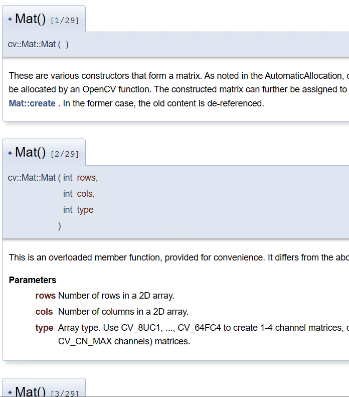

# ROpenCV的核心处理机制 {#ROpenCVMechanisim}

可以不要

```{r echo=FALSE,message=FALSE,warning=FALSE}
library(ROpenCV)
```


ROpenCV针对OpenCV的类和函数进行了二次封装，以便实现：

* 在R中创建OpenCV的类实例并传递给OpenCV
* 在OpenCV中处理、创建/生成类实例并传递给R
* 在R中调用OpenCV的函数（包含类封装的函数），并按照函数要求传递相应的参数

为此所做的主要工作包括：  

* 重载函数的处理
* OpenCV函数输出参数的处理
* OpenCV类实例的处理


## 重载函数的处理

OpenCV中的函数重载是很普遍的现象，在5.0.0(pre)版本的OpenCV中，图像矩阵类（Mat）的构造函数就有29个之多：



R语言本身不支持函数重载，所以桥接层必须自己决定「这一次调用该走哪一个重载」。
ROpenCV的做法是**在调用时按实参的个数与类型分派**，而不是给每个重载起一个编号名字。

比如绘制矩形，OpenCV有两个重载：一个接受两个角点，一个接受一个矩形。在R里
两种写法都可以直接写，函数名一样：

```{r}
#生成一个50行50列的三通道黑色图像
img = Mat(50L,50L,CV_8UC3,0L)

#形式一：给两个角点，在左侧画一个红色矩形
cv_rectangle(img,c(5L,5L),c(20L,20L),c(255L,0L,0L),2L)
#左边框上的像素是红色
as_array(img,numeric=TRUE)[6,11,]

#形式二：给一个矩形（x、y、宽、高），在右侧画一个绿色矩形
cv_rectangle(img,c(30L,5L,20L,20L),c(0L,255L,0L),2L)
#右边框是绿色
as_array(img,numeric=TRUE)[6,31,]
#左边那个红色矩形还在，说明两次调用各画各的
as_array(img,numeric=TRUE)[6,11,]
```

分派的依据是「第2个参数是长度为2的向量还是长度为4的向量」。

注：正因为要按类型分派，**整型参数要写成 `5L` 而不是 `5`**。R 里 `5` 是双精度数，
传下去可能选中错误的那个重载，或者报类型不匹配。

## OpenCV函数输出参数的处理

在OpenCV中，很多函数都具有输出参数，比如颜色转换函数**cvtColor**：

```
void cv::cvtColor(	
  InputArray	src, #src表示待处理图像
  OutputArray	dst, #dst表示处理结果
  int code,        #code指明颜色转换方式
  int dstCn = 0    
)		
```

其中，dst参数就是一个输出参数，用来存放图像的颜色转换结果。C++ 里靠引用把结果
「带出来」，而 R 没有这种机制。

ROpenCV 的做法是**把输出参数变成返回值**。上面那个函数在 R 里写成：

```r
cv_cvtColor(src, code, dstCn = 0, dst = NULL)
```

`dst` 默认是 `NULL`，表示「新建一个对象装结果并返回」；如果确实想复用一块已有的
内存，可以显式传一个对象进去，函数会把它填好并原样返回。于是：

```{r}
#读取图像文件，读取的结果保存在img中
img = cv_imread("images/HappyFish.jpg")
#调用cvtColor函数，将img转变为灰度图像。结果直接返回
dst = cv_cvtColor(img,COLOR_BGR2GRAY)
#显示结果
plot(dst)
```

在这个例子中，`dst` 是函数新建并返回的图像矩阵，不需要事先准备容器。

**复用已有对象**时传 `dst=`，返回的是同一个对象（不是副本）：

```{r}
#准备一个空的灰度图容器
buf = Mat(dim(img)[1],dim(img)[2],CV_8UC1,0L)
#也可以直接准备一个空图容器
# buf = Mat()
#把结果填进 buf，返回的仍是 buf 本身
out = cv_cvtColor(img,COLOR_BGR2GRAY,dst=buf)
identical(out,buf)
```

这种写法在循环里反复处理同一尺寸的图像时有用，可以少申请内存。但要注意：
**传进去的 `buf` 会被覆盖**，如果原内容还要用，得先 `cv_copyTo` 一份。


## OpenCV类实例的处理

### 图像矩阵 cvMat

ROpenCV 不在 R 里重建 OpenCV 的类，而是让 `cvMat` 直接持有指向 `cv::Mat` 的
`externalptr`。R 和 OpenCV 之间传的是指针而不是像素，所以**转换是零拷贝的**：
一张大图从 `cv_imread` 读进来不会在 R 侧再占一份内存。

```{r}
#生成一个空的图像矩阵
emptyImg = Mat()
emptyImg

#生成10行10列的全0单通道图像矩阵
blackImg = Mat(10L,10L,CV_8UC1,0L)
blackImg
```

`Mat()` 不带参数给 0x0 的空矩阵；带参数时按 `Mat(rows, cols, type, value)` 构造。
也可以直接把 R 的矩阵或三维数组搬进去，类型由数组自动推断：

```{r}
m = matrix(sample(0:255,100),10,10)
img = Mat(m)
img
mat_info(img)
```

### 点、尺寸、标量、矩形：普通数值向量

旧版本（是一直没有发布的版本，握在手里几年了）为这些类型各造了一套对象（`Point()`、`Size()`、`Scalar()`、`Rect()`），当前发布的版本取消了这一层——它们本来就是几个数，用 R 的向量即可：

```{r}
#整数点：c(x, y)
pnt = c(10,20)
pnt

#浮点数点同样是长度为2的向量
pnt2f = c(10.1,20.2)
pnt2f

#尺寸：c(width, height)，面积自己算
sz = c(200,100)
sz[1]*sz[2]

#标量（颜色）：c(B, G, R)
sca = c(10,20,30)
sca

#矩形：c(x, y, width, height)
rect = c(10,20,100,50)
rect
```

好处是这些值可以直接参与 R 的运算：求中点写 `(a+b)/2`，判断点在矩形内写
`pnt[1] >= rect[1] && pnt[1] < rect[1]+rect[3]`，不需要记任何方法名。

### 访问图像矩阵的信息

```{r}
img = cv_imread("images/HappyFish.jpg")
#打印摘要：尺寸、类型、通道数
img

#行数、列数（多通道时还有通道数）
dim(img)

#行数、列数、通道数、类型码、深度码
mat_info(img)

#取第100行、第100列像素的值
as_array(img,numeric=TRUE)[100,100,]
```

**下标要注意**：OpenCV 的 `img.at(i,j)` 是 0 基，而 `as_array()` 返回的是 R 数组，
是 1 基。旧代码里的 `img[99,99]` 对应新代码的 `[100,100,]`。

### 旋转矩形

旋转矩形多一个角度，用长度 5 的数值向量表示：
`c(中心x, 中心y, 宽, 高, 角度)`。

```{r}
#四个角点
pts = matrix(c(0,0, 10,0, 10,5, 0,5),ncol=2,byrow=TRUE)
#求最小外接旋转矩形。注意点集必须是 CV_32F
rrect = cv_minAreaRect(cv_mat_convert(Mat(pts),CV_32F))
rrect

#求四个顶点
pts4 = cv_boxPoints(rrect)
as_array(pts4,numeric=TRUE)
```

传入cv_minAreaRect的点集必须是 `CV_32F`：`Mat(matrix)` 默认给的是 `CV_64F`，直接传进去会报
`Assertion failed (depth == CV_32F || depth == CV_32S)`。在使用中，需要结合OpenCV的参考资料留意 函数的使用要求。

### as_array 和 Mat：R 与 OpenCV 的数据交换


```{r}
#生成一个100x100的随机灰度矩阵
img_mat = matrix(sample(0:255,100*100,replace=TRUE),nr=100,nc=100)
#搬到 OpenCV 侧
img = Mat(img_mat)
img

#再取回 R 侧
back = as_array(img,numeric=TRUE)
#数值一致。注意 as_array 的结果带 depth 属性，所以不能直接 identical()
identical(as.vector(back),as.vector(img_mat))
```

三维数组（彩色图）同理，第三维是通道：

```{r}
img_arr = array(sample(0:255,100*100*3,replace=TRUE),dim=c(100,100,3))
img = Mat(img_arr)
img
dim(img)
```

`as_array()` 返回的数组带一个 `depth` 属性，记录图像深度：

```{r}
blackImg = Mat(100L,100L,CV_8UC1,0L)
blackImg_mat = as_array(blackImg,numeric=TRUE)
str(blackImg_mat)
attr(blackImg_mat,"depth")
```

注意 `as_array()` **只带 `depth`，不带 `type`**；要类型码请用 `mat_info(x)[4]`。

改完再搬回去：

```{r}
#把中心区域改成 255
blackImg_mat[40:70,40:70] = 255
#重新构造图像矩阵
blackImg = Mat(blackImg_mat)
blackImg
```

最后是一个两图融合的例子：

```{r}
src1 = cv_imread("images/pictrans1.jpg")
src2 = cv_imread("images/pictrans2.jpg")
#各自取回 R 侧，按 0.5 加权
a1 = as_array(src1,numeric=TRUE)
a2 = as_array(src2,numeric=TRUE)
dst_arr = 0.5*a1 + 0.5*a2
#搬回 OpenCV 侧
dst = Mat(dst_arr)
dst

#进行CV_8U转换，以便plot
dst1 = cv_mat_convert(dst,CV_8U)
op = par(mfrow=c(1,3))
plot(src1)
plot(src2)
plot(dst1)
par(op)
```

`0.5*a1 + 0.5*a2` 的结果是双精度，所以 `Mat()` 得到的是 `CV_64F` 图像。若要
`CV_8U`，用 `cv_mat_convert(dst, CV_8U)` 显式转换——`plot()` 对浮点图会做归一化，
和 8 位图看起来会不一样。
