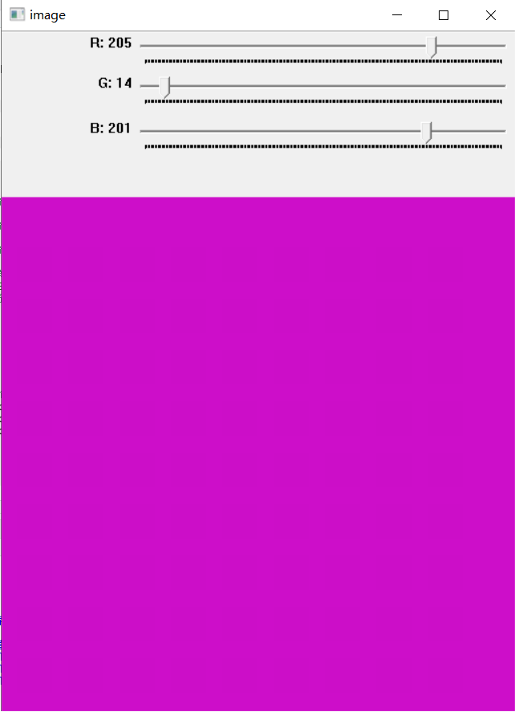
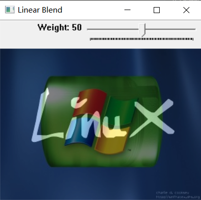

# 图像基本操作 {#firstshow}

## 输入图像

输入图像解决的是生成图像矩阵的问题，主要有三种方式：加载图像文件、利用OpenCV图像矩阵类（Mat）的构造函数，以及用 `Mat()` / `img[] <-` 把 R 的矩阵或者多维数组转换过来。

### 加载图像文件

OpenCV可读取的图像格式包括：

* Windows位图文件 —— BMP, DIB；
* JPEG文件 —— JPEG, JPG, JPE；
* Portable类型文件 —— PNG，PBM，PGM，PPM；
* Sun rasters —— SR，RAS；
* TIFF文件 —— TIFF，TIF;
* OpenEXR HDR文件 —— EXR;
* JPEG 2000文件 —— jp2。


通过使用**cv_imread**函数可以读取指定图像文件，而后通过**plot**函数（或 `cv_imshow`）显示图像内容。

```{r}
#在当前目录中的images文件夹下，有名为HappyFish.jpg的图像文件
imgName = "images/HappyFish.jpg"
#读取此文件，读取结果保存在img中
img = cv_imread(imgName)
mat_info(img)
```

在读入图像数据时，可以指定颜色控制参数，比如以单通道灰度图模式读入图像：

```{r}
imgName = "images/HappyFish.jpg"
# 指定读取参数为IMREAD_GRAYSCALE，将读入的图像转换为单通道灰度图像
img = cv_imread(imgName,IMREAD_GRAYSCALE) 
#或者直接写它的数值
img = cv_imread(imgName,0) 
mat_info(img)
```


颜色控制参数除了IMREAD_GRAYSCALE外，还有其他多种取值。这些常量都由编译器从 OpenCV 头文件算出并注入包的命名空间，用 `ls()` 就能列出来，不必去背：

```{r echo=FALSE}
modes = grep("^IMREAD_", ls("package:ROpenCV"), value = TRUE)
data.frame(mode = modes,
           value = vapply(modes, function(n) as.integer(get(n)), integer(1)),
           row.names = NULL)
```

各个取值的作用意义可以参考OpenCV的帮助文档。

### 创建图像矩阵

除了通过加载图像文件获取图像矩阵外，还可以利用OpenCV的图像矩阵类（Mat）的构造函数创建图像矩阵，这里沿用上一章生成纯色图像的例子：

```{r}
# 生成100行、100列的8位无符号单通道图像，所有像素值都为0（即黑色）
img1 = Mat(100L,100L,CV_8UC1,0L)

# 生成100行、100列的8位无符号单通道图像，所有像素值都为128（即灰色）
img2 = Mat(100L,100L,CV_8UC1,128L)

# 生成100行、100列的8位无符号三通道图像，所有像素值都为(128,0,128)（即紫色）
img3 = Mat(100L,100L,CV_8UC3,c(128,0,128))

# 生成100行、100列的8位无符号三通道图像，所有像素值都为(255,0,0)（即蓝色）
img4 = Mat(100L,100L,CV_8UC3,c(255,0,0))

# 生成100行、100列的8位无符号三通道图像，所有像素值都为(0,255,0)（即绿色）
img5 = Mat(100L,100L,CV_8UC3,c(0,255,0))

# 生成100行、100列的8位无符号三通道图像，所有像素值都为(0,0,255)（即红色）
img6 = Mat(100L,100L,CV_8UC3,c(0,0,255))
```

```{r echo=FALSE, fig.width=9, fig.height=6}
imgs = list(img1,img2,img3,img4,img5,img6)
labs = c("0","128","(128,0,128)","(255,0,0)","(0,255,0)","(0,0,255)")
old = par(mfrow = c(2,3), mar = c(1,1,2,1))
for (k in seq_along(imgs)) {
  plot(imgs[[k]])
  title(main = labs[k], cex.main = 0.9)
}
par(old)
```

### 使用 Mat() 和 img[] 转换 R 的数组

通过先生成R语言的矩阵或多维数组，再写进 OpenCV 的图像矩阵。`Mat(m)` 是按数组新建一个矩阵，`img[] <- m` 是往已有的矩阵里原地写——后者在需要保持原类型时更有用（`Mat(整数矩阵)` 得到的是 `CV_32S`，不是 `CV_8U`）：

```{r}
# 生成100行、100列的全0矩阵img1_mat
img1_mat = matrix(0,nr=100,nc=100)
# 写进OpenCV的8位无符号整数单通道图像
img1 = Mat(100L,100L,CV_8UC1)
img1[] = img1_mat


# 生成100行、100列的随机矩阵img2_mat
img2_mat = matrix(sample(0:255,100*100,replace = T),nr=100,nc=100)
img2 = Mat(100L,100L,CV_8UC1)
img2[] = img2_mat

# 生成3维数组img3_arr
set.seed(123)
img3_arr = array(sample(0:255,100*100*3,replace = T),dim=c(100,100,3))
img3 = Mat(100L,100L,CV_8UC3)
img3[] = img3_arr

#三个图的类型都还是建的时候指定的那个
c(img1 = mat_info(img1)[4], img2 = mat_info(img2)[4], img3 = mat_info(img3)[4])
```

```{r echo=FALSE, fig.width=9, fig.height=3.2}
old = par(mfrow = c(1,3), mar = c(1,1,2,1))
for (k in 1:3) { plot(list(img1,img2,img3)[[k]]); title(main = paste0("img", k), cex.main = 0.9) }
par(old)
```


## 获取图像基本信息

使用**mat_info**函数可以获取图像的基本信息：

```{r}
#在当前目录中的images目录下，有名为HappyFish.jpg的图像文件
imgName = "images/HappyFish.jpg"
#读取此文件
img = cv_imread(imgName)
#获取img的基本信息：行、列、通道数、类型码、深度码
mat_info(img)
```

`mat_info()` 返回一个长度 5 的整数向量，为了看得明白，给它起个名字：

```{r}
info = mat_info(img)
c(rows = info[1], cols = info[2], channels = info[3], type = info[4], depth = info[5])
```

其中：

* rows：表示图像的高度（行数）
* cols：表示图像的宽度（列数）
* channels：表示图像的通道数
* type：表示图像矩阵的类型
* depth：表示图像的深度（像素的存储位数对应的编码）

这些数据表明图像矩阵有194行、259列，有3个通道。

此外，深度与类型的取值可以对照常量表看。这些常量同样是从 OpenCV 头文件算出来的，`ls()` 一下就有：

```{r echo=FALSE}
lvl = c("8U","8S","16U","16S","32S","32F","64F")
tab = sapply(1:4, function(k)
  vapply(lvl, function(d) as.integer(get(paste0("CV_", d, "C", k))), integer(1)))
rownames(tab) = paste0("CV_", lvl)
colnames(tab) = paste0("C", 1:4)
knitr::kable(tab, caption = "深度 x 通道数 -> 类型码")
```

```{r echo=FALSE}
data.frame(depth = paste0("CV_", lvl),
           value = vapply(lvl, function(d) as.integer(get(paste0("CV_", d))), integer(1)),
           row.names = NULL)
```

可以看到，图像矩阵img的深度depth为0（对应于“CV_8U”），说明像素的存储位数是8bit；而图像矩阵img的类型type为64（对应于“CV_8UC3”），说明图像矩阵表示的是8位无符号整数三通道图像。

> 这里有一个容易记错的地方：**OpenCV 4 里 `CV_8UC3` 是 16，OpenCV 5 里是 64**。原因是通道数在类型码里的起始位（`CV_CN_SHIFT`）从 3 挪到了 5。所以类型码不要背，要用就取常量。

利用图像矩阵类也可以获取同样的信息：

```{r}
#读取图像文件
img = cv_imread("images/lena.jpg")
#获取矩阵的列数（宽度）
dim(img)[2]
#获取矩阵的行数（高度）
dim(img)[1]
#获取矩阵的通道数
mat_info(img)[3]
#获取矩阵的深度
mat_info(img)[5]
#获取矩阵的类型
mat_info(img)[4]
```


## 修改图像

### 单通道图像

修改单通道图像的指定像素值：

```{r}
# 生成30行、30列的8位无符号整数图像矩阵img（所有像素值都为0）
img = Mat(30L,30L,CV_8UC1)
# 修改第16行、第16列像素，使其值从0变为255（即由黑色变为白色）
img[16,16] = 255
```

修改完成后显示图像，可以发现图像中部区域有一个小白点。

```{r echo=FALSE}
plot(img)
```

类似地，可以将全黑图像的主对角线上和反对角线上的像素值都改成白色：

```{r}
# 生成100行、100列的全0图像矩阵img
img = Mat(100L,100L,CV_8UC1)
# 利用循环，将主对角线和反主对角线上的像素值从0变为255（即由黑色变为白色）
# 下标从 1 开始：主对角线是 (i,i)，反主对角线是 (i, 101-i)
for(i in 1:100){
  img[i,i] = 255
  img[i,101-i] = 255
}
```

如下代码也可以达到同样目的——先在 R 的矩阵上算好，再整块写回去：

```{r}
# 生成100行、100列的全0矩阵img_mat
img_mat = matrix(0, 100, 100)
# 利用循环，将主对角线和反主对角线上的像素值从0变为255
for(i in 1:100){
  img_mat[i,i] = 255
  img_mat[i,101-i] = 255
}
# 写进OpenCV的8位无符号整数单通道图像
img = Mat(100L,100L,CV_8UC1)
img[] = img_mat
```


```{r echo=FALSE}
plot(img)
```

### 三通道图像

修改三通道图像的指定像素值：

```{r}
# 生成30行、30列的8位无符号整数图像矩阵img（所有像素值都为(0,0,0)）
img = Mat(30L,30L,CV_8UC3)
# 修改第16行、第16列像素，使其值从(0,0,0)变为(0,0,255)，即由黑色变为红色
# 三通道图的一个像素就是三个数，长度正好对上
img[16,16,] = c(0,0,255)
```

修改完成后显示图像，可以发现图像中部区域有一个小红点。

```{r echo=FALSE}
plot(img)
```

类似地，可以将全黑图像的主对角线上和反主对角线上的像素值分别改成红色和绿色：

```{r}
# 生成100行、100列的全0图像矩阵img
img = Mat(100L,100L,CV_8UC3)
for(i in 1:100){
  # 主对角线上的像素值变为红色
  img[i,i,] = c(0,0,255)
  # 反主对角线上的像素值变为绿色
  img[i,101-i,] = c(0,255,0)
}
```

如下代码也可以达到同样目的：

```{r}
# 生成3维数组img_arr（所有元素全为0）
img_arr = array(0, dim = c(100,100,3))
for(i in 1:100){
  # 主对角线上的元素更改为(0,0,255)
  img_arr[i,i,] = c(0,0,255)
  # 反主对角线上的元素更改为(0,255,0)
  img_arr[i,101-i,] = c(0,255,0)
}
# 写进OpenCV的8位无符号整数三通道图像
img = Mat(100L,100L,CV_8UC3)
img[] = img_arr
```


```{r echo=FALSE}
plot(img)
```

## 输出图像

### 输出到图形窗口

通过**cv_imshow**函数产生图形窗口并在窗口中显示图像内容。

```{r eval=FALSE}
# 读取图像文件
img = cv_imread("images/HappyFish.jpg")
# 生成标题为Display window且尺寸自动按照图像大小自动缩放的窗口
cv_namedWindow("Display window",WINDOW_AUTOSIZE)
# 将读取的图像内容显示在Display window窗口中
cv_imshow("Display window",img)
```

在上面的代码中，也可以省去 `cv_namedWindow("Display window",WINDOW_AUTOSIZE)`，即不用提前生成图形窗口，而是由**cv_imshow**函数在执行的时候自动创建图形窗口并显示图像内容。

```{r eval=FALSE}
# 读取图像文件
img = cv_imread("images/HappyFish.jpg")
# 将读取的图像内容显示在Display window窗口中
cv_imshow("Display window",img)
```

`cv_imshow` 开的是 OpenCV 自己的原生窗口，需要有桌面环境，而且它和 R 的图形设备是两套东西——在 Rmd 里渲染不出来。所以本书里凡是「看图」的地方一律用 `plot()`（走 `as.raster`，headless 也能出图），交互式调试时才用 `cv_imshow`，查看图形效果之后留意使用 `cv_destroyAllWindows()`。

```{r echo=FALSE}
img = cv_imread("images/HappyFish.jpg")
plot(img)
```

在显示32位浮点数图像之前，需要转换为8位无符号数图像，例如：

```{r}
#读取图像文件，读取结果保存在img中
img = cv_imread("images/HappyFish.jpg")

#将img灰度化，结果保存在gray中
gray = cv_cvtColor(img, COLOR_BGR2GRAY)

#对gray进行Sobel边缘检测，结果保存在sobelx中，
#此时，sobelx为32位浮点数图像
sobelx = cv_Sobel(gray, CV_32F, 1L, 0L)
mat_info(sobelx)

#获取sobelx的最小值和最大值：cv_minMaxLoc 直接返回一个 list
mm = cv_minMaxLoc(sobelx)
c(minVal = mm$minVal, maxVal = mm$maxVal)

#利用sobelx的值映射到[0,255]区间上，进而转变为8位无符号图像
#cv_mat_convert(src, rtype, alpha, beta) 对应 dst = src * alpha + beta
draw = cv_mat_convert(sobelx, CV_8U,
                      255.0 / (mm$maxVal - mm$minVal),
                      -mm$minVal * 255.0 / (mm$maxVal - mm$minVal))
mat_info(draw)
```


```{r echo=FALSE}
plot(draw)
```


### 输出到命令行

通过 `as_array()` 函数可以将图像矩阵的像素值按行、列顺序输出到命令行。

```{r eval=FALSE}
# 读取图像文件
imgName = "images/HappyFish.jpg"
img = cv_imread(imgName)
#按行、列顺序输出img的各个像素值
as_array(img, numeric = TRUE)
```

当图像矩阵较大时，这种输出方式会产生负担，可以按如下方法调整，进而查看指定部分的像素值：

```{r}
# 读取图像文件
imgName = "images/HappyFish.jpg"
img = cv_imread(imgName)
#查看img中第11行~第20行、第11列~第20列的内容
#三通道图的第三维是通道，省略表示三个通道全要
#CV_8U 读出来是 raw（省内存），所以打印成十六进制
img[11:20,11:20,]
#先转成R语言的数组再取：numeric = TRUE 让结果是整数，不是 raw
arr = as_array(img, numeric = TRUE)
arr[11:20,11:20,]
```

### 输出到磁盘文件

使用**cv_imwrite**函数，可以将图像数据保存为硬盘文件。

```{r eval=FALSE}
# 加载当前目录中images文件夹下的cat2.jpg文件
imgName = "images/cat2.jpg"
img = cv_imread(imgName)

# 将彩色图像从BGR转换为灰度图
gray = cv_cvtColor(img, COLOR_BGR2GRAY)

# 显示原图和转换后的灰度图
cv_imshow("原图",img)
cv_imshow("灰度图",gray)

# 将灰度图像数据gray保存在当前目录中的images文件夹下，
# 文件名称为gray_image.jpg
cv_imwrite("images/gray_image.jpg",gray)
```

指令执行成功后，在当前目录中的images文件夹下，会出现gray_image.jpg文件。要保存的文件格式由指定的文件名的扩展名决定。

```{r}
# 不往源图目录里写，落到临时文件里，跑完就删
out = tempfile(fileext = ".png")
img = cv_imread("images/cat2.jpg")
gray = cv_cvtColor(img, COLOR_BGR2GRAY)
cv_imwrite(out, gray)
#cv_imwrite 不返回成功标志，只能查文件
c(exists = file.exists(out), size = file.info(out)$size)
```

***如果要从内存（而非文件）中读写图像，可以使用cv_imencode和cv_imdecode从内存而不是文件读写图像。***


## 图像的基本运算

当两个图像矩阵具有相同的高度、宽度、通道数和类型时，可以进行加减乘除运算。

**生成两个图像矩阵img1和img2**

```{r}
#创建矩阵arr1、arr2和arr3
arr1 = matrix(248:253,nr=2,nc=3)
arr2 = matrix(1:6,nr=2,nc=3)
arr3 = matrix(5:0,nr=2,nc=3)
#先把三个矩阵建成8位无符号整数单通道图像，再把值写进去
#（注意：直接写 Mat(arr1) 得到的是 CV_32S，不会饱和，见下面的说明）
mk8u = function(m) { x = Mat(nrow(m), ncol(m), CV_8UC1); x[] = m; x }
img1 = mk8u(arr1)
img2 = mk8u(arr2)
img3 = mk8u(arr3)

c(img1 = mat_info(img1)[4], img2 = mat_info(img2)[4], img3 = mat_info(img3)[4])
```

**计算img1与img2之和**

```{r}
#img1+img2，结果保存在img_add中
img_add = cv_add(img1,img2)
#按行、列顺序输出img_add的各个像素值
as_array(img_add, numeric = TRUE)
```

图像矩阵img1和img2相加，符合通常的矩阵相加规则，即对应元素相加；此外由于图像矩阵类型为8位无符号整数，其取值范围为[0,255]，所以相加之后超过255的像素值都被截断为255。

**计算img2与img3之差**

```{r}
#img2-img3，结果保存在img_sub中
img_sub = cv_subtract(img2,img3)
as_array(img_sub, numeric = TRUE)
```

图像矩阵img2和img3相减，符合通常的矩阵相减规则，即对应元素相减；此外由于图像矩阵类型为8位无符号整数，其取值范围为[0,255]，所以相减之后小于0的像素值都被截断为0。

**计算img1与img2的乘积**

```{r}
#img1*img2，结果保存在img_mul中
img_mul = cv_multiply(img1,img2)
as_array(img_mul, numeric = TRUE)
```

图像矩阵img1和img2相乘，不是通常的矩阵相乘，而是对应元素相乘；此外由于图像矩阵类型为8位无符号整数，其取值范围为[0,255]，所以相乘之后大于255的像素值都被截断为255。

**计算img1与img3的商**

```{r}
#img1/img3，结果保存在img_div中
img_div = cv_divide(img1,img3)
as_array(img_div, numeric = TRUE)
```

图像矩阵img1和img3相除，指的是对应元素相除；此外由于图像矩阵类型为8位无符号整数，其取值范围为[0,255]，所以相除之后保留四舍五入的整数；当分母为0时，相除的结果为0。

以上单通道图像矩阵之间的加减乘除运算结论也适用于多通道图像矩阵。

> **饱和是「结果类型」决定的，不是运算本身决定的。** 上面这些例子都先建了 `CV_8UC1` 再写值，所以结果被截到 [0,255]。如果图是从 R 矩阵直接来的——`Mat(arr1)`——得到的是 `CV_32S`，`248+1` 就是 `249`，`252*5` 就是 `1260`，不会截断。要么建图时指定类型，要么算完再使用 `cv_mat_convert(x, CV_8U)` 转换。

顺带一提，`cvMat` 也重载了 `+ - * /` 运算符，`img1 + img2` 和 `cv_add(img1, img2)` 等价，只是要留意运算时的数据取值范围。

**利用R语言的矩阵运算**

由于R语言封装了很强的矩阵（或者数组）运算，所以可以先将图像矩阵转变为R的矩阵（或者数组），经过计算之后，再把计算结果转变回图像矩阵。

```{r}
#读取当前目录中images文件夹下名为LinuxLogo.jpg的图像文件
img1 = cv_imread("images/LinuxLogo.jpg")
#读取当前目录中images文件夹下名为WindowsLogo.jpg的图像文件
img2 = cv_imread("images/WindowsLogo.jpg")
#两张图必须同尺寸、同类型才能逐像素运算
mat_info(img1)[1:3]
mat_info(img2)[1:3]

#将img1和img2转变为R语言的数组arr1和arr2
arr1 = as_array(img1, numeric = TRUE)
arr2 = as_array(img2, numeric = TRUE)

#实现img1+img2
arr_add = arr1 + arr2
arr_add[arr_add<0] = 0
arr_add[arr_add>255] =  255
#用 cv_copyTo 拷一张同尺寸、同类型（CV_8UC3）的空图，再整块写进去
img_add = cv_copyTo(img1)
img_add[] = arr_add

#实现img1-img2
arr_sub = arr1 - arr2
arr_sub[arr_sub<0] = 0
arr_sub[arr_sub>255] =  255
img_sub = cv_copyTo(img1)
img_sub[] = arr_sub

#实现img1*img2
arr_mul = arr1 * arr2
arr_mul[arr_mul<0] = 0
arr_mul[arr_mul>255] =  255
img_mul = cv_copyTo(img1)
img_mul[] = arr_mul

#实现img1/img2
arr_div = round(arr1 / arr2)
arr_div[is.na(arr_div)] = 0   #0/0 在 R 里是 NaN
arr_div[arr_div==Inf] =  0    #分母为0时，结果为0
arr_div[arr_div<0] = 0
arr_div[arr_div>255] =  255
img_div = cv_copyTo(img1)
img_div[] = arr_div
```


```{r echo=FALSE, fig.width=9, fig.height=7}
old = par(mfrow = c(2,2), mar = c(1,1,2,1))
labs = c("img1+img2","img1-img2","img1*img2","img1/img2")
outs = list(img_add,img_sub,img_mul,img_div)
for (k in 1:4) { plot(outs[[k]]); title(main = labs[k], cex.main = 0.9) }
par(old)
```

## 查看图像的直方图

把图像矩阵转变为R语言的矩阵或者数组后，可以使用hist函数查看图形颜色直方图。

```{r}
#读取图像文件(采用灰度图读入模式)
img = cv_imread("images/lena.jpg",IMREAD_GRAYSCALE)
#将img转变为R语言的矩阵
img_mat = as_array(img, numeric = TRUE)

#生成直方图
hist(img_mat,breaks = 0:255,xlab="",ylab="",main="")
```

当读取的图像是三通道彩色图像时，可以按如下方式展示3个通道的颜色直方图：

```{r}
#读取图像文件
img = cv_imread("images/lena.jpg")
#将img转变为R语言的数组
img_arr = as_array(img, numeric = TRUE)

#生成蓝色分量直方图
hist(img_arr[,,1],breaks = 0:255,col="blue",main="",xlab="",ylab="")
#生成绿色分量直方图(叠加到上面的直方图上)
hist(img_arr[,,2],breaks = 0:255,col="green",add=T)
#生成红色分量直方图(叠加到上面的直方图上)
hist(img_arr[,,3],breaks = 0:255,col="red",add=T)
```

## 等待用户按键

下面这段代码循环播放视频，按 Esc 键退出。它同时依赖视频解码和原生窗口两件事，只能在有桌面环境的机器上跑：

```{r eval=FALSE}
#读取视频文件
cap = cvVideoCapture("video/vtest.avi")
#设置ret的值为TRUE
ret = TRUE
#当视频流为打开状态且ret的值为TRUE时，循环播放视频
while(cap$isOpened()){
  #读取视频流中的帧：读到结尾返回 0x0 的 cvMat，
  #成功与否记在 attr(frame, "value") 上
  frame = cap$read()
  if(!isTRUE(attr(frame, "value"))) break
  cv_imshow("frame",frame)
  #调用waitKey函数暂停30毫秒，等待用户按键
  if(cv_waitKey(30L)==27){
    #若按下了esc键，会终止循环（即终止播放）
    break
  }
}
cap$release()
cv_destroyAllWindows()
```


## 添加滑动条控制

**示例**

当图像输出到图形窗口时，可以在图形窗口中添加滑动条，进而实现一些交互性控制。下面的代码演示了如何通过滑动条“合成”红、绿、蓝三种颜色分量，形成一个调色板功能。

```{r eval=FALSE}
#当拖动滑动条时，调用colPallete函数，实现红、绿、蓝颜色分量的合成
colPallete <- function(val, param){
  #获取红色滑动条的刻度值，作为红色分量r
  r = cv_getTrackbarPos('R','image')
  #获取绿色滑动条的刻度值，作为绿色分量g
  g = cv_getTrackbarPos('G','image')
  #获取蓝色滑动条的刻度值，作为蓝色分量b
  b = cv_getTrackbarPos('B','image')
  #生成512行512列的8位无符号3通道图像img，所有像素值都为(b,g,r)
  img = Mat(512L,512L,CV_8UC3,c(b,g,r))
  #将img图像显示在标题为image的图形窗口上
  cv_imshow('image',img)
}

#生成标题为image的图形窗口
cv_namedWindow('image')
#在标题为image的图形窗口上生成名为R、G、B的滑动条，最小值都为0，最大值都为255，
#滑动条拖动的响应函数都为colPallete
#R、G、B滑动条的刻度分别代表红色、绿色和蓝色分量值
cv_createTrackbar("R",'image',0L,255L,colPallete)
cv_createTrackbar("G",'image',0L,255L,colPallete)
cv_createTrackbar("B",'image',0L,255L,colPallete)

#启用colPallete函数
colPallete(0,0)
```




**示例**

拖动滑动条，改变两个图像融合的权重：

```{r eval=FALSE}
#设置滑动条的最大值
alpha_slider_max = 100

#当拖动滑动条时，调用on_trackbar函数，进而调整两个图像的合成权重
on_trackbar = function(val, param)
{
  #获取滑动条当前值
  alpha_slider = cv_getTrackbarPos("Weight", "Linear Blend")
  #以滑动条当前值与最大值的的比值作为图像src1的权重alpha
  alpha = alpha_slider / alpha_slider_max
  #以1-alpha作为图像src2的权重beta
  beta = (1.0 - alpha)
  #按权重合成两个图像
  dst = cv_addWeighted(src1, alpha, src2, beta, 0.0)
  #实现合成结果
  cv_imshow("Linear Blend", dst)
}

#读取两个图像文件
src1 = cv_imread("images/LinuxLogo.jpg")
src2 = cv_imread("images/WindowsLogo.jpg")

#生成标题为Linear Blend的图形窗口
cv_namedWindow("Linear Blend", WINDOW_AUTOSIZE)
#在图形窗口中创建控制权重的滑动条
cv_createTrackbar("Weight",
                  "Linear Blend",
                  0L,
                  alpha_slider_max,
                  on_trackbar)
#调用on_trackbar函数
on_trackbar(0, 0)
```

同样的融合效果不需要滑动条也能验证，把权重固定成 0.5 就是上面那张图：

```{r}
src1 = cv_imread("images/LinuxLogo.jpg")
src2 = cv_imread("images/WindowsLogo.jpg")
blend = cv_addWeighted(src1, 0.5, src2, 0.5, 0.0)
plot(blend)
```





## 推荐使用方式

结合OpenCV文档，查询相关函数的用法以及相关例子
