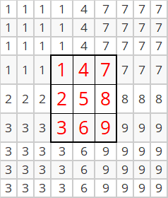
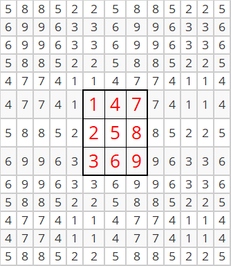
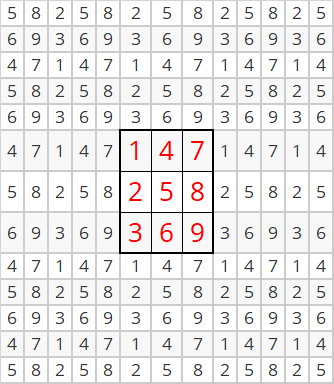
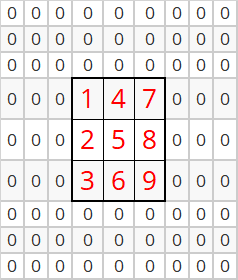
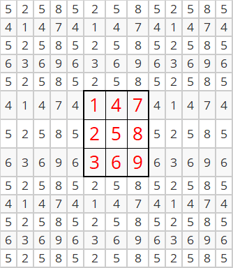
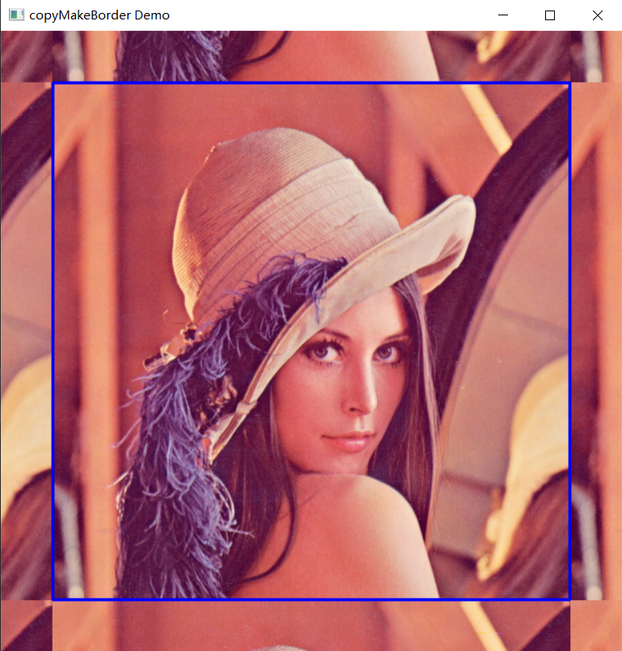
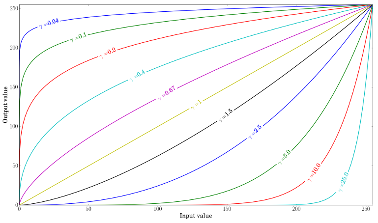
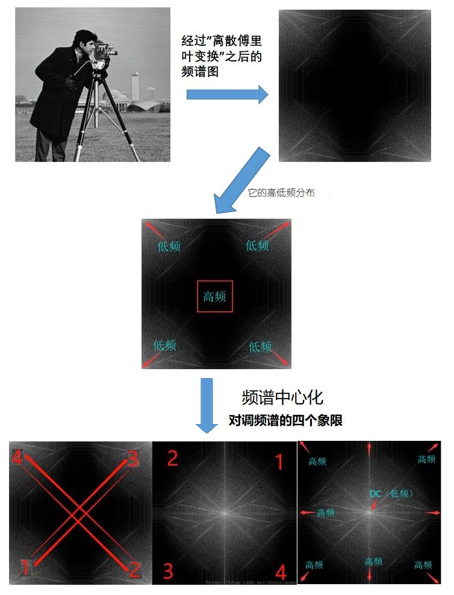
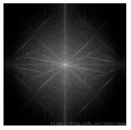

# 核心功能（核心模块） {#coremodule}

```{r echo=FALSE}
library(ROpenCV)
```

本章讲的是「操作图像矩阵」的通用手段：遍历像素、查表、计时、扩边、标准化、
按位运算、掩码（卷积）、融合、对比度亮度、通道拆分合并、离散傅里叶变换，
最后是 XML / YAML 的读写。

这些操作大多只是把像素当成一堆数来处理，和 OpenCV 的算法没什么关系。但它们是
后面所有算法的地基——锐化、边缘检测、频域滤波，用的都是本章的这几种手法。


## 遍历图像矩阵的像素

图像矩阵可以逐像素访问：

```{r}
#读取图像文件，读取结果保存在img中
img = cv_imread("images/LinuxLogo.jpg")
#获取图像第112行~第116行，第167列到第171列的像素，
#并输出到命令行窗口中
for(rr in 112:116){
  for(cc in 167:171){
    #获取rr行cc列的像素值px（由于img是三通道图像，所以px包含三个值）
    px = as.numeric(img[rr,cc])
    #将px输出到命令行窗口中，并以竖线间隔开
    cat(px,"|")
  }
  #一行像素遍历结束后，换行
  cat("\n")
}
# 或者直接使用如下命令
# img[112:116,167:171]
```

这里留意：**`CV_8U` 的像素读出来是 `raw`。**`img[rr, cc]` 返回的是长度为 3 的 `raw`
  向量，`cat()` 打出来是十六进制。要按十进制看，先 `as.numeric()`。

也可以先用 `as_array()` 把图像矩阵转成 R 的数组（或者矩阵），再遍历：

```{r}
#读入图像，获取图像img
img = cv_imread("images/LinuxLogo.jpg")
#通过as_array函数将img转变为R语言的数组img_arr
img_arr = as_array(img, numeric = TRUE)
#获取img_arr的第112行~第116行，第167列到第171列的元素，
#并输出到命令行窗口中
for(rr in 112:116){
  for(cc in 167:171){
    #获取rr行cc列的元素值px（由于是img是三维数组，所以px包含三个值）
    px = img_arr[rr,cc,]
    #将px输出到命令行窗口中，并以竖线间隔开
    cat(px,"|")
  }
  #一行像素遍历结束后，换行
  cat("\n")
}
# 或者直接使用如下命令
# img_arr[112:116,167:171,]
```

`as_array(img)` 不带 `numeric = TRUE` 时，`CV_8U` 的结果是 `raw` 数组；带了才
转成 `double`。后面要参与算术运算，一律加 `numeric = TRUE`。


## 使用查询表

依据前面的知识可知，8 位无符号单通道图像的颜色数有 $2^8=256$ 个，而 8 位无符号
三通道图像的颜色数则有 $2^8 \times 2^8 \times 2^8 \approx1600$ 万颜色值。使用如此
多的颜色会严重影响我们的算法性能。事实上，有时只需很少的颜色就能得到相同的最终
结果。所以，在一些情况下，我们通常会减少颜色空间。比如将颜色除以一个整数，然后
向下取整再乘以该整数，就可以得到更少的颜色（见如下公式）。例如将颜色值除以 10，
向下取整后再乘以 10，那么 0 到 9 之间的每个值变为 0，10 到 19 之间的每个值变为
10，以此类推。

$$
I_{new} = \left \lfloor \frac{I_{old}}{10} \right \rfloor \times 10
$$

```{r}
#按灰度方式读入图像，获取图像矩阵img
img = cv_imread("images/HappyFish.jpg",IMREAD_GRAYSCALE)
#用as_array函数将img转变为R语言的矩阵
img_mat = as_array(img, numeric = TRUE)
#查询img_mat中存在多少个颜色值
length(unique(c(img_mat)))
#查看img_mat第1行~第6行、第1列~第6列的数据
img_mat[1:6,1:6]

#基于公式获取img_mat原来数值对应的新值，并进行更新
for(i in 1:nrow(img_mat)){
  for(j in 1:ncol(img_mat)){
    img_mat[i,j] = floor(img_mat[i,j]/10)*10
  }
}
#更新之后，再次查询img_mat中存在多少个颜色值
length(unique(c(img_mat)))

#利用矩阵下标赋值，把img_mat写回一个与img同类型的图像矩阵
img1 = cv_copyTo(img)
img1[] = img_mat
```

注意最后两行的写法。旧版是 `img1 = img$clone(); img1$r2cv(img_mat)`——先复制一个
图像，再把 R 矩阵灌进去。新版没有 `$clone()` / `$r2cv()`，对应的写法是：

* `cv_copyTo(img)` 得到一份**独立副本**（`img2 = img` 只是多一个名字，指向同一块
  像素内存，不是副本）；
* `img1[] = img_mat` 原地写，长度必须等于 `prod(dim(img1))`。

两步合成一步也行，`img1 = Mat(img_mat)`——但那样会**丢掉原来的类型**：`Mat()` 会
按 R 数组的类型推断，`double` 矩阵得到 `CV_64F`，不再是 `CV_8U`。要保住类型就老
老实实复制再赋值。


由于除法和乘法运算操作对于一个系统来说是比较耗时的，这时候一个明智的做法是预先
计算所有可能的值并将结果存放在"查询表（Lookup table）"中，而后通过查表操作依据
$I_{old}$ 得到 $I_{new}$。"查询表"是一个简单的数组（具有一个或多个维度），体现着
输入值和输出值的对应关系。它的优点是可以避开耗时的计算，而只需要查询并读取结果。

```{r}
#生成查询表lookuptbl（长度256：第k个元素是颜色值k-1对应的新值）
lookuptbl = c(rep(0:24,each=10)*10,rep(250,6))
#基于查询表，可以快速查找I_old（比如87）对应的I_new（为80）
I_old = 87
I_new = lookuptbl[I_old+1]
I_new

#按灰度方式读入图像，获取图像矩阵img
img = cv_imread("images/HappyFish.jpg",IMREAD_GRAYSCALE)
#用as_array函数将img转变为R语言的矩阵
img_mat = as_array(img, numeric = TRUE)
#查询img_mat中存在多少个颜色值
length(unique(c(img_mat)))
#查看img_mat第1行~第6行、第1列~第6列的数据
img_mat[1:6,1:6]

#生成img_new_mat，尺寸与img_mat相同，所有元素为0
img_new_mat = matrix(0,nr=nrow(img_mat),nc=ncol(img_mat))
#基于查询表获取img_mat原来数值对应的新值，并更新img_new_mat对应的值
for(i in 1:nrow(img_mat)){
  for(j in 1:ncol(img_mat)){
    I_old = img_mat[i,j]+1 #因颜色值以0开始,故而加1
    I_new = lookuptbl[I_old]
    img_new_mat[i,j] = I_new
  }
}
#查询img_new_mat中存在多少个颜色值
length(unique(c(img_new_mat)))

#把img_new_mat写回图像矩阵
img1 = cv_copyTo(img)
img1[] = img_new_mat
```


下图左边是原始图像，右边是压缩了颜色空间之后的图像。

```{r echo=FALSE}
op = par(mfrow = c(1, 2), mar = c(1, 1, 2, 1))
plot(img, main = "原图")
plot(img1, main = "颜色空间压缩后")
par(op)
```


***我们的测试操作如下：读入图像（它可以是彩色或灰度），指定用于缩减算法的整数值。
然后使用三种方法对图像进行扫描，转换读取到的颜色值，并打印出所花的时间。***

```{r eval=FALSE}
divideWith = 10L
loopkuptbl = floor((0:255)/divideWith)*divideWith
I = cv_imread("images/HappyFish.jpg")
t1 = cv_getTickCount()
#do something
t2 = cv_getTickCount()
sprintf("Times passed in seconds: %f",(t2-t1)/cv_getTickFrequency())
```


## 计算操作时间

在 OpenCV 中，可以通过如下方式计算一些计算操作消耗的时间：

```{r eval=FALSE}
#获取时间刻度t1，作为计时开始点
t1= cv_getTickCount()

#开始进行一些计算
#……
#计算结束

#获取时间刻度t2，作为计时结束点
t2 = cv_getTickCount()
#打印出从t1到t2所经历的时间(单位：秒)
sprintf("Times passed in seconds: %f",(t2-t1)/cv_getTickFrequency())
```

`cv_getTickCount()` 返回的是机器启动以来的滴答数，`cv_getTickFrequency()` 是每秒
的滴答数（这台机器上是 $10^9$），两者相除才是秒。直接相减得到的是一个很大的整数，
没有意义。

比如，计算直接使用乘法、除法操作压缩狒狒图像颜色空间时所消耗的时间：

```{r}
#获取时间刻度t1，作为计时开始点
t1= cv_getTickCount()

#加载图像文件
img = cv_imread("images/baboon.jpg")
#用as_array函数将img转变为R语言的数组
img_arr = as_array(img, numeric = TRUE)

#对img_arr包含的3个矩阵的每个元素通过乘除运算压缩颜色空间
for(i in 1:nrow(img_arr)){
  for(j in 1:ncol(img_arr)){
    img_arr[i,j,] = floor(img_arr[i,j,]/10)*10
  }
}

#把结果写回图像矩阵
img1 = cv_copyTo(img)
img1[] = img_arr

#获取时间刻度t2，作为计时结束点
t2 = cv_getTickCount()
#打印出从t1到t2所经历的时间(单位：秒)
sprintf("Times passed in seconds: %f",(t2-t1)/cv_getTickFrequency())
```

而在使用查询表时所消耗的时间：

```{r}
#生成查询表lookuptbl
lookuptbl = c(rep(0:24,each=10)*10,rep(250,6))

#获取时间刻度t1，作为计时开始点
t1= cv_getTickCount()

#加载图像文件
img = cv_imread("images/baboon.jpg")
#用as_array函数将img转变为R语言的数组
img_arr = as_array(img, numeric = TRUE)

#对img_arr包含的3个矩阵的每个元素通过查询表压缩颜色空间
for(i in 1:nrow(img_arr)){
  for(j in 1:ncol(img_arr)){
    img_arr[i,j,] = lookuptbl[img_arr[i,j,]+1] #这里加1，是因为颜色值是以0开始的
  }
}

#把结果写回图像矩阵
img1 = cv_copyTo(img)
img1[] = img_arr

#获取时间刻度t2，作为计时结束点
t2 = cv_getTickCount()
#打印出从t1到t2所经历的时间(单位：秒)
sprintf("Times passed in seconds: %f",(t2-t1)/cv_getTickFrequency())
```

可以看到，单独使用查询表方式，较之于直接使用乘除运算方式而言，时间消耗并没有优势。
若在基于查询表的基础之上，再结合向量运算时（R 语言的向量运算很强），时间消耗会
大大减少：

```{r}
#生成查询表lookuptbl
lookuptbl = c(rep(0:24,each=10)*10,rep(250,6))

#获取时间刻度t1，作为计时开始点
t1= cv_getTickCount()

#加载图像文件
img = cv_imread("images/baboon.jpg")
#用as_array函数将img转变为R语言的数组
img_arr = as_array(img, numeric = TRUE)

#对img_arr包含的3个矩阵的每个元素通过查询表和数组操作压缩颜色空间
img_arr[,,] = array(lookuptbl[img_arr+1],dim = dim(img_arr))

#把结果写回图像矩阵
img1 = cv_copyTo(img)
img1[] = img_arr

#获取时间刻度t2，作为计时结束点
t2 = cv_getTickCount()
#打印出从t1到t2所经历的时间(单位：秒)
sprintf("Times passed in seconds: %f",(t2-t1)/cv_getTickFrequency())
```

下图左边是狒狒原始图像，右边是颜色空间压缩结果：

```{r echo=FALSE}
op = par(mfrow = c(1, 2), mar = c(1, 1, 2, 1))
plot(img, main = "原图")
plot(img1, main = "颜色空间压缩后")
par(op)
```


## 扩展图像边缘

可以使用 `copyMakeBorder` 函数扩展图像边缘，形成一些边框效果。扩展方式由
`borderType` 参数决定，几种取值的含义是：

| borderType | 边缘像素的取法 |
|---|---|
| `BORDER_REPLICATE` | 复制最边上那一行/列（`aaaaaa|abcdefgh|hhhhhhh`） |
| `BORDER_REFLECT` | 以边界为轴镜像，边界像素**重复一次**（`fedcba|abcdefgh|hgfedcb`） |
| `BORDER_REFLECT_101`（即 `BORDER_DEFAULT`） | 以边界外侧为轴镜像，边界像素**不重复**（`gfedcb|abcdefgh|gfedcba`） |
| `BORDER_WRAP` | 从对面那头接过来（`cdefgh|abcdefgh|abcdefg`） |
| `BORDER_CONSTANT` | 填一个固定值 |

`BORDER_REFLECT` 和 `BORDER_REFLECT_101` 的差别只有一格，但结果完全不同：
前者是「照镜子，镜面贴着最外一列」，后者是「照镜子，镜面在最外一列之外」。

### BORDER_REPLICATE方式  

```{r}
#生成3行3列的矩阵img_mat
img_mat = matrix(1:9,nr=3,nc=3)
#生成同尺寸的CV_8UC1图像矩阵img，并把img_mat写进去
img = Mat(3,3,CV_8UC1)
img[] = img_mat

#设定图像上、下、左、右四侧需要扩展的像素个数
sz = 3L
#扩展图像边缘，扩展结果存入img_borderadded
img_borderadded = cv_copyMakeBorder(img,sz,sz,sz,sz,BORDER_REPLICATE)

#通过as_array函数，获得img_borderadded的像素值
img_borderadded_mat = as_array(img_borderadded, numeric = TRUE)
knitr::kable(img_borderadded_mat)
```



```{r}
#读入图像，存放在img变量中
img = cv_imread("images/lena.jpg")
# 获取图像img的基本信息（含高度、宽度尺寸）
# mat_info返回：行数、列数、通道数、类型码、深度码
img_info = mat_info(img)

#设定图像上、下、左、右四侧需要扩展的像素个数
sz = 50L
# 扩展图像边缘，扩展结果存入img_borderadded
img_borderadded = cv_copyMakeBorder(img,sz,sz,sz,sz,BORDER_REPLICATE)
#绘制蓝色矩形框，框外部分就是扩展的边缘
#注意：c(x, y, w, h)是0基的OpenCV坐标，w取列数、h取行数
invisible(cv_rectangle(
  img_borderadded,
  c(51L,51L,img_info[2],img_info[1]),
  c(255,0,0),2L
))
```

```{r echo=FALSE}
op = par(mfrow = c(1, 2), mar = c(1, 1, 2, 1))
plot(img, main = "ori")
plot(img_borderadded, main = "BORDER_REPLICATE")
par(op)
```

### BORDER_REFLECT方式  

```{r}
#生成3行3列的矩阵img_mat
img_mat = matrix(1:9,nr=3,nc=3)
#生成同尺寸的CV_8UC1图像矩阵img，并把img_mat写进去
img = Mat(3,3,CV_8UC1)
img[] = img_mat

#设定图像上、下、左、右四侧需要扩展的像素个数
sz = 5L
#扩展图像边缘，扩展结果存入img_borderadded
img_borderadded = cv_copyMakeBorder(img,sz,sz,sz,sz,BORDER_REFLECT)

#通过as_array函数，获得img_borderadded的像素值
img_borderadded_mat = as_array(img_borderadded, numeric = TRUE)
knitr::kable(img_borderadded_mat)
```



```{r}
#读入图像，存放在img变量中
img = cv_imread("images/chicky_512.png")
#获取图像img的基本信息（含高度、宽度尺寸）
img_info = mat_info(img)

#设定图像上、下、左、右四侧需要扩展的像素个数
sz = 50L
# 扩展图像边缘，扩展结果存入img_borderadded
img_borderadded = cv_copyMakeBorder(img,sz,sz,sz,sz,BORDER_REFLECT)
#绘制蓝色矩形框，框外部分就是扩展的边缘
invisible(cv_rectangle(
  img_borderadded,
  c(51L,51L,img_info[2],img_info[1]),
  c(0,255,255),2L
))
```

```{r echo=FALSE}
op = par(mfrow = c(1, 2), mar = c(1, 1, 2, 1))
plot(img, main = "ori")
plot(img_borderadded, main = "BORDER_REFLECT")
par(op)
```
 
### BORDER_WRAP方式  

```{r}
#生成3行3列的矩阵img_mat
img_mat = matrix(1:9,nr=3,nc=3)
#生成同尺寸的CV_8UC1图像矩阵img，并把img_mat写进去
img = Mat(3,3,CV_8UC1)
img[] = img_mat

#设定图像上、下、左、右四侧需要扩展的像素个数
sz = 5L
#扩展图像边缘，扩展结果存入img_borderadded
img_borderadded = cv_copyMakeBorder(img,sz,sz,sz,sz,BORDER_WRAP)

#通过as_array函数，获得img_borderadded的像素值
img_borderadded_mat = as_array(img_borderadded, numeric = TRUE)
knitr::kable(img_borderadded_mat)
```



```{r}
#读入图像，存放在img变量中
img = cv_imread("images/baboon.jpg")
#获取图像img的基本信息（含高度、宽度尺寸）
img_info = mat_info(img)

#设定图像上、下、左、右四侧需要扩展的像素个数
sz = 50L
# 扩展图像边缘，扩展结果存入img_borderadded
img_borderadded = cv_copyMakeBorder(img,sz,sz,sz,sz,BORDER_WRAP)

#绘制蓝色矩形框，框外部分就是扩展的边缘
invisible(cv_rectangle(
  img_borderadded,
  c(51L,51L,img_info[2],img_info[1]),
  c(255,0,0),2L
))
```

```{r echo=FALSE}
op = par(mfrow = c(1, 2), mar = c(1, 1, 2, 1))
plot(img, main = "ori")
plot(img_borderadded, main = "BORDER_WRAP")
par(op)
```

### BORDER_CONSTANT方式  

```{r}
#生成3行3列的矩阵img_mat
img_mat = matrix(1:9,nr=3,nc=3)
#生成同尺寸的CV_8UC1图像矩阵img，并把img_mat写进去
img = Mat(3,3,CV_8UC1)
img[] = img_mat

# 设定图像上、下、左、右四侧需要扩展的像素个数
sz = 3L
# 扩展图像边缘(扩充像素的颜色为0)，扩展结果存入img_borderadded
img_borderadded = cv_copyMakeBorder(img,sz,sz,sz,sz,BORDER_CONSTANT,c(0))

#通过as_array函数，获得img_borderadded的像素值
img_borderadded_mat = as_array(img_borderadded, numeric = TRUE)
knitr::kable(img_borderadded_mat)
```



```{r}
# 读入图像，存放在img变量中
img = cv_imread("images/cat.jpg")
# 获取图像img的基本信息（含高度、宽度尺寸）
img_info = mat_info(img)

#设定图像上、下、左、右四侧需要扩展的像素个数
sz = 50L
# 扩展图像边缘，扩展结果存入img_borderadded
img_borderadded = cv_copyMakeBorder(img,sz,sz,sz,sz,BORDER_CONSTANT,c(128,128,128))

#绘制蓝色矩形框，框外部分就是扩展的边缘
invisible(cv_rectangle(
  img_borderadded,
  c(51L,51L,img_info[2],img_info[1]),
  c(255,0,0),2L
))
```

```{r echo=FALSE}
op = par(mfrow = c(1, 2), mar = c(1, 1, 2, 1))
plot(img, main = "ori")
plot(img_borderadded, main = "BORDER_CONSTANT")
par(op)
```


### BORDER_DEFAULT或者BORDER_REFLECT_101方式

```{r}
#生成3行3列的矩阵img_mat
img_mat = matrix(1:9,nr=3,nc=3)
#生成同尺寸的CV_8UC1图像矩阵img，并把img_mat写进去
img = Mat(3,3,CV_8UC1)
img[] = img_mat

# 设定图像上、下、左、右四侧需要扩展的像素个数
sz = 5L
# 扩展图像边缘，扩展结果存入img_borderadded
img_borderadded = cv_copyMakeBorder(img,sz,sz,sz,sz,BORDER_DEFAULT)

# 通过as_array函数，获得img_borderadded的像素值
img_borderadded_mat = as_array(img_borderadded, numeric = TRUE)
knitr::kable(img_borderadded_mat)
```



把上面五张表摆在一起看，`BORDER_REFLECT` 和 `BORDER_DEFAULT`（即
`BORDER_REFLECT_101`）的差别一眼就能认出来：**前者有相邻重复的像素对，后者没有。**

```
BORDER_REFLECT     第一行：5 8 8 5 2 2 5 8 8 5 2 2 5     ← 8 8、2 2 成对重复
BORDER_DEFAULT     第一行：5 2 5 8 5 2 5 8 5 2 5 8 5     ← 没有任何一对相邻相等
```

原因就是「镜面在哪」：`BORDER_REFLECT` 的镜面贴着最外一列，反射过去的第一格还是它
自己，于是边界像素被写了两遍；`BORDER_REFLECT_101` 把镜面放在最外一列**之外**，
反射从第二列开始，所以边界像素只出现一次。这也是它叫 "101" 的由来——边缘的那 1
被跳过了。

> 这两张表里 `sz = 5` 比图像本身的 3 行还多，所以反射会来回折几次，周期分别是
> $2n=6$（`REFLECT`）和 $2(n-1)=4$（`REFLECT_101`）。看上去有点绕，但「成对重复」
> 这个特征始终成立。想看清一次反射长什么样，把 `sz` 改成 `1L` 再看。

```{r}
# 读入图像，存放在img变量中
img = cv_imread("images/HappyFish.jpg")
# 获取图像img的基本信息（含高度、宽度尺寸）
img_info = mat_info(img)

#设定图像上、下、左、右四侧需要扩展的像素个数
sz = 50L
# 扩展图像边缘，扩展结果存入img_borderadded
img_borderadded = cv_copyMakeBorder(img,sz,sz,sz,sz,BORDER_DEFAULT)

#绘制蓝色矩形框，框外部分就是扩展的边缘
invisible(cv_rectangle(
  img_borderadded,
  c(51L,51L,img_info[2],img_info[1]),
  c(255,0,0),2L
))
```

```{r echo=FALSE}
op = par(mfrow = c(1, 2), mar = c(1, 1, 2, 1))
plot(img, main = "ori")
plot(img_borderadded, main = "BORDER_DEFAULT")
par(op)
```


**示例**

下面这段用键盘交互切换边缘扩展方式，需要真窗口，所以只列出代码不执行：

```{r eval=FALSE}
#指定边缘扩展方式
borderType = BORDER_CONSTANT
#指定图形窗口的标题
window_name = "copyMakeBorder Demo"

#读取图像文件
src = cv_imread("images/lena.jpg")
#获取图像基本信息
src_info = mat_info(src)
#生成图形窗口
cv_namedWindow(window_name, WINDOW_AUTOSIZE)

#指定上、下、左、右需要扩展的像素个数
top = round(0.1 * src_info[1])
bottom = top
left = round(0.1 * src_info[2])
right = left

#循环进行边缘扩展处理
while (TRUE)
{
  #生成随机颜色值，当边缘扩展方式为BORDER_CONSTANT时使用该值
  value = runif(3, 0, 255)
  
  #扩展图像边缘，结果保存在dst中
  dst = cv_copyMakeBorder(src, top, bottom, left, right, borderType, value)
  
  #绘制蓝色矩形框，框外部分就是扩展的边缘
  invisible(cv_rectangle(
    dst,
    c(left,top,src_info[2],src_info[1]),
    c(255,0,0),2L
  ))
  
  #再图形窗口中显示边缘扩展结果
  cv_imshow(window_name, dst)
  #等待500毫秒，以便接受用户键盘输入
  cc = cv_waitKey(500L)
  if (cc == 27){
    #当用户按下esc键时，退出循环
    break
  }else if (cc == charToRaw('c')){
    #当用户按下c键时，则边缘扩展方式为BORDER_CONSTANT
    borderType = BORDER_CONSTANT
  }else if (cc == charToRaw('r')){
    #当用户按下r键时，则边缘扩展方式为BORDER_REPLICATE
    borderType = BORDER_REPLICATE
  }else if (cc == charToRaw('e')){
    #当用户按下e键时，则边缘扩展方式为BORDER_REFLECT
    borderType = BORDER_REFLECT
  }else if (cc == charToRaw('w')){
    #当用户按下w键时，则边缘扩展方式为BORDER_WRAP
    borderType = BORDER_WRAP
  }else if (cc == charToRaw('d')){
    #当用户按下d键时，则边缘扩展方式为BORDER_DEFAULT
    borderType = BORDER_DEFAULT
  }
}

```




## 图像矩阵标准化/归一化

图像矩阵标准化/归一化指的是通过一定方式将图像矩阵的像素值放缩到指定的区间范围内，
而常见的标准化方式有：

**最小最大值标准化**

所使用的公式为：

$$
I_1=\frac{I-min(I)}{max(I)-min(I)}
$$
其中，$min(I)$、$max(I)$分别表示图像矩阵中$I$的最小像素值和最大像素值。从公式
可以推知，经最小最大值标准化之后，图像的像素值都被放缩到[0,1]区间上。

```{r}
#依据公式定义最小最大值标准化函数scale_minmax
scale_minmax = function(I){
  (I-min(I))/(max(I)-min(I))
}
#生成矩阵
img_mat = matrix(1:12,nr=3,nc=4)
#应用scale_minmax函数
img_mat = scale_minmax(img_mat)
#查看标准化结果
round(img_mat,2)
```

利用 OpenCV 中的 **normalize** 函数，指定标准化类型为 `NORM_MINMAX`，可以实现
图像矩阵的最小最大值标准化：

```{r}
#生成矩阵
img_mat = matrix(1:12,nr=3,nc=4)
#生成CV_8UC1图像矩阵，并把img_mat写进去
img = Mat(3,4,CV_8UC1)
img[] = img_mat

#对img进行NORM_MINMAX标准化，返回的矩阵深度为32位浮点数
#（存储的是[0,1]区间上的值）。alpha、beta指定目标区间的下界和上界。
img_norm = cv_normalize(img,alpha = 0,beta = 1,norm_type=NORM_MINMAX,dtype=CV_32F)
#查看标准化结果
round(as_array(img_norm, numeric = TRUE),2)
```

注意 `alpha` / `beta` 的含义随 `norm_type` 变化：

* `NORM_MINMAX` 时，`alpha` 是目标区间的下界、`beta` 是上界。写成
  `alpha = 0, beta = 1` 最不容易误会。
* `NORM_INF` / `NORM_L1` / `NORM_L2` 时，`alpha` 是「缩放之后要达到的范数值」，
  默认 `1`，也就是把范数归一。

**$L_\infty$范数标准化**

所使用的公式为：

$$
I_1=\frac{I}{max \left | I \right |}
$$
其中，$max \left | I \right |$表示对图像矩阵的像素值取绝对值后再取最大值。从公式
可以推知，经 $L_\infty$ 范数标准化之后，图像的像素值都被放缩到[-1,1]区间上。

```{r}
#依据公式定义$L_\infty$范数标准化函数scale_inf
scale_inf = function(I){
  I/max(abs(I))
}
#生成矩阵
img_mat = matrix(1:12,nr=3,nc=4)
#应用scale_inf函数
img_mat = scale_inf(img_mat)
#查看标准化结果
round(img_mat,2)
```

利用 OpenCV 中的 **normalize** 函数，指定标准化类型为 `NORM_INF`，可以实现图像
矩阵的 $L_\infty$ 范数标准化：

```{r}
#生成矩阵
img_mat = matrix(1:12,nr=3,nc=4)
#生成CV_8UC1图像矩阵，并把img_mat写进去
img = Mat(3,4,CV_8UC1)
img[] = img_mat

#对img进行NORM_INF标准化，返回的矩阵深度为32位浮点数
img_norm = cv_normalize(img,alpha = 1,norm_type = NORM_INF,dtype = CV_32F)

#查看标准化结果
round(as_array(img_norm, numeric = TRUE),2)
```

**$L_1$范数标准化**

所使用的公式为：

$$
I_1=\frac{I}{sum \left | I \right |}
$$
其中，$sum \left | I \right |$表示对图像矩阵的像素值取绝对值后再求和。

```{r}
#依据公式定义$L_1$范数标准化函数scale_L1
scale_L1 = function(I){
  I/sum(abs(I))
}
#生成矩阵（含负数，才能体现「先取绝对值再求和」）
img_mat = matrix(-5:6,nr=3,nc=4)
#应用scale_L1函数
img_mat = scale_L1(img_mat)
#查看标准化结果
round(img_mat,2)
```

利用 OpenCV 中的 **normalize** 函数，指定标准化类型为 `NORM_L1`，可以实现图像
矩阵的 $L_1$ 范数标准化：

```{r}
#生成矩阵（含负数，所以要用带符号的CV_8SC1）
img_mat = matrix(-5:6,nr=3,nc=4)
#生成CV_8SC1图像矩阵，并把img_mat写进去
img = Mat(3,4,CV_8SC1)
img[] = img_mat

#对img进行NORM_L1标准化，返回的矩阵深度为32位浮点数
img_norm = cv_normalize(img,alpha = 1,norm_type = NORM_L1,dtype = CV_32F)

#查看标准化结果
round(as_array(img_norm, numeric = TRUE),2)
```

这里必须用 `CV_8SC1`（带符号）而不是 `CV_8UC1`：无符号类型存不下 $-5$，
`img[] = img_mat` 会把它截成 $251$，后面算出来的绝对值之和就不对了。

**$L_2$范数标准化**

所使用的公式为：

$$
I_1=\frac{I}{\sqrt {sum (I^2)}}
$$
其中，$\sqrt {sum (I^2)}$表示对图像矩阵的像素值进行平方运算、而后求和、最后求
算数平方根。

```{r}
#依据公式定义$L_2$范数标准化函数scale_L2
scale_L2 = function(I){
  I/sqrt(sum(I^2))
}
#生成矩阵
img_mat = matrix(1:12,nr=3,nc=4)
#应用scale_L2函数
img_mat = scale_L2(img_mat)
#查看标准化结果
round(img_mat,2)
```

利用 OpenCV 中的 **normalize** 函数，指定标准化类型为 `NORM_L2`，可以实现图像
矩阵的 $L_2$ 范数标准化：

```{r}
#生成矩阵
img_mat = matrix(1:12,nr=3,nc=4)
#生成CV_8UC1图像矩阵，并把img_mat写进去
img = Mat(3,4,CV_8UC1)
img[] = img_mat

#对img进行NORM_L2标准化，由于需要存储小数，所以返回的矩阵深度
#为32位浮点数
img_norm = cv_normalize(img,alpha = 1,norm_type=NORM_L2,dtype =CV_32F)

#查看标准化结果
round(as_array(img_norm, numeric = TRUE),2)
```

**示例**

```{r}
#读取图像文件，获得图像矩阵img_8u
img_8u = cv_imread("images/lena.jpg")

#将img_8u的深度转变为32位浮点数，结果保存在img_32f中
#注意：转换深度只改数据类型，不改数值——img_32f里存的仍然是0~255
img_32f = cv_mat_convert(img_8u,CV_32F)

#直接plot()会报错。把错误信息打出来看看它说了什么
cat(conditionMessage(tryCatch(plot(img_32f),error = function(e) e)),"\n")
```

> 旧版这里用 `cv_imshow()` 显示，窗口里是一片全白，看不出问题出在哪。
> 新版 `plot()` 直接**报错**并告诉你原因：`as.raster()` 要求浮点图的取值落在
> $[0,1]$，而这张图的实际范围是 $0..255$。同一件事，一个是静默显示错误结果，
> 一个是明确报错——后者好得多。

要显示它，有两条路：显式告诉 `plot()` 量程是 0~255，或者先归一化到 $[0,1]$。

```{r}
op = par(mfrow = c(1, 3), mar = c(1, 1, 2, 1))

#路线一：把量程告诉as.raster
plot(img_8u)
title(main = "8U 原图")
plot(as.raster(img_32f,max = 255))
title(main = "32F，max=255")

#路线二：利用最小最大值标准化方法，将img_32f标准化到[0,1]
img_32f_norm = cv_normalize(img_32f,alpha = 0,beta = 1,norm_type=NORM_MINMAX)
plot(img_32f_norm)
title(main = "32F 归一化后")

par(op)
```

`img_8u` 和 `as.raster(img_32f, max = 255)` 看起来一模一样——这正说明「转深度
不改数值」。`img_32f_norm` 也一模一样，因为 0~255 线性压到 0~1 再按 0~1 显示，
等于原地还原。**归一化在这里不是为了好看，是为了让后续计算有个稳定的量纲。**


## 图像矩阵的按位运算

二进制数按位运算包括：

* 按位与（&）：1&1=1，1&0=0，0&1=0，0&0=0
* 按位或（|）：1|1=1，1|0=1，0|1=1，0|0=0
* 按位异或（^）：1^1=0，1^0=1，0^1=1，0^0=0
* 按位求反（~）：~1=0，~0=1

图像矩阵的按位运算有四个函数：

* 按位与函数：`cv_bitwise_and`
* 按位或函数：`cv_bitwise_or`
* 按位异或函数：`cv_bitwise_xor`
* 按位取反函数：`cv_bitwise_not`

这四个函数的大致计算过程是：先将图像矩阵的十进制像素值转变为二进制数，而后再
依据二进制数相应法则计算，再把计算结果转变为十进制数返回。

```{r echo=FALSE,eval=FALSE}
#定义可以将十进制像素值转变为二进制数（raw类型向量）的函数dec2bin
dec2bin = function(num){
  intToBits(num)
}

#定义可以将二进制数（raw类型向量）转变为十进制数的函数bin2dec
bin2dec = function(bin){
  strtoi(paste(rev(as.integer(bin)), collapse=""),base=2)
}

#十进制数9与8的按位运算
#1、按位与
bin2dec(dec2bin(9) & dec2bin(8))
#2、按位或
bin2dec(dec2bin(9) | dec2bin(8))
#3、按位异或
bin2dec(xor(dec2bin(9),dec2bin(8)))

#十进制数9按位取反运算（取8位）
bin2dec(!(dec2bin(9)))

bitwAnd(9,8)
```

```{r}
#生成矩阵img1_mat,img2_mat
img1_mat = matrix(0:9,nr=2,nc=5)
img2_mat = matrix(10:19,nr=2,nc=5)
#将img1_mat和img2_mat转变为图像矩阵img1和img2
img1 = Mat(2,5,CV_8UC1)
img1[] = img1_mat
img2 = Mat(2,5,CV_8UC1)
img2[] = img2_mat

#对img1和img2进行按位与、按位或、按位异或运算
img_and = cv_bitwise_and(img1,img2)
img_or  = cv_bitwise_or(img1,img2)
img_xor = cv_bitwise_xor(img1,img2)

#查看结果按位与结果
as_array(img_and, numeric = TRUE)

#查看结果按位或结果
as_array(img_or, numeric = TRUE)

#查看结果按位异或结果
as_array(img_xor, numeric = TRUE)

#对img1进行按位取反运算
img_not = cv_bitwise_not(img1)

#查看按位取反结果
as_array(img_not, numeric = TRUE)
```

**示例**

```{r}
#读取图像文件
img = cv_imread("images/LinuxLogo.jpg")

#对img进行按位取反
img_not = cv_bitwise_not(img)
```

从操作结果可以看出：按位取反操作会让图像的白色区域变为黑色区域，而黑色区域则变为
白色区域。

```{r echo=FALSE}
op = par(mfrow = c(1, 2), mar = c(1, 1, 2, 1))
plot(img, main = "原图")
plot(img_not, main = "按位取反结果")
par(op)
```

**示例**

对如下两个图像进行按位与、按位或和按位异或运算：

```{r echo=FALSE}
img1 = cv_imread("images/LinuxLogo.jpg")
img2 = cv_imread("images/WindowsLogo.jpg")
op = par(mfrow = c(1, 2), mar = c(1, 1, 2, 1))
plot(img1, main = "LinuxLogo")
plot(img2, main = "WindowsLogo")
par(op)
```


```{r}
#读取图像文件
img1 = cv_imread("images/LinuxLogo.jpg")
img2 = cv_imread("images/WindowsLogo.jpg")

#对img1和img2进行按位与、按位或以及按位异或运算
img_and = cv_bitwise_and(img1,img2)
img_or  = cv_bitwise_or(img1,img2)
img_xor = cv_bitwise_xor(img1,img2)
```

运算结果如下：

```{r echo=FALSE}
op = par(mfrow = c(2, 2), mar = c(1, 1, 2, 1))
plot(img_and, main = "按位与")
plot(img_or,  main = "按位或")
plot(img_xor, main = "按位异或")
par(op)
```

> 按位运算要求两张图**尺寸和类型完全一致**。LinuxLogo 和 WindowsLogo 都是
> 同样大小的三通道图，所以能直接算；尺寸不同会抛 `sizes of input arguments
> do not match`。


## 图像矩阵的掩码运算

考虑如下公式：

$$
I_1(i,j)=5 \times I(i,j)-\left[ I(i-1,j)+I(i+1,j)+I(i,j-1)+I(i,j+1) \right]
$$

其中：  
$I(i,j)$表示图像$I$第$i$行$j$列像素值；  
$I(i-1,j)$表示图像$I$第$i-1$行$j$列像素值；  
$I(i+1,j)$表示图像$I$第$i+1$行$j$列像素值；  
$I(i,j-1)$表示图像$I$第$i$行$j-1$列像素值；  
$I(i,j+1)$表示图像$I$第$i$行$j+1$列像素值；  
$I_1(i,j)$表示图像$I_1$第$i$行$j$列像素值。  

公式表示的意义是：图像$I_1$的第$i$行$j$列像素值等于图像$I$的第$i$行$j$列像素值
放大 5 倍再减去其紧邻的上、下、左、右四个像素值之和。由于第 1 行和最后 1 行，
以及第 1 列和最后 1 列的像素处于图像边缘，其紧邻的像素中不能同时出现上、下、左、
右四个像素。所以，在使用以上公式时通常会先扩展图像边缘，而后再计算，等计算结束
后再舍掉扩展的边缘。

以下代码演示了该公式的使用情形：

```{r}
#加载图像文件(按灰度图模式读入)
src = cv_imread("images/lena.jpg",IMREAD_GRAYSCALE)
#通过BORDER_DEFAULT方式扩展边缘
src_borderadded = cv_copyMakeBorder(src,1L,1L,1L,1L,BORDER_DEFAULT)
#利用as_array函数，将扩展后的图像转变为R语言的矩阵
src_mat = as_array(src_borderadded, numeric = TRUE)

#获取时间刻度t1，作为计时开始点
t1 = cv_getTickCount()

#直接把src_mat赋值给dst_mat
dst_mat = src_mat
#利用上面的公式，通过src_mat计算dst_mat各个元素的值。
for(i in 2:(nrow(src_mat)-1)){
  for(j in 2:(ncol(src_mat)-1)){
    newv = 5*src_mat[i,j]-
      (src_mat[i-1,j]+src_mat[i+1,j]+src_mat[i,j-1]+src_mat[i,j+1])
    dst_mat[i,j] = ifelse(newv<0,0,ifelse(newv>255,255,newv))
  }
}
#去除dst_mat的第1行和最后1行，以及第1列和最后1列(即去除扩展的边缘)
dst_mat = dst_mat[-c(1,nrow(dst_mat)),-c(1,ncol(dst_mat))]
#把dst_mat写回图像矩阵dst（类型跟src一致，所以先复制再赋值）
dst = cv_copyTo(src)
dst[] = dst_mat

#获取时间刻度t2，作为计时结束点
t2 = cv_getTickCount()
#打印出从t1到t2所经历的时间(单位：秒)
sprintf("Times passed in seconds: %f",(t2-t1)/cv_getTickFrequency())
```

可以看出，处理后的图像具有一种锐化效果（即图像边缘更清晰）

```{r echo=FALSE}
op = par(mfrow = c(1, 2), mar = c(1, 1, 2, 1))
plot(src, main = "原图")
plot(dst, main = "锐化后")
par(op)
```


可以将公式：

$$
I_1(i,j)=5 \times I(i,j)-\left[ I(i-1,j)+I(i+1,j)+I(i,j-1)+I(i,j+1) \right]
$$

转变为矩阵操作：

$$
I_1=5 \times I-\left[ I.top+I.bottom+I.left+I.right \right]
$$

由于R有很强的矩阵运算能力，所以将逐个元素的循环运算转变为矩阵运算后，可以提高
处理效率：

```{r}
#加载图像文件(按灰度图模式读入)
I = cv_imread("images/lena.jpg",IMREAD_GRAYSCALE)
#通过BORDER_DEFAULT方式扩展边缘
I_borderadded = cv_copyMakeBorder(I,1L,1L,1L,1L,BORDER_DEFAULT)
#利用as_array函数，将I转变为R语言的矩阵I_mat
I_mat = as_array(I_borderadded, numeric = TRUE)

#获取时间刻度t1，作为计时开始点
t1 = cv_getTickCount()

#整体平移一行/一列，得到「上、下、左、右」四个邻居矩阵
I_top_mat    = I_mat[c(nrow(I_mat),1:(nrow(I_mat)-1)),]
I_bottom_mat = I_mat[c(2:nrow(I_mat),1),]
I_left_mat   = I_mat[,c(ncol(I_mat),1:(ncol(I_mat)-1))]
I_right_mat  = I_mat[,c(2:ncol(I_mat),1)]

I1_mat = 5*I_mat -
  (I_top_mat + I_bottom_mat + I_left_mat + I_right_mat)

#去除I1_mat的第1行和最后1行，以及第1列和最后1列(即去除扩展的边缘)
I1_mat = I1_mat[-c(1,nrow(I1_mat)),-c(1,ncol(I1_mat))]
#把I1_mat写回图像矩阵I1
I1 = cv_copyTo(I)
I1[] = I1_mat

#获取时间刻度t2，作为计时结束点
t2 = cv_getTickCount()
#打印出从t1到t2所经历的时间(单位：秒)
sprintf("Times passed in seconds: %f",(t2-t1)/cv_getTickFrequency())
```


```{r echo=FALSE}
op = par(mfrow = c(1, 2), mar = c(1, 1, 2, 1))
plot(I, main = "原图")
plot(I1, main = "矩阵运算锐化")
par(op)
```


以上图像锐化过程，可以转变为图像矩阵上的掩码运算，这种操作的思想是以掩码矩阵
（也称为内核）的值为权重对相应像素值进行加权求和。

令掩码矩阵（或者内核）为：
$$
\begin{aligned}
M= \left[ \begin{matrix}0 & -1 & 0 \\ -1 & 5 & -1 \\ 0 & -1 & 0  \end{matrix} \right]
\end{aligned}
$$

OpenCV会为掩码矩阵指定一个锚点anchor，默认情况下是掩码矩阵的中心点。锚点在掩码
矩阵中行、列位置分别称为锚点的纵坐标和横坐标。对于这里的掩码矩阵$M$，在默认情况
下，其锚点的横坐标$anchor_x$为1，纵坐标$anchor_y$也为1。

则有：
$$
I_1(i,j) = \sum_{r=0} ^{2} \sum_{c=0}^{2} I(i-anchor_y+r,j-anchor_x+c) \times M(r,c) 
$$


掩码运算的具体操作是：首先依据掩码矩阵尺寸以及锚点所在的位置，扩展图像边缘，而后
在（边缘扩展后的）图像矩阵上，按行按列移动掩码矩阵，每次移动都让掩码矩阵的锚点对准
（边缘扩展前的）图像矩阵的一个像素，并对掩码矩阵"掩盖住"的所有像素值与对应掩码矩阵
位置的权值相乘并求和，如此遍历完所有像素（这里的所有像素，指的是边缘扩展前的图像
矩阵的所有像素）。每次移动，锚点对准的像素称为目标像素，掩码矩阵"掩盖"住的像素都
称为目标像素的领域像素，这些领域像素按原有位置形成的矩阵称为目标像素的领域像素
矩阵，也可以称为掩码矩阵的目标区域，每次的掩码计算结果称为目标像素的掩码输出值。

上面的公式可以演变为如下情形：

$$
I_1(i,j) = I_{neighbour} \otimes M 
$$

其中，$I_{neighbour}$表示目标像素$(i,j)$的邻域像素矩阵。$\otimes$符号表示两个
矩阵对应元素相乘再求和，这种运算方式常称为卷积。

更进一步，可以使用如下公式表示图像矩阵的掩码运算：

$$
I_1 = I \otimes M
$$
**示例**

以下代码演示了如何通过掩码操作实现图像的锐化：

```{r}
#加载图像文件(按灰度图模式读入)
src = cv_imread("images/lena.jpg",IMREAD_GRAYSCALE)
#通过BORDER_DEFAULT方式扩展边缘
src_borderadded = cv_copyMakeBorder(src,1L,1L,1L,1L,BORDER_DEFAULT)
#利用as_array函数，将扩展后的图像转变为R语言的矩阵
src_mat = as_array(src_borderadded, numeric = TRUE)
#设定掩码矩阵（内核）
M = matrix(c(0,-1,0, -1,5,-1, 0,-1,0),nr=3,nc=3,byrow = T)

#获取时间刻度t1，作为计时开始点
t1 = cv_getTickCount()

#直接把src_mat赋值给dst_mat
dst_mat = src_mat

for(i in 2:(nrow(src_mat)-1)){
  for(j in 2:(ncol(src_mat)-1)){
    newv = sum(src_mat[(i-1):(i+1),(j-1):(j+1)] * M)
    dst_mat[i,j] = ifelse(newv<0,0,ifelse(newv>255,255,newv))
  }
}

#去除dst_mat的第1行和最后1行，以及第1列和最后1列(即去除扩展的边缘)
dst_mat = dst_mat[-c(1,nrow(dst_mat)),-c(1,ncol(dst_mat))]
#把dst_mat写回图像矩阵dst
dst = cv_copyTo(src)
dst[] = dst_mat

#获取时间刻度t2，作为计时结束点
t2 = cv_getTickCount()
#打印出从t1到t2所经历的时间(单位：秒)
sprintf("Times passed in seconds: %f",(t2-t1)/cv_getTickFrequency())
```

```{r echo=FALSE}
op = par(mfrow = c(1, 2), mar = c(1, 1, 2, 1))
plot(src, main = "原图")
plot(dst, main = "掩码锐化")
par(op)
```

当直接使用 `cv_filter2D` 函数（下一章还会用到此函数）进行掩码操作时，可以获得更快的
速度：

```{r}
#加载图像文件(按灰度图模式读入)
src = cv_imread("images/lena.jpg",IMREAD_GRAYSCALE)
#设定掩码矩阵（内核）。卷积核用浮点数，所以建CV_32F
M = Mat(3,3,CV_32F)
M[] = matrix(c(0,-1,0, -1,5,-1, 0,-1,0),nr=3,nc=3,byrow = T)

#获取时间刻度t1，作为计时开始点
t1 = cv_getTickCount()

#使用filter2D函数，ddepth=-1表示输出与输入同深度
dst = cv_filter2D(src,-1L,M,borderType = BORDER_DEFAULT)

#获取时间刻度t2，作为计时结束点
t2 = cv_getTickCount()
#打印出从t1到t2所经历的时间(单位：秒)
sprintf("Times passed in seconds: %f",(t2-t1)/cv_getTickFrequency())
```

```{r echo=FALSE}
op = par(mfrow = c(1, 2), mar = c(1, 1, 2, 1))
plot(src, main = "原图")
plot(dst, main = "filter2D 锐化")
par(op)
```


## 融合两个图像

使用如下线性运算公式可以实现两个图像的融合： 
$$
g(i,j)=(1-\alpha)f_0(i,j)+\alpha f_1(i,j)
$$

其中：

$f_0(i,j)$和$f_1(i,j)$表示图像$f_0$和$f_1$各自在第$i$行、第$j$列的像素值。  
$(1-\alpha)$和$\alpha$为两个图像融合时各自的权重，当$\alpha=0$时，融合结果其实
就是$f_0$，当$\alpha=1$时，融合结果其实就是$f_1$。

**示例**

```{r}
#设立两个图像的融合权重都为0.5
alpha = 0.5

#读取两个图像文件
src1 = cv_imread("images/trans1.jpg")
src1_info = mat_info(src1)
src2 = cv_imread("images/trans2.jpg")
src2_info = mat_info(src2)

#通过resize函数确保两个图像数据的尺寸一致
#注意dsize的顺序是c(宽, 高)，也就是mat_info的第2、第1个元素
src2 = cv_resize(src2,c(src1_info[2],src1_info[1]))
mat_info(src2)

#使用addWeighted函数融合src1和src2
dst = cv_addWeighted(src1,1-alpha,src2,alpha,0.0)
```

融合前后的图像：

```{r echo=FALSE}
op = par(mfrow = c(1, 3), mar = c(1, 1, 2, 1))
plot(src1, main = "src1")
plot(src2, main = "src2")
plot(dst,  main = "融合结果")
par(op)
```


通过$\alpha$从0变化到1，则两个图像的融合过程可以形成一种动态渐变效果。

```{r eval=FALSE}
#读取两个图像文件
src1 = cv_imread("images/LinuxLogo.jpg")
src2 = cv_imread("images/WindowsLogo.jpg")

#生成标题为display的图形窗口
cv_namedWindow("display",WINDOW_AUTOSIZE)

#通过循环方式控制图像融合权重变化，形成动态渐变效果
for(alpha in seq(0,1,length=100)){
  #使用addWeighted函数融合src1和src2，得到dst
  dst = cv_addWeighted(src1,1-alpha,src2,alpha,0.0)
  #将dst显示到display图形窗口上
  cv_imshow("display",dst)
  #暂停0.1秒
  Sys.sleep(0.1)
}
```


## 改变图像的对比度和亮度

### 采用线性运算方式

使用以下公式可以实现图像对比度和亮度控制：

$$
g = \alpha f+\beta
$$
其中：

$f$表示原始图像，$g$表示线性运算后得到的图像。

$\alpha$（$\alpha>0$）和$\beta$通常称为增益和偏置参数，可以用来分别控制对比度和
亮度。

$\beta>0$参数会改变图像的亮度。当$\beta>0$，会将图像的直方图右移，进而增加图像
的亮度；而当$\beta<0$，会将图像的直方图左移，进而降低图像的亮度。  

$\alpha$参数会改变图像颜色值的分布方式。当$\alpha<1$，会将图像的直方图压缩，进而
降低图像的对比度；当$\alpha>1$，会将图像的直方图扩展，进而提升图像的对比度。

```{r}
#读取图像文件
img = cv_imread("images/lena.jpg")
#利用as_array函数，将img转变为R语言中的数组
img_arr = as_array(img, numeric = TRUE)

#设置对比度控制参数（或者增益参数）
alpha = 2.2
#设置亮度控制参数（或者偏置参数）
beta = 50
#按照公式生成数组dst_arr
dst_arr = round(alpha*img_arr + beta)
#截断
dst_arr = ifelse(dst_arr<0,0,ifelse(dst_arr>255,255,dst_arr))

#把dst_arr写回图像矩阵new_img
new_img = cv_copyTo(img)
new_img[] = dst_arr
```

```{r echo=FALSE}
op = par(mfrow = c(1, 2), mar = c(1, 1, 2, 1))
plot(img)
title(main = "原图")
plot(new_img)
title(main = "alpha=2.2, beta=50")
par(op)
```


由于$\alpha f + \beta$的计算结果可能超出 `CV_8U` 的取值范围或不是整数，所以需要
采用如下方式来确保值是有效的（等同于 `cv::saturate_cast`）。

    ifelse(dst_arr<0,0,ifelse(dst_arr>255,255,dst_arr))

可以直接使用 OpenCV 中的 `convertTo` 函数实现同样的效果：

```{r}
#读取图像文件
img = cv_imread("images/lena.jpg")

#使用cv_mat_convert函数，得到图像矩阵new_img
#参数依次是：目标类型（-1L表示不变）、缩放系数alpha、偏置beta
new_img = cv_mat_convert(img,-1L,alpha,beta)
```

```{r echo=FALSE}
op = par(mfrow = c(1, 2), mar = c(1, 1, 2, 1))
plot(img)
title(main = "原图")
plot(new_img)
title(main = "convertTo 饱和结果")
par(op)
```

`cv_mat_convert()` 的饱和是**按目标类型**做的：目标仍是 `CV_8U`，所以超过 255
的设置为 255、低于 0 的设置为 0，和上面的 `ifelse` 完全一致。


**示例**

以下代码将一个曝光不足的图像（即图像偏暗）的亮度增加50：

```{r}
#读取图像文件
img = cv_imread('images/flower_lessdose.jpg')
#利用as_array函数将img转变为R语言的数组img_arr
img_arr = as_array(img, numeric = TRUE)

#img_arr的每个元素值都加上50，得到img_new_arr
img_new_arr = img_arr+50
#img_new_arr中元素值小于0的取0，大于255的取255
img_new_arr[img_new_arr<0] = 0
img_new_arr[img_new_arr>255] = 255
#把img_new_arr写回图像矩阵img_new
img_new = cv_copyTo(img)
img_new[] = img_new_arr
```

亮度调整前后的效果：

```{r echo=FALSE}
op = par(mfrow = c(1, 2), mar = c(1, 1, 2, 1))
plot(img)
title(main = "调整前")
plot(img_new)
title(main = "亮度 +50")
par(op)
```

绘制亮度调整前后的两个图像的直方图：

```{r}
hist(img_arr,
     xlim = c(0, 255),
     breaks = 0:255,
     col = "cornsilk",main="",xlab="",ylab="")

hist(
  img_new_arr,
  breaks = 0:255,
  col = rgb(255, 0, 0, 125, maxColorValue = 255),
  xlim = c(0, 255),
  add = T
)
```


可以看到，原始图像的峰值出现在左侧，所以颜色偏暗，而调整后的图像的直方图向右侧
移动了50，所以亮度增加了。


**示例**

以下代码将一个曝光不足的图像（即图像偏暗）的对比度增加：

```{r}
#读取图像文件
img = cv_imread('images/flower_lessdose.jpg')
#利用as_array函数将img转变为R语言的数组img_arr
img_arr = as_array(img, numeric = TRUE)

#img_arr的每个元素值都乘以2.2，得到img_new_arr
img_new_arr = 2.2*img_arr
#img_new_arr中元素值小于0的取0，大于255的取255
img_new_arr[img_new_arr<0] = 0
img_new_arr[img_new_arr>255] = 255

#把img_new_arr写回图像矩阵img_new
img_new = cv_copyTo(img)
img_new[] = img_new_arr
```

对比度调整前后的效果：

```{r echo=FALSE}
op = par(mfrow = c(1, 2), mar = c(1, 1, 2, 1))
plot(img)
title(main = "调整前")
plot(img_new)
title(main = "对比度 x2.2")
par(op)
```


绘制对比度调整前后的两个图像的直方图：

```{r}
op = par(mfrow=c(2,1))
hist(img_arr,breaks=0:255,main="调整前的直方图",xlab="",ylab="")
hist(img_new_arr,breaks=0:255,main="调整后的直方图",xlab="",ylab="")
par(op)
```


**示例**

以下代码将一个曝光不足的图像（即图像偏暗）的对比度和亮度同时增加：

```{r}
#读取图像文件
img = cv_imread('images/flower_lessdose.jpg')
#利用as_array函数将img转变为R语言的数组img_arr
img_arr = as_array(img, numeric = TRUE)

#img_arr的每个元素值都乘以2.2并加上50，得到img_new_arr
img_new_arr = 2.2*img_arr+50
#img_new_arr中元素值小于0的取0，大于255的取255
img_new_arr[img_new_arr<0] = 0
img_new_arr[img_new_arr>255] = 255

#把img_new_arr写回图像矩阵img_new
img_new = cv_copyTo(img)
img_new[] = img_new_arr
```

调整前后的效果：

```{r echo=FALSE}
op = par(mfrow = c(1, 2), mar = c(1, 1, 2, 1))
plot(img)
title(main = "调整前")
plot(img_new)
title(main = "对比度 x2.2，亮度 +50")
par(op)
```


绘制调整前后的两个图像的直方图：

```{r}
op = par(mfrow=c(2,1))
hist(img_arr,breaks=0:255,main="调整前的直方图",xlab="",ylab="")
hist(img_new_arr,breaks=0:255,main="调整后的直方图",xlab="",ylab="")
par(op)
```

### 采用非线性运算方式：伽马校正

Gamma校正可用于通过使用输入值和映射输出值之间的非线性变换来校正图像的亮度：

$$
O= \left( \frac {I}{255} \right) ^ \gamma \times 255
$$



当$\gamma<1$，原来的暗区域将变亮，相应颜色直方图将向右移动，当$\gamma>1$时，
则相反.

**示例**

```{r}
#定义伽马校正函数
gammaCorFunc = function(I,gamma){
  (I/255)^gamma*255
}

#读取图像文件
img = cv_imread('images/flower_lessdose.jpg')
#利用as_array函数将img转变为R语言的数组img_arr
img_arr = as_array(img, numeric = TRUE)

#img_arr的每个元素值都应用伽马校正，得到img_new_arr
img_new_arr = gammaCorFunc(img_arr,0.4)
#img_new_arr中元素值小于0的取0，大于255的取255
img_new_arr[img_new_arr<0] = 0
img_new_arr[img_new_arr>255] = 255
#把img_new_arr写回图像矩阵img_new
img_new = cv_copyTo(img)
img_new[] = img_new_arr
```

调整前后的效果：

```{r echo=FALSE}
op = par(mfrow = c(1, 2), mar = c(1, 1, 2, 1))
plot(img)
title(main = "调整前")
plot(img_new, )
title(main = "gamma = 0.4")
par(op)
```

绘制调整前后的两个图像的直方图：

```{r}
op = par(mfrow=c(2,1))
hist(img_arr,breaks=0:255,main="调整前的直方图",xlab="",ylab="")
hist(img_new_arr,breaks=0:255,main="调整后的直方图",xlab="",ylab="")
par(op)
```

伽马校正的直方图变化和线性调整不同：它不是整体平移，而是**把暗部拉开、把亮部压
缩**，所以低灰度区的柱子变稀、高灰度区变密，而不是整体右移。


## 拆分或者合并图像通道

```{r}
#读取图像文件
img = cv_imread('images/flower_lessdose.jpg')

#拆分img的3个通道（得到的结果就是蓝色、绿色和红色分量矩阵）
#cv_split直接返回一个list，长度等于通道数
bgr = cv_split(img)

#查看bgr
length(bgr)
dim(bgr[[1]])
op = par(mfrow = c(1, 3), mar = c(1, 1, 2, 1))
plot(bgr[[1]], )
title(main = "B")
plot(bgr[[2]])
title(main = "G")
plot(bgr[[3]])
title(main = "R")
par(op)
```


```{r}
img1_mat = matrix(1:9,nr=3,nc=3)
img2_mat = matrix(11:19,nr=3,nc=3)

img1 = Mat(3,3,CV_8UC1)
img1[] = img1_mat
img2 = Mat(3,3,CV_8UC1)
img2[] = img2_mat

#cv_merge接收一个list，把两个单通道图合成一个双通道图
img = cv_merge(list(img1,img2))

#结果是3行3列2通道
dim(img)
as_array(img, numeric = TRUE)
```


## 离散傅里叶变换（DFT）

图像的离散傅里叶变换（DFT）公式如下：

$$
\begin{aligned}
F(k,l)&=\sum_{i=0}^{N-1} \sum_{j=0}^{N-1} f(i,j)e^{-i2\pi \left( {\frac {k\times i}{N}} + {\frac {l\times j} {N}}  \right)} \\
e^{ix}&=cosx+isinx
\end{aligned}
$$ 

这里$f$是空间域中的图像，$F$是频率域中的图像，变换后的结果是复数。

以下代码演示了该公式的实现情形：

```{r}
#生成3行3列的矩阵
img_mat = matrix(1:9,nr=3,nc=3)

#获取矩阵img_mat的行数和列数
M = nrow(img_mat)
N = ncol(img_mat)
#初始化两个矩阵：realPart和imgPart，用来分别存放变换后的实数部分和虚数部分
realPart = matrix(0,nr=M,nc=N)
imgPart = matrix(0,nr=M,nc=N)
#生成两个矩阵：cpos和rpos，分别体现矩阵各个元素的行、列位置
rpos = matrix(rep(0:(M-1),times=N),nr=M,nc=N)
cpos = matrix(rep(0:(N-1),each=M),nr=M,nc=N)
#按照公式，计算每个k、l对应的离散傅里叶变换结果（实数、虚数分开计算）
for(k in 0:(M-1)){
  for(l in 0:(N-1)){
    realPart[k+1,l+1] = sum(img_mat * cos(2*pi*(k*rpos/M+l*cpos/N))) 
    imgPart[k+1,l+1] = sum(-img_mat * sin(2*pi*(k*rpos/M+l*cpos/N)))
  }
}
#查看转换后的实数和虚数结果（保留两位小数）
round(realPart,2)
round(imgPart,2)
```


可以直接使用OpenCV中封装的离散傅里叶变换函数 `cv_dft`：

```{r}
#生成3行3列的矩阵
img_mat = matrix(1:9,nr=3,nc=3)
#生成CV_8UC1图像矩阵，并把img_mat写进去
img = Mat(3,3,CV_8UC1)
img[] = img_mat

#将img的深度由8位无符号整数转变为32位浮点数
img32 = cv_mat_convert(img,CV_32F)
#对img32进行离散傅里叶变换，变换结果保存在complexI中
complexI = cv_dft(img32,DFT_COMPLEX_OUTPUT)

#查看变换结果（保留两位小数）。结果是2通道：第1通道实数、第2通道虚数
round(as_array(complexI, numeric = TRUE),2)
```

两边的结果完全一致。`DFT_COMPLEX_OUTPUT` 让输出变成「实部 + 虚部」的双通道矩阵，
形状是 `M x N x 2`。

**基本步骤**

离散傅里叶变换遵循的如下步骤：



* 将图像扩展到最佳大小  

  DFT的性能取决于图像的大小。当图像大小是2，3和5的倍数时，DFT能够获得最快的处理
  速度。因此，为了获得最大的性能，通常需要扩展图像的边界以确保图像尺寸达到最佳
  大小。**getOptimalDFTSize** 函数可以返回这个最佳大小，然后可以使用
  **copyMakeBorder** 函数以 `BORDER_CONSTANT` 方式扩展边缘（扩展像素初始化为零）。


* 将图像的深度转变为32位浮点数  

  傅立叶变换的结果是复数。这意味着对于每个像素值，DFT变换的结果包含实部和虚部
  两部分。而且，频域的取值范围比空间的取值范围(只有0到255共256个值）大得多。这时，
  我们需要至少用浮点格式来存储这些数据。因此，我们将把输入图像的矩阵转换为浮点
  类型，而且还要再扩展一个通道，以保存复数值（实部和虚部各需要一个通道）。


* 进行离散傅里叶变换，获得实部矩阵和虚部矩阵


* 通过实部矩阵和虚部矩阵计算模矩阵

  模矩阵按如下公式计算：
  
  $$
  M = \sqrt[2] {Re^2+Im^2}
  $$ 
  其中：
  
  $Re$和$Im$分表表示离散傅里叶变换形成的实部矩阵和虚部矩阵

* 对模矩阵取自然对数

  查看使用离散傅里叶变换所产生的复数，会发现这些复数的模的取值范围太大，无法在
  屏幕上显示 ——  可以通过对数变换，将一些过小的值和一些过高的值相应地转变为白点
  和黑点。

* 频谱中心化

  以模矩阵中心点为原点，以中心点所在的行和列为横轴和纵轴，使得模矩阵在坐标系的
  四个象限中各有1/4部分。对调第一、第三象限部分，以及对调第二、第四象限部分，
  可以完成频谱中心化操作。

* 标准化（归一化）

  利用最小最大化归一化方法，将模矩阵的所有元素转变为[0,1]区间上的数。

  最终的模矩阵的图像如下图所示：

  

  图中的每一个点：
  
  * 它到中心点的距离描述的是频率  
  * 中心点到它的方向，是平面波的方向  
  * 该点的像素值描述的是它的幅值  

**示例**

```{r}
#读入图像文件（按灰度模式读入）
I = cv_imread("images/period_input1.jpg",IMREAD_GRAYSCALE)
#获取图像的基本信息
I_info = mat_info(I)
#依据图像现有高度和宽度获取适合DFT算法的优化高度和宽度值
m = cv_getOptimalDFTSize(I_info[1])
n = cv_getOptimalDFTSize(I_info[2])

#如果优化尺寸与原尺寸不一致，就按BORDER_CONSTANT扩充边缘
#（扩充的像素填0，不影响频谱）
if(m != I_info[1] || n != I_info[2]){
  padded = cv_copyMakeBorder(I,0L,m-I_info[1],0L,n-I_info[2],BORDER_CONSTANT)
}else{
  padded = I
}

#将padded的深度从8位无符号整数转变为32位浮点数
padded = cv_mat_convert(padded,CV_32F)
#对padded进行离散傅里叶变换，变换结果保存在complexI中
complexI = cv_dft(padded,DFT_COMPLEX_OUTPUT)

#拆分complexI的通道
#拆分得到的planes包含两个矩阵：第一个矩阵存储实数部分，第二个矩阵存储虚数部分
planes = cv_split(complexI)

#计算幅值
magI = cv_magnitude(planes[[1]],planes[[2]])
#利用as_array函数将magI转变为R语言的矩阵magI_mat
magI_mat = as_array(magI, numeric = TRUE)
#给magI_mat的每个元素加上1，便于取对数（log(0)是-Inf）
magI_mat = magI_mat+1
#对magI_mat的每个元素取自然对数
magI_mat = log(magI_mat)

#计算magI_mat的中心点所在的行、列位置
cy = nrow(magI_mat)/2
cx = ncol(magI_mat)/2

#依据中心点行、列位置为水平轴和竖直轴，将magI_mat划分为四个区域
#q1为左上区域
q1 = magI_mat[1:cy,1:cx]
#q2为左下区域
q2 = magI_mat[(cy+1):(2*cy),1:cx]
#q3为右下区域
q3 = magI_mat[(cy+1):(2*cy),(cx+1):(2*cx)]
#q4为右上区域
q4 = magI_mat[1:cy,(cx+1):(2*cx)]

#频谱中心化
#先交换q1与q3
magI_mat[1:cy,1:cx] = q3
magI_mat[(cy+1):(2*cy),(cx+1):(2*cx)] = q1
#再交换q2与q4
magI_mat[1:cy,(cx+1):(2*cx)] = q2
magI_mat[(cy+1):(2*cy),1:cx] = q4

#自定义归一化函数，实现最大最小归一化
myScale = function(m){
  (m-min(m))/(max(m)-min(m))
}

#对magI_mat进行最小最大归一化，再写回图像矩阵
magI[] = myScale(magI_mat)
```

```{r echo=FALSE}
op = par(mfrow = c(1, 2), mar = c(1, 1, 2, 1))
plot(I)
title(main = "period_input1")
plot(magI)
title(main = "DFT 幅度谱（中心化+对数+归一化）")
par(op)
```


**用 ROI 视图做中心化**

上一段是在 R 数组上交换象限。OpenCV 教程里的做法是在图像矩阵上做，靠的是「子矩阵
共享像素缓冲」这个性质——`cv_mat_roi()` 返回的是一块**视图**，写它就等于写原图：

```{r}
#读入图像文件（按灰度模式读入）
I = cv_imread("images/cat_rotate.jpg",IMREAD_GRAYSCALE)
I_info = mat_info(I)
m = cv_getOptimalDFTSize(I_info[1])
n = cv_getOptimalDFTSize(I_info[2])

if(m != I_info[1] || n != I_info[2]){
  padded = cv_copyMakeBorder(I,0L,m-I_info[1],0L,n-I_info[2],BORDER_CONSTANT,c(0))
}else{
  padded = I
}

#深度转32F，做DFT，拆通道，求幅值
padded32 = cv_mat_convert(padded,CV_32F)
complexI = cv_dft(padded32,DFT_COMPLEX_OUTPUT)
planes = cv_split(complexI)
magI = cv_magnitude(planes[[1]],planes[[2]])

#取对数后写回magI（此时magI是32F，取值是任意实数）
magI_mat = log(as_array(magI, numeric = TRUE)+1)
magI[] = magI_mat

#行数或列数为奇数时没法均分四块，先裁成偶数
nr = bitwAnd(nrow(magI_mat),-2L)
nc = bitwAnd(ncol(magI_mat),-2L)
cx = nc/2
cy = nr/2

#四块ROI视图，坐标是0基的(x, y, w, h)
q1 = cv_mat_roi(magI,c(0,0,cx,cy))
q2 = cv_mat_roi(magI,c(cx,0,cx,cy))
q3 = cv_mat_roi(magI,c(cx,cy,cx,cy))
q4 = cv_mat_roi(magI,c(0,cy,cx,cy))

#交换q1与q3：先存副本，再写回去
tmp = cv_copyTo(q1)
invisible(cv_copyTo(q3,dst=q1))
invisible(cv_copyTo(tmp,dst=q3))
#交换q2与q4
tmp = cv_copyTo(q2)
invisible(cv_copyTo(q4,dst=q2))
invisible(cv_copyTo(tmp,dst=q4))

#频谱归一化到[0,1]，才能当图看
magI = cv_normalize(magI,alpha = 0,beta = 1,norm_type=NORM_MINMAX)
```

```{r echo=FALSE}
op = par(mfrow = c(1, 2), mar = c(1, 1, 2, 1))
plot(I)
title(main = "cat_rotate")
plot(magI)
title(main = "ROI 视图中心化")
par(op)
```

把上面代码的图像文件改为 `cat_rotate.jpg`，然后按照DFT的步骤运行相关代码，会发现：
当图像旋转之后，离散傅里叶变换后的结果也会体现出对应的旋转效果。

> 这一段的 `cv_copyTo(q3, dst = q1)` 是本例的关键：`q1` 是 ROI 视图，往它里面写
> 就是往 `magI` 里写。如果写成 `q1 = cv_copyTo(q3)`，只是把名字 `q1` 指到一块新
> 内存上，`magI` 一个像素都不会变。
>
> 换成 `dst =` 之后语义明确：**写进这个对象**。


## 使用XML和YAML文件进行文件输入和输出

OpenCV 自带一套文件存储机制（`FileStorage`），能把矩阵、标量、字符串按树状结构
写进 XML 或 YAML，也能读回来。这一节先用它写、再用它读，最后补一段用 R 的 XML
包处理任意 XML 的方法。

### 用 FileStorage 写文件

`cvFileStorage(路径, WRITE)` 打开一个待写的文件，`$write(名字, 值)` 逐项写入，
`$release()` 落盘。写什么格式由**扩展名**决定：`.xml` 出 XML，`.yml` / `.yaml`
出 YAML。

```{r}
#写到临时文件，避免污染工作目录
f_xml = file.path(tempdir(),"demo.xml")

fs = cvFileStorage(f_xml,WRITE)
cat("文件打开成功：",fs$isOpened(),"\n")

#标量：整数、浮点数、字符串分别有对应的重载
fs$write("version","0.2.3")
fs$write("count",42L)
fs$write("ratio",3.14159)

#矩阵也能直接写进去
fs$write("eye",cv_setIdentity(Mat(3,3,CV_32F),1))

fs$release()

#看看 OpenCV 写出来的是什么样子
cat(readLines(f_xml),sep="\n")
```

可以看到，OpenCV 给整个文档套了一个 `<opencv_storage>` 根节点，每个 `$write()`
的名字就是子节点名，矩阵被展开成 `rows / cols / dt / data` 四部分。这些格式细节
不用记——读的时候 `$mat()` 会自动拼回去。

同一段代码把扩展名换成 `.yml`，写出来就是 YAML：

```{r}
f_yml = file.path(tempdir(),"demo.yml")
fs = cvFileStorage(f_yml,WRITE)
fs$write("version","0.2.3")
fs$write("count",42L)
fs$write("ratio",3.14159)
fs$write("eye",cv_setIdentity(Mat(3,3,CV_32F),1))
fs$release()
cat(readLines(f_yml),sep="\n")
```

YAML 版本少了那些尖括号，肉眼读起来舒服得多，所以配置文件一般用 YAML。

### 用 FileStorage 读文件

读的时候 `cvFileStorage(路径, READ)` 打开，`$root()` 拿到根节点，然后用
`node[["键名"]]` 逐级往下取：

```{r}
fs = cvFileStorage(f_yml,READ)
root = fs$root()

#根节点是map，keys()列出全部键名
root$keys()

#按键名取子节点，再按类型取值
root[["version"]]$string()
root[["count"]]$real()
root[["ratio"]]$real()

fs$release()
```

`cvFileNode` 有一组 `isXxx()` 用来判断当前节点是什么类型，取值时必须配对使用：

| 判断 | 取值 | 说明 |
|---|---|---|
| `$isInt()` / `$isReal()` | `$real()` | 数值一律走 `$real()` 取成 double |
| `$isString()` | `$string()` | |
| `$isMap()` | `$keys()` + `[["键"]]` | 花括号/缩进那种结构 |
| `$isSeq()` | `$size()` + `[[i]]` | `[a, b, c]` 那种结构，**下标 1 基** |
| `$mat()` | — | 矩阵节点直接转成 cvMat |

键不存在时 `[[` 返回 `NULL`，不报错：

```{r}
fs = cvFileStorage(f_yml,READ)
root = fs$root()

#这个键不存在，返回NULL而不是报错
is.null(root[["nope"]])

#取矩阵节点，直接还原成cvMat
m = root[["eye"]]$mat()
mat_info(m)
as_array(m, numeric = TRUE)

fs$release()
```


### 嵌套结构

配置文件基本都有层级，用 `$startWriteStruct()` / `$endWriteStruct()` 显式开闭一层。
第二个参数是层的类型：`MAP` 表示「花括号/缩进包起来的一层」，`SEQ` 表示「方括号里的
序列」：

```{r}
f_nest = file.path(tempdir(),"camera.yml")
fs = cvFileStorage(f_nest,WRITE)

#内参矩阵先建成cvMat，写进去时OpenCV会自动展开成rows/cols/dt/data
#注意byrow=TRUE：[]赋值是按列填的，不写byrow就会得到一个转置的矩阵
K = Mat(3,3,CV_64F)
K[] = matrix(c(800,0,320, 0,800,240, 0,0,1),nr=3,nc=3,byrow = TRUE)

#开一层map，名字叫camera
fs$startWriteStruct("camera",MAP)
fs$write("width",640L)
fs$write("height",480L)
fs$write("camera_matrix",K)
#关掉camera这一层
fs$endWriteStruct()

fs$release()
cat(readLines(f_nest),sep="\n")
```

两个 `startWriteStruct` 就要配两个 `endWriteStruct`，漏一个文件就写坏了。

读回来同样是逐级 `[[`：

```{r}
fs = cvFileStorage(f_nest,READ)
root = fs$root()

root$keys()
cam = root[["camera"]]
cam$keys()

#逐级往下取
cam[["width"]]$real()
cam[["height"]]$real()

#矩阵节点可以直接还原
K = cam[["camera_matrix"]]$mat()
mat_info(K)
as_array(K, numeric = TRUE)

fs$release()
```

> **`K[] = 向量` 是按列填的，YAML 里的 `data:` 是按行存的。**这两件事不一致，
> 写内参矩阵时特别容易出错：上面若写成 `K[] = c(800,0,320, 0,800,240, 0,0,1)`
> 而不套 `matrix(..., byrow = TRUE)`，文件里会变成
> `data: [ 800., 0., 0., 0., 800., 0., 320., 240., 1. ]`——一个转置过的矩阵。
> 读回来 `mat_info()` 还是 `3 3 1 6 6`，形状完全正确，只有数值错了。
> 内参矩阵转置之后仍然「看起来像内参」，这类错误会一路传到标定结果里。
> 凡是手工填矩阵，需要一律使用 `matrix(..., byrow = TRUE)`。

序列（`SEQ`）的写法是逐项 `$write("", 值)`——名字留空，OpenCV 就写成
`- 10 / - 20 / - 30` 这样的列表项：

```{r}
f_seq = file.path(tempdir(),"seq.yml")
fs = cvFileStorage(f_seq,WRITE)
fs$startWriteStruct("vals",SEQ)
for(v in c(10L,20L,30L)) fs$write("",v)
fs$endWriteStruct()
fs$release()
cat(readLines(f_seq),sep="\n")
```

读序列用 `$size()` 和 `[[i]]`（1 基）：

```{r}
fs = cvFileStorage(f_seq,READ)
s = fs$root()[["vals"]]
s$isSeq()
s$size()
s[[1]]$real()
s[[3]]$real()
fs$release()
```

> **普通数值向量不能直接 `$write()`。**`fs$write("v", c(1,2,3))` 会抛
> `Expecting a single value: [extent=3]`——`write` 的标量重载只收长度 1 的向量。
> 要写一组数，要么建成 `Mat`（矩阵，推荐），要么使用 `SEQ` 逐项写。

这就是相机标定保存内参的标准做法（第 10 章会再遇到）：一个 `camera` 层下面挂尺寸和
内参矩阵，读回来一行 `$mat()` 就还原成 `cvMat`，不用自己拼数组。

### 用 R 的 XML 包处理任意 XML

`cvFileStorage` 只能读 OpenCV 自己写的那种格式。如果手头是别人给的普通 XML
（比如一份书目），就得用 R 的 `XML` 包。下面先造一份小文件，再逐层解析：

```{r}
library(XML)

#把示例XML写到临时文件（原书写的是data/book.xml，这里改成自造，方便直接跑）
book_xml = '
<book>
  <chapter>
    <title>第一章 绪论</title>
    <section>
      <title>第一节 基本概念</title>
    </section>
  </chapter>
</book>
'
f_book = file.path(tempdir(),"book.xml")
writeLines(book_xml, f_book, useBytes = TRUE)
```

先用字符串直接练手，看 `xmlParse` / `xmlToList` 各自给出什么：

```{r}
tt =
'
<x>
  <a>text</a>
    <b foo="1"/>
    <c bar="me">
      <d>a phrase</d>
    </c>
</x>
'
doc = xmlParse(tt)
xmlToList(doc)

# use an R-level node representation
doc = xmlTreeParse(tt)
xmlToList(doc)
```

然后读真正的文件：

```{r}
# 读取并解析XML文件
xmlfile = xmlParse(f_book,encoding="UTF-8") 
class(xmlfile)

#形成根目录列表数据
xmltop = xmlRoot(xmlfile) 
class(xmltop) #查看类

xmlName(xmltop) #查看根目录名
xmlSize(xmltop) #查看根目录下的节点总数
xmlName(xmltop[[1]]) #查看第一个子节点名

# 查看第一个子节点
xmltop[[1]]

#子节点下的节点
xmlSize(xmltop[[1]]) #子节点数
xmlSApply(xmltop[[1]], xmlName) #子节点名
xmlSApply(xmltop[[1]], xmlSize) #子节点大小

#取到最里层：第一章第一节的标题
xmltop[[1]][[2]][[1]][[1]]

#更改第一章第一节的标题
xmltop[[1]][[2]][[1]][[1]] = "The new elements of an XML document"

#保存到指定文件
f_out = file.path(tempdir(),"out.xml")
saveXML(xmltop,file=f_out,encoding = "UTF-8")
cat(readLines(f_out),sep="\n")
```

`xmlSApply(xmltop[[1]], xmlAttrs)` 这一类「取属性」的写法在原书里也演示了，但上面
这份示例 XML 没有属性，跑出来是空的，所以略去；要看属性用前面 `<x><b foo="1"/>`
那个字符串例子即可。

如果只是想把 XML 拍平成数据框，`plyr::ldply` 一行就够：

```{r}
library(plyr)

myBook = ldply(
  xmlToList(f_book), #先转成list
  data.frame        #再转dataframe
)
myBook
```


### YAML 文件处理

R 侧读 YAML 常用 `yaml` 包（`configr` 也能做，但它依赖较重、且不在此环境的默认
库里）。此处留意：**OpenCV 写出的 YAML，`yaml` 包不能直接读。**

```{r}
library(yaml)

#看看OpenCV写的文件开头两行
readLines(f_yml,n=2)

#直接读，会失败
cat(conditionMessage(tryCatch(read_yaml(f_yml),error = function(e) e)),"\n")
```

第一行是 `%YAML:1.0`——注意是**冒号**。YAML 规范的指令写法是 `%YAML 1.1`
（空格），libyaml 遇到冒号就报 `Scanner error`。OpenCV 这个写法
从 2.x 一直沿用到现在，属于历史遗留，短期内不会改。

绕过去很简单：把那一行去掉，剩下的就是标准 YAML 了。

```{r}
#读进来，丢掉%YAML指令行，再交给yaml包解析
txt = readLines(f_yml,warn = FALSE)
txt = txt[!grepl("^%YAML",txt)]
cfg = yaml.load(paste(txt,collapse = "\n"))
str(cfg)

#读取其中的version
cfg$version

#修改version
cfg$version = "0.2.4"

#保存到指定文件
f_cfg2 = file.path(tempdir(),"config.new.yaml")
write_yaml(cfg,f_cfg2)
cat(readLines(f_cfg2),sep="\n")
```

注意 `yaml.load` 读回来的 `version` 是 `"0.2.3"` 这个字符串，而 `count` 是整数
`42`——YAML 里 `"0.2.3"` 带引号所以是字符串，`42` 不带引号所以是整数。这一点和
`cvFileStorage` 的 `$string()` / `$real()` 是一回事：**类型由文件里的写法决定，
不由你期望的类型决定**。

`write_yaml()` 写出来的则是标准 YAML（没有 `%YAML:1.0` 那行），所以它自己写的
文件自己读得回来。但 `cvFileStorage()` **读不了** `write_yaml()` 写的文件——
OpenCV 要求文件开头有它的版本指令。两边各写各的，互不通用：

| 谁写的 | `cvFileStorage` 能读 | `yaml::read_yaml` 能读 |
|---|---|---|
| `cvFileStorage`（`.yml`） | 能 | 不能（`%YAML:1.0` 报错，去掉首行后可以） |
| `yaml::write_yaml` | 不能 | 能 |

所以选一种工具就坚持一直使用（尽量不混用）。


## 如何使用OpenCV parallel来并行化您的代码

OpenCV 的 `parallel_for_` 是 C++ 侧的线程池，R 侧没有对应的入口——R 本身是单线程
的，能并行的只有底层已经用 `parallel_for_` 实现过的那些函数（`cv_filter2D`、
`cv_resize`、各种形态学操作等）。

要在 R 侧并行，走 `parallel` / `foreach` 包，把图像切成几块分给不同进程，各自调用
ROpenCV 的函数——注意每个子进程都要自己 `library(ROpenCV)`，`cvMat` 对象**不能**
跨进程传递（它是指向本进程内存的外部指针）。


