# 图像处理（一）：颜色、几何变换与形态学 {#imgproc1}

```{r echo=FALSE}
library(ROpenCV)

# 轮廓相关的两个小工具函数。
#
# cv_findContours() 返回的轮廓是 list(cvMat, cvMat, ...)，每个 cvMat 形如
# N×1×2（CV_32SC2，两个通道分别是 x 和 y）。取出来是 N×1×2 的数组，
# 因为「通道最内层」，直接 matrix(..., ncol = 2) 就能排成 N 行 2 列。
contour_df <- function(ct) {
  m <- matrix(as_array(ct, numeric = TRUE), ncol = 2)
  data.frame(x = m[, 1], y = m[, 2])
}

# 层次结构是 N×1×4（CV_32SC4），每行是 c(next, prev, firstChild, parent)，
# -1 表示「没有」。注意它的形状可能是 1×N×4 也可能是 N×1×4，
# 所以按「总长度 / 4」来定行数，两种形状都可以。
hierarchy_df <- function(h) {
  a <- as_array(h, numeric = TRUE)
  m <- matrix(a, nrow = length(a) / 4, ncol = 4)
  colnames(m) <- c("next", "prev", "firstChild", "parent")
  m
}
```


## 灰度化

通常使用如下公式实现三通道彩色图形的灰度化：

$$
Y = 0.11 \times B+0.59 \times G+0.3 \times R
$$
其中：$B$、$G$和$R$分别表示彩色图像的蓝色、绿色和红色分量矩阵。

```{r}
set.seed(123)
img_arr = array(sample(0:9,27,replace=TRUE),dim=c(3,3,3))
round(0.11*img_arr[,,1]+0.59*img_arr[,,2]+0.3*img_arr[,,3])
```

利用OpenCV封装的cvtColor函数可以把三通道彩色图像转变为（单通道）灰度图：

```{r}
#设定随机数种子
set.seed(123)
#生成数组
img_arr = array(sample(0:9,27,replace=TRUE),dim=c(3,3,3))
#生成3行3列3通道的图像矩阵，并把img_arr写进去
img = Mat(3,3,CV_8UC3)
img[] = img_arr
#利用cvtColor函数，指定颜色转变代码COLOR_BGR2GRAY，对img进行灰度化，
#灰度化结果保存在gray中
gray = cv_cvtColor(img,COLOR_BGR2GRAY)

#查看灰度化结果
as_array(gray, numeric = TRUE)
```


**示例**

```{r}
#读取图像文件，读取结果保存在img中
img = cv_imread("images/lena.jpg")
#用cvtColor函数将图像转变为灰度图，结果保存在gray中
gray = cv_cvtColor(img,COLOR_BGR2GRAY)
#查看灰度化结果的尺寸：三通道变成了单通道
dim(img)
dim(gray)
```

```{r}
op = par(mfrow = c(1, 2), mar = c(1, 1, 2, 1))
plot(img)
title(main = "原图")
plot(gray)
title(main = "灰度化结果")
par(op)
```

可以先在R侧进行灰度化运算：

```{r eval=FALSE}
#读取图像文件，读取结果保存在img中
img = cv_imread("images/lena.jpg")
#将img转变为R语言的数组img_arr
img_arr = as_array(img, numeric = TRUE)
#使用灰度化经验公式，融合蓝色、绿色和红色分量，结果保存在img_mat中
img_mat = 0.11*img_arr[,,1]+0.59*img_arr[,,2]+0.3*img_arr[,,3]
#生成与img同尺寸的单通道图像矩阵，并把img_mat写进去
img_gray = Mat(dim(img)[1],dim(img)[2],CV_8UC1)
img_gray[] = img_mat
#显示结果
op = par(mfrow = c(1, 2), mar = c(1, 1, 2, 1))
plot(img)
title(main = "原图")
plot(gray)
title(main = "灰度化结果")
par(op)
```


## 几何尺寸变换

OpenCV的**resize**函数可以更改图像尺寸：

```{r}
#读取图像文件
img = cv_imread("images/roi.jpg")
#获取图形基本信息（行、列、通道、类型码、深度码）
img_info = mat_info(img)

#通过指定横向、纵向的缩放系数将img的宽度和高度都放大2倍
#dsize写成c(0,0)表示「尺寸由fx、fy算出来」，不是「输出0x0的图」
img_resize22 = cv_resize(img,c(0,0),2,2)
dim(img_resize22)

#通过指定目标图像的尺寸将img的宽度放大2倍，高度放大3倍
#dsize的顺序是c(宽, 高)，对应mat_info的第2、第1个元素
img_resize23 = cv_resize(img,c(2*img_info[2],3*img_info[1]))
dim(img_resize23)
```

> `dsize = c(0, 0)` 是 OpenCV 的一个约定：**宽或高为 0 表示「这一维不要指定，
> 用 fx/fy 算」**。所以 `cv_resize(img, c(0,0), 2, 2)` 是「两轴都放大 2 倍」，
> 而不是「输出一张 0×0 的图」。反过来，给了非零的 `dsize` 就**忽略** `fx`/`fy`。

OpenCV在更改图像尺寸的过程中，会涉及插值操作，而目前封装的插值方法有：

```{r echo=FALSE}
#旧版的 cvImgProc_InterpolationFlagsEnv 已经没有了，直接现场枚举常量
interp = grep("^INTER_",ls("package:ROpenCV"),value = TRUE)
knitr::kable(data.frame(
  name = interp,
  value = vapply(interp,function(n) as.integer(get(n)),integer(1)),
  row.names = NULL
))
```

以下代码演示了INTER_CUBIC插值方法的应用效果：

```{r}
#读取图像文件
img = cv_imread("images/HappyFish.jpg")

#通过指定横向、纵向的缩放系数将img的宽度和高度都放大2倍，
#插值方式选择INTER_CUBIC，结果保存在dst中
dst = cv_resize(img,c(0,0),2,2,INTER_CUBIC)
dim(dst)
```

```{r echo=FALSE}
op = par(mfrow = c(1, 2), mar = c(1, 1, 2, 1))
plot(img, main = "原图")
plot(dst, main = "cubic 插值放大 2 倍")
par(op)
```

一般而言，OpenCV使用**resize**函数缩小图像时，采用INTER_AREA插值方法，在放大图像时，则采用INTER_CUBIC插值方法（速度较慢）或者INTER_LINEAR（速度较快）插值方法。

**示例**

以下代码用滑动条控制图像的放大系数，便于动态观察图像放大效果。

```{r eval=FALSE}
#控制图像放大系数的滑动条的最大取值为3
max_size = 3
#将图形窗口的标题存放在window_name中
window_name = "resize demo"

#读取图像文件
img = cv_imread("images/HappyFish.jpg")

#定义滑动条滑动事件的响应函数imgResize
imgResize = function(val, param)
{
  #获取图像放大系数的的滑动条的当前取值并加1后，存入sz中
  sz = cv_getTrackbarPos("Ratio:", window_name) + 1

  #通过指定横向、纵向的缩放系数放大图像，插值方式选择INTER_CUBIC
  dst = cv_resize(img,c(0,0),sz,sz,INTER_CUBIC)

  #将dst显示在window_name指定的标题的图形窗口中
  cv_imshow(window_name, dst)
}

#创建以window_name取值为标题的图形窗口
cv_namedWindow(window_name,WINDOW_AUTOSIZE)

#在图形窗口中创建控制放大系数的滑动条（滑动条的位置先置于1处）
cv_createTrackbar("Ratio:",window_name,1,max_size,imgResize)

#调用imgResize函数
imgResize(0, 0)
```

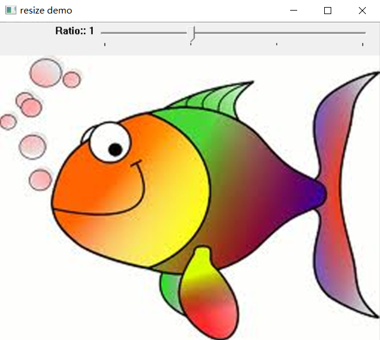


## 仿射变换

仿射变换是一种线性变换，可以保持二维图形在变换前后的“平直性”和“平行性”，即直线经过变换之后仍然是直线，两条平行线经变换之后仍然是平行线。

仿射变换的公式为：

$$
\begin{aligned}
x&=au+bv+m \\
y&=cu+dv+n
\end{aligned}
$$

其中，$u$、$v$为仿射变换前的二维图形中某点的横、纵坐标，$x$、$y$则是该点经仿射变换后得到的新的横、纵坐标。

写成矩阵形式为：

$$
\left[
\begin{matrix}
x \\
y
\end{matrix}
\right]
=
\left[
\begin{matrix}
a&b&m \\
c&d&n
\end{matrix}
\right]
\left[
\begin{matrix}
u \\
v \\
1
\end{matrix}
\right]
$$

其中：

$$
\left[
\begin{matrix}
a&b&m \\
c&d&n
\end{matrix}
\right]
$$
就是仿射矩阵。

在OpenCV中，可以通过**getAffineTransform**函数计算三对不共线的对应点 — 即两组控点，每组控点个数为3个 — 所确定的仿射变换。

先把「一组点」造出来。旧版的 `stdVecOfPoint2f()` + `push_back()` 在新包里没有对应
物，`getAffineTransform` 要的是一个 **`n×1` 的 `CV_32FC2` 矩阵**：

```{r}
#把「点的列表」转成 getAffineTransform 要的 CV_32FC2 矩阵
pts2f = function(pts){
  m = Mat(length(pts),1,CV_32FC2)
  #注意这一行：多通道 Mat 的 [] 赋值是**按通道**铺开的，
  #先写完全部 x、再写完全部 y，不是 (x1,y1,x2,y2) 那样交错
  m[] = c(vapply(pts,`[`,0,1),vapply(pts,`[`,0,2))
  m
}
```

> **这一步写错了不会报错，会静默得到全零矩阵。**如果按 `c(x1,y1,x2,y2,x3,y3)` 的
> 直觉去写，`CV_32FC2` 的前 3 个位置（第 1 通道）会拿到 `x1,y1,x2`，后 3 个
> （第 2 通道）拿到 `y2,x3,y3`，于是三个点变成 `(x1,y2),(y1,x3),(x2,y3)`。
> 如果这三点恰好退化（比如前两点重合），`getAffineTransform` 解出来的就是
> 一个全零矩阵——不抛异常、不警告。看到 `M` 全零，先回头检查点集怎么填的。

```{r}
#先确定一组控点（用列表pts1来表示这组控点的坐标）
pts1 = list(c(50,50),c(200,50),c(50,200))

#再确定另一组对应的控点（用列表pts2来表示其中的三点的坐标）
pts2 = list(c(10,100),c(200,50),c(100,250))

#依据pts1和pts2计算仿射矩阵M
M = cv_getAffineTransform(pts2f(pts1),pts2f(pts2))
#查看M的元素值
round(as_array(M, numeric = TRUE),3)
```

两组控点形成的位置关系如下：

```{r}
#把一组点画在空白图上，标上序号，便于观察两组的对应关系
drawPts = function(pts, col){
  img = Mat(300,300,CV_8UC3)
  for(i in seq_along(pts)){
    #注意 cv_circle / cv_putText 的坐标是 0 基的 OpenCV 坐标，
    #和 R 列表下标无关；pts[[i]] 是 c(x, y)
    invisible(cv_circle(img,pts[[i]],5,col,-1L))
    invisible(cv_putText(img,as.character(i),pts[[i]],
                         FONT_HERSHEY_SIMPLEX,0.8,col,2L))
  }
  #isClosed 用 TRUE；pts 本身就是点列表，不要再包一层 list()
  invisible(cv_polylines(img,pts,TRUE,col))
  img
}
img1 = drawPts(pts1,c(255,0,0))
img2 = drawPts(pts2,c(0,0,255))
```

```{r echo=FALSE}
op = par(mfrow = c(1, 2), mar = c(1, 1, 2, 1))
plot(img1)
title(main = "pts1（蓝）")
plot(img2)
title(main = "pts2（红）")
par(op)
```

仿射矩阵$M$的求解方式实质上就是求解方程组：

将蓝色点1的横、纵坐标(u,v)和对应的红色点1的横纵坐标(x,y)代入仿射变换公式，就可以得到两个方程；同理，将蓝色点2、3的横、纵坐标(u,v)和对应的红色点2、3的横纵坐标(x,y)代入公式，又可以分别得到两个方程。这样一来，就会形成一个包含6个方程的方程组：

$$
\begin{cases}
50a + 50b + m+0c+0d+0n = 10 \\
0a+0b+0m+50c + 50d + n = 100 \\
200a + 50b + m+0c+0d+0n = 200 \\
0a+0b+0m+200c + 50d + n = 50 \\
50a + 200b + m+0c+0d+0n = 100 \\
0a+0b+0m+50c + 200d + n = 250
\end{cases}
$$

由于三个蓝色点不共线（且经仿射变换后，相应的三个红色点也不共线），所以通过6个方程形成的方程组，就可以确定a、b、c、d、m和n的唯一解，进而也就确立了仿射矩阵。

```{r}
#方程组的系数矩阵
A = matrix(c(50,50,1,0,0,0,
             0,0,0,50,50,1, 
             200,50,1,0,0,0,
             0,0,0,200,50,1, 
             50,200,1,0,0,0,
             0,0,0,50,200,1),
           nr=6,nc=6,byrow = T)
#方程组各等式右边的值所形成的向量
B = c(10,100,200,50,100,250)

#求解方程组
sol = solve(A,B)
names(sol) = c('a','b','m','c','d','n')
matrix(round(sol,3),nr=2,nc=3,byrow=T)
```

手算的结果和 `cv_getAffineTransform` 给的一模一样。这就是这个函数在做的事：
解上面那 6 个方程。

在OpenCV中，使用**warpAffine**函数可以基于仿射矩阵对图像进行仿射变换。

**示例**

```{r}
#读取图像文件
bayer = cv_imread("images/bayer.png")
#获得图像矩阵的行数、列数和通道数
#mat_info返回：行、列、通道、类型码、深度码
rows_ = mat_info(bayer)[1]
cols_ = mat_info(bayer)[2]
cns_  = mat_info(bayer)[3]

#形成两个点坐标列表pts1和pts2
pts1 = list(c(50,50),c(200,50),c(50,200))
pts2 = list(c(10,100),c(200,50),c(100,250))
#依据pts1和pts2计算仿射矩阵M
M = cv_getAffineTransform(pts2f(pts1),pts2f(pts2))

#基于M对bayer进行仿射变换，结果保存在dst中
#dsize的顺序是c(宽, 高)
dst = cv_warpAffine(bayer,M,c(cols_,rows_))
dim(dst)
```

```{r echo=FALSE}
op = par(mfrow = c(1, 2), mar = c(1, 1, 2, 1))
plot(bayer)
title(main = "ori")
plot(dst)
title(main = "affine")
par(op)
```

**示例**

当仿射矩阵为如下形式时：

$$
\left[
\begin{matrix}
a&0&0 \\
0&d&0
\end{matrix}
\right]
$$

其作用为：将图像在水平方向和垂直方向上分别缩放$a$倍和$d$倍。比如，当$a=d=2$时，原图像第3行第3列位置的像素在目标像素的位置为：

$$
\left[
\begin{matrix}
x \\
y
\end{matrix}
\right]
=
\left[
\begin{matrix}
2&0&0 \\
0&2&0
\end{matrix}
\right]
\left[
\begin{matrix}
2 \\
2 \\
1
\end{matrix}
\right] = 
\left[
\begin{matrix}
4 \\
4 
\end{matrix}
\right]
$$

即在仿射变换$\displaystyle \left[\begin{matrix}2&0&0 \\ 0&2&0 \end{matrix}\right]$下，原图像第3行第3列位置的像素会成为目标图像的第5行第5列位置的像素。这个结论可以通过如下代码来验证：

```{r}
#生成3行3列的矩阵
img_mat = matrix(9:1,nr=3,nc=3)
#将矩阵第3行第3列的元素更改为134，便于观察结果
img_mat[3,3] = 134
#将img_mat转变为图像矩阵
img = Mat(3,3,CV_8UC1)
img[] = img_mat

#生成仿射变换矩阵（2行3列的32位浮点矩阵）
M_mat = matrix(c(2,0,0, 0,2,0),nr=2,nc=3,byrow=T)
M = Mat(2,3,CV_32F)
M[] = M_mat
#对img进行仿射变换，结果保存在dst中
dst = cv_warpAffine(img,M,c(6,6))

#查看结果：134出现在第5行第5列
as_array(dst, numeric = TRUE)
```

> 上面 `M[] = M_mat` 里 `M_mat` 是 2×3、`M` 也是 2×3，形状对得上，所以按列铺开
> 正好还原。**单通道矩阵没有「通道」这一维**，不存在多通道那种按通道铺开的问题。
> 但 R 的矩阵本来就是按列存的，`matrix(..., byrow=T)` 造出来的值和 `M[]` 的
> 期望顺序一致，只是巧合于「行列数相同」——换成非方阵就要小心。

**示例**

当仿射矩阵为如下形式时：

$$
\left[
\begin{matrix}
1&0&m \\
0&1&n
\end{matrix}
\right]
$$
其作用为：将图像在水平方向和垂直方向上移动m和n个单位（像素）。

```{r}
#读取图像文件
img = cv_imread("images/HappyFish.jpg")
#获取图像矩阵的行数和列数
rows_ = mat_info(img)[1]
cols_ = mat_info(img)[2]
#生成平移矩阵：(1,0,100) 第一行，(0,1,100) 第二行
arr = matrix(c(1,0,100, 0,1,100),nr=2,nc=3,byrow = TRUE)
#将arr转变为32浮点类型的图像矩阵M
M = Mat(2,3,CV_32FC1)
M[] = arr

#基于M对img进行仿射变换，结果保存在dst中
dst = cv_warpAffine(img,M,c(cols_,rows_))
```

```{r echo=FALSE}
op = par(mfrow = c(1, 2), mar = c(1, 1, 2, 1))
plot(img)
title(main = "ori")
plot(dst)
title(main = "平移 (100, 100)")
par(op)
```

**示例**

当仿射矩阵为如下形式时：

$$
\left[
\begin{matrix}
cos(\theta)&sin(\theta)&m \\
-sin(\theta)&cos(\theta)&n
\end{matrix}
\right]
$$
其作用为：将图像旋转$\theta$角度，并在水平方向和垂直方向上移动m和n个单位（像素）。

```{r}
#读取图像文件
img = cv_imread("images/roi.jpg")
#获取图像矩阵的行数和列数
rows_ = mat_info(img)[1]
cols_ = mat_info(img)[2]
#确定旋转角度（角度为负数，表示是逆时针旋转）
theta = -pi/4
#生成旋转矩阵
arr = matrix(
  c(cos(theta),sin(theta),200,
    -sin(theta),cos(theta),300),
  nr=2,nc=3,byrow = TRUE)
M = Mat(2,3,CV_32F)
M[] = arr

#基于M对img进行仿射变换，结果保存在dst中
dst = cv_warpAffine(img,M,c(2*cols_,2*rows_))
dim(dst)
```

```{r echo=FALSE}
op = par(mfrow = c(1, 2), mar = c(1, 1, 2, 1))
plot(img)
title(main = "ori")
plot(dst)
title(main = "旋转 + 平移")
par(op)
```


```{r eval=FALSE}
#用 getRotationMatrix2D 直接造旋转矩阵，省得自己写 sin/cos
img = cv_imread("images/xinlian/keke.jpg")
rows_ = mat_info(img)[1]
cols_ = mat_info(img)[2]

#center 是 c(x, y)：以图像中心为旋转中心，逆时针 45 度，缩放 0.8
M = cv_getRotationMatrix2D(c(cols_/2,rows_/2),45,0.8)
round(as_array(M, numeric = TRUE),3)

res = cv_warpAffine(img,M,c(1.1*cols_,1.1*rows_))
cv_imshow('res',res)

#动态演示：角度从 0 转到 180
angle = seq(0,180,by=180/100)
for(i in angle){
  M = cv_getRotationMatrix2D(c(cols_/2,rows_/2),i,0.8)
  res = cv_warpAffine(img,M,c(1.1*cols_,1.1*rows_))
  cv_imshow('res',res)
  if(cv_waitKey(1L)>0) break
}
```


## 透视变换

透视变换较之于仿射变换，要复杂一些，其变换公式的矩阵形式为：

$$w\left[\begin{matrix}x \\y \\1\end{matrix}\right] =\left[\begin{matrix}a_{11}&a_{12}&a_{13} \\a_{21}&a_{22}&a_{23} \\a_{31}&a_{32}&a_{33} \end{matrix}\right] \left[\begin{matrix}u \\v \\1\end{matrix}\right] $$

其中，$u$、$v$为透视变换前的二维图形中某点的横、纵坐标，$x$、$y$则是该点经透视变换后得到的新的横、纵坐标。而矩阵：

$$
\left[
\begin{matrix}
a_{11}&a_{12}&a_{13} \\
a_{21}&a_{22}&a_{23} \\
a_{31}&a_{32}&a_{33} 
\end{matrix}
\right] 
$$

就是透视矩阵。在透视矩阵中：

* $\displaystyle \left[ \begin{matrix} a_{11}&a_{12} \\ a_{21}&a_{22} \end{matrix} \right]$表示线性变换；
* $\displaystyle \left[ \begin{matrix} a_{13}&a_{23} \end{matrix} \right]$表示透视变换；
* $\displaystyle \left[ \begin{matrix} a_{31}&a_{32} \end{matrix} \right]$表示图像平移。

在OpenCV中，可以通过**getPerspectiveTransform**函数计算四对不共线的对应点 — 即两组控点，每组控点个数为4个 — 所确定的透视变换，比如：

```{r}
#先确定一组控点（用列表pts1来表示这组控点的坐标）
pts1 = list(c(57,40),c(329,23),c(374,407),c(15,407))
#再确定另一组对应的控点（用列表pts2来表示其中的四点的坐标）
pts2 = list(c(20,20),c(380,20),c(380,430),c(20,430))
#依据pts1和pts2计算透视矩阵M
M = cv_getPerspectiveTransform(pts2f(pts1),pts2f(pts2))
#查看M的内容
round(as_array(M, numeric = TRUE),5)
```

两组控点形成的位置关系如下：

```{r}
#这张画布要能装下 450x420，不能用仿射那一节的 300x300
img1 = Mat(450,420,CV_8UC3)
for(i in seq_along(pts1)){
  invisible(cv_circle(img1,pts1[[i]],5,c(255,0,0),-1L))
  invisible(cv_putText(img1,as.character(i),pts1[[i]],
                       FONT_HERSHEY_SIMPLEX,0.8,c(255,0,0),2L))
}
invisible(cv_polylines(img1,pts1,TRUE,c(255,0,0)))
img2 = drawPts(pts2,c(0,0,255))
```

```{r echo=FALSE}
op = par(mfrow = c(1, 2), mar = c(1, 1, 2, 1))
plot(img1, main = "pts1（蓝）")
plot(img2, main = "pts2（红）")
par(op)
```

透视矩阵$M$的求解方式实质上就是求解方程组。首先依据如下公式计算：

$$w\left[\begin{matrix}x \\y \\1\end{matrix}\right] =\left[\begin{matrix}a_{11}&a_{12}&a_{13} \\a_{21}&a_{22}&a_{23} \\a_{31}&a_{32}&a_{33} \end{matrix}\right] \left[\begin{matrix}u \\v \\1\end{matrix}\right] 
$$

得到：

$$
\left[
\begin{matrix}
wx \\
wy \\
w
\end{matrix}
\right] 
=
\left[
\begin{matrix}
a_{11}u+a_{12}v+a_{13} \\
a_{21}u+a_{22}v+a_{23} \\
a_{31}u+a_{32}v+a_{33} 
\end{matrix}
\right] 
$$

则有：

$$
\begin{cases}
wx&=a_{11}u+a_{12}v+a_{13} \\
wy&=a_{21}u+a_{22}v+a_{23} \\
w&=a_{31}u+a_{32}v+a_{33}
\end{cases}
$$

将第三个方程确定的$w$代入第一个和第二方程：

$$
\begin{aligned}
(a_{31}u+a_{32}v+a_{33})x &= a_{11}u+a_{12}v+a_{13} \\
(a_{31}u+a_{32}v+a_{33})y &= a_{21}u+a_{22}v+a_{23}
\end{aligned}
$$

进一步变形可得如下方程组（这里称之为可算计透视变换公式）：

$$
\begin{cases}
\begin{aligned}
a_{11}u+a_{12}v+a_{13} - a_{31}ux-a_{32}vx &= a_{33}x\\
a_{21}u+a_{22}v+a_{23}-a_{31}uy-a_{32}vy &= a_{33}y
\end{aligned}
\end{cases}
$$

将蓝色点1的横、纵坐标(u,v)和对应的红色点1的横纵坐标(x,y)代入可计算透视变化公式，就可以得到两个方程；同理，将蓝色点2、3、4的横、纵坐标(u,v)和对应的红色点2、3、4的横纵坐标(x,y)代入可计算透视变换公式，又可以分别得到两个方程。这样一来，就会形成一个包含8个方程的方程组：

$$
\begin{cases}
57a_{11} + 40a_{12} + a_{13} +0a_{21}+0a_{22}+0a_{23} - 1140a_{31} - 800a_{32} = 20a_{33} \\
0a_{11}+0a_{12}+0a_{13}+57a_{21} + 40a_{22} + a_{23} - 1140a_{31} - 800a_{32} = 20a_{33} \\
329a_{11} + 23a_{12} + a_{13}+0a_{21}+0a_{22}+0a_{23} - 125020a_{31} - 8740a_{32} = 380a_{33} \\
0a_{11}+0a_{12}+0a_{13}+329a_{21} + 23a_{22} + a_{23} - 6580a_{31} - 460a_{32} = 20a_{33} \\
374a_{11} + 407a_{12} + a_{13} +0a_{21}+0a_{22}+0a_{23}- 142120a_{31} - 154660a_{32} = 380a_{33} \\
0a_{11}+0a_{12}+0a_{13}+374a_{21} + 407a_{22} + a_{23} - 160820a_{31} - 175010a_{32} = 430a_{33} \\
15a_{11} + 407a_{12} + a_{13} +0a_{21}+0a_{22}+0a_{23}- 300a_{31} - 8140a_{32} = 20a_{33} \\
0a_{11}+0a_{12}+0a_{13}+15a_{21} + 407a_{22} + a_{23} - 6450a_{31} - 175010a_{32} = 430a_{33}
\end{cases}
$$

由于四个蓝色点不共线（且经透视变换后，相应的四个红色点也不共线），所以这8个方程形成的方程组，就可以确定$a_{11},a_{12},a_{13},a_{21},a_{22},a_{23},a_{31},a_{32}$的解，至于$a_{33}$，不妨设定其值为1。

```{r}
A = matrix(
  c(
    57,40,1,0,0,0,-1140,-800,
    0,0,0,57,40,1,-1140,-800,
    329,23,1,0,0,0,-125020,-8740,
    0,0,0,329,23,1,-6580,-460,
    374,407,1,0,0,0,-142120,-154660,
    0,0,0,374,407,1,-160820,-175010,
    15,407,1,0,0,0,-300,-8140,
    0,0,0,15,407,1,-6450,-175010
  ),
  nr=8,nc=8,byrow = T
)
b = c(20,20,380,20,380,430,20,430)
sol = round(solve(A,b),5)
matrix(c(sol,1),nr=3,nc=3,byrow = T)
```

手算出来的这个 3×3 矩阵，和上面 `cv_getPerspectiveTransform` 给出的完全一致。


在OpenCV中，**warpPerspective**函数可以基于透视矩阵对图像进行透视变换。

**示例**

```{r}
#读取图像文件
img = cv_imread("images/calib_radial.jpg")

#指定图像中棋盘区域的四个顶点坐标，保存在pts1中
pts1 = list(c(57,40),c(329,23),c(374,407),c(15,407))
#指定棋盘区域要映射到的区域（通过四个顶点坐标指定，保存在pts2中）
pts2 = list(c(20,20),c(380,20),c(380,430),c(20,430))
#依据pts1和pts2进行透视变换，获得变换矩阵M
M = cv_getPerspectiveTransform(pts2f(pts1),pts2f(pts2))

#依据M对img进行透视变换，结果保存在img_pers中
img_pers = cv_warpPerspective(img,M,c(420,450))
dim(img_pers)
```

```{r echo=FALSE}
op = par(mfrow = c(1, 2), mar = c(1, 1, 2, 1))
plot(img, main = "原始图像")
title(main = "原始图像")
plot(img_pers, main = "透视变换结果")
title(main = "透视变换结果")
par(op)
```

## 基础绘图

绘图函数都在 `imgproc` 模块里：`line`、`rectangle`、`circle`、`ellipse`、`polylines`、`fillPoly`、`putText`。

旧版本（是一直没有发布的版本，握在手里几年了）为了调用它们，先构造了 `Point`、`Scalar`、`Size`、`Rect`、`RotatedRect` 五种结构体，再靠 `stdVecOfPoint()`、`stdVecOfVecOfPoint()` 这类容器把点串起来。在当前版本中，这些**全都不需要**了——它们各自对应 R 里一个普通向量：


### Point与Scalar

**Point**

```{r}
#横坐标为 0、纵坐标也为 0 的点
pt = c(0,0)
pt
```

```{r}
#横坐标为 10、纵坐标为 8 的点
pt = c(10,8)
pt
```

要改坐标，改下标：

```{r}
#先给一个原点
pt = c(0,0)
#改横坐标、纵坐标
pt[1] = 10
pt[2] = 8
pt
```

**Scalar**

**Scalar** 在 OpenCV 里是个 4 维向量，常用来表示像素值。新版直接写数值向量：

```{r}
#蓝色、绿色和红色分量都为 0
sca = c(0,0,0)
sca
```

```{r}
#蓝色、绿色和红色分量分别为 100、20、230
sca = c(100,20,230)
sca
```

长度不足 4 的向量，我们很容易想到从 **B 开始往后填**，剩下的分量补 0。但这种想法会导致问题：

```{r}
#单通道图：c(255) 就是白色
img_gray = Mat(20,20,CV_8UC1)
invisible(cv_rectangle(img_gray,c(5,5,10,10),c(255),-1))

#三通道图：c(255) 只填了 B 分量，G 和 R 补 0 —— 是纯蓝，不是白色
img_bgr = Mat(20,20,CV_8UC3)
invisible(cv_rectangle(img_bgr,c(5,5,10,10),c(255),-1))

g = as_array(img_gray,numeric = TRUE)
b = as_array(img_bgr,numeric = TRUE)
c(gray = g[10,10],blue = b[10,10,1],green = b[10,10,2],red = b[10,10,3])
```

> **同一个 `c(255)`，在灰度图上是白，在彩色图上是蓝。**
>
> 这不是广播——`c(255)` 被当成 `Scalar(255, 0, 0, 0)`，四个分量里只给了第一个，
> 其余补 0。灰度图只有一个通道，用到的正好是 B 那一位，所以是白；
> 彩色图三个通道都用，于是蓝 255、绿 0、红 0，纯蓝。
>
> 这个坑不报错，图也画得出来，只是颜色跟预期差了一个色系。要点：
> **在彩色图上要坚持把颜色写全** `c(255,255,255)`，不宜写成 `c(255)`。

几个常见颜色的完整写法：

```{r}
swatch = function(col){
  m = Mat(10,10,CV_8UC3)
  invisible(cv_rectangle(m,c(1,1,5,5),col,-1))
  as_array(m,numeric = TRUE)[3,3,]
}
rbind(
  "c(255)"              = swatch(c(255)),
  "c(255,255)"          = swatch(c(255,255)),
  "red   c(0,0,255)"    = swatch(c(0,0,255)),
  "green c(0,255,0)"    = swatch(c(0,255,0)),
  "blue  c(255,0,0)"    = swatch(c(255,0,0)),
  "white c(255,255,255)"= swatch(c(255,255,255))
)
```

列依次是 B、G、R。第一行 `c(255)` 是纯蓝，第二行 `c(255,255)` 是青——都能画出来，都不是白。

也可以随机生成一个颜色：

```{r}
#生成随机颜色的函数：从 0 到 255 中有放回地取 3 个数
randomColor = function(){
  sample(0:255,3,replace = TRUE)
}
#设定随机数种子，保证每次跑出来一样
set.seed(123)
#调用函数得到一个颜色
rndCol = randomColor()
rndCol
```


### 绘制直线（段）

用 **line** 画直线（段）：

```
cv_line(img, pt1, pt2, color, thickness = 1, lineType = LINE_8, shift = 0)
```

`pt1`、`pt2` 是两个端点，`color` 是颜色向量，`thickness` 是线宽，`lineType` 是线段连通方式（`LINE_4` = 4 连通、`LINE_8` = 8 连通、`LINE_AA` = 抗锯齿）。

**在灰度图上绘制直线**

```{r}
#生成全黑的图像（高度、宽度都为 200，类型为 CV_8UC1）
img = Mat(200,200,CV_8UC1)
#指定两个端点
pt1 = c(120,100)
pt2 = c(160,100)
#绘制直线，颜色为白色(255)，线宽为 2
invisible(cv_line(img,pt1,pt2,c(255),2))
```

```{r echo=FALSE}
plot(img)
title(main = "灰度图上的直线")
```

数一下被点亮的像素，确认线真的画上去了：

```{r}
#这条水平线从 x=120 到 x=160，一共 41 个像素
line_pixels = function(th){
  m = Mat(200,200,CV_8UC1)
  invisible(cv_line(m,c(120,100),c(160,100),c(255),th))
  a = as_array(m,numeric = TRUE)
  c(thickness = th,total = sum(a != 0),
    rows = sum(apply(a != 0,1,any)),cols = sum(apply(a != 0,2,any)))
}
t(vapply(1:4,line_pixels,numeric(4)))
```

> 线宽 1 时正好 41 个像素，符合预期。但线宽 2 不是 82，是 125——
> **OpenCV 的粗线不是「把细线复制几行」**，而是沿线段方向填充一个条带，
> 再补上端点。所以「长度 × 线宽」这种估算法在这里不成立。
>
> 更反直觉的是线宽 3 和 4 的条带一样宽（都是 5 行），5 和 6 也一样（7 行）。
> 它按某种奇偶规则取整，并不随线宽线性增长。真要核对像素数，只能实测，
> 不能推算。

画一组放射线：

```{r echo=FALSE}
#8 个方向，间隔 pi/4
alpha = (0:7)*pi/4
#内圈端点：半径 20
x1 = round(100+20*cos(alpha))
y1 = round(100+20*sin(alpha))
#外圈端点：半径 60
x2 = round(100+60*cos(alpha))
y2 = round(100+60*sin(alpha))

knitr::kable(data.frame(x1,y1,x2,y2))
```


```{r}
#生成全黑的图像
img = Mat(200,200,CV_8UC1)
#按数据框的 8 行，逐条画线
for(i in 1:8){
  invisible(cv_line(img,c(x1[i],y1[i]),c(x2[i],y2[i]),c(255),2))
}
```

```{r echo=FALSE}
plot(img)
title(main = "8 条放射线")
```

**在彩色图上绘制直线**

```{r}
#生成全黑的彩色图像
img = Mat(200,200,CV_8UC3)
#画一条红色直线（BGR 下红色是 c(0,0,255)）
invisible(cv_line(img,c(120,100),c(160,100),c(0,0,255),2))
```

```{r echo=FALSE}
plot(img)
title(main = "彩色图上的红色直线")
```

把 8 条线换成随机颜色：

```{r}
set.seed(7)
img = Mat(200,200,CV_8UC3)
for(i in 1:8){
  invisible(cv_line(img,c(x1[i],y1[i]),c(x2[i],y2[i]),randomColor(),2))
}
```

```{r echo=FALSE}
plot(img)
title(main = "8 条随机颜色的放射线")
```


### 绘制矩形

**rectangle** 有两种重载：

```
cv_rectangle(img, pt1, pt2, color, thickness = 1, lineType = LINE_8, shift = 0)  #两个对角顶点
cv_rectangle(img, rec,     color, thickness = 1, lineType = LINE_8, shift = 0)  #左上角 + 宽高
```

第二种里的 `rec` 是长度 4 的向量 `c(x, y, width, height)`。

**在灰度图上绘制矩形**

```{r}
img = Mat(200,200,CV_8UC1)
#第一种：两个对角顶点 (30,30) 和 (70,90)
invisible(cv_rectangle(img,c(30,30),c(70,90),c(255),2))
#第二种：左上角 (100,100)，宽 40、高 60
invisible(cv_rectangle(img,c(100,100,40,60),c(255),2))
```

```{r echo=FALSE}
plot(img)
title(main = "两种方式画的矩形")
```

> **这里要留意：**
>
> 两个对角顶点是**两个长度 2 的向量**，第二种方式是**一个长度 4 的向量**。
> 参数个数不同，R 会按位置匹配到不同的重载——这是设计好的。
>
> 但如果写成 `c(30,30,70,90)`，它不会被当成「两个顶点」，
> 而是被当成 `Rect(x=30, y=30, w=70, h=90)`，画出来是一个 70×90 的大框，
> 但不是 (30,30) 到 (70,90) 的那个框。

```{r}
#同样想画 (30,30)-(70,90)，写成 4 个数字会走 Rect 重载
img4 = Mat(200,200,CV_8UC1)
invisible(cv_rectangle(img4,c(30,30,70,90),c(255),1))

#而写成两个 2 向量，才是两个对角顶点
img2 = Mat(200,200,CV_8UC1)
invisible(cv_rectangle(img2,c(30,30),c(70,90),c(255),1))

span = function(m){
  a = as_array(m,numeric = TRUE)
  c(row = paste(range(which(apply(a != 0,1,any))),collapse = "~"),
    col = paste(range(which(apply(a != 0,2,any))),collapse = "~"))
}
rbind("c(30,30,70,90)" = span(img4),"c(30,30)+c(70,90)" = span(img2))
```

前者占的行列范围是 70×90，后者是 40×60——差了一倍多，但两种写法都不会报错。

要画**填充**矩形，把线宽设成 `-1`：

```{r}
img = Mat(200,200,CV_8UC1)
invisible(cv_rectangle(img,c(30,30),c(70,90),c(255),-1))
invisible(cv_rectangle(img,c(100,100,40,60),c(255),-1))
```

```{r echo=FALSE}
plot(img)
title(main = "填充矩形")
```

填充面积可以直接数出来验证——40×60 的框正好 2400 个像素：

```{r}
#只画一个填充矩形，数像素
img_fill = Mat(200,200,CV_8UC1)
invisible(cv_rectangle(img_fill,c(100,100,40,60),c(255),-1))
sum(as_array(img_fill,numeric = TRUE) != 0)
```

**在彩色图上绘制矩形**

```{r}
img = Mat(200,200,CV_8UC3)
#红色矩形
invisible(cv_rectangle(img,c(30,30),c(70,90),c(0,0,255),2))
#蓝色矩形
invisible(cv_rectangle(img,c(100,100,40,60),c(255,0,0),2))
```

```{r echo=FALSE}
plot(img)
title(main = "彩色图上的两个矩形")
```

```{r}
img = Mat(200,200,CV_8UC3)
invisible(cv_rectangle(img,c(30,30),c(70,90),c(0,0,255),-1))
invisible(cv_rectangle(img,c(100,100,40,60),c(255,0,0),-1))
```

```{r echo=FALSE}
plot(img)
title(main = "彩色图上的两个填充矩形")
```


### 绘制圆

```
cv_circle(img, center, radius, color, thickness = 1, lineType = LINE_8, shift = 0)
```

**在灰度图上绘制圆**

```{r}
img = Mat(200,200,CV_8UC1)
#圆心 (100,100)，半径 60，白色，线宽 2
invisible(cv_circle(img,c(100,100),60,c(255),2))
```

```{r echo=FALSE}
plot(img)
title(main = "灰度图上的圆")
```

填充圆同样是线宽 `-1`：

```{r}
img = Mat(200,200,CV_8UC1)
invisible(cv_circle(img,c(100,100),60,c(255),-1))
```

```{r echo=FALSE}
plot(img)
title(main = "填充圆")
```

填充圆的像素数约等于 $\pi r^2 = 11310$，实际会略多——边界像素按 `LINE_8` 规则补满：

```{r}
sum(as_array(img,numeric = TRUE) != 0)
```

**在彩色图上绘制圆**

一个白圆当脸，两个蓝点当眼睛，一个红点当嘴：

```{r}
img = Mat(200,200,CV_8UC3)
#脸：白色圆
invisible(cv_circle(img,c(100,100),60,c(255,255,255),2))
#左眼：蓝色
invisible(cv_circle(img,c(70,70),10,c(255,0,0),2))
#右眼：蓝色
invisible(cv_circle(img,c(130,70),10,c(255,0,0),2))
#嘴：红色
invisible(cv_circle(img,c(100,130),10,c(0,0,255),2))
```

```{r echo=FALSE}
plot(img)
title(main = "彩色图上的四个圆")
```

```{r}
img = Mat(200,200,CV_8UC3)
invisible(cv_circle(img,c(100,100),60,c(255,255,255),-1))
invisible(cv_circle(img,c(70,70),10,c(255,0,0),-1))
invisible(cv_circle(img,c(130,70),10,c(255,0,0),-1))
invisible(cv_circle(img,c(100,130),10,c(0,0,255),-1))
```

```{r echo=FALSE}
plot(img)
title(main = "四个填充圆")
```

> 填充时后画的会盖住先画的。上面四个圆的顺序很重要：先画大白圆，
> 再画眼睛和嘴，否则它们会被白圆吃掉。


### 绘制椭圆弧

**ellipse** 也有两种重载：

```
#第一种：圆心 + 轴半径 + 旋转角 + 起始角 + 终止角
cv_ellipse(img, center, axes, angle, startAngle, endAngle, color, thickness = 1, lineType = LINE_8, shift = 0)
#第二种：一个 RotatedRect，即 c(cx, cy, width, height, angle)
cv_ellipse(img, box, color, thickness = 1, lineType = LINE_8)
```

第一种里的 `axes` 是**半轴长度** `c(长半轴, 短半轴)`，不是直径。`angle` 是椭圆自身的旋转角，`startAngle`/`endAngle` 是弧的起止角。

**在灰度图上绘制椭圆弧**

```{r}
img = Mat(200,200,CV_8UC1)
#圆心 (100,100)，半轴 60 和 30，旋转角 0，从 0 度画到 90 度
invisible(cv_ellipse(img,c(100,100),c(60,30),0,0,90,c(255),2))

#画一条水平线和一条竖直线，方便看出弧落在哪个象限
invisible(cv_line(img,c(0,100),c(200,100),c(150),lineType = LINE_4))
invisible(cv_line(img,c(100,0),c(100,200),c(150),lineType = LINE_4))
```

```{r echo=FALSE}
plot(img)
title(main = "0°~90° 的椭圆弧")
```

换几组旋转角和起止角：

```{r}
img = Mat(200,200,CV_8UC1)
invisible(cv_ellipse(img,c(100,100),c(60,30),0,0,90,c(255),2))
invisible(cv_ellipse(img,c(100,100),c(70,40),90,0,90,c(255),2))
invisible(cv_ellipse(img,c(100,100),c(80,50),180,45,90,c(255),2))
invisible(cv_line(img,c(0,100),c(200,100),c(150),lineType = LINE_4))
invisible(cv_line(img,c(100,0),c(100,200),c(150),lineType = LINE_4))
```

```{r echo=FALSE}
plot(img)
title(main = "不同旋转角与起止角")
```


起始角 0、终止角 360 就是完整椭圆：

```{r}
img = Mat(200,200,CV_8UC1)
invisible(cv_ellipse(img,c(100,100),c(60,30),0,0,360,c(255),2))
invisible(cv_ellipse(img,c(100,100),c(70,40),45,0,360,c(255),2))
invisible(cv_line(img,c(0,100),c(200,100),c(255),lineType = LINE_4))
invisible(cv_line(img,c(100,0),c(100,200),c(255),lineType = LINE_4))
```

```{r echo=FALSE}
plot(img)
title(main = "完整椭圆")
```

线宽 `-1` 得到填充椭圆：

```{r}
img = Mat(200,200,CV_8UC1)
invisible(cv_ellipse(img,c(100,100),c(80,40),45,0,360,c(255),-1))
```

```{r echo=FALSE}
plot(img)
title(main = "填充椭圆")
```

**在彩色图上绘制椭圆弧**

```{r}
img = Mat(200,200,CV_8UC3)
invisible(cv_ellipse(img,c(100,100),c(60,30),0,0,90,c(0,0,255),2))
invisible(cv_ellipse(img,c(100,100),c(70,40),90,0,90,c(0,255,0),2))
invisible(cv_ellipse(img,c(100,100),c(80,50),180,45,90,c(255,0,0),2))
invisible(cv_line(img,c(0,100),c(200,100),c(255,255,255),lineType = LINE_4))
invisible(cv_line(img,c(100,0),c(100,200),c(255,255,255),lineType = LINE_4))
```

```{r echo=FALSE}
plot(img)
title(main = "三色椭圆弧")
```

填充之后是三个扇形：

```{r}
img = Mat(200,200,CV_8UC3)
invisible(cv_ellipse(img,c(100,100),c(60,30),0,0,90,c(0,0,255),-1))
invisible(cv_ellipse(img,c(100,100),c(70,40),90,0,90,c(0,255,0),-1))
invisible(cv_ellipse(img,c(100,100),c(80,50),180,45,90,c(255,0,0),-1))
invisible(cv_line(img,c(0,100),c(200,100),c(255,255,255),lineType = LINE_4))
invisible(cv_line(img,c(100,0),c(100,200),c(255,255,255),lineType = LINE_4))
```

```{r echo=FALSE}
plot(img)
title(main = "三个填充扇形")
```


**用 RotatedRect 绘制椭圆**

第二种重载收一个 `RotatedRect`，在 R 里就是 `c(cx, cy, width, height, angle)`：

```{r}
img = Mat(200,200,CV_8UC1)
#中心 (100,100)，外接矩形 120×60，旋转 45 度
invisible(cv_ellipse(img,c(100,100,120,60,45),c(255),2))
invisible(cv_line(img,c(0,100),c(200,100),c(150),lineType = LINE_4))
invisible(cv_line(img,c(100,0),c(100,200),c(150),lineType = LINE_4))
```

```{r echo=FALSE}
plot(img)
title(main = "用 RotatedRect 画的椭圆")
```


### 绘制多边形

**polylines** 画折线；`isClosed = TRUE` 时自动把首尾顶点连起来，就成了多边形。

```
cv_polylines(img, pts, isClosed, color, thickness = 1, lineType = LINE_8, shift = 0)
```

`pts` 是**点集列表**，每个元素是一组顶点。一组顶点可以写成 n×2 的矩阵（每行一个点），也可以写成长度 2k 的扁平向量 `c(x1,y1,x2,y2,...)`。

**在灰度图上绘制多边形**

一个三角形加一个矩形：

```{r}
img = Mat(200,200,CV_8UC1)

#三角形：三个顶点，每行一个 (x, y)
tri = rbind(c(50,20),c(20,80),c(80,80))
#矩形：四个顶点
rect = rbind(c(120,120),c(120,180),c(180,180),c(180,120))

#点集列表：一个元素对应一个多边形
pts = list(tri,rect)

#isClosed = TRUE，把每组顶点的首尾连起来
invisible(cv_polylines(img,pts,TRUE,c(255),2))

invisible(cv_line(img,c(0,100),c(200,100),c(150),lineType = LINE_4))
invisible(cv_line(img,c(100,0),c(100,200),c(150),lineType = LINE_4))
```

```{r echo=FALSE}
plot(img)
title(main = "两个多边形")
```

> **这一节最容易踩的坑，是点集的「嵌套层次」。**
>
> 下面这种写法看起来最自然，其实是错的：

```{r}
#错误示范：把「一组点」写成了「一组只有一个点的多边形」
img_bad = Mat(200,200,CV_8UC1)
invisible(cv_polylines(img_bad,list(c(50,20),c(20,80),c(80,80)),TRUE,c(255),2))
plot(img_bad)
sum(as_array(img_bad,numeric = TRUE) != 0)
```

只“点亮”了 3 个像素。因为 `list(c(50,20), c(20,80), c(80,80))` 被理解成**三个多边形**，每个多边形只有一个顶点——画不出线，只留下三个点。

正确的写法是 `list(rbind(...))`，或者 `list(c(50,20, 20,80, 80,80))`：

```{r}
#正确：一组点装在一个元素里，长度 2k 的扁平向量
img_ok = Mat(200,200,CV_8UC1)
invisible(cv_polylines(img_ok,list(c(50,20,20,80,80,80)),TRUE,c(255),2))
plot(img_ok)
sum(as_array(img_ok,numeric = TRUE) != 0)
```


**在彩色图上绘制多边形**

```{r}
img = Mat(200,200,CV_8UC3)
invisible(cv_polylines(img,pts,TRUE,c(0,0,255),2))
invisible(cv_line(img,c(0,100),c(200,100),c(255,255,255),lineType = LINE_4))
invisible(cv_line(img,c(100,0),c(100,200),c(255,255,255),lineType = LINE_4))
```

```{r echo=FALSE}
plot(img)
title(main = "彩色图上的两个多边形")
```

`isClosed = FALSE` 时就只是折线，首尾不连：

```{r}
img_open = Mat(200,200,CV_8UC1)
invisible(cv_polylines(img_open,list(rbind(c(50,20),c(20,80),c(80,80))),FALSE,c(255),2))
```

```{r echo=FALSE}
op = par(mfrow = c(1,2),mar = c(1,1,2,1))
plot(img)
title(main = "isClosed = TRUE")
plot(img_open)
title(main = "isClosed = FALSE")
par(op)
```


### 绘制填充多边形

**fillPoly** 画填充多边形，参数比 `polylines` 少一个 `isClosed`——填充多边形必然是闭合的。

```
cv_fillPoly(img, pts, color, lineType = LINE_8, shift = 0, offset = NULL)
```

**在灰度图上绘制填充多边形**

```{r}
img = Mat(200,200,CV_8UC1)
#pts 还是上面那两个多边形
invisible(cv_fillPoly(img,pts,c(255)))

invisible(cv_line(img,c(0,100),c(200,100),c(150),lineType = LINE_4))
invisible(cv_line(img,c(100,0),c(100,200),c(150),lineType = LINE_4))
```

```{r echo=FALSE}
plot(img)
title(main = "两个填充多边形")
```

填充面积可以数出来，跟手算的三角形面积对一下：

```{r}
a = as_array(img,numeric = TRUE)
#三角形底边长 60、高 60，面积 1800；矩形 60×60，面积 3600
#（都被十字线占了几个像素，所以只能比个大概）
c(nonzero = sum(a != 0))
```

**在彩色图上绘制填充多边形**

```{r}
img = Mat(200,200,CV_8UC3)
invisible(cv_fillPoly(img,pts,c(255,0,0)))
invisible(cv_line(img,c(0,100),c(200,100),c(255,255,255),lineType = LINE_4))
invisible(cv_line(img,c(100,0),c(100,200),c(255,255,255),lineType = LINE_4))
```

```{r echo=FALSE}
plot(img)
title(main = "彩色图上的填充多边形")
```


### 绘制文本

```
cv_putText(img, text, org, fontFace, fontScale, color, thickness = 1, lineType = LINE_8, bottomLeftOrigin = FALSE)
```

`org` 是文本的**左下角基线起点**——注意是基线，不是包围盒左下角，字母 `g`、`y` 的下伸部分会落到 `org` 下方。

**在灰度图上绘制文本**

```{r}
img = Mat(200,200,CV_8UC1)
invisible(cv_putText(img,"Testing",c(20,100),FONT_HERSHEY_SIMPLEX,1.5,c(255),2))
```

```{r echo=FALSE}
plot(img)
title(main = "灰度图上的文本")
```

**在彩色图上绘制文本**

```{r}
img = Mat(200,200,CV_8UC3)
invisible(cv_putText(img,"Testing",c(20,100),FONT_HERSHEY_SIMPLEX,1.5,c(0,0,255),2))
```

```{r echo=FALSE}
plot(img)
title(main = "彩色图上的文本")
```

**测量文本尺寸**

`cv_getTextSize` 返回文本的包围盒尺寸和基线偏移：

```
cv_getTextSize(text, fontFace, fontScale, thickness)
```

```{r}
ts = cv_getTextSize("Testing",FONT_HERSHEY_SIMPLEX,1.5,2)
str(ts)
```

返回值是一个长度 2 的 list：`value` 是 `c(宽, 高)`，`baseLine` 是基线到包围盒底部的距离。


把包围盒画出来，看 `org` 到底指哪儿：

```{r}
ts = cv_getTextSize("Testing",FONT_HERSHEY_SIMPLEX,1.5,2)
w = ts$value[1]
h = ts$value[2]

img = Mat(200,200,CV_8UC1)
invisible(cv_putText(img,"Testing",c(20,100),FONT_HERSHEY_SIMPLEX,1.5,c(255),2))
#包围盒：左上角在 (org_x, org_y - h)，宽 w、高 h
invisible(cv_rectangle(img,c(20,100-h,w,h),c(128),1))
#基线：org_y 那条水平线
invisible(cv_line(img,c(0,100),c(199,100),c(80),1))
```

```{r echo=FALSE}
plot(img)
title(main = "文本的包围盒与基线")
```

```{r}
c(width = w,height = h,baseLine = ts$baseLine,org_y = 100)
```

包围盒的上边在 `100 - h`，下边在 `100 + baseLine`——中间正好差一个 `baseLine`。这就是「基线」的含义。


### 综合示例一：原子与车

把上面的操作组合起来，画一个「原子」和一个「车」（OpenCV 官方 drawing 教程里的例子）。

```{r}
#图像边长
w = 400

#画椭圆：圆心在图像中心，半轴 w/4 和 w/16，旋转角由参数给
MyEllipse = function(img,angle){
  invisible(cv_ellipse(img,c(w/2,w/2),c(w/4,w/16),angle,0,360,c(255,0,0),2,LINE_8))
}

#画填充圆：圆心由参数给，半径 w/32
MyFilledCircle = function(img,center){
  invisible(cv_circle(img,center,w/32,c(0,0,255),-1,LINE_8))
}

#画填充多边形（车顶的「城堡」形状）
MyPolygon = function(img){
  #20 个顶点，每行一个 (x, y)
  rook_points = rbind(
    c(    w/4,   7*w/8 ),
    c(  3*w/4,   7*w/8 ),
    c(  3*w/4,  13*w/16 ),
    c( 11*w/16, 13*w/16 ),
    c( 19*w/32,  3*w/8 ),
    c(  3*w/4,   3*w/8 ),
    c(  3*w/4,     w/8 ),
    c( 26*w/40,    w/8 ),
    c( 26*w/40,    w/4 ),
    c( 22*w/40,    w/4 ),
    c( 22*w/40,    w/8 ),
    c( 18*w/40,    w/8 ),
    c( 18*w/40,    w/4 ),
    c( 14*w/40,    w/4 ),
    c( 14*w/40,    w/8 ),
    c(    w/4,     w/8 ),
    c(    w/4,   3*w/8 ),
    c( 13*w/32,  3*w/8 ),
    c(  5*w/16, 13*w/16 ),
    c(    w/4,  13*w/16 )
  )
  invisible(cv_fillPoly(img,list(rook_points),c(255,255,255),LINE_8))
}

#画直线
MyLine = function(img,start,end){
  invisible(cv_line(img,start,end,c(0,0,0),2,LINE_8))
}

#两张全黑画布
atom_image = Mat(w,w,CV_8UC3)
rook_image = Mat(w,w,CV_8UC3)

#原子：四个不同角度的椭圆 + 中心一个红点
MyEllipse(atom_image,90)
MyEllipse(atom_image,0)
MyEllipse(atom_image,45)
MyEllipse(atom_image,-45)
MyFilledCircle(atom_image,c(w/2,w/2))

#车：白色车顶 + 底部黄色矩形 + 四条黑线当窗框
MyPolygon(rook_image)
invisible(cv_rectangle(rook_image,c(0,7*w/8),c(w,w),c(0,255,255),-1,LINE_8))
MyLine(rook_image,c(0,15*w/16),c(w,15*w/16))
MyLine(rook_image,c(w/4,7*w/8),c(w/4,w))
MyLine(rook_image,c(w/2,7*w/8),c(w/2,w))
MyLine(rook_image,c(3*w/4,7*w/8),c(3*w/4,w))
```

```{r echo=FALSE}
op = par(mfrow = c(1,2),mar = c(1,1,2,1))
plot(atom_image,main = "原子")
plot(rook_image,main = "车")
par(op)
```

四张图叠在一起，正好是「原子」的经典样子：四个椭圆在不同角度交叉，中心一个红点。车则是白顶 + 黄底 + 黑窗框。


### 综合示例二：随机绘图动画


```{r eval=FALSE}
#循环次数
NUMBER = 100
#每帧延时（毫秒）
DELAY = 5

window_width  = 900
window_height = 600

#随机坐标范围：故意超出画布，让图形从边缘进出
x_1 = -window_width/2
x_2 = window_width*3/2
y_1 = -window_width/2
y_2 = window_width*3/2

#生成随机颜色的函数
randomColor = function()
{
  #从0到255的数中随机有放回取出3个数，形成一个3维向量作为函数的返回值
  samp = sample(0:255,3,replace = T)
  c(samp[1],samp[2],samp[3])
}

Drawing_Random_Lines = function(image,window_name){
  for(i in 1:NUMBER){
    pt1 = c(runif(1,x_1,x_2),runif(1,y_1,y_2))
    pt2 = c(runif(1,x_1,x_2),runif(1,y_1,y_2))
    cv_line(image,pt1,pt2,randomColor(),runif(1,1,10),LINE_8)
    cv_imshow(window_name,image)
    #按任意键退出
    if(cv_waitKey(DELAY) >= 0) break
  }
}

#绘制随机矩形（或者随机填充矩形）的函数
Drawing_Random_Rectangles = function(image, window_name)
{
  #循环NUMBER次，每次都绘制一个矩形（或者填充矩形）
  for( i in 1:NUMBER )
  {
    pt1 = c(runif(1,x_1,x_2),runif(1,y_1,y_2))
    pt2 = c(runif(1,x_1,x_2),runif(1,y_1,y_2))
    thickness = max(runif(1,-3,10),-1)
    cv_rectangle(image,pt1,pt2,randomColor(),thickness,LINE_8)

    #在图形窗口上展示图像image
    cv_imshow(window_name, image)
    #延时5秒，如果用户按下键盘上的按钮，将终止循环。
    if(cv_waitKey( DELAY ) >= 0 ){ 
      break
    }
  }
}

#绘制随机椭圆弧（或者随机填充椭圆弧）的函数
Drawing_Random_Ellipses = function( image, window_name )
{
  #循环NUMBER次，每次都绘制一个椭圆弧（或者填充椭圆弧）
  for(i in 1:NUMBER)
  {
    center = c(runif(1,x_1,x_2),runif(1,y_1,y_2))
    axes   = c(runif(1,0,200),runif(1,0,200))
    angle  = runif(1,0,180)
    cv_ellipse(image,center,axes,angle,angle-100,angle+200,
                         randomColor(),runif(1,-1,9),LINE_8)

    #在图形窗口上展示图像image
    cv_imshow(window_name, image)
    #延时5秒，如果用户按下键盘上的按钮，将终止循环。
    if(cv_waitKey( DELAY) >= 0 ){ 
      break
    }
  }
}

#绘制随机三角形的函数
Drawing_Random_Polylines = function(image, window_name )
{
  #循环NUMBER次，每次都绘制两个三角形
  for(i in 1:NUMBER)
  {
    #随机生成两个三角形的顶点
    triangle1 = rbind(
      c(runif(1, x_1, x_2),runif(1, y_1, y_2)),
      c(runif(1, x_1, x_2),runif(1, y_1, y_2)),
      c(runif(1, x_1, x_2),runif(1, y_1, y_2))
    )
    triangle2 = rbind(
      c(runif(1, x_1, x_2),runif(1, y_1, y_2)),
      c(runif(1, x_1, x_2),runif(1, y_1, y_2)),
      c(runif(1, x_1, x_2),runif(1, y_1, y_2))
    )
    ppt = list(triangle1,triangle2)
    
    #在image上绘制两个三角形
    cv_polylines(image, ppt, TRUE,randomColor(), runif(1, 1, 10), LINE_8)

    #在图形窗口上展示图像image
    cv_imshow(window_name, image)
    #延时5秒，如果用户按下键盘上的按钮，将终止循环。
    if(cv_waitKey( DELAY) >= 0 ){ 
      break
    }
  }
}

#绘制随机填充三角形的函数
Drawing_Random_Filled_Polygons = function( image, window_name )
{
  #循环NUMBER次，每次都绘制两个三角形
  for(i in 1:NUMBER)
  {
    #随机生成两个三角形的顶点
    triangle1 = rbind(
      c(runif(1, x_1, x_2),runif(1, y_1, y_2)),
      c(runif(1, x_1, x_2),runif(1, y_1, y_2)),
      c(runif(1, x_1, x_2),runif(1, y_1, y_2))
    )
    triangle2 = rbind(
      c(runif(1, x_1, x_2),runif(1, y_1, y_2)),
      c(runif(1, x_1, x_2),runif(1, y_1, y_2)),
      c(runif(1, x_1, x_2),runif(1, y_1, y_2))
    )
    ppt = list(triangle1,triangle2)
    
    #在image上绘制两个填充三角形
    cv_fillPoly( image, ppt, randomColor(), LINE_8 )
    
    #在图形窗口上展示图像image
    cv_imshow(window_name, image)
    #延时5秒，如果用户按下键盘上的按钮，将终止循环。
    if(cv_waitKey( DELAY) >= 0 ){ 
      break
    }
  }
}

#绘制随机圆（或者随机填充圆）的函数
Drawing_Random_Circles = function( image, window_name)
{
  #循环NUMBER次，每次都绘制一个圆（或者填充圆）
  for (i in 1:NUMBER)
  {
    #随机生成圆心的横、纵坐标
    center = c(runif(1, x_1, x_2), runif(1, y_1, y_2))
    #随机生成圆半径(0到300之间)
    radius = runif(1, 0, 300)

    #在image上绘制圆
    cv_circle( image, center, radius, randomColor(),
            runif(1, -1, 9), LINE_8 )

    #在图形窗口上展示图像image
    cv_imshow(window_name, image)
    #延时5秒，如果用户按下键盘上的按钮，将终止循环。
    if(cv_waitKey( DELAY) >= 0 ){ 
      break
    }
  }
}

#在随机位置上绘制文本的函数
Displaying_Random_Text= function(image, window_name)
{
  #指定线条类型为8，即LINE_8
  lineType = 8

  #循环NUMBER次，每次都绘制一个文本
  for (i in 1:NUMBER )
  {
    #随机生成文本的左下角定位点
    org = c(runif(1, x_1, x_2), runif(1, y_1, y_2))
    #随机确定文本的字体类型
    fontType = runif(1,0,8)
    #随机确定文本的放缩系数
    fontScale = runif(1,0,100)*0.05+0.1
    #随机确定文本颜色
    cl = randomColor()
    #随机确定线条粗细度（在1到10之间）
    thickness =  runif(1, 1, 10)
    
    #在image上绘文本
    cv_putText( image, "Testing text rendering", org, fontType,
             fontScale, randomColor(), runif(1, 1, 10), LINE_8)

    #在图形窗口上展示图像image
    cv_imshow(window_name, image)
    #延时5秒，如果用户按下键盘上的按钮，将终止循环。
    if(cv_waitKey( DELAY) >= 0 ){ 
      break
    }
  }
}

#显示大型结束文本的函数
Displaying_Big_End = function( image, window_name )
{
  #获取包含文本的矩形尺寸textSize以及文本基准线的纵坐标baseLine
  res = cv_getTextSize("OpenCV forever!", FONT_HERSHEY_COMPLEX, 3, 5)
  baseLine = res[[2]]
  textsize = res[[1]]
  
  
  #确定文本的左下角定位点
  org = c((window_width - textsize[1])/2, (window_height - textsize[2])/2)

  #利用as_array函数将image转变为R语言的数组
  image_arr = as_array(image,numeric = TRUE)

  #通过循环，不断将图像的各个灰度值都变为0
  for(i in seq(0,255,by=2) )
  {
    #将image_arr减去tmp，结果保存在out中，则out中对应于image_arr元素值为i的部分都是0
    out = Mat(dim(image_arr)[1],dim(image_arr)[2],CV_8UC3)
    out[] = image_arr - i
    #在image2上绘制文本
    cv_putText( out, "OpenCV forever!", org, FONT_HERSHEY_COMPLEX, 3,
             c(i, i, 255), 5, LINE_8 );

    #在图形窗口上展示图像image
    cv_imshow(window_name, out)
    #延时5秒，如果用户按下键盘上的按钮，将终止循环。
    if(cv_waitKey( DELAY) >= 0 ){ 
      break
    }
  }
}

window_name = "Drawing_2 Tutorial"
image = Mat(window_height,window_width,CV_8UC3)
cv_imshow(window_name,image)
cv_waitKey(DELAY)

Drawing_Random_Lines(image,window_name)
Drawing_Random_Rectangles(image,window_name)
Drawing_Random_Ellipses(image,window_name)
Drawing_Random_Polylines(image,window_name)
Drawing_Random_Filled_Polygons(image,window_name)
Drawing_Random_Circles(image,window_name)
Displaying_Random_Text(image,window_name)
Displaying_Big_End(image,window_name)

```


## 基本阈值运算

`cv_threshold()` 是最简单也最常用的一类图像分割：给一个阈值，把像素按「高于」还是
「低于」它分成两类。它有 5 种模式，都靠最后一个 `type` 参数选。

假设图像的强度函数是 $src(x,y)$，下图红色折线是像素值、蓝色横线是阈值：

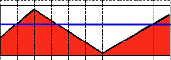

新的接口比旧版少一个参数——**结果直接作为返回值**，不用再先建一个空 Mat 当出参：

```{r}
#设定一个随机种子，保证每次生成的矩阵一样
set.seed(123)
#生成一个10行10列的随机矩阵，随机数来自均值为50、标准差为20的正态分布
img_mat = matrix(round(rnorm(100,mean = 50,sd = 20)),nr = 10,nc = 10)

#把 R 矩阵搬进 cvMat
img = Mat(10,10,CV_8UC1)
img[] = img_mat
```

### 二值化阈值

$$
dst(x,y) = \begin{cases} maxVal & if \; src(x,y)>thresh \\0 & otherwise \end{cases}
$$

高于阈值的像素设为 `maxVal`，其余设为 0。

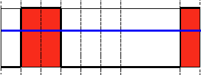

```{r}
#超过 50 的取 255，小于等于 50 的取 0
dst = cv_threshold(img,50,255,THRESH_BINARY)

#转回 R 矩阵方便看
dst_mat = as_array(dst,numeric = TRUE)
```

原像素值：

```{r echo=FALSE}
knitr::kable(img_mat)
```

二值化后的像素值：

```{r echo=FALSE}
knitr::kable(dst_mat)
```

### 逆二值化阈值

$$
dst(x,y) = \begin{cases} 0 & if \; src(x,y)>thresh \\maxVal & otherwise \end{cases}
$$

刚好和二值化相反：高于阈值取 0，其余取 `maxVal`。

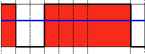

```{r}
dst_inv = cv_threshold(img,50,255,THRESH_BINARY_INV)
as_array(dst_inv,numeric = TRUE)
```

### 截断

$$
dst(x,y) = \begin{cases} thresh & if \; src(x,y)>thresh \\src(x,y) & otherwise \end{cases}
$$

高于阈值的**压到阈值**，低于的保持原样。注意这时 `maxVal` 根本用不上。

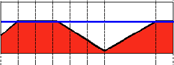

```{r}
dst_trunc = cv_threshold(img,50,255,THRESH_TRUNC)
as_array(dst_trunc,numeric = TRUE)
```

### 下折断（阈值以下为 0）

$$
dst(x,y) = \begin{cases} src(x,y) & if \; src(x,y)>thresh \\0 & otherwise \end{cases}
$$

低于阈值的清成 0，高于的保持原样。

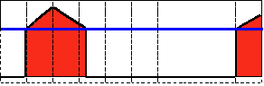

```{r}
dst_zero = cv_threshold(img,50,255,THRESH_TOZERO)
as_array(dst_zero,numeric = TRUE)
```

### 上折断（阈值以上为 0）

$$
dst(x,y) = \begin{cases} 0 & if \; src(x,y)>thresh \\src(x,y) & otherwise \end{cases}
$$

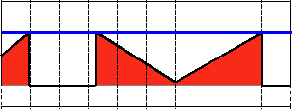

```{r}
dst_zero_inv = cv_threshold(img,50,255,THRESH_TOZERO_INV)
as_array(dst_zero_inv,numeric = TRUE)
```

### 五种模式放在一起看

单独看每个结果容易糊，把同一张图、同一个阈值下的五种输出并排比一下：

```{r}
# 同一个阈值，五种模式
types = c(THRESH_BINARY,THRESH_BINARY_INV,THRESH_TRUNC,
          THRESH_TOZERO,THRESH_TOZERO_INV)
names(types) = c("BINARY","BINARY_INV","TRUNC","TOZERO","TOZERO_INV")

# 每种模式输出里出现过的值（升序）
sapply(types,function(t){
  v = as_array(cv_threshold(img,50,255,t),numeric = TRUE)
  paste(sort(unique(as.vector(v))),collapse = ",")
})
```

> 从取值集合就能看出五种模式的区别：
>
> | 模式 | 输出只可能是 |
> |---|---|
> | `BINARY` | `{0, 255}` |
> | `BINARY_INV` | `{0, 255}` |
> | `TRUNC` | 原值里 ≤50 的那些，加上 50 |
> | `TOZERO` | `0`，加上原值里 >50 的那些 |
> | `TOZERO_INV` | 原值里 ≤50 的那些，加上 `0` |
>
> `TRUNC` 和 `TOZERO` 最容易混：前者把高的**压低**，后者把低的**取为 0**。
> 两者的输出值域完全不同，看「最大值是不是还是 50」就能分辨。

### 阈值函数的返回值上挂着实际用的阈值

`cv_threshold()` 返回的 `cvMat` 上有个 `attr(x, "value")`，是**这次实际使用的阈值**。
自己指定阈值时它就是那个数：

```{r}
attr(cv_threshold(img,50,255,THRESH_BINARY),"value")
```

这个属性在自动阈值（Otsu）时才真正有用：

```{r}
#THRESH_OTSU 是个标志位，和基本模式按位或
dst_otsu = cv_threshold(img,0,255,THRESH_BINARY + THRESH_OTSU)

#Otsu 算出来的阈值是多少？
attr(dst_otsu,"value")
```

> 当阈值是 Otsu 时，通常传入0即可——反正会被覆盖。想获取真正用的那个数，
> 可以读 `attr(x, "value")`，因为 `cv_threshold()` 只返回图像，没有第二个返回值。
>
> 这跟 10 章 `cap$read()` 的约定相同：**有返回值又有「额外信息」要报告时，
> 额外信息挂在返回值的 `attr(x, "value")` 上。**

### 综合示例：滑动条实时调阈值

把阈值和模式都做成滑动条，边拖边看。这是 OpenCV 教程里的经典写法，需要窗口，
所以在 Rmd 里不执行：

```{r eval=FALSE}
#阈值运算类型：0 二值化 / 1 逆二值化 / 2 截断 / 3 下折断 / 4 上折断
Threshold_Demo = function(val){
  threshold_type  = cv_getTrackbarPos(trackbar_type,window_name)
  threshold_value = cv_getTrackbarPos(trackbar_value,window_name)

  dst = cv_threshold(src,threshold_value,255,threshold_type)
  cv_imshow(window_name,dst)
}

window_name    = "Threshold Demo"
trackbar_type  = "Type:"
trackbar_value = "Value:"

#造一张从左到右 0..255 的横向渐变图，拖滑动条时变化最直观
arr = matrix(0,nr = 512,nc = 512)
for(i in 1:256){
  arr[2*i-1,] = i-1
  arr[2*i,]   = i-1
}
src = Mat(512,512,CV_8UC1)
src[] = arr

cv_namedWindow(window_name,WINDOW_AUTOSIZE)
cv_createTrackbar(trackbar_type, window_name,3,4,Threshold_Demo)
cv_createTrackbar(trackbar_value,window_name,0,255,Threshold_Demo)

#两条都在了，画第一帧
Threshold_Demo(0)
```


### 综合示例：只对局部区域做阈值

思路是「复制一份 → 取感兴趣区域 → 在副本上阈值 → 写回原位置」。关键在于
**ROI 是视图，不是拷贝**：`cv_mat_roi()` 返回的 Mat 和原图共享同一块像素，
所以写进 ROI 就等于写进原图。

```{r}
#以灰度模式读图
src = cv_imread("images/chicky_512.png",IMREAD_GRAYSCALE)
dim(src)

#复制一份，别把原图画花
res = cv_copyTo(src)

#取小狗头部那块区域（x, y, w, h）
roi = cv_mat_roi(res,c(150,70,250,280))
dim(roi)

#只对 ROI 做阈值
roi_th = cv_threshold(roi,128,255,THRESH_BINARY)

#把结果写回 ROI。因为 roi 是视图，res 里对应区域也跟着变
invisible(cv_copyTo(roi_th,dst = roi))
```

```{r}
#验证：ROI 区域变成二值，区域外一点没动
res_arr = as_array(res,numeric = TRUE)
src_arr = as_array(src,numeric = TRUE)

c(roi_is_binary = all(res_arr[71:350,151:400] %in% c(0,255)),
  outside_same  = identical(res_arr[1:60,1:60],src_arr[1:60,1:60]))
```

```{r echo=FALSE}
#把 ROI 框出来，方便对照
#src 是灰度图，直接在上面画 c(0,0,255) 只会用到第一个分量（黑）；
#先转成 BGR，框才是红的
vis = cv_cvtColor(src,COLOR_GRAY2BGR)
vis = cv_rectangle(vis,c(150,70,250,280),c(0,0,255),3)

op = par(mfrow = c(1,3),mar = c(1,1,2,1))
plot(vis)
title(main = "原图（红框是 ROI）")
plot(roi)
title(main = "ROI 内部")
plot(res)
title(main = "只有 ROI 被阈值化")
par(op)
```

> 这里需要留意：
>
> 1. **`res = cv_copyTo(src)` 不能省。** 直接 `res = src` 是浅拷贝，阈值化的结果会把原图也改掉（第 12 章开头详细讲过）
> 2. **`cv_mat_roi(m, c(x,y,w,h))` 是视图。** 在它上面画、阈值、滤波，都会反映到
>    `m` 上。想「独立处理一块再贴回去」，先 `cv_copyTo` 再取 ROI。
> 3. **`cv_copyTo(src, dst = roi)` 把结果写进指定位置**，默认是新建一个 Mat 返回。
>    第二个参数是 `mask`，第三个才是 `dst`，用命名参数写不会搞错。


## 使用inRange进行阈值运算

### HSV色彩空间

HSV（hue，saturation，value）颜色空间是一种表示颜色空间的模型，类似于RGB颜色模型。由于使用色调通道对颜色类型进行建模，因此在需要根据颜色分割对象的图像处理任务中非常有用。饱和度的变化从不饱和到表示灰度和完全饱和（无白色成分）。值通道描述颜色的亮度或强度。下一幅图显示了HSV柱体。

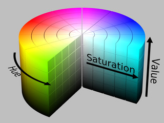

由于RGB颜色空间中的颜色是使用三个通道进行编码的，因此基于颜色分割图像中的对象更加困难。

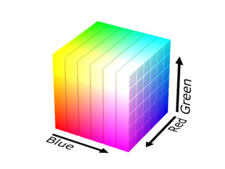

关于使用**cvtColor**函数从一个颜色空间转换到另一个颜色空间的公式在"颜色转换"中有说明。

### 计算BGR颜色空间中指定颜色对应的HSV颜色值

BGR中的蓝色映射到HSV颜色空间：

```{r}
#生成只含一个像素的OpenCV图像矩阵img
img = Mat(1,1,CV_8UC3)
#将像素值设定为蓝色
img[1,1] = c(255,0,0)

#将img的颜色空间从BGR转为HSV
hsv = cv_cvtColor(img,COLOR_BGR2HSV)

#取出这个像素的 H、S、V 三个分量
v = as_array(hsv,numeric = TRUE)[1,1,]
names(v) = c("H","S","V")
v
```

结果表明：BGR颜色空间中的蓝色映射到HSV颜色空间后为 `(120,255,255)`，即 H 分量为 120，S 和 V 分量都为 255。

> **8 位图像的 H 是「角度 ÷ 2」。**
>
> HSV 中 H 的物理范围是 0°~360°，但 `CV_8U` 只能装 0~255。
> OpenCV 的做法是把 H 压缩到 **0~180**，每个单位代表 2°。
> 所以蓝色（240°）记作 120，绿色（120°）记作 60，红色（0°）记作 0。
> 这个「除以 2」是后面所有 H 区间都必须遵守的约定——
> 滑动条上界写 `360/2` 而不是 360，原因就在这里。

将 `img[1,1] = c(255,0,0)` 换成绿色 `c(0,255,0)` 和红色 `c(0,0,255)`，可以一次算完：

```{r}
#三种纯色一起算：每行是 BGR 输入，结果每行是对应的 HSV
bgr = rbind(c(255,0,0), c(0,255,0), c(0,0,255))
rownames(bgr) = c("蓝","绿","红")

t(apply(bgr,1,function(val){
  m = Mat(1,1,CV_8UC3)
  m[1,1] = val
  px = as_array(cv_cvtColor(m,COLOR_BGR2HSV),numeric = TRUE)[1,1,]
  setNames(px,c("H","S","V"))
}))
```

即：绿色映射为 `(60,255,255)`，红色映射为 `(0,255,255)`，三者的 S、V 都是 255。

进一步，可以把这段封装成函数，计算 BGR 颜色空间中任一颜色对应的 HSV 颜色值：

```{r}
bgr2hsv = function(bgr_val){
  if(length(bgr_val) != 3){
    stop("需要蓝色、绿色和红色三个颜色分量")
  }
  #只含一个像素的图像
  img = Mat(1,1,CV_8UC3)
  #注意是 1 起索引
  img[1,1] = bgr_val

  #转色彩空间：返回值就是结果，不用先建空 Mat 当出参
  hsv = cv_cvtColor(img,COLOR_BGR2HSV)

  #取出像素值并命名
  v = as_array(hsv,numeric = TRUE)[1,1,]
  names(v) = c("H","S","V")
  v
}

#调用示例：BGR(60,120,90) 是一种偏绿的灰色
bgr2hsv(c(60,120,90))
```

### 用 inRange 提取指定颜色

**示例**

```{r}
#300 X 300 的黑色图像（Mat() 默认全 0，不需要 Mat_zeros）
img = Mat(300,300,CV_8UC3)
#红色填充圆
invisible(cv_circle(img,c(50,50),45,c(0,0,255),-1))
#绿色填充矩形
invisible(cv_rectangle(img,c(100,100),c(180,180),c(0,255,0),-1))
#蓝色填充三角形：三个顶点写成三行
tri = rbind(c(200,200),c(280,280),c(280,200))
invisible(cv_fillPoly(img,list(tri),c(255,0,0)))
```

```{r echo=FALSE}
plot(img)
title(main = "三个彩色图形")
```

下面的代码把红色填充圆挑出来：

```{r}
#设定HSV颜色空间中待识别的颜色范围（针对红色）
lower = c(-10,255,255)
upper = c( 10,255,255)

#将img的颜色空间由BGR转为HSV
hsv = cv_cvtColor(img,COLOR_BGR2HSV)

#逐像素判断是否落在 [lower, upper] 区间内，返回 0/255 的单通道掩膜
mask = cv_inRange(hsv,lower,upper)

#用掩膜和原图做按位与：掩膜为 255 的位置保留原色，为 0 的位置变黑
dst = cv_bitwise_and(img,img,mask = mask)

#掩膜中非零像素的个数
sum(as_array(mask,numeric = TRUE) > 0)
```

```{r echo=FALSE}
plot(dst)
title(main = "只保留红色圆")
```

挑出来的正是那个圆：`6361` 个像素，而半径 45 的圆面积是 `pi * 45^2 = 6362`，
差的 1 个像素来自栅格化时的边界取整。

将区间改为绿色：

```{r}
#设定HSV颜色空间中待识别的颜色范围（针对绿色）
lower = c(50,255,255)
upper = c(70,255,255)
```

```{r echo=FALSE}
mask_g = cv_inRange(hsv,lower,upper)
dst_g  = cv_bitwise_and(img,img,mask = mask_g)
plot(dst_g)
title(main = "只保留绿色矩形")
```

挑出的是矩形：`6561` 个像素，`81 * 81 = 6561`，边长 81 是因为 `100..180` 两端都含。

再将区间改为蓝色：

```{r}
#设定HSV颜色空间中待识别的颜色范围（针对蓝色）
lower = c(110,255,255)
upper = c(130,255,255)
```

```{r echo=FALSE}
mask_b = cv_inRange(hsv,lower,upper)
dst_b  = cv_bitwise_and(img,img,mask = mask_b)
plot(dst_b)
title(main = "只保留蓝色三角形")
```

三角形 `3321` 个像素，直角边为 80 的等腰直角三角形面积是 `80 * 80 / 2 = 3200`，其余是边界像素。

> **两个必须知道的陷阱。**
>
> **一、红色的色调是环绕的。**
>
> 红色在 H 轴上不在中间，而是被 0/180 这条接缝劈成两半：
> 纯红是 `H = 0`，但稍暗一点的红（`BGR(20,0,200)`）算出来是 `H = 177`。
> 单个区间 `[-10,10]` 抓不到 177，于是一张图里的「红」只被挑出一部分。
> 而 `inRange` 只能表达一个矩形区间，所以红色必须**分两段取、再并起来**：
>
> ```{r}
> #一段管 0 附近，一段管 180 附近，最后取并集
> m_lo = cv_inRange(hsv,c(  0,100,100),c( 10,255,255))
> m_hi = cv_inRange(hsv,c(170,100,100),c(180,255,255))
> mask_red = cv_bitwise_or(m_lo,m_hi)
> invisible(mask_red)
> ```
>
> 实测：一张图里并排放纯红 `H=0`、暗红 `H=177`、橙红 `H=7` 三块，
> 单区间 `[-10,10]` 只选中 2 块；两段并集选中全部 3 块
> （`30603` 个像素，正好是 `3 * 101 * 101`）。
>
> **二、`255` 当下界等于「必须拉满」。**
>
> 书上写 `lower = Scalar(-10,255,255)`，意思是 S 和 V 都**不得低于 255**，
> 也就是只接受「饱和度满、亮度满」的纯色。
> 对上面这种程序画出来的纯色图没问题，换成照片就几乎什么都选不到。
> 实际使用的时候 S、V 的下界一般给 50~100，再按需微调。
>
> 顺带一提，负下界 `-10` 不会报错，`CV_8U` 下会被截断成 0，
> 所以 `[-10,10]` 实际等价于 `[0,10]`——它并不能解决环绕问题。

### 交互式调参

```{r eval=FALSE}
#窗口标题
win_name = "Object Detection"

#滑动条回调：任何一条滑动条动了都会调到这里
onScroll = function(val, param){
  low_H  = cv_getTrackbarPos("LowH", win_name)
  high_H = cv_getTrackbarPos("HighH",win_name)
  low_S  = cv_getTrackbarPos("LowS", win_name)
  high_S = cv_getTrackbarPos("HighS",win_name)
  low_V  = cv_getTrackbarPos("LowV", win_name)
  high_V = cv_getTrackbarPos("HighV",win_name)

  #按当前六条滑动条的值取掩膜
  mask = cv_inRange(frame_HSV,
                    c(low_H, low_S, low_V),
                    c(high_H,high_S,high_V))
  #按掩膜保留原色
  dst = cv_bitwise_and(frame,frame,mask = mask)
  #显示结果
  cv_imshow(win_name,dst)
}

#读取图像文件并转为HSV
frame     = cv_imread("images/balloon.png")
frame_HSV = cv_cvtColor(frame,COLOR_BGR2HSV)

#创建图形窗口
cv_namedWindow(win_name,WINDOW_AUTOSIZE)

#H 的上界是 180 而不是 360——8 位图像的 H 是角度除以 2
cv_createTrackbar("LowH", win_name,  0, 180, onScroll)
cv_createTrackbar("HighH",win_name, 10, 180, onScroll)
cv_createTrackbar("LowS", win_name,  0, 255, onScroll)
cv_createTrackbar("HighS",win_name,255, 255, onScroll)
cv_createTrackbar("LowV", win_name,  0, 255, onScroll)
cv_createTrackbar("HighV",win_name,255, 255, onScroll)

#六条都在了，先画一次
onScroll(0,0)
```

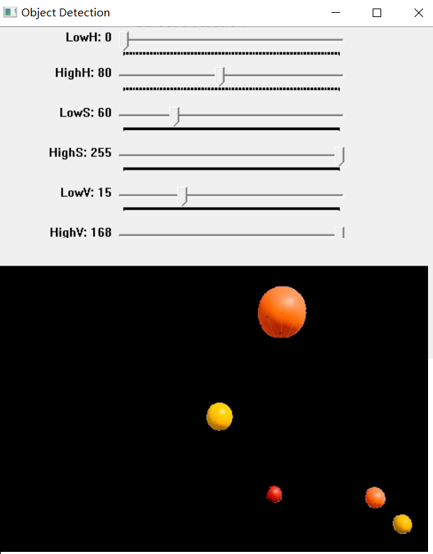


## 漫水填充

漫水填充法是一种用特定的颜色填充联通区域，通过设置可连通像素的上下限以及连通方式来达到不同的填充效果的方法。漫水填充经常被用来标记或分离图像的一部分以便对其进行进一步处理或分析，也可以用来从输入图像获取掩码区域，掩码会加速处理过程，或只处理掩码指定的像素点，操作的结果总是某个连续的区域。

**示例**

对如下图像中的白色棋子、黑色棋子、硬币、铅笔和打火机进行漫水填充：

```{r echo=FALSE}
src = cv_imread("images/stuff.jpg",0)
plot(src,main = "原图（灰度）")
```

五个种子点分别落在这五件东西上。先确认一下取到的确实是它们——
注意 `seedPoint` 用的是 `c(x, y)`，而图像下标是 `img[行, 列]`，
两者**顺序相反**，所以种子点 `(x, y)` 对应的像素是 `img[y+1, x+1]`（下标 1 起）：

```{r}
#种子点一律写成 c(x, y)，和 cv_floodFill 的 seedPoint 约定保持一致
p  = list(c(390,180), c(230, 60), c(203,308), c(196,174), c(336,386))
nm = c("白色棋子","黑色棋子","硬币","铅笔","打火机")

#取种子点的灰度值：img[y+1, x+1]
v = sapply(p,function(q) as.integer(src[q[2]+1, q[1]+1]))
names(v) = nm
v
```

白色棋子处是 248（接近纯白），黑色棋子处是 49，铅笔处是 40，
和肉眼看到的一致，说明坐标没搞反。

```{r}
#读取图像文件(以灰度图方式)
src = cv_imread("images/stuff.jpg",0)

#深拷贝：cv_floodFill 是原地修改，不拷贝会把 src 画花
dst = cv_copyTo(src)

#每个区域允许的灰度偏差：loDiff 往下、upDiff 往上
lo = c(1,1,4,5,3)
up = c(3,3,4,5,3)

#依次对五个区域填充
area = numeric(length(p))
for(k in seq_along(p)){
  r = cv_floodFill(dst,
                   seedPoint = p[[k]],
                   newVal    = c(128),
                   loDiff    = c(lo[k]),
                   upDiff    = c(up[k]))
  area[k] = r$value
}
names(area) = nm
area
```

```{r echo=FALSE}
op = par(mfrow = c(1,2), mar = c(1,1,2,1))
plot(src)
title(main = "原图")
plot(dst)
title(main = "五个区域填成 128")
par(op)
```

五个区域分别填了 8402、2857、916、2306、2756 个像素，合计 17237。
原图本来就有 1305 个像素恰好是 128，所以结果图里值为 128 的像素一共 18542 个。


## 图像平滑

图像平滑，也称为图像模糊，是一种简单而常用的图像处理操作。平滑的作用很多，包括减少噪声（其他用途将在后续内容中看到）。平滑操作涉及到应用滤波器——也常被叫做内核、卷积核、核矩阵、掩码矩阵，最常见的滤波器类型是线性的。

设滤波器$M$的行数和列数分别为$m$和$n$，其锚点横坐标为$anchor_x$，纵坐标为$anchor_y$，则在图像$I$上使用此滤波器时，相应的计算公式为：

$$
I_1(i,j) = \sum_{r=0} ^{m-1} \sum_{c=0}^{n-1} I(i-anchor_y+r,j-anchor_x+c) \times M(r,c) 
$$
公式中的输出像素值（$I_1(i,j)$）是由输入像素值（例如$I(i-anchor_x+r,j-anchor_y+c)$）以$M$的对应元素为权重进行的加权求和。  


平滑的具体操作是：首先依据滤波器尺寸以及锚点所在的位置，扩展图像边缘，而后在（边缘扩展后的）图像矩阵上，按行按列移动滤波器，每次移动都让滤波器的锚点对准（边缘扩展前的）图像矩阵的一个像素，并对滤波器“掩盖住”的所有像素值与对应滤波器位置的权值相乘并求和，如此遍历完所有像素（这里的所有像素，指的是边缘扩展前的图像矩阵的所有像素）。每次移动，锚点对准的像素称为目标像素，滤波器“掩盖”住的像素都称为目标像素的领域像素，这些领域像素按原有位置形成的矩阵称为目标像素的领域像素矩阵，也可以称为滤波器的目标区域，每次的滤波计算结果称为目标像素的滤波输出值。

图像平滑其实是前面所讲的图像矩阵的掩码运算，所以上面的公式还可以表达成如下两种形式：

$$
I_1(i,j) = I_{neighbour} \otimes M 
$$

$$
I_1 = I \otimes M 
$$
其中，$I_{neighbour}$表示目标像素$(i,j)$的邻域像素矩阵。$\otimes$符号表示两个矩阵对应元素相乘再求和


### 常用滤波器

#### 归一化盒子滤波器

归一化盒子滤波器形状如下：

$$
M=\frac {1}{width \cdot height} \left[ \begin{matrix} 1  & 1 & \cdots & 1 \\ 1 & 1 & \cdots & 1 \\ \cdots & \cdots & \cdots & \cdots \\ 1 & 1 & \cdots & 1  \end{matrix} \right]
$$

其中：$width$和$height$表示滤波器的宽度和高度（也即是相应滤波矩阵的列数和行数）。

在归一化盒子滤波器下，每个目标像素的输出值都是其领域像素值的平均值（目标像素的所有领域像素的权重相等）。


OpenCV将归一化盒子滤波器封装在了**blur**函数中：

```{r}
#https://blog.csdn.net/qq_41498261/article/details/101168155
#生成矩阵img_mat
img_mat = matrix(1:9,nr=3,nc=3)
#将img_mat写入图像矩阵img
img = Mat(3,3,CV_32FC1)
img[] = img_mat

#使用blur函数对img进行归一化盒子滤波，滤波器为3行3列矩阵
blur_out = cv_blur(img,c(3,3))

#查看blur_out
round(as_array(blur_out,numeric = TRUE),2)
```

可以通过以下代码来验证这个结果：

```{r}
#生成矩阵img_mat
img_mat = matrix(1:9,nr=3,nc=3)
#将img_mat写入图像矩阵img
img = Mat(3,3,CV_32FC1)
img[] = img_mat

#按BORDER_DEFAULT方式扩展图像边缘：
#对于3行3列且锚点在中心位置的滤波器，只需上下各扩展1行，左右各扩展1列即可
img_borderadded = cv_copyMakeBorder(img,1,1,1,1,BORDER_DEFAULT)

#转成R语言的矩阵
img_borderadded_mat = as_array(img_borderadded,numeric = TRUE)

#res_mat先初始化为img_borderadded_mat
res_mat = img_borderadded_mat
#设定滤波器的行数和列数
m = 3
n = 3
#设定滤波器的锚点为其中心点
anchor_x = 1
anchor_y = 1
#生成归一化盒子滤波器
M = 1/(3*3)*matrix(1,nr=m,nc=n)

#移动滤波器，计算目标像素的输出值，并保存在res_mat的对应位置中
for(i in 2:(nrow(res_mat)-1)){
  for(j in 2:(ncol(res_mat)-1)){
    #取出目标像素的领域像素矩阵，保存在tmp中
    tmp = img_borderadded_mat[(i-anchor_y):(i-anchor_y+m-1),
                              (j-anchor_x):(j-anchor_y+n-1)]
    #计算目标像素的滤波输出值
    res_mat[i,j] = sum(tmp * M)
  }
}
#去除扩展的边缘
res_mat = res_mat[-c(1,5),-c(1,5)]
#查看结果
round(res_mat,2)
```

两者完全一致。顺带说明：`BORDER_DEFAULT` 等价于 `BORDER_REFLECT_101`，
也就是以边缘为轴**不含边缘本身**地镜像。把 `1:9` 扩一圈就能看清：

```{r}
img = Mat(3,3,CV_32FC1)
img[] = matrix(1:9,nr=3,nc=3)

#上下左右各扩 1 行/列，得到 5x5
as_array(cv_copyMakeBorder(img,1,1,1,1,BORDER_DEFAULT),numeric = TRUE)
```

中间的 3x3 是原矩阵，外面一圈是镜像出来的：
左上角的 5 是「1 的右邻居 4」和「1 的下邻居 2」继续镜像的结果，
而 1 本身不会出现在边框里——这就是 `REFLECT_101` 和 `REFLECT` 的区别。

#### 高斯滤波器

高斯滤波器的计算公式如下：

$$
\begin{aligned}
M_0(x,y) &= e^{-\frac{(x-anchor_x)^2}{2\sigma_x^2} - \frac{(y-anchor_y)^2}{2\sigma_y^2}} \quad x,y=0,1,2,\dots,k-1 \\
M(x,y) &= \frac {G_0(x,y)}{sum(M_0)}
\end{aligned}
$$
其中$k$为滤波器尺寸（即滤波器矩阵的行数和列数都为$k$），$anchor_x$和$anchor_y$为滤波器锚点的横纵坐标，$sigma_x$和$sigma_y$分别为横向和纵向的标准差，$sum(M_0)$为$M_0$中所有元素之和。

参照公式，如下代码可以形成3行3列的高斯滤波器：

```{r}
#生成3行3列的全0矩阵
M0 = matrix(0,nr=3,nc=3)
#设定锚点横、纵坐标都为1
anchor_x = 1
anchor_y = 1
#设定横向、纵向标准差分别1.5和2.0
sigma_x = 1.5
sigma_y = 2.0
#计算M0的各个元素
for(y in 0:2){
  for(x in 0:2){
    M0[y+1,x+1] = exp(-(x-anchor_x)^2/(2*sigma_x^2)-(y-anchor_y)^2/(2*sigma_y^2))
  }
}
#获得滤波器M
M = M0/sum(M0)
#查看滤波器
round(M,4)
```

可以通过矩阵运算代替循环：

```{r}
#生成滤波器像素的列标矩阵
xpos_mat = matrix(rep(0:2,each=3),nr=3,nc=3)
#生成滤波器像素的行标矩阵
ypos_mat = matrix(rep(0:2,times=3),nr=3,nc=3)

#设定锚点横、纵坐标都为1
anchor_x = 1
anchor_y = 1

M0 = exp(-(xpos_mat - anchor_x)^2/(2*1.5^2)-(ypos_mat - anchor_y)^2/(2*2.0^2))
M = M0/sum(M0)
round(M,4)
```

依据指数函数的运算规律，可以对计算$M_0$的公式进行变形：

$$
\begin{aligned}
M_0(x,y) &= e^{-\frac{(x-anchor_x)^2}{2\sigma_x^2} - \frac{(y-anchor_y)^2}{2\sigma_y^2}} \quad x,y=0,1,2,\dots,k-1 \\
&=e^{-\frac{(x-anchor_x)^2}{2\sigma_x^2}} \times e^{-\frac{(y-anchor_y)^2}{2\sigma_y^2}}
\end{aligned}
$$
即$M_0$可以分解成两部分，而这两部分可以近似认为是横向和纵向的一维高斯滤波器。在OpenCV中，可以使用**getGaussianKernel**生成一维高斯滤波器，而两个一维高斯滤波器按矩阵乘法相乘后，可以得到二维高斯滤波器。

```{r}
#生成一维（横向）高斯滤波器Gx
Gx = cv_getGaussianKernel(3,1.5)
#生成一维（纵向）高斯滤波器Gy
Gy = cv_getGaussianKernel(3,2.0)

#两个 cvMat 直接 %*% 即可，t() 也有 cvMat 的方法
G = Gy %*% t(Gx)
round(as_array(G,numeric = TRUE),4)
```

> `cv_getGaussianKernel` 返回的是 `CV_64FC1` 的列向量（3 行 1 列），
> `t(Gx)` 得到 1 行 3 列。两者相乘是**矩阵乘法**，得到一个 3 行 3 列的
> 二维高斯核——注意顺序是 `Gy %*% t(Gx)`，反过来得到的是它的转置。


OpenCV将高斯滤波器封装在了**GaussianBlur**函数中：

```{r}
#生成矩阵img_mat
img_mat = matrix(1:9,nr=3,nc=3)
#将img_mat写入图像矩阵img
img = Mat(3,3,CV_32FC1)
img[] = img_mat

#使用GaussianBlur函数对img进行高斯滤波，
#横向标准差为1.5，纵向标准差为2.0
blur_out = cv_GaussianBlur(img,c(3,3),1.5,2.0)

#查看blur_out
round(as_array(blur_out,numeric = TRUE),4)
```

可以通过以下代码来验证这个结果：

```{r}
#生成矩阵img_mat
img_mat = matrix(1:9,nr=3,nc=3)
#将img_mat写入图像矩阵img
img = Mat(3,3,CV_32FC1)
img[] = img_mat

#按BORDER_DEFAULT方式扩展图像边缘
img_borderadded = cv_copyMakeBorder(img,1,1,1,1,BORDER_DEFAULT)

#转成R语言的矩阵
img_borderadded_mat = as_array(img_borderadded,numeric = TRUE)

#res_mat先初始化为img_borderadded_mat
res_mat = img_borderadded_mat
#设定滤波器的行数和列数
m = 3
n = 3
#设定滤波器的锚点为其中心点
anchor_x = 1
anchor_y = 1
#生成高斯滤波器：纵向标准差2.0，横向标准差1.5
ker = cv_getGaussianKernel(m,2.0) %*% t(cv_getGaussianKernel(n,1.5))
ker_mat = as_array(ker,numeric = TRUE)

#移动滤波器，计算目标像素的滤波输出值，并保存在res_mat的对应位置中
for(i in 2:(nrow(res_mat)-1)){
  for(j in 2:(ncol(res_mat)-1)){
    #取出目标像素的领域像素矩阵，保存在tmp中
    tmp = img_borderadded_mat[(i-anchor_y):(i-anchor_y+m-1),
                              (j-anchor_x):(j-anchor_y+n-1)]
    #将tmp与滤波器ker的对应元素相乘再求和，得到目标像素的滤波输出值
    res_mat[i,j] = sum(tmp * ker_mat)
  }
}
#去除扩展的边缘
res_mat = res_mat[-c(1,5),-c(1,5)]
#查看结果
round(res_mat,4)
```

手算结果与 `cv_GaussianBlur` 的差在 `1.9e-7` 量级，纯粹是 `CV_32F`
的单精度舍入，可以认为完全一致。

#### 中值滤波器

中值滤波器会把目标像素的邻域像素矩阵的中值作为滤波输出值。

OpenCV将中值滤波器封装在了**medianBlur**函数中：

```{r}
#生成矩阵img_mat
img_mat = matrix(1:9,nr=3,nc=3)
#将img_mat写入图像矩阵img
img = Mat(3,3,CV_8UC1)
img[] = img_mat

#使用medianBlur函数对img进行中值滤波，滤波器为3行3列矩阵
blur_out = cv_medianBlur(img,3)

#查看blur_out
as_array(blur_out,numeric = TRUE)
```

可以通过以下代码来验证这个结果：

```{r}
#生成矩阵img_mat
img_mat = matrix(1:9,nr=3,nc=3)
#将img_mat写入图像矩阵img
img = Mat(3,3,CV_32FC1)
img[] = img_mat

#按BORDER_REPLICATE方式扩展图像边缘：
#对于3行3列且锚点在中心位置的滤波器，只需上下各扩展1行，左右各扩展1列即可
#注意这里的 bordertype 是 REPLICATE，不是 DEFAULT
img_borderadded = cv_copyMakeBorder(img,1,1,1,1,BORDER_REPLICATE)

#转成R语言的矩阵
img_borderadded_mat = as_array(img_borderadded,numeric = TRUE)

#res_mat先初始化为img_borderadded_mat
res_mat = img_borderadded_mat
#设定滤波器的行数和列数
m = 3
n = 3
#设定滤波器的锚点为其中心点
anchor_x = 1
anchor_y = 1
#移动滤波器，计算目标像素的滤波输出值，并保存在res_mat的对应位置中
for(i in 2:(nrow(res_mat)-1)){
  for(j in 2:(ncol(res_mat)-1)){
    #取出目标像素的领域像素矩阵，保存在tmp中
    tmp = img_borderadded_mat[(i-anchor_y):(i-anchor_y+m-1),
                              (j-anchor_x):(j-anchor_y+n-1)]
    #将tmp中的中位数作为目标像素的滤波输出值
    res_mat[i,j] = median(tmp)
  }
}
#去除扩展的边缘
res_mat = res_mat[-c(1,5),-c(1,5)]
#查看结果
res_mat
```

> 这里 `bordertype` 必须是 `BORDER_REPLICATE`（复制边缘像素），
> 不能用 `BORDER_DEFAULT`。`medianBlur` 内部就是这么扩边的。
> 换成 `BORDER_DEFAULT` 的话，左上角的中值会从 2 变成 4，对不上。
>
> 另外 `medianBlur` 对输入深度有要求：`CV_8U` 支持任意奇数 `ksize`，
> `CV_32F` 只支持 `ksize` 为 3 或 5。上面自动版本用 `CV_8UC1`、
> 手算版本用 `CV_32FC1` 且 `ksize = 3`，都在允许范围内。

#### 双边滤波器

归一化盒子滤波器、高斯滤波器和中值滤波器等能消除噪声，也会模糊边缘。为了保留边缘（至少在一定程度上），可以使用双边滤波器。

类似于高斯滤波器的方式，双边滤波器也会考虑像素分配的权重。这些权重有两个分量，第一个分量与高斯滤波器使用的权重相同。第二分量考虑相邻像素和被评估像素之间的强度差。

双边滤波公式：

$$
g(i,j)=\frac{\sum_{(k,l) \in S(i,j)}f(k,l)w(i,j,k,l)}{\sum_{(k,l) \in S(i,j)}w(i,j,k,l)}
$$
$g(i, j)$代表输出点；  
$S(i, j)$的是指以$(i,j)$为中心的$(2d+1) \times (2d+1)$的大小的范围；  
$f(k, l)$代表(多个)输入点；  
$w(i, j, k, l)$是两个高斯函数$w_s$和$w_r$的乘积，其中$w_s$为空间临近高斯函数，$w_r$为像素值相似度高斯函数：

$$
w=w_s \times w_r
$$

$$
w_s = e^{-\frac{(i-k)^2+(j-l)^2}{2 \sigma_s^2}}
$$


$$
w_r = e^{-\frac{|| f(i,j)-f(k,l) ||^2}{2 \sigma_r^2}}
$$
OpenCV将双边滤波器封装在了**bilateralFilter**函数中：

```{r}
#生成矩阵img_mat
img_mat = matrix(1:9,nr=3,nc=3)
#将img_mat写入图像矩阵img
img = Mat(3,3,CV_32FC1)
img[] = img_mat

#使用bilateralFilter函数对img进行双边滤波，
#邻域半径d=1，色彩标准差3，空间标准差3
blur_out = cv_bilateralFilter(img,d = 1,sigmaColor = 3,sigmaSpace = 3)

round(as_array(blur_out,numeric = TRUE),4)
```

可以通过如下基于双边滤波器原理的代码来验证：

```{r}
#生成矩阵img_mat
img_mat = matrix(1:9,nr=3,nc=3)
#将img_mat写入图像矩阵img
img = Mat(3,3,CV_32FC1)
img[] = img_mat

#设置邻域半径
d = 1
#设置滤波器的行数和列数
m = 2*d+1
n = 2*d+1

#按BORDER_DEFAULT方式扩展图像边缘，上下左右各扩展 d 行/列
img_borderadded = cv_copyMakeBorder(img,d,d,d,d,BORDER_DEFAULT)
img_borderadded_mat = as_array(img_borderadded,numeric = TRUE)

#res_mat先初始化为img_borderadded_mat
res_mat = img_borderadded_mat

#生成空间邻近高斯权重矩阵ws
#注意：位置矩阵本身就以 0 为中心（-d..d），不要再减锚点
xpos_mat = matrix(rep(-d:d,each=n),nr=m,nc=n)
ypos_mat = matrix(rep(-d:d,times=m),nr=m,nc=n)
ws = exp(-(xpos_mat^2 + ypos_mat^2)/(2*3^2))
#把圆形邻域之外（对角线上距离超过 d）的权重置 0
for(i in 1:m){
  for(j in 1:n){
    if(sqrt((i-(d+1))^2+(j-(d+1))^2) > d){
      ws[i,j] = 0
    }
  }
}

#移动滤波器，计算目标像素的滤波输出值，并保存在res_mat的对应位置中
for(i in (d+1):(nrow(res_mat)-d)){
  for(j in (d+1):(ncol(res_mat)-d)){
    #取出目标像素的邻域像素矩阵，保存在tmp中
    tmp = img_borderadded_mat[(i-d):(i+d),(j-d):(j+d)]
    #生成像素值相似度权重矩阵wr
    destPix = tmp[d+1,d+1]   #取出中心元素
    wr = exp(-(tmp-destPix)^2/(2*3^2))
    #计算滤波器w
    w = ws * wr
    w = w/sum(w)

    res_mat[i,j] = sum(tmp * w)
  }
}
#去除扩展的边缘
res_mat = res_mat[(d+1):(nrow(res_mat)-d),(d+1):(ncol(res_mat)-d)]
#查看结果
round(res_mat,4)
```

双边滤波真正有意思的地方是**保边**。拿一张人像试试：

```{r}
img = cv_imread("images/girl.png")
dst = cv_bilateralFilter(img,25,50,100)

op = par(mfrow = c(1,2),mar = c(1,1,2,1))
plot(img)
title(main = "原图")
plot(dst)
title(main = "双边滤波（d=25, σc=50, σs=100）")
par(op)
```

皮肤上的细小起伏被抹平了，但五官的轮廓还在——这正是它和高斯模糊的区别：
高斯模糊不分青红皂白地平均，双边滤波只在"颜色差不多"的邻居之间平均。

### 自定义滤波器

滤波器的形状可以是任意的，除以上常用的过滤器外，可以依据实际问题自定义各种滤波器，然后结合OpenCV的**filter2D**函数，实现相应的图像处理效果。比如：

```{r}
#读取图像文件
src = cv_imread("images/apple.jpg")

#自定义滤波器
kernel_mat = matrix(c(1,1,0, 1,-4,1, 0,1,1),nr=3,nc=3,byrow=TRUE)
kernel = Mat(3,3,CV_32F)
kernel[] = kernel_mat

#对src进行自定义滤波
dst = cv_filter2D(src,-1,kernel)
```

```{r echo=FALSE}
op = par(mfrow = c(1,2),mar = c(1,1,2,1))
plot(src,main = "原图")
plot(dst,main = "filter2D（自定义核）")
par(op)
```

自定义的核是：

```{r}
kernel_mat
```


**示例**

下面的例子把四种滤波器按尺寸从 1 到 31 依次作用于同一张图，每换一个尺寸就刷新一次窗口。

```{r eval=FALSE}
#设置标题显示时间为1500毫秒，即1.5秒
DELAY_CAPTION = 1500
#设置每次模糊效果的显示时间为500毫秒，即0.5秒
DELAY_BLUR = 500
#设置最大滤波器尺寸为31
MAX_KERNEL_LENGTH = 31
#设定图形窗口标题
window_name = "Smoothing Demo"

#在黑色背景图片上显示标题文字，表明图像处理的状态
display_caption = function(caption) {
  #和原图同尺寸的全黑图
  dst <<- Mat(dim(src)[1],dim(src)[2],CV_8UC3)
  cv_putText(dst,
             caption,
             c(dim(src)[2] %/% 4, dim(src)[1] %/% 2),
             FONT_HERSHEY_COMPLEX,
             1,
             c(255,255,255))
  display_dst(DELAY_CAPTION)
}

#显示图像处理结果
display_dst = function(delay) {
  cv_imshow(window_name, dst)
  cv_waitKey(delay)
}

#读入图像，存放在src中
src = cv_imread("images/girl.png")
#显示文字标题Original Image
display_caption("Original Image")

#将src深拷贝到dst
dst = cv_copyTo(src)
#显示dst（现在dst存放的就是原始图像src）
display_dst(DELAY_CAPTION)

#显示文字标题Homegeneous Blur
display_caption("Homegeneous Blur")

#使用归一化盒子滤波器（滤波器的尺寸逐渐变大）
for (i in seq(1, MAX_KERNEL_LENGTH, by = 2)) {
  dst = cv_blur(src,c(i,i))
  display_dst(DELAY_BLUR)
}

#显示文字标题Gaussian Blur
display_caption("Gaussian Blur")

#使用高斯滤波器（滤波器的尺寸逐渐变大）
for (i in seq(1, MAX_KERNEL_LENGTH, by = 2)) {
  dst = cv_GaussianBlur(src,c(i,i),0,0)
  display_dst(DELAY_BLUR)
}

#显示文字标题Median Blur
display_caption("Median Blur")

#使用中值滤波器（滤波器的尺寸逐渐变大）
for (i in seq(3, MAX_KERNEL_LENGTH, by = 2)) {
  dst = cv_medianBlur(src,i)
  display_dst(DELAY_BLUR)
}

#显示文字标题Bilateral Blur
display_caption("Bilateral Blur")

#使用双边滤波器（滤波器的尺寸逐渐变大，sigmaSpace和sigmaColor也逐渐增大）
for (i in seq(1, MAX_KERNEL_LENGTH, by = 2)) {
  dst = cv_bilateralFilter(src,i,i*2,i/2)
  display_dst(DELAY_BLUR)
}

#显示文字标题Done
display_caption("Done!")
```

**示例**

以下代码演示了通过**filter2D**函数使用归一化盒子滤波器进行滤波的情况。

```{r eval=FALSE}
#读取图像文件
src = cv_imread("images/apple.jpg")

#将滤波器尺寸存放在kernel_size中（初始值为1）
kernel_size = 1
# 原书是 while(TRUE) 靠 waitKey 读 ESC，这里固定跑 6 轮（正好覆盖 ksize = 3,5,7,9,11 再回到 1），
# 免得有人把 eval 改成 TRUE 之后卡在死循环里
for (step in 1:6){
  #如果kernel_size的值超过11，则重新设置为1
  if(kernel_size>11){
    kernel_size = 1
  }
  #kernel_size的值累加2
  kernel_size = kernel_size + 2
  #生成高度和宽度都为kernel_size的归一化盒子滤波器
  kernel_mat = matrix(1/(kernel_size*kernel_size),
                  nr=kernel_size,nc=kernel_size)
  kernel = Mat(kernel_size,kernel_size,CV_32F)
  kernel[] = kernel_mat

  #对src进行滤波
  dst = cv_filter2D(src,-1,kernel)

  #在标题为filter2D Demo的图形窗口中显示dst
  cv_imshow("filter2D Demo",dst)

  #等待0.5秒，若用户按下esc键，则循环终止
  cc = cv_waitKey(500)
  if(cc == 27){
    break
  }
}
```

## 形态学的结构核

形态学是一组基于预定义结构元素处理图像的操作。这里的预定义结构元素是一个向量或者矩阵，也常称为结构核，结构核的高度与宽度指的是相应矩阵的行数和列数——通常，结构核的尺寸都使用奇数。每个结构核都有一个锚点，默认情况下位于其中心点处，而锚点在矩阵中的行、列位置分别称为锚点的纵坐标和横坐标。结构核中的非零元素称为有效元素。

形态学的具体操作是：首先依据结构核尺寸以及锚点所在的位置，扩展图像边缘，而后在（边缘扩展后的）图像矩阵上，按行按列移动结构核，每次移动都让结构核的锚点对准（边缘扩展前的）图像矩阵的一个像素，并对结构核有效元素“掩盖住”的所有像素值进行对应的形态计算，如此遍历完所有像素（这里的所有像素，指的是边缘扩展前的图像矩阵的所有像素）。每次移动，锚点对准的像素称为目标像素，结构核“掩盖”住的像素都称为目标像素的邻域像素，这些邻域像素按原有位置形成的矩阵称为目标像素的邻域像素矩阵，也可以称为结构核的目标区域，每次的形态计算结果称为目标像素的形态输出值。

OpenCV的**getStructuringElement**函数可以生成矩形，十字形，椭圆盘（或者圆盘）等多种形状的结构核，并可以同时指定锚点位置：

```{r}
#生成矩形结构核
ele_rect = cv_getStructuringElement(MORPH_RECT,c(3,5))
as_array(ele_rect,numeric = TRUE)

#生成十字形结构核
ele_cross = cv_getStructuringElement(MORPH_CROSS,c(3,5))
as_array(ele_cross,numeric = TRUE)

#生成椭圆盘/圆盘结构核，且指定锚点位置为第2行第4列
ele_ellipse = cv_getStructuringElement(MORPH_ELLIPSE,c(7,7),anchor = c(1,3))
as_array(ele_ellipse,numeric = TRUE)
```


> 锚点只是记录在结构核上的元数据，**不改变核里 0/1 的分布**——
> 上面给椭圆盘指定 `anchor = c(1,3)` 之后，矩阵内容和默认锚点时一模一样。
> 它影响的是后面腐蚀/膨胀时核如何对齐目标像素。
>


还可以按照实际需求，生成各种形状的结构核（比如后面的直线结构核）

## 腐蚀与膨胀

腐蚀与膨胀是两个最基本的形态学操作，它们的结构核可以是如下$m$行$n$列的全1矩阵：

$$
S= \left[ \begin{matrix} 1  & 1 & \cdots & 1 \\ 1 & 1 & \cdots & 1 \\ \cdots & \cdots & \cdots & \cdots \\ 1 & 1 & \cdots & 1  \end{matrix} \right]_{m\times n}
$$

膨胀会给图像中物体的边界增加像素，而腐蚀则恰恰相反。添加或移除的像素量分别取决于用于处理图像的结构核的大小和形状。一般来说，这两个操作遵循的规则如下：

### 膨胀

膨胀操作的计算公式为：

$$
\begin{aligned}
I_1(i,j) &= \max_{r,c} I(i-anchor_y+r,j-anchor_x+c) \\
&r=0,1,\dots,m-1 ;c=0,1,\dots,n-1;S(r,c) \ne 0
\end{aligned}
$$

其中，$I$为输入图像，$S$为结构核，$anchor_x$和$anchor_y$和结构核锚点的横坐标和纵坐标，$m$和$n$为结构核的高度和宽度。从膨胀公式可以看出，目标像素的形态输出值是结构核有效元素所覆盖的图像像素的最大值。

以下图形展示了膨胀过程：

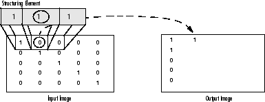

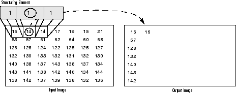

OpenCV将膨胀操作封装在了**dilate**函数中：

```{r}
#生成全0矩阵img_mat
img_mat = matrix(0,nr=3,nc=3)
#将img_mat的第1行第1列的值更改为1
img_mat[1,1] = 1
#将img_mat写入图像矩阵img
img = Mat(3,3,CV_8UC1)
img[] = img_mat

#生成膨胀结构核：3行3列的全1矩阵
ker = Mat(3,3,CV_8UC1)
ker[] = 1

#使用dilate函数对img进行膨胀操作
img_dilate = cv_dilate(img,ker)

#查看膨胀操作前的img
as_array(img,numeric = TRUE)
#查看膨胀操作后得到的img_dilate
as_array(img_dilate,numeric = TRUE)
```


可以通过以下代码来验证这个结果：

```{r}
#生成3行3列的全0矩阵img_mat
img_mat = matrix(0,nr=3,nc=3)
#将img_mat的第1行第1列的值更改为1
img_mat[1,1] = 1
#将img_mat写入图像矩阵img
img = Mat(3,3,CV_8UC1)
img[] = img_mat

#按BORDER_CONSTANT方式扩展图像边缘，扩展像素的值都为0
img_borderadded = cv_copyMakeBorder(img,1,1,1,1,BORDER_CONSTANT,value = c(0))

#转成R语言的矩阵
img_borderadded_mat = as_array(img_borderadded,numeric = TRUE)

#res_mat先初始化为img_borderadded_mat
res_mat = img_borderadded_mat
#设定结构核的行数和列数
m = 3
n = 3
#设定结构核的锚点为其中心点
anchor_x = 1
anchor_y = 1
#生成结构核
ker = matrix(1,nr=m,nc=n)

#移动结构核，计算目标像素的形态输出值，并保存在res_mat的对应位置中
for(i in 2:(nrow(res_mat)-1)){
  for(j in 2:(ncol(res_mat)-1)){
    #取出目标像素的领域像素矩阵，保存在tmp中
    tmp = img_borderadded_mat[(i-anchor_y):(i-anchor_y+m-1),
                              (j-anchor_x):(j-anchor_y+n-1)]
    #将tmp与结构核ker的对应元素相乘再求最大值，得到目标像素的形态输出值
    res_mat[i,j] = max(bitwAnd(tmp,ker))
  }
}
#去除扩展的边缘
res_mat = res_mat[-c(1,5),-c(1,5)]
#查看结果
res_mat
```

### 腐蚀

腐蚀操作的计算公式为：

$$
\begin{aligned}
I_1(i,j) &= \min_{r,c} I(i-anchor_y+r,j-anchor_x+c) \\
&r=0,1,\dots,m-1 ;c=0,1,\dots,n-1;S(r,c) \ne 0
\end{aligned}
$$

其中，$I$为输入图像，$S$为结构核，$anchor_x$和$anchor_y$和结构核锚点的横坐标和纵坐标，$m$和$n$为结构核的高度和宽度。从侵蚀公式可以看出，目标像素的形态输出值是结构核有效元素所覆盖的图像像素的最小值。

以下图形展示了侵蚀过程：


OpenCV将腐蚀操作封装在了**erode**函数中：

```{r}
#生成全0矩阵img_mat
img_mat = matrix(0,nr=3,nc=3)
#将img_mat的左上角四个元素的值更改为1
img_mat[1:2,1:2] = 1
#将img_mat写入图像矩阵img
img = Mat(3,3,CV_8UC1)
img[] = img_mat

#生成腐蚀结构核：3行3列的全1矩阵
ker = Mat(3,3,CV_8UC1)
ker[] = 1

#使用erode函数对img进行腐蚀操作
img_erode = cv_erode(img,ker,borderValue = c(255))

#查看腐蚀操作前的img
as_array(img,numeric = TRUE)
#查看腐蚀操作后得到的img_erode
as_array(img_erode,numeric = TRUE)
```


可以通过以下代码来验证这个结果：

```{r}
#生成全0矩阵img_mat
img_mat = matrix(0,nr=3,nc=3)
#将img_mat的左上角四个元素的值更改为1
img_mat[1:2,1:2] = 1
#将img_mat写入图像矩阵img
img = Mat(3,3,CV_8UC1)
img[] = img_mat

#按BORDER_CONSTANT方式扩展图像边缘，扩展像素的值都为1
#腐蚀是取最小值，边界填 0 会把整幅图腐蚀成 0，所以这里必须填 1（相当于"看不见边界"）
img_borderadded = cv_copyMakeBorder(img,1,1,1,1,BORDER_CONSTANT,value = c(1))

#转成R语言的矩阵
img_borderadded_mat = as_array(img_borderadded,numeric = TRUE)

#res_mat先初始化为img_borderadded_mat
res_mat = img_borderadded_mat
#设定结构核的行数和列数
m = 3
n = 3
#设定结构核的锚点为其中心点
anchor_x = 1
anchor_y = 1
#生成结构核
ker = matrix(1,nr=m,nc=n)

#移动结构核，计算目标像素的形态输出值，并保存在res_mat的对应位置中
for(i in 2:(nrow(res_mat)-1)){
  for(j in 2:(ncol(res_mat)-1)){
    #取出目标像素的领域像素矩阵，保存在tmp中
    tmp = img_borderadded_mat[(i-anchor_y):(i-anchor_y+m-1),
                              (j-anchor_x):(j-anchor_y+n-1)]
    #将tmp与结构核ker的对应元素相乘再求最小值，得到目标像素的形态输出值
    res_mat[i,j] = min(bitwAnd(tmp,ker))
  }
}
#去除扩展的边缘
res_mat = res_mat[-c(1,5),-c(1,5)]
#查看结果
res_mat
```

以下的示例展示了腐蚀、膨胀运算的一些应用效果：

**示例**

```{r}
#加载图像文件
img = cv_imread("images/letterJ.jpg")
#生成腐蚀结构核：11行11列的圆盘
kernel = cv_getStructuringElement(MORPH_ELLIPSE,c(11,11))
#对img进行腐蚀
dst = cv_erode(img,kernel,borderValue = c(255,255,255))
```

可以看到，腐蚀会使亮区域变小：

```{r echo=FALSE}
op = par(mfrow = c(1,2),mar = c(1,1,2,1))
plot(img)
title(main = "原图")
plot(dst)
title(main = "腐蚀（11x11 圆盘）")
par(op)
```

```{r}
#加载图像文件
img = cv_imread("images/letterJ.jpg")
#生成膨胀结构核：11行11列的圆盘
kernel = cv_getStructuringElement(MORPH_ELLIPSE,c(11,11))
#对img进行膨胀
dst = cv_dilate(img,kernel)
```

可以看到，膨胀会使亮区域变大：

```{r echo=FALSE}
op = par(mfrow = c(1,2),mar = c(1,1,2,1))
plot(img)
title(main = "原图")
plot(dst)
title(main = "膨胀（11x11 圆盘）")
par(op)
```

亮像素的个数能把这两个说法量化：原图 31116 个，腐蚀后 12276 个，膨胀后 50079 个。

**示例**

识别五线谱中的水平直线：

```{r}
#读入五线谱图像文件（按灰度图模式读入）
src = cv_imread("images/notes.png",0)
#对src进行逆二值化：音符和五线谱是黑的，逆二值化后变成白的前景
src_bin = cv_threshold(src,100,255,THRESH_BINARY_INV+THRESH_OTSU)

#生成结构核，用来寻找水平线：1 行 40 列，只保留"横向连续 40 个像素"的地方
horizontalStructure = cv_getStructuringElement(MORPH_RECT,c(40,1))

#用横向长核做腐蚀：只有能完整容纳这个核的横向线段才会留下
dst = cv_erode(src_bin,horizontalStructure,borderValue = c(255))

#再纵向膨胀一点，把线加粗，便于观察
ker = Mat(3,1,CV_8UC1)
ker[] = 1
dst = cv_dilate(dst,ker)
```

```{r echo=FALSE}
op = par(mfrow = c(2,1),mar = c(1,1,2,1))
plot(src)
title(main = "原图")
plot(dst)
title(main = "只留下水平线")
par(op)
```

> 这算是形态学最经典的用法：**用结构核的形状去筛选形状**。
> 用一个 1×40 的横条去腐蚀，横着的线整条都在核内，会保持；
> 竖着的符干、圆形的符头放不进这个横条，被去掉。
>
> 想找竖线就把核换成 40×1。这个技巧比霍夫直线变换简单得多，
> 前提是线的方向和长度大致已知。
>
> 留意：Otsu 自动算出来的阈值可以用 `attr(src_bin,"value")` 读出来（本例是 145）。

以下代码用两个滑动条分别控制腐蚀结构核的形状和尺寸，易于观察不同形状和尺寸的结构核所带来的腐蚀效果（见下图）。

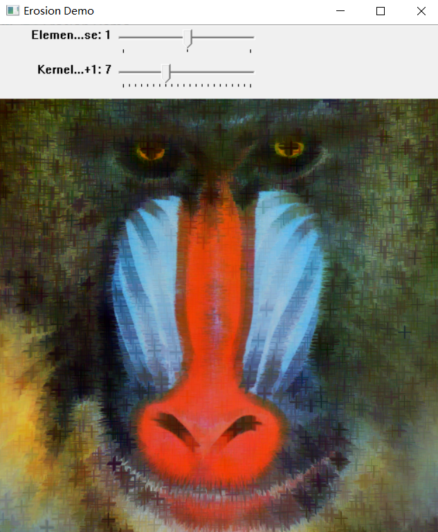

```{r eval=FALSE}
#读取图像文件
src = cv_imread("images/baboon.jpg")

#定义两个滑动条滑动事件的响应函数Erosion
Erosion = function(val, parm){
  #获取控制结构核形状的滑动条的当前取值，存入erosion_elem中
  erosion_elem = cv_getTrackbarPos("Element:","Erosion Demo")
  #依据erosion_elem的取值情况，确定结构核的形状：
  #取0时为矩形，取1时为十字形，取2为椭圆盘或者圆盘
  erosion_type = MORPH_RECT
  if( erosion_elem == 0 ){
    erosion_type = MORPH_RECT
  }else if( erosion_elem == 1 ){
    erosion_type = MORPH_CROSS
  }else if( erosion_elem == 2){
    erosion_type = MORPH_ELLIPSE
  }

  #获取控制结构核尺寸的滑动条的当前取值，存入erosion_size中
  erosion_size = cv_getTrackbarPos("Kernel size:","Erosion Demo")

  #生成相应形状和尺寸的结构核
  element = cv_getStructuringElement(erosion_type,
                       c( 2*erosion_size + 1, 2*erosion_size+1 ),
                       anchor = c( erosion_size, erosion_size ))

  #对图形src进行腐蚀
  erosion_dst = cv_erode( src, element )

  #将erosion_dst显示在标题为Erosion Demo的图形窗口中
  cv_imshow( "Erosion Demo", erosion_dst)
}

#生成标题为Erosion Demo的图形窗口
cv_namedWindow("Erosion Demo")
#在图形窗口上创建控制结构核形状的滑动条
cv_createTrackbar("Element:","Erosion Demo",0,2,Erosion)
#在图形窗口上创建控制结构核尺寸的滑动条
cv_createTrackbar("Kernel size:","Erosion Demo",0,21,Erosion)

#调用Erosion函数
Erosion(0,0)
```

**示例**

以下代码用两个滑动条分别控制膨胀结构核的形状和尺寸，易于观察不同形状和尺寸的结构核所带来的膨胀效果（见下图）。

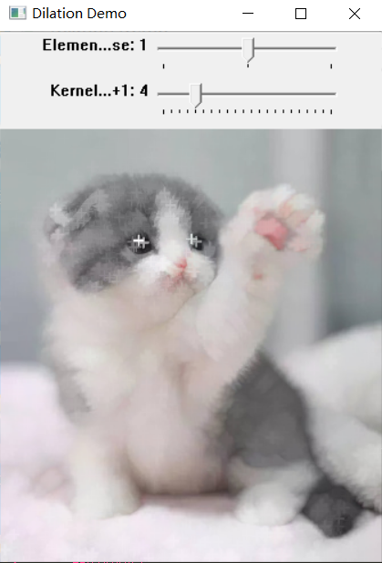

```{r eval=FALSE}
#读取图像文件
src = cv_imread("images/cat.jpg")

#定义两个滑动条滑动事件的响应函数Dilation
Dilation = function(val, voidP){
  #获取控制结构核形状的滑动条的当前取值，存入dilation_elem中
  dilation_elem = cv_getTrackbarPos("Element:","Dilation Demo")
  #依据dilation_elem的取值情况，确定结构核的形状：
  #取0时为矩形，取1时为十字形，取2为椭圆盘或者圆盘
  dilation_type = MORPH_RECT
  if( dilation_elem == 0 ){
    dilation_type = MORPH_RECT
  }else if( dilation_elem == 1 ){
    dilation_type = MORPH_CROSS
  }else if( dilation_elem == 2){
    dilation_type = MORPH_ELLIPSE
  }

  #获取控制结构核尺寸的滑动条的当前取值，存入dilation_size中
  dilation_size = cv_getTrackbarPos("Kernel size:","Dilation Demo")

  #生成相应形状和尺寸的结构核
  element = cv_getStructuringElement( dilation_type,
                       c( 2*dilation_size + 1, 2*dilation_size+1 ),
                       anchor = c( dilation_size, dilation_size ))

  #对图形src进行膨胀
  dilation_dst = cv_dilate( src, element )

  #将dilation_dst显示在标题为Dilation Demo的图形窗口中
  cv_imshow( "Dilation Demo", dilation_dst)
}

#生成标题为Dilation Demo的图形窗口
cv_namedWindow("Dilation Demo",WINDOW_AUTOSIZE)
#在图形窗口上创建控制结构核形状的滑动条
cv_createTrackbar("Element:","Dilation Demo",0,2,Dilation)
#在图形窗口上创建控制结构核尺寸的滑动条
cv_createTrackbar("Kernel size:","Dilation Demo",0,21,Dilation)

#调用Dilation函数
Dilation(0,0)
```

## 开运算、闭运算和形态学梯度

基于图像膨胀与腐蚀，使用OpenCV的**morphologyEx**函数能够实现图像的开运算、闭运算和形态学梯度等更多的形态学操作。


### 开运算

* 它是通过对图像先腐蚀后膨胀来获得的，即：openning(src,element)=dilate(erode(src,element)) 
* 它有助于移除暗区域中的小白点 

```{r}
#生成全0矩阵img_mat
img_mat = matrix(0,nr=11,nc=11)
#在正中间放一个孤立的白点，经开运算之后它会消失
img_mat[6,6] = 1
#将img_mat写入图像矩阵img
img = Mat(11,11,CV_8UC1)
img[] = img_mat
#生成开运算结构核：3行3列的全1矩阵
ker = Mat(3,3,CV_8UC1)
ker[] = 1
#对img进行开运算
img_open = cv_morphologyEx(img,MORPH_OPEN,ker)

#开运算之后还有多少个非零像素
sum(as_array(img_open,numeric = TRUE) > 0)
```

可以通过先执行腐蚀操作，再执行膨胀操作来验证结果：

```{r}
img = Mat(11,11,CV_8UC1)
img_mat = matrix(0,nr=11,nc=11)
img_mat[6,6] = 1
img[] = img_mat
ker = Mat(3,3,CV_8UC1)
ker[] = 1

#先腐蚀后膨胀
img_open = cv_dilate(cv_erode(img,ker),ker)

sum(as_array(img_open,numeric = TRUE) > 0)
```

两次都得到 0：白点被抹掉了。

### 闭运算

* 它是通过图像先膨胀后腐蚀来获得的，即：closing(src,element)=erode(dilate(src,element))  
* 它有助于消除亮区域中的小黑点。  

```{r}
#生成全0矩阵img_mat
img_mat = matrix(0,nr=11,nc=11)
#在中间画一个 7x7 的白方块
img_mat[3:9,3:9] = 1
#在白方块正中间挖一个黑洞，经闭运算之后它会被填上
img_mat[6,6] = 0
#将img_mat写入图像矩阵img
img = Mat(11,11,CV_8UC1)
img[] = img_mat
#生成闭运算核
ker = Mat(3,3,CV_8UC1)
ker[] = 1
#对img进行闭运算
img_close = cv_morphologyEx(img,MORPH_CLOSE,ker)

#闭运算之后白方块有多少个像素（7*7 = 49 说明洞被填上了）
sum(as_array(img_close,numeric = TRUE) > 0)
```

可以通过先执行膨胀操作，再执行腐蚀操作来验证结果：

```{r}
img = Mat(11,11,CV_8UC1)
img_mat = matrix(0,nr=11,nc=11)
img_mat[3:9,3:9] = 1
img_mat[6,6] = 0
img[] = img_mat
ker = Mat(3,3,CV_8UC1)
ker[] = 1

#先膨胀后腐蚀
img_close = cv_erode(cv_dilate(img,ker),ker)

sum(as_array(img_close,numeric = TRUE) > 0)
```

两次都是 49，黑洞被填平了。

基于开运算和闭运算，还可以实现礼帽与黑帽效果。

### 礼帽

它是输入图像和开运算之差。即：tophat(src,element)=src-openning(src,element)

```{r}
#生成全0矩阵img_mat
img_mat = matrix(0,nr=11,nc=11)
#黑底上放一个 2x2 的小白块：它比结构核还小，开运算会把它整个抹掉
img_mat[5:6,5:6] = 1
#将img_mat写入图像矩阵img
img = Mat(11,11,CV_8UC1)
img[] = img_mat
#生成结构核
ker = Mat(3,3,CV_8UC1)
ker[] = 1

#原图像减去开运算结果
img_tophat = cv_subtract(img,cv_morphologyEx(img,MORPH_OPEN,ker))

#礼帽结果里还剩几个像素
sum(as_array(img_tophat,numeric = TRUE) > 0)
```

也可以直接使用cv_morphologyEx函数进行tophat运算：

```{r}
img = Mat(11,11,CV_8UC1)
img_mat = matrix(0,nr=11,nc=11)
img_mat[5:6,5:6] = 1
img[] = img_mat
ker = Mat(3,3,CV_8UC1)
ker[] = 1

img_tophat = cv_morphologyEx(img,MORPH_TOPHAT,ker)

sum(as_array(img_tophat,numeric = TRUE) > 0)
```

两种写法都得到 4，正好是被开运算抹掉的那个 2×2 小白块。
礼帽的作用就是**把「开运算删掉的小东西」单独拎出来**。

### 黑帽

它是闭运算和它的输入图像之间的差，即：balckhat(src,element)=closing(src,element)-src。

```{r}
#生成全0矩阵img_mat
img_mat = matrix(0,nr=11,nc=11)
#白方块
img_mat[3:9,3:9] = 1
#白方块里挖一个 2x2 的黑洞：闭运算会把它填上
img_mat[5:6,5:6] = 0
#将img_mat写入图像矩阵img
img = Mat(11,11,CV_8UC1)
img[] = img_mat
#生成结构核
ker = Mat(3,3,CV_8UC1)
ker[] = 1

#闭运算结果减去原图像
img_blackhat = cv_subtract(cv_morphologyEx(img,MORPH_CLOSE,ker),img)

#黑帽结果里还剩几个像素
sum(as_array(img_blackhat,numeric = TRUE) > 0)
```

可以直接使用cv_morphologyEx函数进行blackhat运算：

```{r}
img = Mat(11,11,CV_8UC1)
img_mat = matrix(0,nr=11,nc=11)
img_mat[3:9,3:9] = 1
img_mat[5:6,5:6] = 0
img[] = img_mat
ker = Mat(3,3,CV_8UC1)
ker[] = 1

img_blackhat = cv_morphologyEx(img,MORPH_BLACKHAT,ker)

sum(as_array(img_blackhat,numeric = TRUE) > 0)
```

两种写法都是 4，即那个 2×2 的黑洞。黑帽和礼帽正好对称：
礼帽抓「被开运算抹掉的亮点」，黑帽抓「被闭运算填掉的暗点」。

### 形态学梯度

* 它是图像膨胀和腐蚀之后相减。 即：morph_grad(src,element)=dilate(src,element)-erode(src,element)  
* 它有助于找到对象的轮廓。 

```{r}
#生成全0矩阵img_mat
img_mat = matrix(0,nr=11,nc=11)
#黑底上一个 5x5 的白方块
img_mat[4:8,4:8] = 1
#将img_mat写入图像矩阵img
img = Mat(11,11,CV_8UC1)
img[] = img_mat
#生成形态学梯度运算结构核
ker = Mat(3,3,CV_8UC1)
ker[] = 1

#对img进行形态学梯度运算
img_grad = cv_morphologyEx(img,MORPH_GRADIENT,ker)

#梯度结果里非零像素的个数
sum(as_array(img_grad,numeric = TRUE) > 0)
```

可以通过先分别执行膨胀和腐蚀操作，然后再把结果相减，进而验证结果：

```{r}
img = Mat(11,11,CV_8UC1)
img_mat = matrix(0,nr=11,nc=11)
img_mat[4:8,4:8] = 1
img[] = img_mat
ker = Mat(3,3,CV_8UC1)
ker[] = 1

#膨胀结果减去腐蚀结果
img_grad = cv_subtract(cv_dilate(img,ker),cv_erode(img,ker))

sum(as_array(img_grad,numeric = TRUE) > 0)
```

都是 40 个像素。注意这个「轮廓」是**有厚度**的：3×3 的核会让边界两侧各扩 1 像素，
所以轮廓宽 2 像素，不是一条细线。想要更细的轮廓就用 3×3 以外的更小核
（最小就是 3×3），或者干脆用 Canny 之类的边缘检测。

以下示例展示了开运算、闭运算、礼帽、黑帽和形态学梯度等运算效果：

**示例**

```{r}
#读取带外部噪点的图像文件
img = cv_imread("images/letterJNoiseOuter.jpg")
#生成开运算结构核
element = cv_getStructuringElement(MORPH_RECT,c(5,5))
#进行开运算
dst = cv_morphologyEx(img,MORPH_OPEN,element)
```

可以看到，经过开运算后，图像黑色区域的小白点被消除了。

```{r echo=FALSE}
op = par(mfrow = c(1,2),mar = c(1,1,2,1))
plot(img)
title(main = "开运算前")
plot(dst)
title(main = "开运算后")
par(op)
```

**示例**

```{r}
#读取带内部噪点的图像文件
img = cv_imread("images/letterJNoiseInner.jpg")
#生成闭运算结构核
element = cv_getStructuringElement(MORPH_RECT,c(5,5))
#对img进行闭运算
dst = cv_morphologyEx(img,MORPH_CLOSE,element)
```

可以看到，经过闭运算后，图像白色区域的小黑点被消除了。

```{r echo=FALSE}
op = par(mfrow = c(1,2),mar = c(1,1,2,1))
plot(img)
title(main = "闭运算前")
plot(dst)
title(main = "闭运算后")
par(op)
```

**示例**

```{r}
#读取图像文件
img = cv_imread("images/letterJNoiseOuter.jpg")
#生成礼帽运算结构核：15x15 比笔画还宽，开运算会把细笔画整段抹掉
element = cv_getStructuringElement(MORPH_RECT,c(15,15))
#对img进行礼帽运算
dst = cv_morphologyEx(img,MORPH_TOPHAT,element)
```

可以看到，经过礼帽运算后，图像中出现了"礼帽"效果——
笔画里比核更细的部分被单独提取了出来。

```{r echo=FALSE}
op = par(mfrow = c(1,2),mar = c(1,1,2,1))
plot(img)
title(main = "礼帽输入")
plot(dst)
title(main = "礼帽结果")
par(op)
```

**示例**

```{r}
#读取图像文件
img = cv_imread("images/letterJNoiseInner.jpg")
#生成黑帽运算结构核
element = cv_getStructuringElement(MORPH_RECT,c(15,15))
#对img进行黑帽运算
dst = cv_morphologyEx(img,MORPH_BLACKHAT,element)
```

可以看到，经过黑帽运算后，图像中出现了"黑帽"效果。

```{r echo=FALSE}
op = par(mfrow = c(1,2),mar = c(1,1,2,1))
plot(img)
title(main = "黑帽输入")
plot(dst)
title(main = "黑帽结果")
par(op)
```

**示例**

```{r}
#读取图像文件
img = cv_imread("images/letterJ.jpg")
#生成形态学梯度运算结构核
element = cv_getStructuringElement(MORPH_RECT,c(5,5))
#对img进行形态学梯度运算
dst = cv_morphologyEx(img,MORPH_GRADIENT,element)
```

可以看到，经过形态学梯度运算后，图像中出现了"轮廓"效果。

```{r echo=FALSE}
op = par(mfrow = c(1,2),mar = c(1,1,2,1))
plot(img)
title(main = "原图")
plot(dst)
title(main = "形态学梯度")
par(op)
```

**示例**

以下代码用三个滑动条分别控制形态学操作类型、结构核形状和结构核尺寸，
便于观察在不同形态学操作、不同结构核形状和尺寸下相应的形态学效果。

```{r eval=FALSE}
#控制形态学操作类型的滑动条的最大取值为6
#0~6 依次是：腐蚀、膨胀、开、闭、梯度、礼帽、黑帽
max_operator = 6
#控制结构核形状的滑动条的最大取值为2
max_elem = 2
#控制结构核尺寸的滑动条的最大取值为21
max_kernel_size = 21

#定义三个滑动条滑动事件的响应函数Morphology_Operations
Morphology_Operations = function( val, param )
{
  #获取控制形态学操作类型的滑动条的当前取值
  morph_operator = cv_getTrackbarPos(operatorTrackname,window_name)

  #获取控制结构核形状的滑动条的当前取值
  morph_elem = cv_getTrackbarPos(elementTrackname,window_name)

  #获取控制结构核尺寸的滑动条的当前取值
  morph_size = cv_getTrackbarPos(morphsizeTrackname,window_name)

  #生成相应的结构核
  #morph_elem 的 0/1/2 恰好就是 MORPH_RECT/MORPH_CROSS/MORPH_ELLIPSE
  element = cv_getStructuringElement( morph_elem,
                                      c( 2*morph_size + 1, 2*morph_size+1 ),
                                      anchor = c( morph_size, morph_size ))

  #对图像src进行形态学操作
  dst = cv_morphologyEx( src, morph_operator, element )

  #将dst显示在window_name指定的标题的图形窗口中
  cv_imshow( window_name, dst )
}

#读取图像文件
src = cv_imread("images/baboon.jpg")

#创建图形窗口
window_name = "Morphology Transformations Demo"
cv_namedWindow(window_name,WINDOW_AUTOSIZE)

#在图形窗口中创建控制形态学操作类型的滑动条
operatorTrackname = "Operator:"
cv_createTrackbar(operatorTrackname,
                  window_name, 0,
                  max_operator, Morphology_Operations )

#在图形窗口中创建控制结构核类型的滑动条
elementTrackname = "Element:"
cv_createTrackbar(elementTrackname, window_name,
                  0, max_elem,
                  Morphology_Operations )

#在图形窗口中创建控制结构核尺寸的滑动条
morphsizeTrackname = "Kernel size:\n 2n +1"
cv_createTrackbar(morphsizeTrackname, window_name,
                  0, max_kernel_size,
                  Morphology_Operations )

#调用Morphology_Operations函数
Morphology_Operations( 0, 0 )
```


***以下代码演示了如何从如下图像中提出出音符。***

```{r echo=FALSE}
src = cv_imread("images/notes.png")
plot(src,main = "notes.png")
```


***从音乐表中提取音符。涉及利用形态变换提取水平线和垂直线***

这段是 OpenCV 官方 tutorial 的移植，步骤多：

```{r eval=FALSE}
show_wait_destroy = function(winname, img) {
    cv_imshow(winname, img)
}

src = cv_imread("images/notes.png")
#按通道数决定要不要转灰度
if(length(dim(src)) == 3){
  gray = cv_cvtColor(src,COLOR_BGR2GRAY)
}else{
  gray = src
}
show_wait_destroy("gray", gray)

#反色：音符和五线谱本来是黑的，反色后变成白的前景
gray_inv = cv_bitwise_not(gray)

#自适应阈值
bw = cv_adaptiveThreshold(gray_inv,255,ADAPTIVE_THRESH_MEAN_C,THRESH_BINARY,15,-2)
show_wait_destroy("binary", bw)

#深拷贝两份，分别抽横线和竖线
horizontal = cv_copyTo(bw)
vertical   = cv_copyTo(bw)

#横线：核宽 = 图像宽 / 30，高 1
horizontal_size = dim(bw)[2] / 30
horizontalStructure = cv_getStructuringElement(MORPH_RECT, c(horizontal_size, 1))
#先腐蚀再膨胀（这就是开运算），把非横线的部分去掉
horizontal = cv_dilate(cv_erode(horizontal,horizontalStructure),horizontalStructure)
show_wait_destroy("horizontal", horizontal)

#竖线：核高 = 图像高 / 30，宽 1
vertical_size = dim(bw)[1] / 30
verticalStructure = cv_getStructuringElement(MORPH_RECT, c(1, vertical_size))
vertical = cv_dilate(cv_erode(vertical,verticalStructure),verticalStructure)
show_wait_destroy("vertical", vertical)

#竖线反色，方便后面做差
vertical = cv_bitwise_not(vertical)
show_wait_destroy("vertical_bit", vertical)

# 1. 取边缘
edges = cv_adaptiveThreshold(vertical,255,ADAPTIVE_THRESH_MEAN_C,THRESH_BINARY,3,-2)
show_wait_destroy("edges", edges)
# 2. 膨胀边缘
kernel = Mat(2,2,CV_8UC1)
kernel[] = 1
edges = cv_dilate(edges,kernel)
show_wait_destroy("dilate", edges)
# 3. 拷贝一份原图用来平滑
smooth = cv_copyTo(vertical)
# 4. 平滑
smooth = cv_blur(smooth,c(2,2))
# 5. 用 edges 作掩码，把平滑结果贴回去
vertical = cv_copyTo(smooth, mask = edges, dst = vertical)
# 最终结果
show_wait_destroy("smooth - final", vertical)
```


## 击中-击不中变换（hit-miss）

击中-击不中变换也属于形态学，适用于单通道二值图像，可以用来探测图像中存在的某些特征（比如：水平线、竖直线、直角边缘等等）。这种变换使用两个结构核$B_1$和$B_2$，分别称为击中结构核与击不中结构核，其中$B_1$用于探测目标区域内部，作为击中部分，B2用于探测目标区域外部,作为击不中部分。从数学公式上，击中-击不中变换可以表示为：


$$
A \oplus B = (A \ominus B_1) \cap (A^c \ominus B_2)
$$

击中-击不中变换的基本步骤为：

* 使用$B_1$对图像$A$进行腐蚀得到$C_1$；  
* 使用$B_2$对图像$A$的补集进行腐蚀得到$C_2$；  
* 取$C_1$和$C_2$的交集作为击中-击不中变换的运算结果。  


击中结构核$B_1$与击不中结构核$B_2$可以合并成一个结构核，比如：

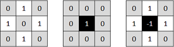

组合而成的结构核（默认情况下，锚点在中心点处）可以探测的图像特征是：在目标像素的邻域像素矩阵中，目标像素的上、下、左、右四个像素取值相同，但目标像素的取值与这四个像素值不同，而其它像素取值则没有限制。

OpenCV中使用**morphologyEx**函数可以进行击中-击不中变换操作：


```{r}
#生成矩阵7行7列的全0矩阵
img_mat = matrix(0,nrow = 7,ncol = 7)
#将矩阵的对角线和反对角线上的元素(不包括边缘像素)设置为255
for(i in 2:6){
  img_mat[i,i] = 255
  img_mat[i,7-i+1] = 255
}
#将img_mat写入图像矩阵img
img = Mat(7,7,CV_8UC1)
img[] = img_mat

#生成击中-击不中内核，寻找X型特征
ker_mat = matrix(
        c(1, -1, 1,
        -1, 1, -1,
        1, -1, 1),3,3,byrow = T)
ker = Mat(3,3,CV_32F)
ker[] = ker_mat

#使用morphologyEx进行击中-击不中变换
dst = cv_morphologyEx(img,MORPH_HITMISS,ker)

#查看变换前的img
matrix(as_array(img,numeric = TRUE),7,7)
#查看变换后得到的dst
matrix(as_array(dst,numeric = TRUE),7,7)
```

可以看到，结果中仅有第4行第4列的元素为255，表明在这个位置存在X型特征。可以通过如下代码（遵循击中-击不中变换的基本步骤）来验证这个结果：

```{r}
#生成矩阵7行7列的全0矩阵
img_mat = matrix(0,nrow = 7,ncol = 7)
#将矩阵的对角线和反对角线上的元素(不包括边缘像素)设置为255
for(i in 2:6){
  img_mat[i,i] = 255
  img_mat[i,7-i+1] = 255
}
#将img_mat写入图像矩阵img
img = Mat(7,7,CV_8UC1)
img[] = img_mat

#生成击中结构核
hit_kernel_mat = matrix(
        c(1, 0, 1,
          0, 1, 0,
          1, 0, 1),3,3,byrow = T)
hit_kernel = Mat(3,3,CV_8UC1)
hit_kernel[] = hit_kernel_mat
#对img按照击中结构核进行腐蚀
hit_result = cv_erode(img,hit_kernel)

#生成击不中结构核
miss_kernel_mat = matrix(
        c(0, 1, 0,
          1, 0, 1,
          0, 1, 0),3,3,byrow = T)
miss_kernel = Mat(3,3,CV_8UC1)
miss_kernel[] = miss_kernel_mat
#img取补集
img_comp = cv_bitwise_not(img)

#对img_comp按照击不中结构核进行腐蚀
miss_result = cv_erode(img_comp,miss_kernel)

#对hit_result和miss_result取交集
img_out = cv_bitwise_and(hit_result,miss_result)

#查看结果
matrix(as_array(img_out,numeric = TRUE),7,7)
```

**示例**

以下代码演示了使用不同结构核探索图形的不同结构特征的情况。

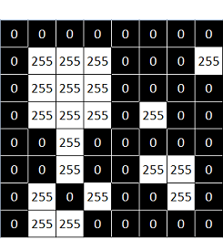

首先生成上图所示的图像矩阵

```{r}
#生成矩阵img_mat
img_mat = matrix(
        c(0, 0,   0,   0,   0, 0,   0,   0,
          0, 255, 255, 255, 0, 0,   0,   255,
          0, 255, 255, 255, 0, 0,   0,   0,
          0, 255, 255, 255, 0, 255, 0,   0,
          0, 0,   255, 0,   0, 0,   0,   0,
          0, 0,   255, 0,   0, 255, 255, 0,
          0, 255, 0,   255, 0, 0,   255, 0,
          0, 255, 255, 255, 0, 0,   0,   0),8,8,byrow = T)
#将img_mat写入图像矩阵img
img = Mat(8,8,CV_8UC1)
img[] = img_mat
```

* 使用如下结构核，探测图像特征 —— 在目标像素的邻域像素矩阵中，目标像素的上、下、左、右四个像素取值相同，但目标像素的取值与这四个像素值不同，而其它像素取值则没有限制。

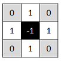

```{r}
#生成击中-击不中内核
ker_mat = matrix(
        c(0,  1,  0,
          1, -1,  1,
          0,  1,  0),3,3,byrow = T)
ker = Mat(3,3,CV_16SC1)
ker[] = ker_mat
#使用morphologyEx进行击中-击不中变换
dst = cv_morphologyEx(img,MORPH_HITMISS,ker)

#查看结果
matrix(as_array(dst,numeric = TRUE),8,8)
```

结果表明，以第7行第3列像素为目标像素的邻域像素矩阵中存在待探测的结构。


* 若使用如下结构核，则可以在图像中发现右上角模式。

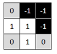
```{r}
#生成击中-击不中内核
ker_mat = matrix(
        c(0, -1, -1,
          1,  1, -1,
          0,  1,  0),3,3,byrow = T)
ker = Mat(3,3,CV_16SC1)
ker[] = ker_mat
#使用morphologyEx进行击中-击不中变换
dst = cv_morphologyEx(img,MORPH_HITMISS,ker)

#查看结果
matrix(as_array(dst,numeric = TRUE),8,8)
```

结果表明，以第2行第4列像素、第6行第7列像素为目标像素的邻域像素矩阵中存在待探测的结构。

* 将击中-击不中结构核换成如下形式，则可以发现左端点模式。

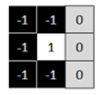
```{r echo=FALSE}
#生成击中-击不中内核
ker_mat = matrix(
        c(-1, -1, 0,
          -1,  1, 0,
          -1, -1, 0),3,3,byrow = T)
ker = Mat(3,3,CV_16SC1)
ker[] = ker_mat
#使用morphologyEx进行击中-击不中变换
dst = cv_morphologyEx(img,MORPH_HITMISS,ker)

#查看结果
matrix(as_array(dst,numeric = TRUE),8,8)
```

结果表明，以第2行第8列像素、第4行第6列像素、第6行第6列像素为目标像素的邻域像素矩阵中存在待探测的结构。


* 再击中-击不中内核换成如下形式，则可以发现长度为3像素的水平线。

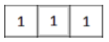

```{r echo=FALSE}
#生成击中-击不中内核
ker_mat = matrix(
        c(1, 1, 1),1,3,byrow = T)
ker = Mat(1,3,CV_16SC1)
ker[] = ker_mat
#使用morphologyEx进行击中-击不中变换
dst = cv_morphologyEx(img,MORPH_HITMISS,ker)

#查看结果
matrix(as_array(dst,numeric = TRUE),8,8)
```

结果表明，以第2行第3列像素、第3行第3列像素、第4行第3列像素、第8行第3列像素为目标像素的邻域像素矩阵中存在待探测的结构。

* 最后将击中-击不中内核换成如下形式，可以发现长度为5像素的竖直线。

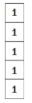


```{r echo=FALSE}
#生成击中-击不中内核
ker_mat = matrix(
        rep(1,5),5,1)
ker = Mat(5,1,CV_16SC1)
ker[] = ker_mat
#使用morphologyEx进行击中-击不中变换
dst = cv_morphologyEx(img,MORPH_HITMISS,ker)

#查看结果
matrix(as_array(dst,numeric = TRUE),8,8)
```

结果表明，以第4行第3列像素为目标像素的邻域像素矩阵中存在待探测的结构。

**示例**

识别五线谱中的水平直线：

```{r}
#读入五线谱图像文件（按灰度图模式读入）
src = cv_imread("images/notes.png",0)
#对src进行逆二值化
src_bin = cv_threshold(src,100,255,
                       THRESH_BINARY_INV+THRESH_OTSU)

#生成结构核，用来寻找水平线
horizontalStructure = cv_getStructuringElement(MORPH_RECT, c(40, 1))

#使用morphologyEx进行击中-击不中变换
dst = cv_morphologyEx(src_bin,MORPH_HITMISS,horizontalStructure)

#进行膨胀操作，增强水平线效果
ker = Mat(3,1,CV_8UC1,1)
dst = cv_dilate(dst,ker)

dim(dst)
```

```{r echo=FALSE}
op = par(mfrow = c(2, 1), mar = c(1, 1, 2, 1))
plot(src)
title(main = "src：五线谱原图")
plot(dst)
title(main = "dst：击中-击不中 + 膨胀后的水平线")
par(op)
```


**示例**

通过识别五线谱中的竖直直线来提取出音符。

```{r}
#读入五线谱图像文件（按灰度图模式读入）
src = cv_imread("images/notes.png",0)
#对src进行逆二值化（背景变为黑色）
src_bin = cv_threshold(src,100,255,
                       THRESH_BINARY_INV + THRESH_OTSU)
#生成结构核，用来寻找竖直线
verticalStructure = cv_getStructuringElement(MORPH_RECT, c(1, 4))
#使用morphologyEx进行击中-击不中变换
dst = cv_morphologyEx(src_bin,MORPH_HITMISS,verticalStructure)

#对dst进行膨胀操作，增强竖直线效果
dst = cv_dilate(dst,verticalStructure)

#对dst进行平滑操作，再次增强竖直线效果
dst = cv_blur(dst,c(2,2))

#对dst进行按位取反操作（让背景变为白色）
dst = cv_bitwise_not(dst)

dim(dst)
```

```{r echo=FALSE}
op = par(mfrow = c(2, 1), mar = c(1, 1, 2, 1))
plot(src)
title(main = "src：五线谱原图")
plot(dst)
title(main = "dst：取反后的竖直线（音符都在里面）")
par(op)
```


```{r echo=FALSE,eval=FALSE}
# 读入五线谱图片，放在src变量中
src = cv_imread("images/notes.png")
# 获取图像基本信息：dim() 返回 c(行, 列, 通道)
src_info = dim(src)

if(length(src_info) == 3 && src_info[3] == 3){
  # 如果src是3通道彩图，则转为单通道灰度图
  gray = cv_cvtColor(src,COLOR_BGR2GRAY)
}else{
  # 如果src本身就是单通道灰度图，则直接把src赋值给gray变量
  gray = src
}

# 使用cv_bitwise_not函数生成逆灰度图（黑底白线，方便后面做形态学）
gray_inv = cv_bitwise_not(gray)

# 使用cv_adaptiveThreshold函数生成二值图
bw = cv_adaptiveThreshold(gray_inv,255,
                          ADAPTIVE_THRESH_MEAN_C,
                          THRESH_BINARY,15,-2)

# horizontal 从 bw 出发。新版 cv_* 都是纯函数，不接返回值就等于白算
horizontal = bw
# 生成结构元，用来寻找horizontal中的水平线
horizontal_size = dim(horizontal)[2] / 30
horizontalStructure = cv_getStructuringElement(MORPH_RECT,c(horizontal_size,1))
#通过 as_array 查看结构元的具体取值：是一个包含34个元素的行矩阵
as_array(horizontalStructure, numeric = TRUE)

# 通过先腐蚀再膨胀的操作，可以取出水平线
horizontal = cv_erode(horizontal,horizontalStructure)
horizontal = cv_dilate(horizontal,horizontalStructure)

# 竖直线同理
vertical = bw
# 生成结构元，用来寻找vertical中的竖直线
vertical_size = dim(vertical)[1] / 30
verticalStructure = cv_getStructuringElement(MORPH_RECT,c(1,vertical_size))
#通过 as_array 查看verticalStructure结构元的具体取值：是一个包含4个元素的列矩阵
as_array(verticalStructure, numeric = TRUE)

# 通过先腐蚀再膨胀的操作，可以取出竖直线
vertical = cv_erode(vertical,verticalStructure)
vertical = cv_dilate(vertical,verticalStructure)
# 可以看出，竖直线中包含着所有音符（也包含着节划分线）

# 对vertical图像取反，结果仍然存入vertical变量中
vertical = cv_bitwise_not(vertical)

# 按下面的步骤把五线谱的横线抹掉、只留下音符：
# 1. 取边缘  2. 膨胀  3. 复制一份  4. 模糊  5. 用边缘作掩膜贴回去
# Step 1
edges = cv_adaptiveThreshold(vertical,255,
                             ADAPTIVE_THRESH_MEAN_C,
                             THRESH_BINARY,3,-2)
#Step 2
kernel = Mat(2,2,CV_8UC1,1)        # 等价于旧的 Mat_ones(2,2,CV_8UC1)
edges = cv_dilate(edges,kernel)
#Step 3
smooth = cv_mat_convert(vertical,-1)
#Step 4
smooth = cv_blur(smooth,c(2,2))
#Step 5
# cv_copyTo 的第二个位置参数是 mask，dst 必须具名
cv_copyTo(smooth, dst = vertical, mask = edges)

op = par(mfrow = c(2,3), mar = c(1,1,2,1))
plot(gray);       title("gray")
plot(bw);         title("binary")
plot(horizontal); title("horizontal")
plot(vertical);   title("vertical")
plot(smooth);     title("smooth")
plot(vertical);   title("final")
par(op)
```

