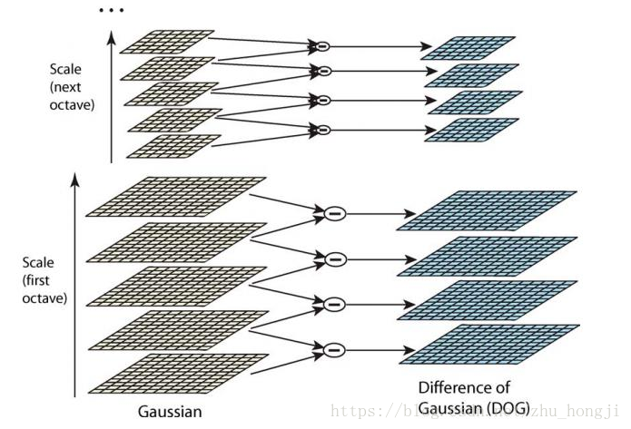
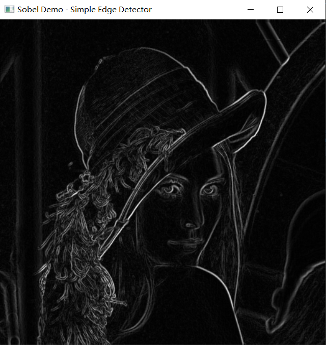
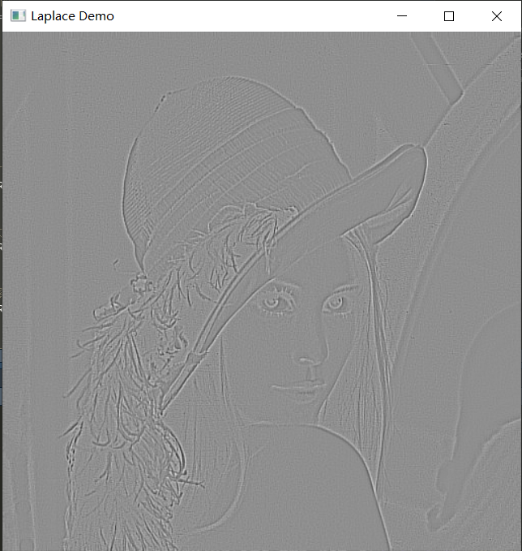
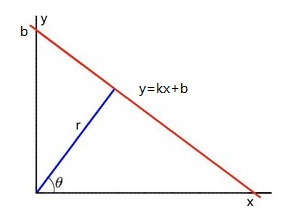
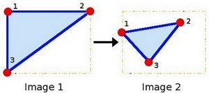
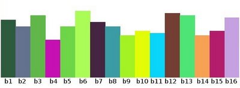
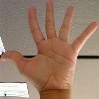
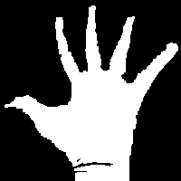
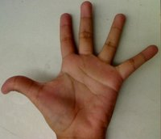

# 图像处理（二）：边缘、霍夫变换与直方图 {#imgproc2}

## 图像金字塔


在一个图像的尺寸不断减半且同时分辨率降低的过程中，会形成一系列图像，这些图像按尺寸大小从底部向上依次排列，会呈现出一个金字塔形状，因此常把这一系列图像称为原图像的图像金字塔，如图：

```{r echo=FALSE, eval=FALSE}
# 自己绘制金字塔
# 难点：确立要绘制的平行四边形坐标
img = cv_imread("images/lena.jpg")
hh = dim(img)[1]; ww = dim(img)[2]
plot(img)

# 四个角点，用 list 装，交给 pts2f() 转成 CV_32FC2
pts1 = list(c(0,0), c(ww,0), c(ww,hh), c(0,hh))

# 生成一个平行四边形（四条边按顺时针方向给出）
pts2_pro = function(center_x,center_y,w,h,alpha){
  #alpha为平行四边形两条相邻边的夹角,取值范围在0到pi之间
  if(alpha==pi/2){
    #垂直
    list(c(center_x-w/2, center_y-h/2),
         c(center_x+w/2, center_y-h/2),
         c(center_x+w/2, center_y+h/2),
         c(center_x-w/2, center_y+h/2))
  }else{
    list(c(center_x-w/2+1/2*h/tan(alpha), center_y-h/2),
         c(center_x+w/2+1/2*h/tan(alpha), center_y-h/2),
         c(center_x+w/2-1/2*h/tan(alpha), center_y+h/2),
         c(center_x-w/2-1/2*h/tan(alpha), center_y+h/2))
  }
}

# 三层，尺寸依次减半，中心依次上移
M = cv_getPerspectiveTransform(pts2f(pts1), pts2f(pts2_pro(250,400,350,100,pi/4)))
dst1 = cv_warpPerspective(img,M,c(500,500))

M = cv_getPerspectiveTransform(pts2f(pts1), pts2f(pts2_pro(250,300,175,50,pi/4)))
dst2 = cv_warpPerspective(img,M,c(500,500))

M = cv_getPerspectiveTransform(pts2f(pts1), pts2f(pts2_pro(250,200,80,25,pi/4)))
dst3 = cv_warpPerspective(img,M,c(500,500))

# cv_add 直接返回相加的结果，不再需要预先克隆一个 dst 再原地累加
dst = cv_add(dst1,dst2)
dst = cv_add(dst,dst3)

plot(dst)
```

```{r echo=FALSE,eval=FALSE}
rng = 200
plot(0:rng,type="n")

org_x = 100
org_y = 50

# y，z轴
#abline(v=org.x,h=org.y,lty="dashed")

# x轴
x = seq(0,rng,length=rng*3)
alpha = pi/3
xaxisFun = function(x,org_x,org_y,alpha){
	(x-org_x)*tan(alpha)+org_y
}
y = xaxisFun(x,org_x,org_y,alpha)
#lines(x,y,lty="dashed")

# 平行四边形四个点
# 横向长度
hori_len = 70 #这个值如何依据某种条件自动变化呢
# x轴上的长度
hori_xlen = hori_len * cos(alpha)
# 四个点坐标
pt1_x = hori_len+org_x
pt1_y = org_y
points(pt1_x,pt1_y)

pt2_x = hori_xlen * cos(alpha)+org_x
pt2_y = hori_xlen * sin(alpha)+org_y
points(pt2_x,pt2_y)

pt3_x = -hori_len+org_x
pt3_y = org_y
points(pt3_x,pt3_y)

pt4_x = hori_xlen * cos(alpha+pi)+org_x
pt4_y = hori_xlen * sin(alpha+pi)+org_y
points(pt4_x,pt4_y)

polygon(c(pt1_x,pt2_x,pt3_x,pt4_x),c(pt1_y,pt2_y,pt3_y,pt4_y))

hat_x = org_x
hat_y = 180
lines(c(hat_x,pt1_x),c(hat_y,pt1_y))
lines(c(hat_x,pt2_x),c(hat_y,pt2_y))
lines(c(hat_x,pt3_x),c(hat_y,pt3_y))
lines(c(hat_x,pt4_x),c(hat_y,pt4_y))


# 第2层平行四边形四点
N = 6
height_z = hat_y - org_y
unit_z = height_z/N

for(i in 1:N){
	# (height_z - unit_z*i)/height_z = hori_newlen/hori_len
	hori_lennew = (height_z - unit_z*i)/height_z * hori_len
	# x轴上的长度
	hori_xlen = hori_lennew * cos(alpha)
	# 四个点坐标
	pt1_x = hori_lennew+org_x
	pt1_y = org_y + unit_z*i
	points(pt1_x,pt1_y)

	pt2_x = hori_xlen * cos(alpha)+org_x
	pt2_y = hori_xlen * sin(alpha)+org_y+unit_z*i
	points(pt2_x,pt2_y)

	pt3_x = -hori_lennew+org_x
	pt3_y = org_y+unit_z*i
	points(pt3_x,pt3_y)

	pt4_x = hori_xlen * cos(alpha+pi)+org_x
	pt4_y = hori_xlen * sin(alpha+pi)+org_y+unit_z*i
	points(pt4_x,pt4_y)

	polygon(c(pt1_x,pt2_x,pt3_x,pt4_x),c(pt1_y,pt2_y,pt3_y,pt4_y))	
}
```

```{r echo=FALSE}
# 自己绘制金字塔：把 lena 依次透视变换成不同尺寸的平行四边形，自下而上叠起来，
# 再把最底层的三个角连到顶点，得到金字塔的示意图。
#
# 旧版这一段有三个地方要换：
#   stdVecOfPoint2f() + push_back(Point2f(x,y))  ->  pts2f()（前面仿射变换那节定义的）
#   img_info$width / $height                     ->  dim(img)
#   Mat + Rect + $copyTo + $clone + cv_add(a,b,dst) -> 见下面逐条注释
img = cv_imread("images/lena.jpg")
# mat_info() 返回 c(行, 列, 通道, 类型, 位深)，行在前、列在后，
# 和旧版 $width / $height 的顺序正好相反，所以这里直接用 dim() 更不容易错。
h = dim(img)[1]; w = dim(img)[2]
pts1 = list(c(0,0), c(w,0), c(w,h), c(0,h))

# 在「数学坐标」（y 向上）里算平行四边形的四个顶点
para = function(cx, cy, hl, alpha){
  dx = hl*cos(alpha)^2
  dy = hl*cos(alpha)*sin(alpha)
  list(c(cx-hl, cy), c(cx+dx, cy+dy), c(cx+hl, cy), c(cx-dx, cy-dy))
}

CW = 500; CH = 500          # 画布尺寸
org_x = CW/2                # 金字塔的中心线
org_y = min(50, CH/4)       # 最底层的高度
alpha = pi/4                # 平行四边形的倾角
hori_len = 1/3*CW           # 最底层的水平半宽
N = 7                       # 层数
hat_y = CH - 50             # 顶点高度
height_z = hat_y - org_y
unit_z = height_z/N

res_mat = array(0, dim = c(CH, CW, 3))
bottom = NULL
for(i in 0:(N-1)){
  # 越往上，平行四边形的水平半宽越小
  hl = (height_z - unit_z*i)/height_z*hori_len
  cy = org_y + unit_z*i
  p = para(org_x, cy, hl, alpha)
  # 数学坐标 -> 图像坐标：y 翻过来（图像的行号向下增长）
  p_img = lapply(p, function(q) c(q[1], CH - q[2]))
  M = cv_getPerspectiveTransform(pts2f(pts1), pts2f(p_img))
  layer = cv_warpPerspective(img, M, c(CW, CH))
  # 旧版是先把每层 $cv2r() 存进 list，再循环相加；这里直接累加到 res_mat
  res_mat = res_mat + as_array(layer, numeric = TRUE)
  if(i == 0) bottom = p_img
}
# 七层叠加会超过 255，截断到 8 位范围
res_mat[res_mat > 255] = 255

res = Mat(CW, CH, CV_8UC3)
res[] = res_mat
# 顶点连到最底层的三个角，画出金字塔的三条棱
apex = c(org_x, CH - hat_y)
res = cv_line(res, apex, bottom[[1]], c(255,255,255))
res = cv_line(res, apex, bottom[[3]], c(255,255,255))
res = cv_line(res, apex, bottom[[4]], c(255,255,255))

plot(res, main = "自己绘制的图像金字塔示意图")
```

在实际应用中，会对图像金字塔从最底层到最顶层编号：最底层为0，依次向上为1、2、3、……。从$i$层变化到$i+1$层，由于尺寸会变小，所以这种变化操作常称为下采样；相反从$i+1$层变化到$i$层，由于尺寸会变大，所以这种变化操作常称为上采样。

常见图像金字塔有高斯金字塔、拉普拉斯金字塔和DOG金字塔。


### 高斯金字塔（Gaussian pyramid）

高斯金字塔在形成过程中会使用高斯滤波器。

从$i$层变化到$i+1$层的下采样步骤为：

* 对$i$层图像$G_i$用如下高斯滤波器进行平滑：

    $$
    \frac{1}{256} \left[ \begin{matrix} 1&4&6&4&1 \\4&16&24&16&4 \\6&24&36&24&6 \\4&16&24&16&4 \\1&4&6&4&1 \end{matrix} \right]
    $$  
* 删除高斯平滑结果中的偶数行和偶数列后作为$i+1$层图形。

从$i+1$层变化到$i$层的上采样步骤为：

* 将$i+1$层图像$G_{i+1}$的行、列都扩展2倍，确保扩展的行、列都在偶数位置，且以0填充。  
* 对扩展图像用如下高斯滤波器进行平滑，平滑结果作为$i$层图像。

    $$
    \frac{1}{64} \left[ \begin{matrix} 1&4&6&4&1 \\4&16&24&16&4 \\6&24&36&24&6 \\4&16&24&16&4 \\1&4&6&4&1 \end{matrix} \right]
    $$

在OpenCV中，高斯金字塔的下采样操作可以通过**pyrDown**函数实现。


```{r}
#生成13行13列的随机矩阵img_mat
set.seed(123)
img_mat = matrix(sample(1:13,13*13,replace=T),nr=13,nc=13)
#将img_mat写入图像矩阵img
img = Mat(13,13,CV_32FC1)
img[] = img_mat

#对img进行高斯金字塔下采样
dst = cv_pyrDown(img)

#查看结果
round(matrix(as_array(dst),nrow = dim(dst)[1]),3)
```

可以通过如下代码（遵循高斯下采样步骤）验证这个结果：

```{r}
#生成13行13列的随机矩阵img_mat
set.seed(123)
img_mat = matrix(sample(1:13,13*13,replace=T),nr=13,nc=13)
#将img_mat写入图像矩阵img
img = Mat(13,13,CV_32FC1)
img[] = img_mat

#生成高斯滤波器
gKer_mat = matrix(0,nr=5,nc=5)
ind = 1
for(i in c(1,4,6,4,1)){
  gKer_mat[ind,] = i*c(1,4,6,4,1)
  ind = ind +1
}
gKer_mat = gKer_mat/256
gKer = Mat(5,5,CV_32FC1)
gKer[] = gKer_mat
#对img进行高斯滤波（使用的是filter2D函数）
dst1 = cv_filter2D(img,-1,gKer)

#将dst1转变为R语言矩阵res
res = matrix(as_array(dst1),13,13)
#查看res去除了偶数行和偶数列后的结果
round(res[-c(1:6*2),-c(1:6*2)],3)
```

> 这里 `res[-c(1:6*2),-c(1:6*2)]` 的负下标 `-c(2,4,6,8,10,12)` 就是
> 「删掉偶数行、偶数列」。跑出来的 7×7 结果和上面 `cv_pyrDown()` 的
> **每一位都相同**——说明高斯金字塔的下采样确实就是
> 「5×5 高斯核（除以 256）平滑 + 抽掉偶数行列」这两步。

```{r echo=FALSE,eval=FALSE}
gKer_mat = matrix(0,nr=5,nc=5)
ind = 1
for(i in c(1,4,6,4,1)){
  gKer_mat[ind,] = i*c(1,4,6,4,1)
  ind = ind +1
}
gKer_mat = gKer_mat/256
gKer = Mat(5,5,CV_32FC1)
gKer[] = gKer_mat

dst1 = cv_filter2D(img,-1,gKer)
res = matrix(as_array(dst1),13,13)
round(res[-c(1:6*2),-c(1:6*2)],3)
#使用filter2D函数，出现稍许差异(保留小数位数，可以消除这种差异)
```


而高斯金字塔的上采样操作可以通过OpenCV的**pyrUp**函数实现。

```{r}
#取img_mat为上面res去除了偶数行和偶数列后的结果
#这样做，可以很容易看出高斯金字塔的上、下采样不是可互逆还原的过程，
#因为其中存在信息损失
img_mat = res[-c(1:6*2),-c(1:6*2)]
#将img_mat写入图像矩阵img
img = Mat(7,7,CV_32FC1)
img[] = img_mat

#对img进行高斯金字塔上采样
dst = cv_pyrUp(img)

#查看结果
round(matrix(as_array(dst),nrow = dim(dst)[1]),3)
```

> 7 行上采样成 14 行。**`pyrUp` 不是 `pyrDown` 的逆**：
> 它先把行列各插一倍零，再拿那个除以 64 的高斯核平滑，
> 插进去的零被邻域摊开，原来的信息补不回来。
> 所以上面 `pyrDown` 得到 7×7、再 `pyrUp` 回 14×14，
> 和原来的 13×13 已经对不上了——这就是「有信息损失」。

可以通过如下代码（遵循高斯上采样步骤）验证这个结果：

```{r echo=FALSE,eval=FALSE}
#取img_mat为上面res去除了偶数行和偶数列后的结果
#这样做，可以很容易看出高斯金字塔的上、下采样不是可互逆还原的过程 —— 其中存在信息损失
img_mat = res[-c(1:6*2),-c(1:6*2)]
#生成14行14列矩阵img_extend_mat（行数、列数扩大2倍）
img_extend_mat = matrix(0,14,14)
#img_extend_mat的奇数行、奇数列数据为img_mat（确保扩展的行、列都在偶数位置）
img_extend_mat[seq(1,14,by=2),seq(1,14,by=2)] = img_mat
#将img_extend_mat转变为图像矩阵img_extend
img_extend = Mat(14,14,CV_32FC1)
img_extend[] = img_extend_mat

#生成高斯滤波器（上采样时核要除以 64，相当于放大 4 倍）
gKer_mat = matrix(0,nr=5,nc=5)
ind = 1
for(i in c(1,4,6,4,1)){
  gKer_mat[ind,] = i*c(1,4,6,4,1)
  ind = ind +1
}
gKer_mat = gKer_mat/64
gKer = Mat(5,5,CV_32FC1)
gKer[] = gKer_mat

#对img_extend进行高斯滤波（使用的是filter2D函数），结果保存在dst1中
dst1 = cv_filter2D(img_extend,-1,gKer)

#查看结果
round(matrix(as_array(dst1),14,14),3)
```

```{r echo=FALSE,eval=FALSE}
gKer_mat = matrix(0,nr=5,nc=5)
ind = 1
for(i in c(1,4,6,4,1)){
  gKer_mat[ind,] = i*c(1,4,6,4,1)
  ind = ind +1
}
gKer_mat = gKer_mat/64
gKer = Mat(5,5,CV_32FC1)
gKer[] = gKer_mat

img_extend_mat = matrix(0,14,14)
img_extend_mat[seq(1,14,by=2),seq(1,14,by=2)] = img_mat
img_extend = Mat(14,14,CV_32FC1)
img_extend[] = img_extend_mat

dst1 = cv_filter2D(img_extend,-1,gKer)
res = matrix(as_array(dst1),14,14)
round(res,3)
#使用filter2D函数，出现稍许差异
```

### 拉普拉斯金字塔（Laplacian pyramid）

拉普拉斯金字塔第$i$层图像$L_i$的生成步骤：

* 首先生成高斯金字塔  
* 对高斯金字塔第$i+1$层图像$G_{i+1}$进行上采样得到$G_i'$ 
* 计算高斯金字塔第$i$层图像$G_i$与$G_i'$之差，即$G_i - G_i'$，作为拉普拉斯金字塔第$i$层图像$L_i$。

以下代码演示了拉普拉斯金字塔的生成操作：

```{r}
#读取图像文件
img = cv_imread("images/lena.jpg")
#转成 32 位浮点：拉普拉斯层是「原图减去上采样结果」，差值有正有负，
#8 位无符号装不下负值，必须先转浮点
img = cv_mat_convert(img,CV_32F)

#对img进行5次高斯金字塔下采样，并将采样结果保存在列表G中（G代表一个高斯金字塔）
G = vector("list",6)
G[[1]] = img
for(i in 2:6){
  G[[i]] = cv_pyrDown(G[[i-1]])
}

#生成拉普拉斯金字塔，把结果保存在列表L中
L = vector("list",5)
for(i in 1:5){
  #对高斯金字塔的第i+1层进行上采样，再和第i层相减
  L[[i]] = cv_subtract(G[[i]],cv_pyrUp(G[[i+1]]))
}

#各层尺寸（逐层减半）
sapply(G,function(m) paste(dim(m),collapse="x"))
```

### DOG金字塔(Difference of Gaussian-DOG)

通俗描述：就是把同一张图像在不同的参数下做高斯模糊之后的结果相减，得到的输出图像。称为高斯不同(DOG)。高斯不同是图像的内在特征，在灰度图像增强、角点检测中经常用到

理论描述：差分金字塔，DOG（Difference of Gaussian）金字塔是在高斯金字塔的基础上构建起来的，其实生成高斯金字塔的目的就是为了构建DOG金字塔。DOG金字塔的第1组第1层是由高斯金字塔的第1组第2层减第1组第1层得到的。以此类推，逐组逐层生成每一个差分图像，所有差分图像构成差分金字塔。概括为DOG金字塔的第0组第l层图像是由高斯金字塔的第0组第i+1层减第0组第i层得到的。

DOG金字塔的构建可以用下图描述：




**示例**

```{r eval=FALSE}
#设置图形窗口的标题
window_name = "Pyramids Demo"

#读取图像文件
src = cv_imread("images/chicky_512.png")

# 原书是 while(TRUE) 靠 waitKey 读 i / o / ESC，这里改成固定跑 3 轮，
# 免得有人把 eval 改成 TRUE 之后卡在死循环里
for (k in 1:3) {
  #在图形窗口中显示src
  cv_imshow(window_name,src)
  #等待用户按键
  cc = cv_waitKey(0)
  if(cc==27){
    #若按下esc，则循环终止
    cv_destroyWindow(window_name)
    break
  }else if(cc==charToRaw("i")){
    #若按下i，则进行上采样
    hh = dim(src)[1]; ww = dim(src)[2]
    src = cv_pyrUp(src,c(ww*2,hh*2))
  }else if(cc==charToRaw("o")){
    #若按下o，则进行下采样
    hh = dim(src)[1]; ww = dim(src)[2]
    src = cv_pyrDown(src,c(ww/2,hh/2))
  }
}
```

**示例**

图像重建

```{r}
#读取图像文件
orange = cv_imread("images/orange.jpg")
#将图像转变为32位浮点类型
orange = cv_mat_convert(orange,CV_32F)

#对orange生成拉普拉斯金字塔
#首先：对orange进行5次高斯金字塔下采样，并将采样结果保存在列表G中，
#G代表橙子图片的高斯金字塔
G = vector("list",6)
G[[1]] = orange
for(i in 2:6){
  G[[i]] = cv_pyrDown(G[[i-1]])
}

#然后生成橙子图片的拉普拉斯金字塔，把结果保存在列表L中
L = vector("list",6)
for(i in 1:5){
  L[[i]] = cv_subtract(G[[i]],cv_pyrUp(G[[i+1]]))
}
L[[6]] = G[[6]]

#基于L重建橙子图像
res = L[[6]]
for(i in 5:1){
  res = cv_add(L[[i]],cv_pyrUp(res))
}

#按最大最小值方式把res归一化到 0～255，再转回 8 位
res = cv_normalize(res,alpha = 0,beta = 255,norm_type = NORM_MINMAX)
res = cv_mat_convert(res,CV_8U)
dim(res)
```

```{r echo=FALSE}
op = par(mfrow = c(1, 2), mar = c(1, 1, 2, 1))
plot(cv_imread("images/orange.jpg"))
title(main = "原图 orange")
plot(res)
title(main = "拉普拉斯金字塔重建")
par(op)
```


**示例**

苹果和橘子的融合

```{r}
#读取苹果和橘子图像文件
apple = cv_imread("images/apple.jpg")
orange = cv_imread("images/orange.jpg")

#将两个图像都转变为32位浮点类型
apple = cv_mat_convert(apple,CV_32F)
orange = cv_mat_convert(orange,CV_32F)

#对apple生成拉普拉斯金字塔
#首先：对apple进行5次高斯金字塔下采样，并将采样结果保存在列表Ga中，
#Ga代表苹果图片的高斯金字塔
Ga = vector("list",6)
Ga[[1]] = apple
for(i in 2:6){
  Ga[[i]] = cv_pyrDown(Ga[[i-1]])
}

#然后生成苹果图片的拉普拉斯金字塔，把结果保存在列表La中
La = vector("list",6)
for(i in 1:5){
  La[[i]] = cv_subtract(Ga[[i]],cv_pyrUp(Ga[[i+1]]))
}
La[[6]] = Ga[[6]]

#对orange生成拉普拉斯金字塔
Go = vector("list",6)
Go[[1]] = orange
for(i in 2:6){
  Go[[i]] = cv_pyrDown(Go[[i-1]])
}

Lo = vector("list",6)
for(i in 1:5){
  Lo[[i]] = cv_subtract(Go[[i]],cv_pyrUp(Go[[i+1]]))
}
Lo[[6]] = Go[[6]]

#对苹果和橙子的拉普拉斯金字塔的相同层图像进行融合，结果保存在列表Ls中
Ls = vector("list",6)
for(i in 1:6){
  #cvMat 是浅拷贝：Ls[[i]] 和 La[[i]] 指向同一块像素，
  #所以往 Ls[[i]] 的右半区写，等于直接改了 La[[i]]
  Ls[[i]] = La[[i]]
  d = dim(La[[i]]); hh = d[1]; ww = d[2]
  #取右半区作为感兴趣区域（x, y, 宽, 高）
  appleRight  = cv_mat_roi(Ls[[i]],c(ww/2,0,ww/2,hh))
  orangeRight = cv_mat_roi(Lo[[i]],c(ww/2,0,ww/2,hh))
  #把橘子的右半区贴到苹果的右半区（dst 指向 ROI，会写穿到底图）
  cv_copyTo(orangeRight,dst = appleRight)
}

#Ls是苹果左侧和桔子右侧融合图形的拉普拉斯金字塔
res = Ls[[6]]
for(i in 5:1){
  res = cv_add(Ls[[i]],cv_pyrUp(res))
}

#归一化到 0～255 并转回 8 位
res = cv_normalize(res,alpha = 0,beta = 255,norm_type = NORM_MINMAX)
res = cv_mat_convert(res,CV_8U)
dim(res)
```

```{r echo=FALSE}
op = par(mfrow = c(1, 3), mar = c(1, 1, 2, 1))
plot(cv_imread("images/apple.jpg"), main = "apple")
plot(cv_imread("images/orange.jpg"), main = "orange")
plot(res, main = "拉普拉斯金字塔融合")
par(op)
```

若是直接左右拼接融合苹果和橘子图像，效果如下：

```{r}
#读取图像文件
apple = cv_imread("images/apple.jpg")
orange = cv_imread("images/orange.jpg")
#获取苹果的基本信息（行、列、通道、类型、位深）
d = dim(apple); hh = d[1]; ww = d[2]

#设置苹果右半区域为感兴趣区域appleRight
appleRight = cv_mat_roi(apple,c(ww/2,0,ww/2,hh))
#获取橘子右半区域
orangeRight = cv_mat_roi(orange,c(ww/2,0,ww/2,hh))

#将橘子右半区域复制到苹果的右半区域
cv_copyTo(orangeRight,dst = appleRight)

plot(apple)
title(main = "直接拼接：左苹果 + 右橘子")
```

## 图像边缘检测


```{r echo=FALSE}
img_mat = matrix(0,nrow = 100,ncol = 100)
img_mat[,51:100] = 180

img = Mat(100,100,CV_8UC1)
img[] = img_mat
plot(img)
title(main = "左边暗、右边亮：中间那条线就是边缘")
```

对于上图而言，图里面竖直中心线左边很暗，而右边很亮，所以人眼会很容易识别这条线，并将其作为边缘 —— 也就是像素的灰度值快速变化的地方。

下图是函数$\displaystyle y=f(x)=\frac{1} {(1+e^{-x})}$的图像，函数在红圈标注的点处，函数值变化最快。

```{r echo=FALSE}
x = seq(-10,10,length=100)
y = 1/(1+exp(-x))
plot(x,y,type='l',bty="n",xlab="",ylab="")
#axis(1,at=-10:10,labels=rep("",21))
#axis(2,at=seq(0,1,by=0.1),labels=rep("",11))
points(0,0.5,pch=1,col="red",cex=3)
text(8,0.95,"y=f(x)")
abline(h=0.5,v=0,lty="dashed")
```

在数学中，可以用导数来刻画函数值变化快慢。下图是$y=f(x)$的导数图形，可以发现在红圈标注的点出，导数取得最大值。

```{r echo=FALSE}
x = seq(-10,10,length=100)
dfy = exp(-x)/(1 + exp(-x))^2
# plot(x,dfy,type='l',bty="n")
plot(x,dfy,type='l',bty="n",xlab="",ylab="")
# axis(1,at=-10:10,labels=rep("",21))
# axis(2,at=seq(0,0.25,by=0.05),labels=rep("",6))
points(0,0.25,pch=1,col="red",cex=3)
text(4.5,0.05,"y=f'(x)")
abline(v=0,lty="dashed")
```

OpenCV借鉴了这种现象背后的结论，通过寻找导数（或者说梯度）高于指定阈值的像素位置来确立图像边缘，并形成了多种边缘检测方法。这些方法的主要思路是：


### Sobel算子

Sobel算子的主要计算步骤：

* 求图像强度函数的水平方向导数

定义如下形式的滤波器（常称之为水平导数内核）：

$$
M_x=\left[ \begin{matrix} -1&0&+1 \\ -2&0&+2 \\-1&0&+1 \end{matrix} \right]
$$
使用此滤波器对图像进行平滑：

$$
  G_x= I \otimes M_x
$$

平滑结果$G_x$中的每个元素都表示原图像强度函数在对应像素位置处的水平方向导数，即体现着原图像强度函数在相应位置处的水平方向的变化速度。


* 求图像强度函数的垂直方向导数

定义如下形式的滤波器（常称之为垂直导数内核）

$$
  M_y=\left[ \begin{matrix} -1&-2&-1 \\ 0&0&0 \\+1&+2&+1 \end{matrix} \right]
$$ 

使用此滤波器对图像进行平滑：

$$
  G_y= I \otimes M_y
$$

平滑结果$G_y$中的每个元素都表示原图像强度函数在对应像素位置处的垂直方向导数，即体现着原图像强度函数在相应位置处的垂直方向的变化速度。

* 基于$G_x$和$G_y$计算图像强度函数梯度的模

在图像的每个点上，我们通过结合以上两个结果来计算该点梯度的模：

$$
G=\sqrt {G_x^2+G_y^2}
$$ 

有时，也会使用以下更简单的替代计算公式：

$$
G=|G_x| + |G_y|
$$
getDerivKernels函数，可以生成求导内核：

```{r}
#生成x方向、y方向上都是2阶导数的3阶内核
k = cv_getDerivKernels(2,2,3)

#显示结果（kx、ky 是返回的 list 里的两项）
matrix(as_array(k$kx),nrow = dim(k$kx)[1])
matrix(as_array(k$ky),nrow = dim(k$ky)[1])
```


**示例**

通过Sobel算子计算图像的水平方向导数：

```{r}
#生成矩阵img_mat
img_mat = matrix(0,nrow = 7,ncol = 7)
img_mat[,4] = 255
#将img_mat写入图像矩阵img
img = Mat(7,7,CV_8UC1)
img[] = img_mat

#使用Sobel算子计算水平方向导数(默认使用3阶求导内核)
res_sobel = cv_Sobel(img,CV_32F,1,0)

#查看结果
matrix(as_array(res_sobel),7,7)
```

从结果可以看出，求导结果的取值范围会超出[0,255]区间，所以在计算导数的时候，为Sobel算子指定了"CV_32F"——即计算结果的像素深度为为32位浮点数。

此外，可以通过如下代码来验证这个结果：

```{r}
#生成矩阵img_mat
img_mat = matrix(0,nrow = 7,ncol = 7)
img_mat[,4] = 255
#将img_mat写入图像矩阵img
img = Mat(7,7,CV_8UC1)
img[] = img_mat

#按BORDER_DEFAULT方式扩展图像边缘：
#对于3行3列且锚点在中心位置的滤波器，只需上下各扩展1行，左右各扩展1列即可，
#扩展结果保存在img_borderadded中
img_borderadded = cv_copyMakeBorder(img,1,1,1,1,BORDER_DEFAULT)

#把扩展后的图像转成R语言的矩阵
img_borderadded_mat = matrix(as_array(img_borderadded,numeric = TRUE),9,9)

#res_mat先初始化为img_borderadded_mat
res_mat = img_borderadded_mat
#设定滤波器的行数和列数
m=3
n=3
#设定滤波器的锚点为其中心点
anchor_x=1
anchor_y=1
#生成水平导数内核
Mx = matrix(c(-1,-2,-1, 0,0,0, 1,2,1),nr=3,nc=3)

#移动水平导数内核，计算目标像素的水平导数值，并保存在res_mat的对应位置中
for(i in 2:8){
  for(j in 2:8){
    #取出目标像素的邻域像素矩阵，保存在tmp中
    tmp = img_borderadded_mat[(i-anchor_y):(i-anchor_y+m-1),
                              (j-anchor_x):(j-anchor_y+n-1)]
    #将tmp与滤波器ker的对应元素相乘再求和，得到目标像素的滤波输出值
    res_mat[i,j] = sum(tmp * Mx) 
  }
}
#去除扩展的边缘
res_mat = res_mat[-c(1,9),-c(1,9)]
#查看结果
res_mat
```

类似地，可以通过Sobel算子计算图像的垂直方向导数（并进行验证）。

```{r eval=FALSE,echo=FALSE}
img_mat = matrix(1:9,nr=3,nc=3)
img = cv_mat_convert(Mat(img_mat), CV_8U)

# cv_Sobel 直接返回结果，第三个参数是 dx，第四个是 dy
res_sobel = cv_Sobel(img,-1,0,1)
as_array(res_sobel, numeric = TRUE)[,]

img_extend = cv_copyMakeBorder(img,1,1,1,1,BORDER_DEFAULT)
img_extend_mat = as_array(img_extend, numeric = TRUE)
sobel_y = matrix(c(-1,-2,-1, 0,0,0, 1,2,1),nr=3,nc=3, byrow=T)
res = matrix(0,nr=4,nc=4)
for(i in 2:4){
  for(j in 2:4){
    res[i,j] = sum(img_extend_mat[(i-1):(i+1),(j-1):(j+1)] * sobel_y)
  }
}
res[2:4,2:4]
```

**示例**

Sobel算子中的scale参数的设置方式有：

* 依据求导内核的尺寸设置

$$
scale = \frac{1}{2^{ksize-1}}
$$

其中：$ksize$为求导内核的阶数。


```{r}
#生成矩阵img_mat
img_mat = matrix(0,nrow = 7,ncol = 7)
img_mat[,4] = 255
#将img_mat写入图像矩阵img
img = Mat(7,7,CV_8UC1)
img[] = img_mat

#设置求导内核尺寸为5
ksize = 5
#使用Sobel算子计算水平方向导数
res_sobel = cv_Sobel(img,CV_32F,1,0,scale = 1)

#查看结果
matrix(as_array(res_sobel),7,7)
```


**示例**

```{r echo=FALSE,eval=FALSE}
img_mat = matrix(0,300,300)
img = cv_mat_convert(Mat(img_mat), CV_8U)

# 一个多边形就是一串点，直接写成 n×2 的整数矩阵
pnts = matrix(as.integer(c(50,50, 250,50, 250,250, 50,250)), ncol = 2, byrow = TRUE)
# cv_polylines 要的是「多组点」的 list，这里只有一组
poly = list(pnts)
img = cv_polylines(img,poly,TRUE,c(255),2)
#cv.line(img,c(50,50),c(250,250),255,2)
#cv.line(img,c(50,250),c(250,50),255,2)
plot(img)

cv_imwrite("images/abox01.jpg",img)
```

* 单独使用水平方向导数时，能检测出竖直方向边缘；而单独使用垂直方向导数时，能检测出水平方向边缘

```{r}
#读取图像文件
img = cv_imread("images/abox01.jpg")

#使用Sobel算子计算水平方向导数
grad_x = cv_Sobel(img,CV_32F,1,0)
#将grad_x标准化到 0～255，再转 8 位，便于显示
grad_x = cv_mat_convert(cv_normalize(grad_x,alpha = 0,beta = 255,norm_type = NORM_MINMAX),CV_8U)

#使用Sobel算子计算垂直方向导数
grad_y = cv_Sobel(img,CV_32F,0,1)
#将grad_y标准化，便于显示
grad_y = cv_mat_convert(cv_normalize(grad_y,alpha = 0,beta = 255,norm_type = NORM_MINMAX),CV_8U)
```

边缘检测结果为如下：左边为原图，中间为水平方向导数图（检测出竖直方向边缘），右边为垂直方向导数图（检测出水平方向边缘）

```{r echo=FALSE}
op = par(mfrow = c(1, 3), mar = c(1, 1, 2, 1))
plot(img)
title(main = "原图")
plot(grad_x)
title(main = "水平方向导数（竖直边缘）")
plot(grad_y)
title(main = "垂直方向导数（水平边缘）")
par(op)
```

* 通过水平方向导数和垂直方向导数计算梯度的模，可以同时检测出多个方向的边缘

```{r}
#读取图像文件（用灰度读入，两块才能对比；见后面的说明）
img = cv_imread("images/abox02.jpg",IMREAD_GRAYSCALE)
#使用Sobel算子计算水平方向导数
grad_x = cv_Sobel(img,CV_32F,1,0)
#计算grad_x的平方
grad_x_square = cv_multiply(grad_x,grad_x)

#使用Sobel算子计算垂直方向导数
grad_y = cv_Sobel(img,CV_32F,0,1)
#计算grad_y的平方
grad_y_square = cv_multiply(grad_y,grad_y)

#计算grad_x和grad_y的平方和
square_sum = cv_add(grad_x_square,grad_y_square)
#求square_sum的算数平方根
grad = cv_sqrt(square_sum)

#将grad标准化到 0～255，再转 8 位，便于显示
grad = cv_mat_convert(cv_normalize(grad,alpha = 0,beta = 255,norm_type = NORM_MINMAX),CV_8U)
plot(grad)
title(main = "梯度的模（各方向边缘都在）")
```

可以通过R语言的矩阵运算，简化上面关于图像矩阵求平方、求和、求算数平方根的代码：

```{r}
#读取图像文件。注意必须读成灰度图：彩色读入时 cv_Sobel 会保留 3 个通道，
#下面 as_array() 得到的就是 300×300×3 的数组，塞不进单通道的 CV_32FC1 里
img = cv_imread("images/abox02.jpg",IMREAD_GRAYSCALE)
#使用Sobel算子计算水平方向导数
grad_x = cv_Sobel(img,CV_32F,1,0)
#使用Sobel算子计算垂直方向导数
grad_y = cv_Sobel(img,CV_32F,0,1)

#将grad_x和grad_y转变为R语言的数组
grad_x_arr = as_array(grad_x)
grad_y_arr = as_array(grad_y)
#一次性完成平方、求和、求算数平方根运算
grad_arr = sqrt(grad_x_arr^2 + grad_y_arr^2)
#将grad_arr写回图像矩阵
grad = Mat(nrow(grad_arr),ncol(grad_arr),CV_32FC1)
grad[] = grad_arr

#将grad标准化到 0～255，再转 8 位，便于显示
grad = cv_mat_convert(cv_normalize(grad,alpha = 0,beta = 255,norm_type = NORM_MINMAX),CV_8U)
plot(grad)
title(main = "用 R 的矩阵运算算出来的梯度模")
```


**示例**

以下代码演示了如何交互控制Sobel算子的导数内核尺寸ksize、导数放大系数scale和导数偏移量delta，进而观察不同的边缘检测效果。



```{r eval=FALSE, echo=FALSE}
#将图形窗口的标题存放在window_name中
window_name = "Sobel Demo - Simple Edge Detector"
#Sobel算子的导数内核尺寸存放在ksize中，初始值为3
ksize = 3
#Sobel算子的导数放大系数存放在scale中，初始值为1
scale = 1
#Sobel算子的导数偏移量存放在delta中，初始值为0
delta = 0
#Sobel算子的求导结果是32位浮点数（expr() 已经没有了，直接写常量）
ddepth = CV_32F

#读取图像文件
image = cv_imread("images/lena.jpg")
# 原书是 while(TRUE)，这里固定跑 4 轮
for (step in 1:4){
  src = cv_GaussianBlur(image,c(3,3),0,0,BORDER_DEFAULT)
  src_gray = cv_cvtColor(src,COLOR_BGR2GRAY)

  grad_x = cv_Sobel(src_gray,ddepth,1,0,ksize,scale,delta,BORDER_DEFAULT)
  grad_y = cv_Sobel(src_gray,ddepth,0,1,ksize,scale,delta,BORDER_DEFAULT)

  #注意这种方式会把值转为8位无符号整数
  abs_grad_x = cv_convertScaleAbs(grad_x)
  abs_grad_y = cv_convertScaleAbs(grad_y)

  #两个方向各取一半权重相加，效果比直接取绝对值之和更柔和
  grad = cv_addWeighted(abs_grad_x,0.5,abs_grad_y,0.5,0)

  cv_imshow(window_name,grad)
  key = cv_waitKey(0)
  if(key == 27){
    break
  }
  if(key == charToRaw('k') || key == charToRaw('K')){
    ksize = ifelse(ksize<30,ksize+2,3)
  }
  if(key == charToRaw('s') || key == charToRaw('S')){
    scale=scale+1
  }
  if(key == charToRaw('d') || key == charToRaw('D')){
    delta=delta+1
  }
  if(key == charToRaw('r') || key == charToRaw('R')){
    scale=1
    ksize=3
    delta=0
  }
}
```

```{r eval=FALSE}
#将图形窗口的标题存放在window_name中
window_name = "Sobel Demo - Simple Edge Detector"
#Sobel算子的导数内核尺寸存放在ksize中，初始值为3
ksize = 3
#Sobel算子的导数放大系数存放在scale中，初始值为1
scale = 1
#Sobel算子的导数偏移量存放在delta中，初始值为0
delta = 0
#Sobel算子的求导结果是32位浮点数
ddepth = CV_32F

#读取图像文件
img = cv_imread("images/lena.jpg")

while(TRUE){
  #对img进行高斯平滑
  img_gauss = cv_GaussianBlur(img,c(3,3),0,0,BORDER_DEFAULT)

  #将img_gauss灰度化
  img_gray = cv_cvtColor(img_gauss,COLOR_BGR2GRAY)

  #求img_gray的水平方向和垂直方向导数
  grad_x = cv_Sobel(img_gray,ddepth,1,0,ksize,scale,delta)
  grad_y = cv_Sobel(img_gray,ddepth,0,1,ksize,scale,delta)

  #将grad_x和grad_y转变为R语言的矩阵
  grad_x_mat = as_array(grad_x, numeric = TRUE)
  grad_y_mat = as_array(grad_y, numeric = TRUE)
  #一次性完成取绝对值、求和运算
  grad_mat = abs(grad_x_mat) + abs(grad_y_mat)
  #将grad_mat转变为图像矩阵（Mat() 按双精度矩阵造出来是 CV_64F，转成 CV_32F）
  grad = cv_mat_convert(Mat(grad_mat),CV_32F)
  #将grad标准化到 [0,1]，便于显示grad对应的图像
  grad = cv_normalize(grad,norm_type = NORM_MINMAX)
  cv_imshow(window_name,grad)

  #图形窗口等待用户输入
  key = cv_waitKey(0)
  #若这个过程中，用户按下esc键，则循环终止
  if(key == 27){
    break
  }
  #若这个过程中，用户按下k键，则导数内核尺寸ksize累加2，当累加值超过30，又变回3
  if(key == charToRaw('k') || key == charToRaw('K')){
    ksize = ifelse(ksize<30,ksize+2,3)
  }
  #若这个过程中，用户按下s键，则导数内核放大系数累加1
  if(key == charToRaw('s') || key == charToRaw('S')){
    scale=scale+1
  }
  #若这个过程中，用户按下d键，则导数内核偏移量累加1
  if(key == charToRaw('d') || key == charToRaw('D')){
    delta=delta+1
  }
  #若这个过程中，用户按下r键，则：
  #ksize的值重置为3，scale的值重置为1，delta的值重置为0
  if(key == charToRaw('r') || key == charToRaw('R')){
    ksize=3
    scale=1
    delta=0
  }
}
```

### Scharr算子


当Sobel算子的导数内核$M_x$和$M_y$为3行3列矩阵时，计算结果可能会存在较大偏差。为此OpenCV通过使用Scharr算子来解决导数内核为3行3列时产生的不精确性。速度上，Scharr算子与Sobel算子一样快，但更精确。

Scharr算子使用的水平导数内核、垂直导数内核为：

$$
  M_x=\left[ \begin{matrix} -3&0&+3 \\ -10&0&+10 \\-3&0&+3 \end{matrix} \right]
$$


$$
  M_y=\left[ \begin{matrix} -3&-10&-3 \\ 0&0&0 \\+3&+10&+3 \end{matrix} \right]
$$

**示例**

通过Scharr算子计算图像的水平方向导数：

```{r}
#生成矩阵img_mat
img_mat = matrix(0,nrow = 7,ncol = 7)
img_mat[,4] = 255
#将img_mat写入图像矩阵img
img = Mat(7,7,CV_8UC1)
img[] = img_mat

#使用Scharr算子计算水平方向导数
res_scharr = cv_Scharr(img,CV_32F,1,0)

#查看结果
matrix(as_array(res_scharr),7,7)
```

可以通过如下代码来验证这个结果：

```{r}
#生成矩阵img_mat
img_mat = matrix(0,nrow = 7,ncol = 7)
img_mat[,4] = 255
#将img_mat写入图像矩阵img
img = Mat(7,7,CV_8UC1)
img[] = img_mat

#按BORDER_DEFAULT方式扩展图像边缘：
#对于3行3列且锚点在中心位置的滤波器，只需上下各扩展1行，左右各扩展1列即可，
#扩展结果保存在img_borderadded中
img_borderadded = cv_copyMakeBorder(img,1,1,1,1,BORDER_DEFAULT)

#把扩展后的图像转成R语言的矩阵
img_borderadded_mat = matrix(as_array(img_borderadded,numeric = TRUE),9,9)

#res_mat先初始化为img_borderadded_mat
res_mat = img_borderadded_mat
#设定滤波器的行数和列数
m=3
n=3
#设定滤波器的锚点为其中心点
anchor_x=1
anchor_y=1
#生成滤波器（水平导数内核）
Mx = matrix(c(-3,-10,-3, 0,0,0, 3,10,3),nr=3,nc=3)

#移动水平导数内核，计算目标像素的水平导数值，并保存在res_mat的对应位置中
for(i in 2:8){
  for(j in 2:8){
    #取出目标像素的邻域像素矩阵，保存在tmp中
    tmp = img_borderadded_mat[(i-anchor_y):(i-anchor_y+m-1),
                              (j-anchor_x):(j-anchor_x+n-1)]
    #将tmp与滤波器ker的对应元素相乘再求和，得到目标像素的滤波输出值
    res_mat[i,j] = sum(tmp * Mx) 
  }
}
#去除扩展的边缘
res_mat = res_mat[-c(1,9),-c(1,9)]
#查看结果
res_mat
```

类似地，可以通过Scharr算子计算图像的垂直方向导数（并进行验证）。


```{r echo=FALSE,eval=FALSE}
img_mat = matrix(1:9,nr=3,nc=3)
img = cv_mat_convert(Mat(img_mat), CV_8U)

# cv_Scharr 直接返回结果，第三个参数是 dx，第四个是 dy
res_scharr = cv_Scharr(img,-1,0,1)
as_array(res_scharr, numeric = TRUE)[,]

img_extend = cv_copyMakeBorder(img,1,1,1,1,BORDER_DEFAULT)
img_extend_mat = as_array(img_extend, numeric = TRUE)
scharr_y = matrix(c(-3,-10,-3, 0,0,0, 3,10,3),nr=3,nc=3, byrow=T)
res = matrix(0,nr=4,nc=4)
for(i in 2:4){
  for(j in 2:4){
    res[i,j] = sum(img_extend_mat[(i-1):(i+1),(j-1):(j+1)] * scharr_y)
  }
}
res[2:4,2:4]
```


```{r eval=FALSE,echo=FALSE}
# 读入图像，存入img变量中
img = cv_imread("images/abox02.jpg")
# 对img进行水平Scharr算子操作，结果直接返回
grad_x = cv_Scharr(img,CV_32F,1,0)

# 对img进竖直Scharr算子操作
grad_y = cv_Scharr(img,CV_32F,0,1)

grad_x_mat = as_array(grad_x, numeric = TRUE)
grad_y_mat = as_array(grad_y, numeric = TRUE)
grad_mat = sqrt(grad_x_mat^2 + grad_y_mat^2)
# 如何转变取值范围
grad_mat = round(grad_mat/max(grad_mat) * 255)

# Mat() 按双精度矩阵造出来是 CV_64F，转成 CV_8U 才能当图像显示
grad = cv_mat_convert(Mat(grad_mat), CV_8U)
plot(grad)
```

### Laplace算子

函数$\displaystyle y=f(x)=\frac{1} {(1+e^{-x})}$在$x=0$处，函数值变化最快（见下图）。

```{r echo=FALSE}
x = seq(-10,10,length=100)
y = 1/(1+exp(-x))
plot(x,y,type='l',bty="n",xlab="",ylab="")
#axis(1,at=-10:10,labels=rep("",21))
#axis(2,at=seq(0,1,by=0.1),labels=rep("",11))
points(0,0.5,pch=1,col="red",cex=3)
text(8,0.95,"y=f(x)")
abline(h=0.5,v=0,lty="dashed")
```

函数$\displaystyle y=f(x)=\frac{1} {(1+e^{-x})}$的一阶导数在$x=0$处取最大值（如下图）。

```{r echo=FALSE}
x = seq(-10,10,length=100)
dfy = exp(-x)/(1 + exp(-x))^2
# plot(x,dfy,type='l',bty="n")
plot(x,dfy,type='l',bty="n",xlab="",ylab="")
# axis(1,at=-10:10,labels=rep("",21))
# axis(2,at=seq(0,0.25,by=0.05),labels=rep("",6))
points(0,0.25,pch=1,col="red",cex=3)
text(4.5,0.05,"y=f'(x)")
abline(v=0,lty="dashed")
```

而函数$\displaystyle y=f(x)=\frac{1} {(1+e^{-x})}$的二阶导数在$x=0$处为0。

```{r echo=FALSE}
x = seq(-10,10,length=100)
d2fy = exp(-x)*(exp(-x)-1)/(1+exp(-x))^3
# plot(x,dfy,type='l',bty="n")
plot(x,d2fy,type='l',bty="n",xlab="",ylab="")
# axis(1,at=-10:10,labels=rep("",21))
# axis(2,at=seq(0,0.25,by=0.05),labels=rep("",6))
points(0,0,pch=1,col="red",cex=3)
text(5,-0.02,"y=f'’(x)")
abline(h=0,v=0,lty="dashed")
```

OpenCV中的Laplace算子就是使用图像强度函数的二阶导数为0的准则来检测图像中的边缘。在实际边缘检测中，由于二阶导数为0的点不仅出现在边缘上，也可以出现在其他无意义的位置上，所以Laplace算子还包括对非边缘点的过滤方法。


Laplace算子的核心计算公式为：

$$
Laplace(f) = \frac {\partial^2 f} {\partial x^2}+\frac {\partial^2 f} {\partial y^2}
$$ 
其中$f$表示图像强度函数。

公式表明：Laplace算子会计算每个像素所在位置的水平二阶导数和垂直二阶导数，而后再计算这两个二阶导数之和。而这种计算过程，可以转为图像平滑运算，而采用的滤波器为如下类似矩阵：

$$
M_x=\left[ \begin{matrix} +2&0&+2 \\ 0&-8&0 \\+2&0&+2 \end{matrix} \right]
$$

使用此滤波器对图像进行平滑：

$$
  G_x= I \otimes M_x
$$

平滑结果$G_x$中的每个元素都表示原图像强度函数在对应像素位置处的水平方向导数，即体现着原图像强度函数在相应位置处的水平方向的变化速度。


**示例**

```{r}
#生成矩阵img_mat
set.seed(123)
img_mat = matrix(sample(1:7,7*7,replace=T),nr=7,nc=7)
#将img_mat写入图像矩阵img
img = Mat(7,7,CV_8UC1)
img[] = img_mat

#对img使用Laplace算子
res_lap = cv_Laplacian(img,CV_32F,3)

#查看结果
matrix(as_array(res_lap),7,7)
```

可以通过如下代码（基于Sobel算子计算两个方向的二阶导数）验证这个结果：

```{r}
#生成矩阵img_mat
set.seed(123)
img_mat = matrix(sample(1:7,7*7,replace=T),nr=7,nc=7)

#将img_mat写入图像矩阵img
img = Mat(7,7,CV_8UC1)
img[] = img_mat

#使用Sobel算子计算2阶水平方向导数和2阶垂直方向导数
res_sobel_x2 = cv_Sobel(img,CV_32F,2,0)
res_sobel_y2 = cv_Sobel(img,CV_32F,0,2)

#查看结果（水平方向2阶导数和垂直方向2阶导数之和）
matrix(as_array(res_sobel_x2) + as_array(res_sobel_y2),7,7)
```

还可以通过如下代码（图形平滑思路）来验证这个结果：

```{r eval=FALSE,echo=FALSE}
#生成矩阵img_mat
set.seed(123)
img_mat = matrix(sample(1:7,7*7,replace=T),nr=7,nc=7)
#将img_mat转变为图像矩阵img（Mat() 按整数矩阵造出来是 CV_32S，先转 CV_8U）
img = cv_mat_convert(Mat(img_mat), CV_8U)

#按BORDER_DEFAULT方式扩展图像边缘：
#对于3行3列且锚点在中心位置的滤波器，只需上下各扩展1行，左右各扩展1列即可，
#扩展结果直接返回
img_borderadded = cv_copyMakeBorder(img,1,1,1,1,BORDER_DEFAULT)

#用 as_array() 把扩展后的图像转回 R 语言的矩阵
img_borderadded_mat = as_array(img_borderadded, numeric = TRUE)

#res_mat先初始化为img_borderadded_mat
res_mat = img_borderadded_mat
#设定滤波器的行数和列数
m=3
n=3
#设定滤波器的锚点为其中心点
anchor_x=1
anchor_y=1
#生成滤波器
Mx = matrix(c(2,0,2, 0,-8,0, 2,0,2),nr=3,nc=3)

#移动滤波器，计算目标像素的滤波输出值，并保存在res_mat的对应位置中
for(i in 2:8){
  for(j in 2:8){
    #取出目标像素的领域像素矩阵，保存在tmp中
    tmp = img_borderadded_mat[(i-anchor_y):(i-anchor_y+m-1),
                              (j-anchor_x):(j-anchor_y+n-1)]
    #将tmp与滤波器ker的对应元素相乘再求和，得到目标像素的滤波输出值
    res_mat[i,j] = sum(tmp * Mx)
  }
}
#去除扩展的边缘
res_mat = res_mat[-c(1,9),-c(1,9)]
#查看结果
res_mat
```

**示例**

以下代码演示了如何交互控制Laplace算子的导数内核尺寸ksize、导数放大系数scale和导数偏移量delta，进而观察不同的边缘检测效果。



```{r eval=FALSE}
#将图形窗口的标题存放在window_name中
window_name = "Laplace Demo"
#导数内核尺寸存放在ksize中，初始值为3
ksize = 3
#导数放大系数存放在scale中，初始值为1
scale = 1
#导数偏移量存放在delta中，初始值为0
delta = 0
#求导结果是32位浮点数
ddepth = CV_32F

#读取图像文件
img = cv_imread("images/lena.jpg")


while(TRUE){
  #对img进行高斯平滑
  img_gauss = cv_GaussianBlur(img,c(3,3),0,0,BORDER_DEFAULT)
  
  #将img_gauss灰度化
  img_gray = cv_cvtColor(img,COLOR_BGR2GRAY)
  
  #对img_gray使用Laplace算子
  img_lap = cv_Laplacian(img_gray,ddepth,ksize,scale,delta)
  
  #将img_lap标准化到 0～255，便于显示
  img_lap = cv_mat_convert(cv_normalize(img_lap,alpha = 0,beta = 255,norm_type = NORM_MINMAX),CV_8U)
  cv_imshow(window_name,img_lap)
  
  #图形窗口等待用户输入
  key = cv_waitKey(0)
  #若这个过程中，用户按下esc键，则循环终止
  if(key == 27){
    break
  }
  #若这个过程中，用户按下k键，则导数内核尺寸ksize累加2，当累加值超过30，又变回3
  if(key == charToRaw('k') || key == charToRaw('K')){
    ksize = ifelse(ksize<30,ksize+2,3)
  }
  #若这个过程中，用户按下s键，则导数内核放大系数累加1
  if(key == charToRaw('s') || key == charToRaw('S')){
    scale=scale+1
  }
  #若这个过程中，用户按下d键，则导数内核偏移量累加1
  if(key == charToRaw('d') || key == charToRaw('D')){
    delta=delta+1
  }
  #若这个过程中，用户按下r键，则ksize的值重置为3，scale的值重置为1，delta的值重置为0
  if(key == charToRaw('r') || key == charToRaw('R')){
    ksize=3
    scale=1
    delta=0
  }
}
```

```{r echo=FALSE}
cv_destroyAllWindows()
```


### Canny算子

应用Canny算子检测边缘的主要步骤：

* 通过图像平滑抑制噪声  
* 计算图像强度梯度的模和梯度方向

  * 使用Sobel算子，计算图像水平方向导数$G_x$和垂直方向导数$G_y$。  
  * 通过如下公式计算梯度的模和梯度方向：

$$
  \begin{aligned}
    G &= \sqrt {G_x^2+G_y^2} \\
    \theta &= arctan \left( \frac{G_y}{G_x} \right)
  \end{aligned}
$$ 
  
梯度方向值会四舍五入到四个可能的角度之一，即0、45、90或135

* 应用非最大抑制，删除不应被视为边缘的像素（这里涉及到插值、比较等操作）。

* 确定并使用上、下两个阈值进一步过滤目前的都的边缘像素

  * 如果像素梯度的模高于上阈值，则接受该像素作为边缘；  
  * 如果像素梯度的模低于下限阈值，则拒绝该像素作为边缘；  
  * 如果像素梯度的模在两个阈值之间，则仅当它连接到高于上阈值的像素时才接受该像素作为边缘。  

Canny推荐的上、下阈值之比在2:1和3:1之间。


```{r eval=FALSE,echo=FALSE}
#生成矩阵img_mat
set.seed(123)
img_mat = matrix(sample(1:7,7*7,replace=T),nr=7,nc=7)
#将img_mat转变为图像矩阵img（Mat() 按整数矩阵造出来是 CV_32S，先转 CV_8U）
img = cv_mat_convert(Mat(img_mat), CV_8U)

#对img使用Canny算子，结果直接返回
res_canny = cv_Canny(img,60,180)

#查看结果
as_array(res_canny, numeric = TRUE)[,]
```

**示例**

以下代码用滑动条控制Canny算子的下阈值，上阈值则自动为下阈值的3倍，便于观察在不同上、下阈值下Canny算子的边缘检测效果。

```{r eval=FALSE}
#控制下阈值的滑动条的最大取值为100
max_lowThreshold = 100
#调用Sobel算子时，水平导数内核与垂直导数内核的尺寸为3行3列矩阵
ksize = 3
#将图形窗口的标题存放在window_name中
window_name = "Edge Map"

#读取图像文件
src = cv_imread("images/building1.jpg")
#将src转变为灰度图
src_gray = cv_cvtColor(src, COLOR_BGR2GRAY)

#定义滑动条滑动事件的响应函数CannyThreshold

CannyThreshold = function(val, param)
{
  #对src_gray进行平滑操作（使用的是归一化盒子滤波）
  src_blur = cv_blur(src_gray, c(3, 3))
  
  #获取控制下阈值的滑动条的当前取值，存入lowThreshold中
  #★ as.numeric() 不能省：getTrackbarPos 返回 integer，而 3*lowThreshold 是 double。
  #  整数和 double 混着传会让 cv_Canny 的重载分派误选 Canny(dx, dy, ...) 那条，
  #  报 (-215) _dx.type() == CV_16SC1 || _dx.type() == CV_16SC3
  lowThreshold = as.numeric(cv_getTrackbarPos("Min Threshold:", window_name))
  
  #对src_blur进行Canny算子边缘检测
  detected_edges = cv_Canny(src_blur, lowThreshold, 3*lowThreshold, ksize)
  
  #将detected_edges显示在window_name指定的标题的图形窗口中
  cv_imshow(window_name, detected_edges)
}

#创建以window_name取值为标题的图形窗口
cv_namedWindow(window_name,WINDOW_AUTOSIZE)

#在图形窗口中创建控制Canny算子下阈值的滑动条（滑动条的位置先置于30处）
cv_createTrackbar("Min Threshold:",
                  window_name,
                  30,
                  max_lowThreshold,
                  CannyThreshold)

#调用CannyThreshold函数
CannyThreshold(0, 0)
```


```{r echo=FALSE}
cv_destroyAllWindows()
```


## 霍夫直线变换

在下图中，蓝色直线垂直于红色直线（$y=kx+b$），依据几何关系可知：

$$
\begin{aligned}
k \times tan(\theta) &= k \times \frac{sin(\theta)}{cos(\theta)}=-1 \Rightarrow k=-\frac{cos(\theta)}{sin(\theta)} \\
b&=\frac{r}{sin(\theta)}
\end{aligned}
$$

 

所以：

$$
\begin{aligned}
y=kx+b &\Rightarrow y=\left( -\frac{cos \theta}{sin \theta} \right)x+\left( \frac{r}{sin \theta} \right) \\
&\Rightarrow r=xcos \theta + y sin \theta
\end{aligned}
$$

对于$r=xcos \theta + y sin \theta$，当固定$x$和$y$而不断变化$\theta$的取值时，会得到相应的$r$的值。若以$\theta$为横轴，以$r$为纵轴建立坐标系（简称$\theta-r$坐标系），然后绘制每一对$\theta$与$r$确定的点，则会形成一条曲线。在几何意义上，这条曲线上的每个点($\theta,r$)都对应着笛卡尔坐标系下经过点$(x,y)$的一条直线，所以整个曲线也就对应对笛卡尔坐标系下经过点$(x,y)$的所有直线。

以直线$\displaystyle y = -\frac{3}{4}x+12$为例，点(8,6)在这条直线上，则在$\theta-r$坐标系下，$r=8 cos \theta+6 sin \theta$对应的曲线如下图所示（只考虑满足$r>0$和$0<\theta<2 \pi$的点）：

```{r echo=FALSE}
# 笛卡尔坐标系下过(1,1)，且斜率为-2的直线
x = 8
y = 6

theta = seq(0,pi,length=100)
rho1 = x[1]*cos(theta)+y[1]*sin(theta)
plot(theta,rho1,type='l',bty='n',col="red",ylim=c(-15,15),xaxs="i",yaxs="i")
points(atan(y[1]/x[1]),sqrt(x[1]^2+y[1]^2),pch=1,col="red")
abline(h=0,lty='dashed')
```

图中红色小圆标注的点对应于直角坐标系下的点(8,6)。

类似地，我们还可以在直线$\displaystyle y = -\frac{3}{4}x+12$再找两个点，比如(4,9)和(12,3)，然后在$\theta-r$坐标系下，绘制$r=4 cos \theta+9 sin \theta$和$r=12 cos \theta+3 sin \theta$对应的曲线。

```{r echo=FALSE}
# 笛卡尔坐标系下过(1,1)，且斜率为-2的直线
x = c(4,8,12)
y = c(9,6,3)

theta = seq(0,pi,length=100)
rho1 = x[1]*cos(theta)+y[1]*sin(theta)
rho2 = x[2]*cos(theta)+y[2]*sin(theta)
rho3 = x[3]*cos(theta)+y[3]*sin(theta)
plot(theta,rho1,type='l',bty='n',col="red",ylim=c(-15,15),xaxs="i",yaxs="i")
lines(theta,rho2,col="blue")
lines(theta,rho3,col="green")
points(atan(y[1]/x[1]),sqrt(x[1]^2+y[1]^2),pch=1,col="red")
points(atan(y[2]/x[2]),sqrt(x[2]^2+y[2]^2),pch=1,col="blue")
points(atan(y[3]/x[3]),sqrt(x[3]^2+y[3]^2),pch=1,col="green")
text(2.5,2.5,expression(r==8*cos(theta)+6*sin(theta)),col="red",cex=0.8)
text(2.5,-2.5,expression(r==4*cos(theta)+9*sin(theta)),col="blue",cex=0.8)
text(2.5,-7,expression(r==12*cos(theta)+3*sin(theta)),col="green",cex=0.8)
points(0.927,9.6,pch="*",cex=2)
abline(h=0,lty='dashed')
```

从图中可以看出，三条曲线有交点$\displaystyle \left( arctan \left( \frac{4}{3} \right),9.6 \right)$，而该点对应于直角坐标系的点$\displaystyle \left( 9.6 \times cos \left( arctan \left( \frac{4}{3} \right) \right)=5.76,\;9.6 \times sin \left( arctan \left( \frac{4}{3} \right) \right)=7.68 \right)$也在直线$\displaystyle y = -\frac{3}{4}x+12$上。

总结而言，这个现象背后的结论是：在笛卡尔坐标系下，经过一点(x,y)的所有直线可以在$\theta-r$坐标系下用一条曲线$r=xcos \theta + y sin \theta$表示。而在$\theta-r$坐标系下，若有$n$条曲线相交于一点，则表明存在$n$个点共线，当$n$越大，表示该交点所代表的直线上有越多的点，则越能相信$n$点确定的直线“存在”。OpenCV使用该结论形成了霍夫直线变换方法，用来检测图像中存在的直线。它在$\theta-r$坐标系下每个点的曲线相交情况。如果某点上的交叉曲线的数量高于某个阈值，则它将其确定为由$(\theta,r)$确定的直线。

```{r echo=FALSE,eval=FALSE}
src_mat = matrix(0,300,300)
# 画线要求 8 位图，matrix(0,...) 是双精度，先转一次
src = cv_mat_convert(Mat(src_mat), CV_8U)
# y轴颠倒后，以先前的y轴截距点为坐标原点，形成的直线方程为y=-kx
src = cv_line(src,c(20,15),c(280,210),c(255),1)

dst = cv_Canny(src,50,20,3)

# cv_HoughLines 直接返回一个 cvMat：n×1 的 CV_32FC2，每行是 c(r, theta)
llines = cv_HoughLines(dst,1,pi/180,150,0,0)
dim(llines)[1]
llines_mat = matrix(as_array(llines, numeric = TRUE), ncol = 2)
colnames(llines_mat) = c("r","theta")
round(llines_mat,3)
# 为何不做预处理，就可能检测不出结果呢？
# 检测出的结果为何不是交点呢(0.925,9.6)
```


OpenCV实现了两种霍夫直线变换：

* 标准霍夫直线变换函数**cv.HoughLines**，它会返回一组参数$(\theta,r,votes)$    
* 概率霍夫直线变换函数**cv.HoughLinesP**，它会返回检测到的直线的两个端点坐标$(x0,y0,x1,y1)$ 

**示例**

```{r}
#按灰度图模式读取图像文件
src = cv_imread("images/abox02.jpg",IMREAD_GRAYSCALE)
#用Canny算子获取边缘
dst = cv_Canny(src,50,20,3)

#对dst进行霍夫直线变换检测直线（设置阈值为100）
#每组的 votes 表明有多少条曲线交于 rho 和 theta 确定的点
llines = cv_HoughLines(dst,1,pi/180,100)

#llines 是 n×1 的 CV_32FC2 矩阵：第 1 通道是 rho，第 2 通道是 theta。
#摊成 n×2 的普通矩阵，第 1 列 rho、第 2 列 theta
Lm = matrix(as_array(llines),nrow = dim(llines)[1],ncol = 2)
nrow(Lm)

#基于 Lm 形成数据框，并计算每条直线上的固定点坐标
daf = data.frame(rho = Lm[,1],theta = Lm[,2])
daf$x = daf$rho * cos(daf$theta)
daf$y = daf$rho * sin(daf$theta)

#在每条直线的固定点上画一个圆
for(i in seq_len(nrow(daf))){
  cv_circle(src,c(daf$x[i],daf$y[i]),5,c(255),1)
}
plot(src)
title(main = "白圈 = 每条霍夫直线离原点最近的那个点")
```


**示例**

```{r}
#以灰度模式读取图像文件
src = cv_imread("images/sudoku.png",IMREAD_GRAYSCALE)
#用Canny算子获取边缘
dst = cv_Canny(src,50,20,3)

#将dst转变为三通道彩色图，保存在cdst中；再转一份给 cdstP 用
cdst  = cv_cvtColor(dst,COLOR_GRAY2BGR)
cdstP = cv_cvtColor(dst,COLOR_GRAY2BGR)

#对dst进行霍夫直线变换检测直线（设置阈值为150）
llines = cv_HoughLines(dst,1,pi/180,150)
#摊成 n×2：第 1 列 rho，第 2 列 theta
Lm = matrix(as_array(llines),nrow = dim(llines)[1],ncol = 2)

#在cdst中绘制各条直线
for(i in seq_len(nrow(Lm))){
  #取出一条直线对应的rho和theta
  rho   = Lm[i,1]
  theta = Lm[i,2]
  #计算theta的余弦和正弦值，分别存入a，b中
  a = cos(theta)
  b = sin(theta)
  #计算x0,y0
  x0 = rho*a
  y0 = rho*b
  #通过x0,y0计算待绘制直线上的两个点
  pt1 = c(round(x0+1000*(-b)),round(y0+1000*a))
  pt2 = c(round(x0-1000*(-b)),round(y0-1000*a))
  #绘制直线
  cv_line(cdst,pt1,pt2,c(0,0,255),3,LINE_AA)
}

#对dst进行霍夫直线概率变换检测直线（设置阈值为150）
linesP = cv_HoughLinesP(dst,1,pi/180,50,50,10)
#linesP 是 1×n×4 的 CV_32SC4，摊成 n×4：x1,y1,x2,y2
Pm = matrix(as_array(linesP),nrow = dim(linesP)[2],ncol = 4)
#在cdstP中绘制各条直线
for(i in seq_len(nrow(Pm))){
  cv_line(cdstP,c(Pm[i,1],Pm[i,2]),c(Pm[i,3],Pm[i,4]),c(0,0,255),3,LINE_AA)
}

dim(cdst); dim(cdstP); nrow(Lm); nrow(Pm)
```

```{r echo=FALSE}
op = par(mfrow = c(1, 3), mar = c(1, 1, 2, 1))
plot(src)
title(main = "原图（Canny 边缘）")
plot(cdst)
title(main = "标准霍夫变换")
plot(cdstP)
title(main = "概率霍夫变换")
par(op)
```


## 霍夫圆变换


霍夫圆变换的工作方式大致上类似于霍夫直线变换。二者的一个明显区别在于：在直线检测情况下，只需两个参数$\theta$和$r$来确定一条直线. 而在圆检测情况下，需要三个参数$x_{center},y_{center},r$来定义一个圆（如下图所示），其中$(x_{center},y_{center}$定义了中心位置（绿点），r是半径。


<!-- 为了提高效率，OpenCV实现了一种比标准Hough变换稍微复杂的检测方法：Hough梯度法，它由两个主要阶段组成。第一阶段是边缘检测和寻找可能的圆心，第二阶段是寻找每个候选圆心的最佳半径。 -->

OpenCV将霍夫圆变换封装在了**HoughCircles**函数中。

**示例**

```{r}
#读取图像文件
src = cv_imread("images/smarties.png")
#将src灰度化
gray = cv_cvtColor(src,COLOR_BGR2GRAY)
#对gray进行平滑（使用中位数滤波器）
blured = cv_medianBlur(gray,5)

#对blured进行霍夫圆变换检测圆，
#检测时两个圆的圆心距离不得低于图像高度的1/16
#待检测的圆的最小半径为1，最大半径为30
circles = cv_HoughCircles(blured,HOUGH_GRADIENT,1,
                          dim(blured)[1]/16,100,30,1,30)

#circles 是 1×n×3 的 CV_32FC3：摊成 n×3，三列依次是圆心 x、圆心 y、半径
Cm = matrix(as_array(circles),nrow = dim(circles)[2],ncol = 3)
nrow(Cm)

#在src上绘制检测出的各个圆
for(i in seq_len(nrow(Cm))){
  center = c(Cm[i,1],Cm[i,2])
  #先画一个半径为1的小点标出圆心
  cv_circle(src,center,1,c(0,100,100),3,LINE_AA)
  #再画圆
  cv_circle(src,center,Cm[i,3],c(255,0,255),3,LINE_AA)
}

plot(src)
title(main = "霍夫圆变换：粉圈是检测到的圆，中心的小点是圆心")
```


## 重映射

重映射指的是依据源图像与目标图像之间的像素位置映射关系，将原图像一个位置上的像素放置到目标图像中的对应位置。像素位置映射关系可以通过两个矩阵来指定：一个矩阵表示原图像像素的横坐标（即列位置），可称之为像素横坐标映射矩阵；另一矩阵表示原图像像素的纵坐标（即行位置），可称之为像素纵坐标映射矩阵。

比如，有一个3行3列的图像矩阵$I$：

```{r echo=FALSE}
img_mat = matrix(1:9,nr=3,nc=3)
knitr::kable(img_mat)
```

像素横坐标映射矩阵（map_x）为：

```{r echo=FALSE}
daf = data.frame(x=rep(1:3,each=3),y=rep(1:3,times=3))
set.seed(1234)
ind = sample(1:9)
map_x_mat = matrix(daf$x[ind]-1,nr=3,nc=3)
knitr::kable(map_x_mat)
```

像素纵坐标映射矩阵（map_y）为：

```{r echo=FALSE}
map_y_mat = matrix(daf$y[ind]-1,nr=3,nc=3)
knitr::kable(map_y_mat)
```

则对$I$进行重映射时，相应的操作可以理解为：

* 由于map.x的第1行第1列元素为1（即像素横坐标为2），map.y的第1行第1列元素为2（即像素纵坐标为3），所以把$I$的第3行第2列元素6放置在目标图像的第1行第1列；  
* 由于map.x的第1行第2列元素为0（即像素横坐标为1），map.y的第1行第2列元素为0（即像素纵坐标为1），所以把$I$的第1行第1列元素1放置在目标图像的第1行第2列；  
* 由于map.x的第1行第3列元素为2（即像素横坐标为3），map.y的第1行第3列元素为0（即像素纵坐标为1），所以把$I$的第1行第3列元素7放置在目标图像的第1行第3列；  
* 以此类推

所以，重映射完成后，结果为：
```{r echo=FALSE}
img = Mat(3,3,CV_8UC1)
img[] = img_mat
map_x = Mat(3,3,CV_32FC1)
map_x[] = map_x_mat
map_y = Mat(3,3,CV_32FC1)
map_y[] = map_y_mat
dst = cv_remap(img,map_x,map_y,INTER_NEAREST)
knitr::kable(matrix(as_array(dst,numeric = TRUE),3,3))
```

在重映射过程中，当源图像和目标图像的像素不存在一一对应关系是，可能需要对非整数像素位置进行一些插值。

OpenCV将重映射操作封装在了**remap**函数中。

```{r echo=FALSE,eval=FALSE}
img_mat = matrix(1:25,nr=5,nc=5)
img = cv_mat_convert(Mat(img_mat), CV_8U)

# mapx / mapy 存的是「目标像素 (i,j) 应该去源图的哪个坐标取色」，
# OpenCV 用 0 起始坐标，所以这里统一减 1；类型必须是 CV_32F
mapx_mat = matrix(rep(1:5,each=5),nr=5,nc=5)
mapx = cv_mat_convert(Mat(mapx_mat-1), CV_32F)
mapy_mat = matrix(rep(1:5,each=5),nr=5,nc=5,byrow = T)
mapy = cv_mat_convert(Mat(mapy_mat-1), CV_32F)

dst = cv_remap(img, mapx, mapy, INTER_NEAREST)

dst_mat = as_array(dst, numeric = TRUE)
```

```{r echo=FALSE,eval=FALSE}
knitr::kable(img_mat)
knitr::kable(dst_mat)
# 坐标没有变化，所以没有插值？
```


```{r eval=FALSE,echo=FALSE}
img_mat = matrix(1:25,nr=5,nc=5)
# Mat() 按整数矩阵造出来是 CV_32S，先转成 CV_8U
img = cv_mat_convert(Mat(img_mat), CV_8U)
# 设定图像上、下、左、右四侧需要扩展的像素个数
sz = 1
# 扩展图像边缘，结果直接返回
img_borderadded = cv_copyMakeBorder(img, sz, sz, sz, sz, BORDER_DEFAULT)

img_borderadded_mat = as_array(img_borderadded, numeric = TRUE)
# 看不出近邻插值的规律？——扩展1行1列，看中间8个元素，首先取最多个数的数，如果有多个数的最多个数相同，则取其中最大值
```

<!-- 行、列坐标都进行逆序变换 -->

<!-- ```{r eval=FALSE,echo=FALSE} -->
<!-- img.mat = matrix(1:25,nr=5,nc=5) -->
<!-- img = cv.mat.r2cv(img.mat,"cv_8uc1") -->

<!-- mapx.mat = matrix(rep(5:1,each=5),nr=5,nc=5) -->
<!-- #mapy.mat = matrix(rep(5:1,each=5),nr=5,nc=5,byrow = T) -->
<!-- mapy.mat = matrix(rep(1:5,each=5),nr=5,nc=5,byrow = T) -->

<!-- mapx = cv.mat.r2cv(mapx.mat-1,"CV_32FC1") -->
<!-- mapy = cv.mat.r2cv(mapy.mat-1,"CV_32FC1") -->

<!-- dst.ref = encloseRef(cv.mat.Mat01()) -->
<!-- cv.remap(img,dst.ref,mapx,mapy,"INTER_NEAREST") -->
<!-- dst = uncloseRef(dst.ref) -->

<!-- dst.mat = cv.mat.cv2r(dst) -->
<!-- ``` -->

<!-- ```{r eval=FALSE,echo=FALSE} -->
<!-- img.mat %>% knitr::kable() -->
<!-- dst.mat %>% knitr::kable() -->
<!-- # 由于坐标都是齐全的，所以没有插值 -->
<!-- ``` -->


<!-- ```{r eval=FALSE,echo=FALSE} -->
<!-- img.mat = matrix(25:1,nr=5,nc=5) -->
<!-- img = cv.mat.r2cv(img.mat,"cv_8uc1") -->
<!-- # 设定图像上、下、左、右四侧需要扩展的像素个数 -->
<!-- sz = 1 -->
<!-- # 扩展图像边缘，扩展结果存入img.borderadded -->
<!-- img.borderadded.ref = encloseRef(cv.mat.Mat01()) -->
<!-- cv.copyMakeBorder(img,img.borderadded.ref,sz,sz,sz,sz,"BORDER_DEFAULT") -->
<!-- img.borderadded = uncloseRef(img.borderadded.ref) -->

<!-- img.borderadded.mat = cv.mat.cv2r(img.borderadded) -->
<!-- # 看不出近邻插值的规律？——扩展1行1列，看中间8个元素，首先取最多个数的数，如果有多个数的最多个数相同，则取其中最大值 -->
<!-- # 先对行、列进行重映射，而后扩展边缘，再进行插值 -->
<!-- # 避开插值原理的说明——因为吃不准，只需体现一些实验效果，让用户自己去体会 -->

<!-- ``` -->

<!-- 取图像右下角部分 -->

<!-- ```{r eval=FALSE,echo=FALSE} -->
<!-- img.mat = matrix(1:25,nr=5,nc=5) -->
<!-- img = cv.mat.r2cv(img.mat,"cv_8uc1") -->

<!-- mapx.mat = matrix(rep(1:5,each=5),nr=5,nc=5) -->
<!-- mapx.mat = mapx.mat + 5/2 -->
<!-- mapy.mat = matrix(rep(1:5,each=5),nr=5,nc=5,byrow = T) -->
<!-- mapy.mat = mapy.mat + 5/2 -->

<!-- mapx = cv.mat.r2cv(mapx.mat-1,"CV_32FC1") -->
<!-- mapy = cv.mat.r2cv(mapy.mat-1,"CV_32FC1") -->

<!-- dst.ref = encloseRef(cv.mat.Mat01()) -->
<!-- cv.remap(img,dst.ref,mapx,mapy,"INTER_NEAREST") -->
<!-- dst = uncloseRef(dst.ref) -->

<!-- dst.mat = cv.mat.cv2r(dst) -->
<!-- ``` -->

<!-- ```{r eval=FALSE,echo=FALSE} -->
<!-- img.mat %>% knitr::kable() -->
<!-- dst.mat %>% knitr::kable() -->
<!-- # 此处有插值（还看不出插值的方式） -->
<!-- ``` -->


**示例**

通过重映射，实现图像左右翻转效果：

```{r}
#读取图像文件
img = cv_imread("images/lena.jpg")
#获取图像基本信息
d = dim(img); hh = d[1]; ww = d[2]

#生成像素横坐标映射矩阵mapx，第i列元素的值都为ww-i
mapx_mat = matrix(rep(ww:1 - 1,each=hh),
              nr=hh,nc=ww)
mapx = Mat(nrow(mapx_mat),ncol(mapx_mat),CV_32FC1)
mapx[] = mapx_mat
#生成像素纵坐标映射矩阵mapy，第i行元素的值都为i-1
mapy_mat = matrix(rep(1:hh -1,times=ww),
              nr=hh,nc=ww)
mapy = Mat(nrow(mapy_mat),ncol(mapy_mat),CV_32FC1)
mapy[] = mapy_mat

#对img进行重映射，
#插值方式为INTER_NEAREST，
#边缘扩展方式为BORDER_DEFAULT，
#结果保存在dst中
dst = cv_remap(img,mapx,mapy,INTER_NEAREST,BORDER_DEFAULT)
```

```{r echo=FALSE}
op = par(mfrow = c(1, 2), mar = c(1, 1, 2, 1))
plot(img)
title(main = "原图")
plot(dst)
title(main = "重映射结果")
par(op)
```


通过重映射，实现图像上下翻转效果：

```{r}
#读取图像文件
img = cv_imread("images/lena.jpg")
#获取图像基本信息
d = dim(img); hh = d[1]; ww = d[2]

#生成像素横坐标映射矩阵mapx，第i列元素的值都为 i-1
mapx_mat = matrix(rep(1:ww - 1,each=hh),
              nr=hh,nc=ww)
mapx = Mat(hh,ww,CV_32FC1)
mapx[] = mapx_mat
#生成像素纵坐标映射矩阵mapy，第i行元素的值都为 hh-i
mapy_mat = matrix(rep(hh:1 -1,times=ww),
              nr=hh,nc=ww)
mapy = Mat(hh,ww,CV_32FC1)
mapy[] = mapy_mat

#对img进行重映射，
#插值方式为INTER_NEAREST，
#边缘扩展方式为BORDER_DEFAULT，
#结果保存在dst中
dst = cv_remap(img,mapx,mapy,INTER_NEAREST,BORDER_DEFAULT)
```

```{r echo=FALSE}
op = par(mfrow = c(1, 2), mar = c(1, 1, 2, 1))
plot(img)
title(main = "原图")
plot(dst)
title(main = "重映射结果")
par(op)
```

通过重映射，使得目标图像仅取源图像左上角的1/4部分：

```{r}
#读取图像文件
img = cv_imread("images/lena.jpg")
#获取图像基本信息
d = dim(img); hh = d[1]; ww = d[2]

#生成像素横坐标映射矩阵mapx，第i列元素的值都为 i-1
mapx_mat = matrix(rep(1:ww - 1,each=hh),
              nr=hh,nc=ww)
#生成像素纵坐标映射矩阵mapy，第i行元素的值都为 hh-i
mapy_mat = matrix(rep(1:hh -1,times=ww),
              nr=hh,nc=ww)


#mapx右半部分的值都加上原图像宽度的1/2，而mapy下半部分的值都加上原图像高度的1/2，
#如此一来，目标图像中仅有左上角1/4的像素与原图像左上角1/4的像素有对应关系
mapx_mat[,(ww/2):ww] = 
  mapx_mat[,(ww/2):ww] + ww/2
mapx = Mat(hh,ww,CV_32FC1)
mapx[] = mapx_mat
mapy_mat[(hh/2):hh,] =
  mapy_mat[(hh/2):hh,] + hh/2
mapy = Mat(hh,ww,CV_32FC1)
mapy[] = mapy_mat

#对img进行重映射，
#插值方式为INTER_NEAREST，
#边缘扩展方式为BORDER_CONSTANT，扩展像素值为黑色(0,0,0)
#结果保存在dst中
dst = cv_remap(img,mapx,mapy,INTER_NEAREST,BORDER_CONSTANT,c(0,0,0))
```

```{r echo=FALSE}
op = par(mfrow = c(1, 2), mar = c(1, 1, 2, 1))
plot(img)
title(main = "原图")
plot(dst)
title(main = "重映射结果")
par(op)
```


通过重映射，使得目标图像仅取源图像右上角的1/4部分和左下角的1/4部分：

```{r}
#读取图像文件
img = cv_imread("images/lena.jpg")
#获取图像基本信息
d = dim(img); hh = d[1]; ww = d[2]

#生成像素横坐标映射矩阵mapx_mat，第i列元素的值都为 i-1
mapx_mat = matrix(rep(1:ww - 1,each=hh),
              nr=hh,nc=ww)
#生成像素纵坐标映射矩阵mapy_mat，第i行元素的值都为 hh-i
mapy_mat = matrix(rep(1:hh -1,times=ww),
              nr=hh,nc=ww)

#mapx_mat左上角1/4的元素都变为-1，mapy_mat右下角1/4的元素也变为-1，
mapx_mat[1:(hh/2),1:(ww/2)] = -1
mapx = Mat(hh,ww,CV_32FC1)
mapx[] = mapx_mat
mapy_mat[(hh/2):hh,(ww/2):ww] = -1
mapy = Mat(hh,ww,CV_32FC1)
mapy[] = mapy_mat

#对img进行重映射，
#插值方式为INTER_NEAREST，
#边缘扩展方式为BORDER_CONSTANT，扩展像素值为黑色(0,0,0)
#结果保存在dst中
dst = cv_remap(img,mapx,mapy,INTER_NEAREST,BORDER_CONSTANT,c(0,0,0))
```

```{r echo=FALSE}
op = par(mfrow = c(1, 2), mar = c(1, 1, 2, 1))
plot(img)
title(main = "原图")
plot(dst)
title(main = "重映射结果")
par(op)
```

**示例**

```{r}
#读取图像文件
img = cv_imread("images/lena.jpg")
#获取图像基本信息
d = dim(img); hh = d[1]; ww = d[2]

#生成像素横坐标映射矩阵mapx_mat，第i列元素的值都为i-1
mapx_mat = matrix(rep(1:ww - 1,each=hh),
              nr=hh,nc=ww)
#生成像素纵坐标映射矩阵mapy_mat，第i行元素的值都为i-1
mapy_mat = matrix(rep(1:hh -1,times=ww),
              nr=hh,nc=ww)

#mapx的所有值加上原图像宽度的1/2，而mapy的所有值都加上原图像高度的1/2，
#如此一来，目标图像中仅有左上角1/4的像素与原图像右下角1/4的像素有对应关系
mapx_mat = mapx_mat + ww/2
mapx = Mat(hh,ww,CV_32FC1)
mapx[] = mapx_mat
mapy_mat = mapy_mat + hh/2
mapy = Mat(hh,ww,CV_32FC1)
mapy[] = mapy_mat

#对img进行重映射，
#插值方式为INTER_NEAREST，
#边缘扩展方式为BORDER_CONSTANT，扩展像素值都为(128,128,128)，
#结果保存在dst_constant中
dst_constant = cv_remap(img,mapx,mapy,INTER_NEAREST,BORDER_DEFAULT,c(128,128,128))

#对img进行重映射，
#插值方式为INTER_NEAREST，
#边缘扩展方式为BORDER_REPLICATE，
#结果保存在dst_replicate中
dst_replicate = cv_remap(img,mapx,mapy,INTER_NEAREST,BORDER_REPLICATE)

#对img进行重映射，
#插值方式为INTER_NEAREST，
#边缘扩展方式为BORDER_REFLECT，
#结果保存在dst_reflect中
dst_reflect = cv_remap(img,mapx,mapy,INTER_NEAREST,BORDER_REFLECT)

#对img进行重映射，
#插值方式为INTER_NEAREST，
#边缘扩展方式为BORDER_WRAP，
#结果保存在dst_wrap中
dst_wrap = cv_remap(img,mapx,mapy,INTER_NEAREST,BORDER_WRAP)

#对img进行重映射，
#插值方式为INTER_NEAREST，
#边缘扩展方式为BORDER_DEFAULT，
#结果保存在dst_default中
dst_default = cv_remap(img,mapx,mapy,INTER_NEAREST,BORDER_DEFAULT)

```

```{r}
op = par(mfrow = c(2, 3), mar = c(1, 1, 2, 1))
plot(img);            title(main = "原图")
plot(dst_constant);   title(main = "BORDER_CONSTANT")
plot(dst_replicate);  title(main = "BORDER_REPLICATE")
plot(dst_reflect);    title(main = "BORDER_REFLECT")
plot(dst_wrap);       title(main = "BORDER_WRAP")
plot(dst_default);    title(main = "BORDER_DEFAULT")
par(op)
```


```{r eval=FALSE,echo=FALSE}
update_map = function()
{
  map_x_mat = as_array(map_x, numeric = TRUE)
  map_y_mat = as_array(map_y, numeric = TRUE)
  for (i in 1:nrow(map_x_mat))
  {
    for (j in 1:ncol(map_x_mat))
    {
      if (ind == 0) {
        if (j > ncol(map_x_mat) * 0.25 &&
            j < ncol(map_x_mat) * 0.75 &&
            i > nrow(map_x_mat) * 0.25 && i < nrow(map_x_mat) * 0.75) {
          map_x_mat[i, j] = 2 * (j - ncol(map_x_mat) * 0.25) + 0.5
          map_y_mat[i, j] = 2 * (i - nrow(map_x_mat) * 0.25) + 0.5
        } else{
          map_x_mat[i, j] = 0
          map_y_mat[i, j] = 0
        }
      } else if (ind == 1) {
        map_x_mat[i, j] = j
        map_y_mat[i, j] = nrow(map_x_mat) - i
      } else if (ind == 2) {
        map_x_mat[i, j] = ncol(map_x_mat) - j
        map_y_mat[i, j] = i
      } else if(ind == 3){
        map_x_mat[i, j] = ncol(map_x_mat) - j
        map_y_mat[i, j] = nrow(map_x_mat) - i
      }
    }
  }
  ind <<- (ind + 1) %% 4
  # 旧版是 map_x$r2cv(...)，原地改写；新版直接重新赋值
  map_x <<- cv_mat_convert(Mat(map_x_mat), CV_32F)
  map_y <<- cv_mat_convert(Mat(map_y_mat), CV_32F)
}

src = cv_imread("images/chicky_512.png")
hh = dim(src)[1]; ww = dim(src)[2]
map_x = Mat(hh, ww, CV_32FC1)
map_y = Mat(hh, ww, CV_32FC1)

remap_window = "Remap demo"
cv_namedWindow(remap_window, WINDOW_AUTOSIZE)

ind = 0

# 原书是 while(TRUE) 靠 waitKey 读到 ESC 才退出，这里改成固定跑 4 轮
# （正好覆盖 4 种模式），免得有人把 eval 改成 TRUE 之后卡在死循环里
for (k in 1:4) {
  update_map()

  dst = cv_remap(src, map_x, map_y, INTER_LINEAR, BORDER_CONSTANT, c(0, 0, 0))
  cv_imshow(remap_window, dst)

  cc = cv_waitKey(1000)
  if (cc == 27) break
}
```

## 仿射变换

仿射变换主要是源图像与目标图像之间的像素位置对应关系的计算过程：对源图像的每个像素的位置按指定方式进行计算，并将计算结果作为该像素在目标图像上的位置。

OpenCV中使用2×3矩阵来表示仿射变换：

$$
\begin{aligned}
A=\left[ \begin{matrix} a_{00}&a_{01} \\ a_{10}&a_{11} \end{matrix} \right] \;B=\left[ \begin{matrix} b_{00} \\ b_{10}\end{matrix} \right] \\
M = [A\;B]=\left[ \begin{matrix} a_{00}&a_{01}&b_{00} \\ a_{10}&a_{11}&b_{10} \end{matrix} \right]
\end{aligned}
$$

其中，矩阵$M$由$A$和$B$共同构成，代表着一个仿射变换，$A$体现的是仿射变换的线性部分（可以起到图像旋转和缩放作用），而$B$体现的是向量偏移部分（可以起到图像平移作用）。当需要对一个像素的坐标$(x,y)$进行由$M$确定的仿射变换时，计算过程为：

$$
\begin{aligned}
\left[ \begin{matrix} x' \\ y' \end{matrix} \right]&=A \times \left[ \begin{matrix} x \\ y \end{matrix} \right]+B \\
&=\left[ \begin{matrix} a_{00}&a_{01} \\ a_{10}&a_{11} \end{matrix} \right] \times \left[ \begin{matrix} x \\ y \end{matrix} \right] + \left[ \begin{matrix} b_{00} \\ b_{10}\end{matrix} \right] \\
&=\left[ \begin{matrix} a_{00}x+a_{01}y+b_{00} \\a_{10}x+a_{11}y+b_{10} \end{matrix} \right] \\
&=\left[ \begin{matrix} a_{00}&a_{01}&b_{00} \\ a_{10}&a_{11}&b_{10} \end{matrix} \right] \times \left[ \begin{matrix} x \\ y \\ 1 \end{matrix} \right] \\
&=M \times \left[ \begin{matrix} x \\ y \\ 1 \end{matrix} \right]
\end{aligned}
$$

比如，当仿射变换$\begin{aligned} M=\left[ \begin{matrix} 2&0&0 \\ 0&2&0 \end{matrix} \right] \end{aligned}$时，源图像第3行第3列位置的像素在目标图像中的位置为：

$$
\begin{aligned}
\left[ \begin{matrix} x' \\ y' \end{matrix} \right]&= 
\left[ \begin{matrix} 2&0&0 \\ 0&2&0 \end{matrix} \right] \times \left[ \begin{matrix} 2 \\ 2 \\ 1 \end{matrix} \right] =\left[ \begin{matrix} 4 \\ 4  \end{matrix} \right]
\end{aligned}
$$
即在仿射变换$M$下，源图像第3行第3列位置的像素会被会成为目标图像的第5行第5列位置的像素。这个结论可以通过使用OpenCV封装的**cv.warpAffine**函数来验证一下：

```{r}
#生成3行3列的矩阵
img_mat = matrix(9:1,nr=3,nc=3)
#将矩阵第3行第3列的元素更改为134，便于观察结果
img_mat[3,3] = 134
#将img_mat写入图像矩阵
img = Mat(3,3,CV_8UC1)
img[] = img_mat

#生成仿射变换矩阵
M_mat = matrix(c(2,0,0, 0,2,0),nr=2,nc=3,byrow=T)
M = Mat(2,3,CV_32FC1)
M[] = M_mat
#对img进行仿射变换（目标尺寸用 c(宽,高) 给）
dst = cv_warpAffine(img,M,c(6,6))

#查看结果
matrix(as_array(dst,numeric = TRUE),6,6)
```


可以看到，源图像第3行第3列像素成为了目标图像中的第5行第5列像素。同样地，源图像的另外8个像素也被变换到目标图像中的相应位置。目标图像中除了源图像的9个像素外，其余像素都是通过插值方式生成的（默认的插值方法是INTER_LINEAR）。

```{r echo=FALSE,eval=FALSE}
img_mat = matrix(9:1,nr=3,nc=3)
img_mat[3,3] = 134
pos = which(img_mat>0,arr.ind = T)-1
pos = pos[,c(2,1)]
pos = as.matrix(rbind(t(pos),rep(1,9)))

# Mat() 按整数矩阵造出来是 CV_32S，而 warpAffine 只接受 8U/16U/32F/64F
img = cv_mat_convert(Mat(img_mat), CV_8U)

M_mat = matrix(c(2,0,0, 0,2,0),nr=2,nc=3,byrow=T)
M_mat %*% pos
# M 必须是 CV_32FC1 的 2×3 矩阵
M = cv_mat_convert(Mat(M_mat), CV_32F)

dst = cv_warpAffine(img, M, c(6, 6))

as_array(dst, numeric = TRUE)[,]
```


在实际应用中，OpenCV提供了两种仿射变换矩阵的生成方式：

* 三点对应法

如下图所示，先在源图像中选择可以形成一个三角形的三个像素的坐标，而后在目标图像中对应确定三个像素的坐标，将这两组坐标同时传入**cv.getAffineTransform**函数中，即可得到相应的仿射变换矩阵。



点1、2和3（在图1中形成一个三角形）被映射到图2中，仍然形成一个三角形，但现在它们已经发生了明显的变化。如果我们找到这三个点的仿射变换（你可以随意选择），那么我们就可以把这个找到的关系应用到图像中的所有像素。


比如：


```{r echo=FALSE}
plot(0:200,type="n")
points(100,100)
text(100,100,"1",adj=c(1.5,0.5))
points(100,50)
text(100,50,"2",adj=c(1.5,0.5))
points(150,100)
text(150,100,"3",adj=c(-1,0.5))

lines(c(100,100,150,100),c(100,50,100,100))
```

```{r echo=FALSE}
plot(0:200,type="n")
points(100,100)
text(100,100,"1",adj=c(1.5,0.5))
points(150,100)
text(150,100,"3",adj=c(-1,0.5))
points(100,150)
text(100,150,"2",adj=c(0.5,-0.5))
lines(c(100,150,100,100),c(100,100,150,100))
```


```{r}
#确立源图像中的三个像素坐标，形成一个列表
# srcTri = list(
#   c(100,100),
#   c(100,50),
#   c(150,100)
# )
srcTri = list(c(100,100), c(100,50), c(150,100))
#确立目标图像中的三个像素坐标，形成一个列表
# dstTri = list(
#   c(100,100),
#   c(100,150),
#   c(150,100)
# )
dstTri = list(c(100,100), c(100,150), c(150,100))

#使用getAffineTransform，获得两组坐标确立的仿射变换矩阵
warp = cv_getAffineTransform(pts2f(srcTri),pts2f(dstTri))

#查看结果
round(as_array(warp, numeric = TRUE),3)
```

* 直接使用**cv_getRotationMatrix2D**函数

比如可以生成一个只是将图像放大2倍的仿射变换矩阵：

```{r}
#使用getRotationMatrix2D函数：
#旋转中心为(0,0)点，
#旋转角度为0度（即不旋转）,
#缩放因子为2
warp = cv_getRotationMatrix2D(c(0,0),0,2)

#查看结果
round(as_array(warp, numeric = TRUE),3)
```

也可以生成一个只是将图像旋转45度的仿射变换矩阵：

```{r}
#使用getRotationMatrix2D函数：
#旋转中心为(0,0)点，
#旋转角度为45度,
#缩放因子为0
warp = cv_getRotationMatrix2D(c(0,0),45,1)

#查看结果
round(as_array(warp, numeric = TRUE),3)
```

还可以生成一个以100行100列像素为旋转中心，旋转角度为30，缩放因子为0.5的仿射变换矩阵：

```{r}
#使用getRotationMatrix2D函数：
#旋转中心为(99,99)点，
#旋转角度为30度,
#缩放因子为0.5
warp = cv_getRotationMatrix2D(c(99,99),30,0.5)

#查看结果
round(as_array(warp, numeric = TRUE),3)
```

**示例**

```{r}
#读取图像文件
img = cv_imread("images/HappyFish.jpg")
#获取图像基本信息（行、列、通道、类型、位深）
d = dim(img); hh = d[1]; ww = d[2]

#设定仿射变换后的图像为源图像尺寸的1.5倍
w = 1.5*ww
h = 1.5*hh

#生成仿射变换矩阵
M_mat = matrix(c(0.87,0.50,-36, -0.50,0.87,63),nr=2,nc=3,byrow=T)
M = Mat(2,3,CV_32FC1)
M[] = M_mat

#对img进行仿射变换，边缘扩展方式为BORDER_CONSTANT，扩展像素值都为(128,128,128)
warp_constant  = cv_warpAffine(img,M,c(w,h),INTER_LINEAR,BORDER_CONSTANT,c(128,128,128))

#边缘扩展方式为BORDER_REPLICATE
warp_replicate = cv_warpAffine(img,M,c(w,h),INTER_LINEAR,BORDER_REPLICATE)

#边缘扩展方式为BORDER_WRAP
warp_wrap      = cv_warpAffine(img,M,c(w,h),INTER_LINEAR,BORDER_WRAP)

#边缘扩展方式为BORDER_DEFAULT
warp_default   = cv_warpAffine(img,M,c(w,h),INTER_LINEAR,BORDER_DEFAULT)
```

```{r echo=FALSE}
op = par(mfrow = c(2, 3), mar = c(1, 1, 2, 1))
plot(img);            title(main = "原图")
plot(warp_constant);  title(main = "BORDER_CONSTANT")
plot(warp_replicate); title(main = "BORDER_REPLICATE")
plot(warp_wrap);      title(main = "BORDER_WRAP")
plot(warp_default);   title(main = "BORDER_DEFAULT")
par(op)
```


```{r eval=FALSE,echo=FALSE}
src = cv_imread("images/lena.jpg")
hh = dim(src)[1]; ww = dim(src)[2]

# 三对控点，用 list 装，交给 pts2f() 转成 CV_32FC2
srcTri = list(c(0, 0), c(ww - 1, 0), c(0, hh))
dstTri = list(c(0, hh * 0.33), c(ww * 0.85, hh * 0.25), c(ww * 0.15, hh * 0.7))

warp = cv_getAffineTransform(pts2f(srcTri), pts2f(dstTri))
round(as_array(warp, numeric = TRUE), 3)

warp_dst = cv_warpAffine(src, warp, c(ww, hh))

center = c(ww / 2, hh / 2)
rotM = cv_getRotationMatrix2D(center, -50, 0.6)
round(as_array(rotM, numeric = TRUE), 3)

warp_rotate_dst = cv_warpAffine(warp_dst, rotM, c(ww, hh))

par(mfrow = c(1, 3), mar = c(1, 1, 2, 1))
plot(src);             title("source")
plot(warp_dst);        title("warp")
plot(warp_rotate_dst); title("warp + rotate")
```

## 直方图计算

对于一个8位单通道图像矩阵，其像素取值范围在0到255之间，这时可以将这个范围划分成$n,1\le n  \le256$个紧挨但不交叉的区间$b_1,b_2,\dots,b_n$，然后依据像素值统计位于各个区间的像素个数，形成一个频数统计表，常称这样形成的表为直方图，在图形化展示方面，直方图的常见效果形如下图。



OpenCV在**calcHist**函数中封装了直方图计算操作。

**示例**

以下代码演示了如何使用该函数计算8位无符号单通道图像矩阵的直方图。

```{r echo=FALSE,eval=FALSE}
px_old = 0:7
pr = c(0.19,0.25,0.21,0.16,0.08,0.06,0.03,0.02)
pr * 100
sum(pr * 100)
x = rep(0:7,pr*100)
m = matrix(sample(x),nr=10,nc=10)

table(m)/100

# Mat() 按整数矩阵造出来是 CV_32S，而 calcHist 只接受 CV_8U / CV_32F，
# 所以先用 cv_mat_convert() 转一次；imgs 必须是 list，mask 写 NULL 占位
img = cv_mat_convert(Mat(m), CV_8U)
hist_mat = as_array(cv_calcHist(list(img), 0, NULL, 256, c(0, 256)), numeric = TRUE)
hist_mat
```

```{r}
#按指定频率重复生成0,1,2,...,7这8个数：
#0-7这8个数重复的次数分别为19,25,21,16,8,6,3和2，结果保存在x中
x = rep(0:7,c(19,25,21,16,8,6,3,2))
#对x随机排序后,转变为10行10列矩阵m
set.seed(123)
m_mat = matrix(sample(x),nr=10,nc=10)
#查看矩阵m中各个元素出现的次数
table(m_mat)

#将m_mat写入图像矩阵
img = Mat(10,10,CV_8UC1)
img[] = m_mat

#计算img的直方图
hist = cv_calcHist(list(img),  #图像列表，单张图就写成 list(img)
                   0,          #针对第 0 个通道
                   NULL,       #遮罩矩阵，NULL 表示不遮罩
                   256,        #划分区间个数
                   c(0,256))   #区间端点：0 到 256，等长划分

#查看结果
c(as_array(hist))
```


从结果可以看出，0-7这8个数出现的频数依次为19,25,21,16,8,6,3和2，其余数出现的频数都为0，这与预期一致。

```{r echo=FALSE,eval=FALSE}
#OpenCV绘制直方图的方式不好

range(hist_mat)
# 高度取[0,40]，正好取10倍
hist_w = 512
hist_h = 400
histSize = 256
histImage = Mat(hist_h, hist_w, CV_8UC3, 0)
bin_w = round(hist_w / histSize)
for (i in 2:histSize) {
  histImage = cv_line(histImage,
                      c(bin_w * (i - 2), hist_h - round(hist_mat[i - 1] * 10)),
                      c(bin_w * (i - 1), hist_h - round(hist_mat[i] * 10)),
                      c(255, 0, 0), 2)
}
plot(histImage)
```

```{r echo=FALSE, eval=FALSE}
plot(histImage)
# 感觉opencv的直方图绘制效果并不好
```

类似地，可以计算三通道图像的每个通道（即蓝色分量矩阵、绿色分量矩阵和红色分量矩阵）的直方图：

```{r}
#按指定频率重复生成0,1,2,...,7这8个数：
#0-7这8个数重复的次数分别为19,25,21,16,8,6,3和2，结果保存在x中
x = rep(0:7,c(19,25,21,16,8,6,3,2))
#对x随机排序后,转变为10行10列矩阵m
set.seed(123)
m = matrix(sample(x),nr=10,nc=10)

#形成一个3维全0数组
arr = array(0,dim=c(10,10,3))
#将arr包含的3个10行10列矩阵都更改为m
arr[,,1] = m
arr[,,2] = m
arr[,,3] = m

#将arr写入图像矩阵
img = Mat(10,10,CV_8UC3)
img[] = arr

#划分区间：8 个，端点 0 到 8
histSize = 8
histRange = c(0,8)

#三个通道各算一次，通道号直接给整数
hist_blue  = cv_calcHist(list(img), 0, NULL, histSize, histRange)
hist_green = cv_calcHist(list(img), 1, NULL, histSize, histRange)
hist_red   = cv_calcHist(list(img), 2, NULL, histSize, histRange)

#查看三个通道的直方图
c(as_array(hist_blue))
c(as_array(hist_green))
c(as_array(hist_red))
```

从结果可以看出，0-7这8个数在三个通道上出现的频数依次都是19,25,21,16,8,6,3和2，这与预期一致。

**示例**

已知一个手部图像和相应的遮罩图像：

```{r echo=FALSE}
img = cv_imread("images/palm_0.jpg")
mask = cv_imread("images/palm_0_mask.png",0)
op = par(mfrow = c(1, 2), mar = c(1, 1, 2, 1))
plot(img)
title(main = "palm_0.jpg")
plot(mask)
title(main = "遮罩")
par(op)
```

而遮罩图像中的白色区域大致覆盖了整个手部：

```{r echo=FALSE}
#cv_bitwise_and 的第三个位置是 mask（不是 dst），结果是返回值
dst = cv_bitwise_and(img,img,mask = mask)
plot(dst)
title(main = "遮罩后的手部区域")
```

可以通过如下代码计算遮罩图像白色区域对应的手部图像的色调-饱和度直方图：

```{r}
#读取图像文件
img = cv_imread("images/palm_0.jpg")
#读取遮罩图像文件
mask = cv_imread("images/palm_0_mask.png",0)

#将img转变为HSV三通道图像矩阵
img_hsv = cv_cvtColor(img,COLOR_BGR2HSV)

#在遮罩矩阵作用下计算img_hsv的色调-饱和度直方图
#两个通道 -> histSize 和 ranges 都是长度 2 的向量
hhist = cv_calcHist(list(img_hsv),
                    c(0,1),            #H 通道和 S 通道
                    mask,              #遮罩矩阵
                    c(180,256),        #H 分 180 档、S 分 256 档
                    c(0,180,0,256))    #H 的端点、S 的端点

#对hhist进行归一化（最大最小值方式）到 0～255，再转 8 位，才能当图像画出来
hhist = cv_mat_convert(cv_normalize(hhist,alpha = 0,beta = 255,norm_type = NORM_MINMAX),CV_8U)
```

```{r echo=FALSE}
#hhist 是 180×256 的二维矩阵：横轴是 S，纵轴是 H，亮度表示该 (H,S) 组合的像素数
plot(hhist)
title(main = "色调-饱和度直方图（遮罩后）")
```


```{r echo=FALSE,eval=FALSE}
mask = cv_imread("images/palm_0_mask.png")

# cv_cvtColor 直接返回灰度图
mask_gray = cv_cvtColor(mask,COLOR_BGR2GRAY)

# cv_threshold 直接返回结果图（不再有 retval 那个输出参数）
res = cv_threshold(mask_gray,0,255,
                   THRESH_BINARY+THRESH_OTSU)

#感觉还需要进行开操作，消除一些小白点
M = Mat(3,3,CV_8UC1,1)          # 等价于旧的 Mat_ones(3,3,CV_8UC1)
res = cv_morphologyEx(res,MORPH_OPEN,M)

plot(res)

cv_imwrite("images/palm_0_mask.png",res)
```

**示例**

在实际应用中，OpenCV的**cv::calcHist**函数还可以同时依据两个通道计算直方图，这种直方图可以被称为双通道直方图，而上面只针对一个通道计算的结果是单通道直方图。

```{r}
#按指定频率重复生成0,1,2,...,7这8个数：
#0-7这8个数重复的次数分别为19,25,21,16,8,6,3和2，结果保存在x中
x = rep(0:7,c(19,25,21,16,8,6,3,2))
#对x随机排序后,转变为10行10列矩阵m1
set.seed(123)
m1 = matrix(sample(x),nr=10,nc=10)
#再对x随机排序后,转变为10行10列矩阵m2
set.seed(124)
m2 = matrix(sample(x),nr=10,nc=10)
#继续对x随机排序后,转变为10行10列矩阵m3
set.seed(125)
m3 = matrix(sample(x),nr=10,nc=10)

#形成一个3维全0数组
arr = array(0,dim=c(10,10,3))
#将arr包含的3个10行10列矩阵分别改为m1,m2和m3
arr[,,1] = m1
arr[,,2] = m2
arr[,,3] = m3

#将arr写入图像矩阵
img = Mat(10,10,CV_8UC3)
img[] = arr

#计算第 0、1 两个通道的联合直方图
hist = cv_calcHist(list(img),
                   c(0,1),          #两个通道
                   NULL,
                   c(8,4),          #第 1 个通道分 8 档、第 2 个分 4 档
                   c(0,8,0,8))      #两个通道的端点

#查看结果（8 行 4 列的矩阵）
matrix(as_array(hist),nrow = dim(hist)[1],ncol = dim(hist)[2])
```

结果表明：

* 第1行第1列的元素为9，表明图像矩阵img中有9个像素满足：其蓝色分量位于8个划分区间中的第1个，且其绿色分量位于4个划分区间中的第1个；  
* 第1行第2列的元素为6，表明图像矩阵img中有6个像素满足：其蓝色分量位于8个划分区间中的第1个，且其绿色分量位于4个划分区间中的第2个；  
* 第1行第3列的元素为2，表明图像矩阵img中有2个像素满足：其蓝色分量位于8个划分区间中的第1个，且其绿色分量位于4个划分区间中的第3个；  
* 第1行第4列的元素为2，表明图像矩阵img中有2个像素满足：其蓝色分量位于8个划分区间中的第1个，且其绿色分量位于4个划分区间中的第4个； 
* 以此类推。

同时也可以看到，当对矩阵按行求和时，结果依次为19,25,21,16,8,6,3和2，这正好是蓝色分量矩阵中0-7这8个数出现的频次数。

这个双通道直方图计算结果，还可以通过如下代码来验证：

```{r}
#按指定频率重复生成0,1,2,...,7这8个数：
#0-7这8个数重复的次数分别为19,25,21,16,8,6,3和2，结果保存在x中
x = rep(0:7,c(19,25,21,16,8,6,3,2))
#对x随机排序后,转变为10行10列矩阵m1
set.seed(123)
m1 = matrix(sample(x),nr=10,nc=10)
#再对x随机排序后,转变为10行10列矩阵m2
set.seed(124)
m2 = matrix(sample(x),nr=10,nc=10)
#继续对x随机排序后,转变为10行10列矩阵m3
set.seed(125)
m3 = matrix(sample(x),nr=10,nc=10)

#将m1的元素划分为8个区间（左闭右开型区间）
zone_1 = cut(m1,breaks = 0:8,right = F)
#将m2的元素划分为4个区间（左闭右开型区间）
zone_2 = cut(m2,breaks = seq(0,8,by=2),right = F)
#统计频数（以m1的划分区间为行，以m2的划分区间为列）
table(zone_1,zone_2)
```

**示例**

以下代码演示了如何通过R语言的hist函数来绘制图像矩阵的直方图：

```{r}
#读取图像文件
src = cv_imread("images/lena.jpg")

#用split函数分离图像矩阵的通道（返回一个 list）
bgr_planes = cv_split(src)

#将bgr_planes中的三个图像矩阵转变为R语言的矩阵
b_mat = as_array(bgr_planes[[1]],numeric = TRUE)
g_mat = as_array(bgr_planes[[2]],numeric = TRUE)
r_mat = as_array(bgr_planes[[3]],numeric = TRUE)

#用hist函数绘制三个b.mat、g.mat和r.mat的直方图(划分区间数都为256个)
op = par(mfrow=c(3,1))
hist(b_mat,breaks=256,col="blue",main="蓝色分量矩阵直方图",xlab="",ylab="")
hist(g_mat,breaks=256,col="green",main="绿色分量矩阵直方图",xlab="",ylab="")
hist(r_mat,breaks=256,col="red",main="红色分量矩阵直方图",xlab="",ylab="")
par(op)
```

进一步，可以依据直方图绘制图像像素强度的密度曲线图：

```{r}
#读取图像文件
src = cv_imread("images/lena.jpg")

#用split函数分离图像矩阵的通道（返回一个 list）
bgr_planes = cv_split(src)

#将bgr_planes中的三个图像矩阵转变为R语言的矩阵
b_mat = as_array(bgr_planes[[1]],numeric = TRUE)
g_mat = as_array(bgr_planes[[2]],numeric = TRUE)
r_mat = as_array(bgr_planes[[3]],numeric = TRUE)

#用hist函数计算b_mat、g_mat和r_mat的直方图
b_ht = hist(b_mat,breaks=256,plot=F)
g_ht = hist(g_mat,breaks=256,plot=F)
r_ht = hist(r_mat,breaks=256,plot=F)

#依据hist计算结果返回的区间中点和密度值绘制图像强度的密度曲线图
#首先要获取三个直方图的最大密度值，并放大1.1倍作为纵轴的上限
ymax = max(c(b_ht$density,g_ht$density,r_ht$density))*1.1 
#绘制蓝色分量矩阵像素强度密度曲线
plot(b_ht$mids,b_ht$density,type='l',col="blue",xlim=c(0,255),ylim=c(0,ymax),main = "",xlab="",ylab="",bty="n",xaxs="i",yaxs="i")
#绘制绿色分量矩阵像素强度密度曲线
lines(g_ht$mids,g_ht$density,col="green")
#绘制红色分量矩阵像素强度密度曲线
lines(r_ht$mids,r_ht$density,col="red")
```

```{r eval=FALSE,echo=FALSE}
src = cv_imread("images/lena.jpg")

bgr_planes = cv_split(src)          # 返回 list(B, G, R)，1 起始

# 每个通道单独算一次直方图：256 个 bin，取值范围 0..256
b_hist = cv_calcHist(list(bgr_planes[[1]]), 0, NULL, 256, c(0, 256))
g_hist = cv_calcHist(list(bgr_planes[[2]]), 0, NULL, 256, c(0, 256))
r_hist = cv_calcHist(list(bgr_planes[[3]]), 0, NULL, 256, c(0, 256))

hist_w = 512
hist_h = 400
histSize = 256
bin_w = round(hist_w / histSize)

histImage = Mat(hist_h, hist_w, CV_8UC3, 0)

# 把直方图的高度拉伸到 [0, hist_h]
b_hist = cv_normalize(b_hist, alpha = 0, beta = hist_h, norm_type = NORM_MINMAX)
g_hist = cv_normalize(g_hist, alpha = 0, beta = hist_h, norm_type = NORM_MINMAX)
r_hist = cv_normalize(r_hist, alpha = 0, beta = hist_h, norm_type = NORM_MINMAX)

b_hist.mat = as_array(b_hist, numeric = TRUE)
g_hist.mat = as_array(g_hist, numeric = TRUE)
r_hist.mat = as_array(r_hist, numeric = TRUE)

for (i in 2:histSize) {
  histImage = cv_line(histImage,
                      c(bin_w * (i - 2), hist_h - round(b_hist.mat[i - 1])),
                      c(bin_w * (i - 1), hist_h - round(b_hist.mat[i])),
                      c(255, 0, 0), 2)
  histImage = cv_line(histImage,
                      c(bin_w * (i - 2), hist_h - round(g_hist.mat[i - 1])),
                      c(bin_w * (i - 1), hist_h - round(g_hist.mat[i])),
                      c(0, 255, 0), 2)
  histImage = cv_line(histImage,
                      c(bin_w * (i - 2), hist_h - round(r_hist.mat[i - 1])),
                      c(bin_w * (i - 1), hist_h - round(r_hist.mat[i])),
                      c(0, 0, 255), 2)
}
plot(histImage)
```

```{r eval=FALSE,echo=FALSE}
src = cv_imread("images/lena.jpg")

bgr_planes = cv_split(src)        # 返回 list(B, G, R)，1 起始

histSize = 256
hist_w = 512
hist_h = 400
bin_w = round(hist_w / histSize)

myScale = function(x,minV,maxV){
  minV+(x - min(x))/(max(x)-min(x))*(maxV-minV)
}

b_mat = as_array(bgr_planes[[1]], numeric = TRUE)
b_hist = hist(b_mat, breaks = 0:histSize, plot = FALSE)
b_hist$mids = myScale(b_hist$mids,0,hist_w)
b_hist$density = myScale(b_hist$density,0,hist_h)
g_mat = as_array(bgr_planes[[2]], numeric = TRUE)
g_hist = hist(g_mat, breaks = 0:histSize, plot = FALSE)
g_hist$mids = myScale(g_hist$mids,0,hist_w)
g_hist$density = myScale(g_hist$density,0,hist_h)
r_mat = as_array(bgr_planes[[3]], numeric = TRUE)
r_hist = hist(r_mat, breaks = 0:histSize, plot = FALSE)
r_hist$mids = myScale(r_hist$mids,0,hist_w)
r_hist$density = myScale(r_hist$density,0,hist_h)

op = par(bg="black")
plot(0:hist_w,ylim=c(0,hist_h),type="n")
lines(b_hist$mids,b_hist$density,col="blue",lwd=3)
lines(g_hist$mids,g_hist$density,col="green",lwd=3)
lines(r_hist$mids,r_hist$density,col="red",lwd=3)
par(op)
# 感觉蓝色线条的位置有差别
```

**示例**

以下代码演示了如何计算计算图形的双通道直方图并进行可视化展示：

```{r}
#读取图像文件
img = cv_imread("images/palm_0.jpg")

#将img转变为HSV三通道图像矩阵
img_hsv = cv_cvtColor(img,COLOR_BGR2HSV)

#计算img_hsv的双通道（H、S）直方图
hhist = cv_calcHist(list(img_hsv),
                    c(0,1),            #H 通道和 S 通道
                    NULL,              #不遮罩
                    c(180,256),        #H 分 180 档、S 分 256 档
                    c(0,180,0,256))

#归一化到 0～255 并转 8 位，才能当图像画出来
hhist = cv_mat_convert(cv_normalize(hhist,alpha = 0,beta = 255,norm_type = NORM_MINMAX),CV_8U)
```

```{r echo=FALSE}
plot(hhist)
title(main = "色调-饱和度直方图（不遮罩）")
```


## 直方图均衡化

先读取pout.tif图像文件，并绘制其直方图：

```{r echo=FALSE}
img = cv_imread("images/pout.tif",IMREAD_GRAYSCALE)
img_mat = as_array(img, numeric = TRUE)
hist(img_mat,breaks=256,main="",xlim=c(0,255),xlab="",ylab="")
```

可以看到，直方图主要分布在80-160的范围里，且在这个范围内的分布也很不均匀，所以在视觉上，这个图形的对比度偏弱。

```{r echo=FALSE}
plot(img)
```

直方图均衡化可以将图像矩阵的直方图映射成为另一个分布范围更宽、分布更均匀的直方图，进而增强图像的对比度。OpenCV封装的**equalizeHist**函数可以针对8位无符号单通道图像进行直方图均衡化，其主要步骤是：

* 计算图像的直方图（划分区间个数为256，像素取值范围为0-255）；  
* 对直方图归一化（即直方图除以图像的像素量——图像的高度与宽度的乘积）；  
* 对归一化的直方图进行累计求和，求和所得的结果常被称为累计直方图或者累计分布图，体现的是图像在对应像素取值处的累计分布值；  
* 生成与遍历图像的每个像素，依据其取值情况在累计直方图中查询相应的累计分布值，并把这个值作为图像该像素新的取值；  
* 对图像的像素值进行归一化（最大最小值方式），确保像素值范围为[0,255]区间。  

**示例**

```{r}
#按指定频率重复生成0,1,2,...,7这8个数：
#0-7这8个数重复的次数分别为19,25,21,16,8,6,3和2，结果保存在x中
x = rep(0:7,c(19,25,21,16,8,6,3,2))
#对x随机排序后,转变为10行10列矩阵m
set.seed(123)
m = matrix(sample(x),nr=10,nc=10)
#查看矩阵m中各个元素出现的次数
table(m)

#将m转变为图像矩阵
img = Mat(10,10,CV_8UC1)
img[] = m

#使用equalizeHist对img进行直方图均衡化
dst = cv_equalizeHist(img)

#查看结果
dst_mat = as_array(dst, numeric=TRUE)
table(dst_mat)
```

从运行结果可以看到，均衡化之前的像素分布在[0,7]区间，而均衡化后的像素分布在[0,255]区间。这个结果，还可以通过如下代码验证：


```{r}
#按指定频率重复生成0,1,2,...,7这8个数：
#0-7这8个数重复的次数分别为19,25,21,16,8,6,3和2，结果保存在x中
x = rep(0:7,c(19,25,21,16,8,6,3,2))
#对x随机排序后,转变为10行10列矩阵m
set.seed(123)
m = matrix(sample(x),nr=10,nc=10)

#将m的元素划分为256个区间（左闭右开型区间）
zone = cut(m,breaks=0:256,right=F)
#统计各区间中的像素数量（即计算直方图）
dhist = table(zone)
#将直方图归一化（除以像素数量）
dhist = dhist / 100
#计算归一化直方图的累计分布图
Dhist = cumsum(dhist)

#遍历m中的所有元素
for(i in 1:10){
  for(j in 1:10){
    #获取元素的值（需要加上1，因为图像矩阵的像素可以为0，
    #但R语言中的向量是从1开始位置的）
    tmp1 = m[i,j]+1
    #依据元素的取值从累计分布中获取相应的值并乘以255
    tmp2 = round(Dhist[tmp1]*255,3)
    #将新的值作为i、j处元素的新值
    m[i,j] = tmp2
  }
}
#定义归一化函数（最大最小值方式）
myScale = function(m1){
  round((m1-min(m1))/(max(m1)-min(m1)),3)
}

#对m进行归一化后乘以255，再取整——这一步可以确保m的元素取值范围为[0,255]区间
m = round(myScale(m)*255)

#统计m中所有元素的各个取值数量（即计算直方图）
table(m)
```


```{r echo=FALSE,eval=FALSE}
img = cv_imread("images/pout.tif", IMREAD_GRAYSCALE)
img_mat = as_array(img, numeric = TRUE)

hist(img_mat, breaks = 0:256, col = "red")
hist(img_mat)

dst = cv_equalizeHist(img)

par(mfrow = c(1, 2), mar = c(1, 1, 2, 1))
plot(img); title("before")
plot(dst); title("after cv_equalizeHist()")
```

```{r echo=FALSE,eval=FALSE}
op = par(mfrow=c(2,1))
hist(img_mat,breaks=256,xaxt="n",xlim=c(0,255))
axis(side = 1,at=seq(0,255,by=10))

dst_mat = as_array(dst, numeric = TRUE)
hist(dst_mat,breaks=256,xaxt="n",xlim=c(0,255))
axis(side = 1,at=seq(0,255,by=10))
par(op)
```


```{r echo=FALSE,eval=FALSE}
#https://blog.csdn.net/macunshi/article/details/79815870

px_old = 0:7
pr = c(0.19,0.25,0.21,0.16,0.08,0.06,0.03,0.02)
pr * 100
sum(pr * 100)
x = rep(0:7,pr*100)
m = matrix(sample(x),nr=10,nc=10)

table(m)/100

cumsum(pr)

as.integer(7*cumsum(pr)+0.5)
px_new = floor(7*cumsum(pr)+0.5)

m1 = m
for(i in 8:1){
	m1[m1==px_old[i]] = px_new[i]
}
table(m1)/100 #如何把这几个值映射到[0,255]区间
```

```{r echo=FALSE,eval=FALSE}
knitr::kable(m)
img = Mat(10,10,CV_8UC1)
img[] = m
dst = cv_equalizeHist(img)
dst_mat = as_array(dst, numeric = TRUE)
prop.table(table(dst_mat))


```


```{r echo=FALSE,eval=FALSE}
# https://www.cnblogs.com/yumoye/p/10512693.html

px_old = 0:7
pr = c(0.19,0.25,0.21,0.16,0.08,0.06,0.03,0.02)
pr * 100
sum(pr * 100)
x = rep(0:7,pr*100)
m = matrix(sample(x),nr=10,nc=10)
table(m)

img = Mat(10,10,CV_8UC1)
img[] = m
dst = cv_equalizeHist(img)
dst_mat = as_array(dst, numeric = TRUE)
prop.table(table(dst_mat))

zone = cut(m,breaks=0:256,right=F)
dhist = table(zone)
dhist = dhist / 100
Dhist = cumsum(dhist)

m1 = matrix(0,10,10)
for(i in 1:10){
  for(j in 1:10){
    tmp1 = m[i,j]
    tmp2 = round(Dhist[tmp1+1]*255,3)
    m1[i,j] = tmp2
  }
}

myScale = function(m1){
  round((m1-min(m1))/(max(m1)-min(m1)),3)
}

table(round(myScale(m1)*255))

zone1 = cut(m1,breaks=0:256,right=F)
tt = table(zone1)
tt[tt>0]
```

**示例**

```{r}
#读取图像文件（按灰度图模式）
img = cv_imread("images/pout.tif",IMREAD_GRAYSCALE)

#使用equalizeHist对img进行直方图均衡化，结果保存在dst中
dst = cv_equalizeHist(img)

#显示源图像和均衡化后的图像
cv_imshow( "Source image", img )
cv_imshow( "Equalized Image", dst )
```

```{r echo=FALSE}
op = par(mfrow=c(1,2), mar=c(1,1,2,1))
plot(img, main="Source image")
plot(dst, main="Equalized Image")
par(op)
```

进一步，可以将均衡化前后图像的直方图绘制在一起，从中可以看到直方图本身的均衡化效果：

```{r}
#将均衡化前后的图像矩阵都转变为R语言的矩阵
img_mat = as_array(img, numeric = TRUE)
dst_mat = as_array(dst, numeric = TRUE)

#绘制均衡化前的直方图
hist(img_mat,breaks = 0:256,col="red",main="",xlab="",ylab="")
#绘制均衡化后的直方图
hist(dst_mat,breaks = 0:256,col="green",add=T)
```

## 直方图比较


直方图比较指的是计算两个直方图的匹配程度，OpenCV在**compareHist**函数中封装了直方图比较运算操作，它提供了4种度量直方图匹配程度的方法：

* 相关性度量

    $$
    d(H_1,H_2)=\frac{\sum_I (H_1(I)-\bar {H_1})(H_2(I)-\bar {H_2})}{\sqrt {\sum_I (H_1(I)-\bar {H_1})^2 \sum_I (H_2(I)-\bar {H_2})^2}}
    $$ 

其中： 
    
$$
    \bar {H_k} = \frac{1}{N} \sum_J H_k(J) \quad (k=1,2)
$$ 
表示图像直方图平均数（这里的$N$是直方图划分区间数）。


```{r}
#生成随机矩阵img_mat
set.seed(123)
img_mat = matrix(sample(1:5,25,replace = T),nr=5,nc=5)
#生成随机矩阵img1.mat
set.seed(456)
img1_mat = matrix(sample(3:7,25,replace = T),nr=5,nc=5)
#将img_mat和img1_mat转变为图像矩阵
img = Mat(5,5,CV_8UC1)
img[] = img_mat
img1 = Mat(5,5,CV_8UC1)
img1[] = img1_mat

#计算img和img1的直方图，结果分别保存在img_hist和img1_hist中

img_hist = cv_calcHist(list(img), 0, NULL, 20, c(0, 20))
img1_hist = cv_calcHist(list(img1), 0, NULL, 20, c(0, 20))

#计算直方图匹配程度（按相关性度量）
cv_compareHist(img_hist,img1_hist,HISTCMP_CORREL)
```


可以用如下代码来验证这个结果：

```{r}
#生成随机矩阵img_mat
set.seed(123)
img_mat = matrix(sample(1:5,25,replace = T),nr=5,nc=5)
#生成随机矩阵img1_mat
set.seed(456)
img1_mat = matrix(sample(3:7,25,replace = T),nr=5,nc=5)

#计算img_mat的直方图（直方图划分区间数为20），结果保存在img_hist中
img_hist = rep(0,20)
names(img_hist)=0:19
img_hist[names(table(img_mat))] = table(img_mat)

#计算img1_mat的直方图（直方图划分区间数为20），结果保存在img1_hist中
img1_hist = rep(0,20)
names(img1_hist)=0:19
img1_hist[names(table(img1_mat))] = table(img1_mat)

#直接用R语言的相关性函数cor计算
cor(img_hist,img1_hist)

#按照相关性度量公式计算
sum((img_hist - mean(img_hist)) * (img1_hist - mean(img1_hist))) / 
  sqrt(sum((img_hist-mean(img_hist))^2)*sum((img1_hist-mean(img1_hist))^2))
```

* 卡方度量

$$
    d(H_1,H_2) = \sum_{I} \frac{(H_1(I)-H_2(I))^2}{H_1(I)}
$$
```{r}
#生成随机矩阵img_mat
set.seed(123)
img_mat = matrix(sample(1:5,25,replace = T),nr=5,nc=5)
#生成随机矩阵img1.mat
set.seed(456)
img1_mat = matrix(sample(3:7,25,replace = T),nr=5,nc=5)
#将img_mat和img1_mat转变为图像矩阵
img = Mat(5,5,CV_8UC1)
img[] = img_mat
img1 = Mat(5,5,CV_8UC1)
img1[] = img1_mat

#计算img和img1的直方图，结果分别保存在img_hist和img1_hist中
img_hist = cv_calcHist(list(img), 0, NULL, 20, c(0, 20))
img1_hist = cv_calcHist(list(img1), 0, NULL, 20, c(0, 20))

#计算直方图匹配程度（按卡方度量）
cv_compareHist(img_hist,img1_hist,HISTCMP_CHISQR)
```

可以用如下代码来验证这个结果：

```{r}
#生成随机矩阵img_mat
set.seed(123)
img_mat = matrix(sample(1:5,25,replace = T),nr=5,nc=5)
#生成随机矩阵img1_mat
set.seed(456)
img1_mat = matrix(sample(3:7,25,replace = T),nr=5,nc=5)

#计算img_mat的直方图（直方图划分区间数为20），结果保存在img_hist中
img_hist = rep(0,20)
names(img_hist)=0:19
img_hist[names(table(img_mat))] = table(img_mat)

#计算img1_mat的直方图（直方图划分区间数为20），结果保存在img1_hist中
img1_hist = rep(0,20)
names(img1_hist)=0:19
img1_hist[names(table(img1_mat))] = table(img1_mat)

#按照卡方度量公式计算
ind = which(img_hist!=0)
sum((img_hist[ind] - img1_hist[ind])^2 / img_hist[ind] )
```

* 相交（交集）度量

$$
    d(H_1,H_2) = \sum_I min(H_1(I),H_2(I))
$$

```{r}
#生成随机矩阵img_mat
set.seed(123)
img_mat = matrix(sample(1:5,25,replace = T),nr=5,nc=5)
#生成随机矩阵img1_mat
set.seed(456)
img1_mat = matrix(sample(3:7,25,replace = T),nr=5,nc=5)
#将img_mat和img1_mat转变为图像矩阵
img = Mat(5,5,CV_8UC1)
img[] = img_mat
img1 = Mat(5,5,CV_8UC1)
img1[] = img1_mat

#计算img和img1的直方图，结果分别保存在img_hist和img1_hist中
img_hist = cv_calcHist(list(img), 0, NULL, 20, c(0, 20))
img1_hist = cv_calcHist(list(img1), 0, NULL, 20, c(0, 20))

#计算直方图匹配程度（按相交（交集）度量）
cv_compareHist(img_hist,img1_hist,HISTCMP_INTERSECT)
```

可以用如下代码来验证这个结果：

```{r}
#生成随机矩阵img_mat
set.seed(123)
img_mat = matrix(sample(1:5,25,replace = T),nr=5,nc=5)
#生成随机矩阵img1.mat
set.seed(456)
img1_mat = matrix(sample(3:7,25,replace = T),nr=5,nc=5)

#计算img_mat的直方图（直方图划分区间数为20），结果保存在img_hist中
img_hist = rep(0,20)
names(img_hist)=0:19
img_hist[names(table(img_mat))] = table(img_mat)

#计算img1.mat的直方图（直方图划分区间数为20），结果保存在img1_hist中
img1_hist = rep(0,20)
names(img1_hist)=0:19
img1_hist[names(table(img1_mat))] = table(img1_mat)

#按照相交（交集）度量公式计算
sum(sapply(1:length(img_hist),
           function(i) min(img_hist[i],img1_hist[i])))
```

* Bhattacharyya距离度量

$$
    d(H_1,H_2) = \sqrt {1-\frac{1}{\sqrt{\bar H_1 \bar H_2 N^2} } \sum_I \sqrt {H_1(I) \cdot H_2(I)}}
$$

```{r}
#生成随机矩阵img_mat
set.seed(123)
img_mat = matrix(sample(1:5,25,replace = T),nr=5,nc=5)
#生成随机矩阵img1_mat
set.seed(456)
img1_mat = matrix(sample(3:7,25,replace = T),nr=5,nc=5)
#将img_mat和img1_mat转变为图像矩阵
img = Mat(5,5,CV_8UC1)
img[] = img_mat
img1 = Mat(5,5,CV_8UC1)
img1[] = img1_mat

#计算img和img1的直方图，结果分别保存在img_hist和img1_hist中
img_hist = cv_calcHist(list(img), 0, NULL, 20, c(0, 20))
img1_hist = cv_calcHist(list(img1), 0, NULL, 20, c(0, 20))

#计算直方图匹配程度（按Bhattacharyya距离度量）
cv_compareHist(img_hist,img1_hist,HISTCMP_BHATTACHARYYA)
# or
cv_compareHist(img_hist,img1_hist,HISTCMP_HELLINGER)
```

可以用如下代码来验证这个结果：

```{r}
#生成随机矩阵img_mat
set.seed(123)
img_mat = matrix(sample(1:5,25,replace = T),nr=5,nc=5)
#生成随机矩阵img1_mat
set.seed(456)
img1_mat = matrix(sample(3:7,25,replace = T),nr=5,nc=5)

#计算img_mat的直方图（直方图划分区间数为20），结果保存在img_hist中
img_hist = rep(0,20)
names(img_hist)=0:19
img_hist[names(table(img_mat))] = table(img_mat)

#计算img1_mat的直方图（直方图划分区间数为20），结果保存在img1_hist中
img1_hist = rep(0,20)
names(img1_hist)=0:19
img1_hist[names(table(img1_mat))] = table(img1_mat)

#按照Bhattacharyya距离度量公式计算
N = length(img_hist)
sqrt(1- sum(sqrt(img_hist*img1_hist)) / 
       sqrt(mean(img_hist)*mean(img1_hist)*N^2))
```

* 可选卡方度量

$$
    d(H_1,H_2) = 2 \times \sum_{I} \frac{(H_1(I)-H_2(I))^2}{H_1(I)+H_2(I)}
$$


```{r}
#生成随机矩阵img_mat
set.seed(123)
img_mat = matrix(sample(1:5,25,replace = T),nr=5,nc=5)
#生成随机矩阵img1_mat
set.seed(456)
img1_mat = matrix(sample(3:7,25,replace = T),nr=5,nc=5)
#将img_mat和img1_mat转变为图像矩阵
img = Mat(5,5,CV_8UC1)
img[] = img_mat
img1 = Mat(5,5,CV_8UC1)
img1[] = img1_mat

#计算img和img1的直方图，结果分别保存在img_hist和img1_hist中
img_hist = cv_calcHist(list(img), 0, NULL, 20, c(0, 20))
img1_hist = cv_calcHist(list(img1), 0, NULL, 20, c(0, 20))


#计算直方图匹配程度（按可选卡方度量）
cv_compareHist(img_hist,img1_hist,HISTCMP_CHISQR_ALT)
```

可以用如下代码来验证这个结果：

```{r}
#生成随机矩阵img_mat
set.seed(123)
img_mat = matrix(sample(1:5,25,replace = T),nr=5,nc=5)
#生成随机矩阵img1_mat
set.seed(456)
img1_mat = matrix(sample(3:7,25,replace = T),nr=5,nc=5)

#计算img_mat的直方图（直方图划分区间数为20），结果保存在img_hist中
img_hist = rep(0,20)
names(img_hist)=0:19
img_hist[names(table(img_mat))] = table(img_mat)

#计算img1_mat的直方图（直方图划分区间数为20），结果保存在img1_hist中
img1_hist = rep(0,20)
names(img1_hist)=0:19
img1_hist[names(table(img1_mat))] = table(img1_mat)

#按照可选卡方度量公式计算
ind = which(img_hist+img1_hist!=0)
2*sum((img_hist[ind] - img1_hist[ind])^2 / 
        (img_hist[ind]+img1_hist[ind]) )
```

* K-L散度度量

$$
    d(H_1,H_2) =  \sum_{I} H_1(I) log \left( \frac{H_1(I)}{H_2(I)} \right)
$$

```{r}
#生成随机矩阵img_mat
set.seed(123)
img_mat = matrix(sample(1:5,25,replace = T),nr=5,nc=5)
#生成随机矩阵img1_mat
set.seed(456)
img1_mat = matrix(sample(3:7,25,replace = T),nr=5,nc=5)
#将img_mat和img1_mat转变为图像矩阵
img = Mat(5,5,CV_8UC1)
img[] = img_mat
img1 = Mat(5,5,CV_8UC1)
img1[] = img1_mat

#计算img和img1的直方图，结果分别保存在img_hist和img1_hist中
img_hist = cv_calcHist(list(img), 0, NULL, 20, c(0, 20))
img1_hist = cv_calcHist(list(img1), 0, NULL, 20, c(0, 20))

#计算直方图匹配程度（按K-L散度度量）
cv_compareHist(img_hist,img1_hist,HISTCMP_KL_DIV)
```

可以用如下代码来验证这个结果：

```{r}
#生成随机矩阵img_mat
set.seed(123)
img_mat = matrix(sample(1:5,25,replace = T),nr=5,nc=5)
#生成随机矩阵img1_mat
set.seed(456)
img1_mat = matrix(sample(3:7,25,replace = T),nr=5,nc=5)

#计算img_mat的直方图（直方图划分区间数为20），结果保存在img_hist中
img_hist = rep(0,20)
names(img_hist)=0:19
img_hist[names(table(img_mat))] = table(img_mat)

#计算img1_mat的直方图（直方图划分区间数为20），结果保存在img1_hist中
img1_hist = rep(0,20)
names(img1_hist)=0:19
img1_hist[names(table(img1_mat))] = table(img1_mat)

#按照K-L散度度量公式计算
ind = which(img_hist!=0)
img1_hist[img1_hist==0] = 1e-10
sum(img_hist[ind]*log(img_hist[ind]/img1_hist[ind]) )
```


**示例**

有如下四个图像：

```{r echo=FALSE}
src_base = cv_imread("images/palm_0.jpg")
src_test1 = cv_imread("images/palm_1.jpg")
src_test2 = cv_imread("images/palm_2.jpg")

#取 src_base 的下半部分作为 src_half_down
h = dim(src_base)[1]; w = dim(src_base)[2]
src_half_down = cv_mat_roi(src_base, c(0, floor(h/2), w, h - floor(h/2)))

op = par(mfrow=c(2,2), mar=c(1,1,2,1))
plot(src_base);       title(main="pic1")
plot(src_half_down);  title(main="pic2")
plot(src_test1);      title(main="pic3")
plot(src_test2);      title(main="pic4")
par(op)
```

设左上角图像编号为pic1，右上角图像编号为pic2（就是pic1的下半部分图像），左下角图像编号为pic3，右下角图像编号为pic4。以下代码演示了pic1在不同度量方式下分别与自己、与pic2、pic3和pic4的直方图匹配程度的计算结果。

```{r}
#读取图像文件
pic1 = cv_imread("images/palm_0.jpg")
pic3 = cv_imread("images/palm_1.jpg")
pic4 = cv_imread("images/palm_2.jpg")

#依据pic1生成pic2（取 pic1 的下半部分）
h = dim(pic1)[1]; w = dim(pic1)[2]
pic2 = cv_mat_roi(pic1, c(0, floor(h/2), w, h - floor(h/2)))

#将pic1、pic2、pic3和pic4转变为HSV三通道图像
hsv_pic1 = cv_cvtColor(pic1, COLOR_BGR2HSV)
hsv_pic2 = cv_cvtColor(pic2, COLOR_BGR2HSV)
hsv_pic3 = cv_cvtColor(pic3, COLOR_BGR2HSV)
hsv_pic4 = cv_cvtColor(pic4, COLOR_BGR2HSV)

#计算直方图：H通道50个区间（0-180），S通道60个区间（0-256），遮罩矩阵为空
hist_pic1 = cv_calcHist(list(hsv_pic1), c(0, 1), NULL, c(50, 60), c(0, 180, 0, 256))
hist_pic2 = cv_calcHist(list(hsv_pic2), c(0, 1), NULL, c(50, 60), c(0, 180, 0, 256))
hist_pic3 = cv_calcHist(list(hsv_pic3), c(0, 1), NULL, c(50, 60), c(0, 180, 0, 256))
hist_pic4 = cv_calcHist(list(hsv_pic4), c(0, 1), NULL, c(50, 60), c(0, 180, 0, 256))

#将四个直方图分别归一化到[0,1]区间
hist_pic1 = cv_normalize(hist_pic1, alpha = 0, beta = 1, norm_type = NORM_MINMAX)
hist_pic2 = cv_normalize(hist_pic2, alpha = 0, beta = 1, norm_type = NORM_MINMAX)
hist_pic3 = cv_normalize(hist_pic3, alpha = 0, beta = 1, norm_type = NORM_MINMAX)
hist_pic4 = cv_normalize(hist_pic4, alpha = 0, beta = 1, norm_type = NORM_MINMAX)

#依次在相关性度量、卡方度量、相交度量、Bhattacharyya距离度量或者Hellinger距离度量、
#可选卡方度量和KL散度度量方式计算pic1与自己、与pic2、pic3和pic4的直方图匹配程度
HistCompMethods = list(
  HISTCMP_BHATTACHARYYA,
  HISTCMP_CHISQR,
  HISTCMP_CHISQR_ALT,
  HISTCMP_CORREL,
  HISTCMP_HELLINGER,
  HISTCMP_INTERSECT,
  HISTCMP_KL_DIV
)
for (compare_method in HistCompMethods)
{
  pic1_pic1 = cv_compareHist(hist_pic1, hist_pic1, compare_method)
  pic1_pic2 = cv_compareHist(hist_pic1, hist_pic2, compare_method)
  pic1_pic3 = cv_compareHist(hist_pic1, hist_pic3, compare_method)
  pic1_pic4 = cv_compareHist(hist_pic1, hist_pic4, compare_method)
  cat(
    "Method " ,
    compare_method,
    " pic1:pic1, pic1:pic2, pic1:pic3, pic1:pic4: "
    ,
    round(pic1_pic1,2) ,
    " / " ,
    round(pic1_pic2,2) ,
    " / " ,
    round(pic1_pic3,2) ,
    " / " ,
    round(pic1_pic4,2) ,
    "\n"
  )
}
```

运行结果是：

```
Method 3 (Bhattacharyya/Hellinger)  0     / 0.24  / 0.68  / 0.87
Method 1 (Chi-Square)               0     / 4.68  / 2697.98 / 4763.8
Method 4 (Chi-Square Alt)           0     / 7.2   / 41.66 / 89.44
Method 0 (Correlation)              1     / 0.88  / 0.2   / 0.07
Method 2 (Intersect)                18.89 / 13.02 / 5.44  / 2.58
Method 5 (KL-Divergence)            0     / 11.04 / 55.72 / 199.38
```

七种度量给出的**排序完全一致**：pic1 与自己最匹配，其次是 pic2（pic1 的下半部分），
再到 pic3，最后是 pic4。这与肉眼判断相符——pic2 本来就是 pic1 裁下来的一块，光照和
色温都没变；pic3 是另一只手、白背景；pic4 则是同一只手但严重欠曝。注意
`HISTCMP_BHATTACHARYYA` 和 `HISTCMP_HELLINGER` 在 OpenCV 里是**同一个常量**（都是 3），
所以表里那一行会打印两遍，不是笔误。


## 反向投影

反向投影指的是图像依据一个指定的直方图，判定每个像素位于直方图的哪个划分区间，并将相应区间的直方图数据作为该像素新的取值的整个计算过程。

### 单通道图像基于单通道直方图的反向投影

```{r}
#生成矩阵img_mat
img_mat = matrix(c(0:11, 8, 9, 14, 15),
                 nr = 4,
                 nc = 4,
                 byrow = T)
#将img_mat转变为图像矩阵img
img = Mat(4,4,CV_8UC1)
img[] = img_mat

#计算img的直方图，结果保存在hhist中
#针对第1个通道计算，划分4个区间，取值范围0-16，遮罩矩阵为空
hhist = cv_calcHist(list(img), 0, NULL, 4, c(0, 16))

#对img依据其自身的直方图hhist进行反向投影，结果保存在backProj中
backProj = cv_calcBackProject(list(img),
                              0,      #对第1个通道进行反向投影
                              hhist,  #指定反向投影参照的直方图
                              c(0, 16),#指定划分区间的最小和最大端点值
                              1)      #放大系数

#查看结果
as_array(backProj, numeric = TRUE)
```


可以通过如下代码来验证这个结果：

```{r}
#生成矩阵img_mat
img_mat = matrix(c(0:11,8,9,14,15),nr=4,nc=4,byrow=T)
#将img_mat中各元素取值划分为4个区间：[0,4),[4,8),[8,12),[12,16)，
#结果保存在tcut中。
#特别留意tcut中的值表明的是img.mat的各个元素所在的划分区间：
#1-4个数对应于img.mat的第1列，5-8个数对应于第2列，9-12个数对应于第3列，
#13-16个数对应于第4列。
tcut = cut(img_mat,breaks=c(0,4,8,12,16),right=FALSE)
#计算各区间的元素个数，即计算直方图：
#第1、第2个区间都有4个数，第3个区间有6个数，第4个区间有2个数
ht = table(tcut)

#依据img.mat的各个元素取值所对应的直方图划分区间，取出各自对应的
#直方图数据，结果保存在backProj中
backProj = ht[tcut]
#将backProj转变为矩阵模式，获得反向投影结果
dim(backProj) = c(4,4)

#查看结果
backProj
```

```{r eval=FALSE,echo=FALSE}
#生成矩阵img_mat
img_mat = matrix(c(0:11,8,9,14,15),nr=4,nc=4,byrow=T)
#用hist计算img_mat中各元素取值的直方图
ht = hist(img_mat,breaks=c(0,4,8,12,16),right=FALSE,plot=F)
#将img_mat中各元素取值划分为4各区间：[0,4),[4,8),[8,12),[12,16)
tcut = cut(img_mat,breaks=c(0,4,8,12,16),right=FALSE)
#levels(tcut)
#str(tcut)
backProj1 = ht$counts[tcut]
dim(backProj1) = dim(img_mat)
backProj1
```


```{r eval=FALSE,echo=FALSE}
set.seed(123)
img_mat = matrix(sample(1:5,100,replace = T),nr=10,nc=10)
table(img_mat)

templ_mat = img_mat[1:3,1:3]
table(templ_mat)

# range(img.mat)
# img_hist = rep(0,20)
# names(img_hist)=0:19
# img_hist[names(table(img.mat))] = table(img.mat)
# 
# img1_hist = rep(0,20)
# names(img1_hist)=0:19
# img1_hist[names(table(img1.mat))] = table(img1.mat)
# 
# ind = which(img_hist*img1_hist!=0)
# sum(img_hist[ind]*log(img_hist[ind]/img1_hist[ind]) )

img = Mat(10,10,CV_8UC1)
img[] = img_mat
templ = Mat(3,3,CV_8UC1)
templ[] = templ_mat

#模板 templ 的直方图（256个区间，取值范围0-256）
hhist = cv_calcHist(list(templ), 0, NULL, 256, c(0, 256))
as_array(hhist, numeric = TRUE)

#把 templ 的直方图反向投影到整幅 img 上
backproj = cv_calcBackProject(list(img), 0, hhist, c(0, 256), 1)
as_array(backproj, numeric = TRUE)
img_mat

img1 = Mat(3,3,CV_8UC1)
img1[] = img_mat[1:3,1:3]
img1_hist = cv_calcHist(list(img1), 0, NULL, 256, c(0, 256))
img1_hist = cv_normalize(img1_hist, alpha = 0, beta = 255, norm_type = NORM_MINMAX)

cv_compareHist(img1_hist, hhist, HISTCMP_CHISQR)
```

### 三通道图像基于双通道直方图的反向投影

```{r}
#按指定频率重复生成0,1,2,...,7这8个数：
#0-7这8个数重复的次数分别为19,25,21,16,8,6,3和2，结果保存在x中
x = rep(0:7,c(19,25,21,16,8,6,3,2))
#对x随机排序后,转变为10行10列矩阵m1
set.seed(123)
m1 = matrix(sample(x),nr=10,nc=10)
#再对x随机排序后,转变为10行10列矩阵m2
set.seed(124)
m2 = matrix(sample(x),nr=10,nc=10)
#继续对x随机排序后,转变为10行10列矩阵m3
set.seed(125)
m3 = matrix(sample(x),nr=10,nc=10)

#形成一个3维全0数组
arr = array(0,dim=c(10,10,3))
#将arr包含的3个10行10列矩阵分别改为m1,m2和m3
arr[,,1] = m1
arr[,,2] = m2
arr[,,3] = m3

#将arr转变为图像矩阵（arr是10行10列3通道，所以这里必须是CV_8UC3、10行10列）
img = Mat(10,10,CV_8UC3)
img[] = arr

#计算img的双通道直方图，结果保存在hhist中
#针对第1个和第2个通道计算；第1通道8个区间、第2通道4个区间，取值范围都是0-8
hhist = cv_calcHist(list(img), c(0, 1), NULL, c(8, 4), c(0, 8, 0, 8))

#对img依据其自身的直方图hhist进行反向投影，结果保存在backProj中
backProj = cv_calcBackProject(list(img),
                              c(0, 1),       #对第1个和第2个通道进行反向投影
                              hhist,         #指定反向投影参照的直方图
                              c(0, 8, 0, 8), #指定两个通道各自的划分区间的最小和最大端点值
                              1)             #放大系数

#查看结果
as_array(backProj, numeric = TRUE)
```

可以通过如下代码来验证这个结果：

```{r}
#按指定频率重复生成0,1,2,...,7这8个数：
#0-7这8个数重复的次数分别为19,25,21,16,8,6,3和2，结果保存在x中
x = rep(0:7,c(19,25,21,16,8,6,3,2))
#对x随机排序后,转变为10行10列矩阵m1
set.seed(123)
m1 = matrix(sample(x),nr=10,nc=10)
#再对x随机排序后,转变为10行10列矩阵m2
set.seed(124)
m2 = matrix(sample(x),nr=10,nc=10)
#继续对x随机排序后,转变为10行10列矩阵m3
set.seed(125)
m3 = matrix(sample(x),nr=10,nc=10)

#形成一个3维全0数组
arr = array(0,dim=c(10,10,3))
#将arr包含的3个10行10列矩阵分别改为m1,m2和m3
arr[,,1] = m1
arr[,,2] = m2
arr[,,3] = m3

#将arr[,,1]中各元素取值划分为8个区间，结果保存在tcut1中。
#特别留意tcut1中的值表明的是arr[,,1]的各个元素所在的划分区间：
#1-10个数对应于img.mat的第1列，11-20个数对应于第2列，依次类推。
tcut1 = cut(arr[,,1],breaks=0:8,right=FALSE)

#将arr[,,2]中各元素取值划分为4个区间，结果保存在tcut1中。
#特别留意tcut2中的值表明的是arr[,,2]的各个元素所在的划分区间：
#1-10个数对应于img.mat的第1列，11-20个数对应于第2列，依次类推。
tcut2 = cut(arr[,,2],breaks=seq(0,8,by=2),right=FALSE)

#统计频数（以arr[,,1]的划分区间为行，以arr[,,2]的划分区间为列），
#即计算直方图
ht = table(tcut1,tcut2)

#依据arr[,,1]和arr[,,2]的各个元素取值所对应的直方图划分区间，
#取出各自对应的直方图数据，结果保存在backProj中
backProj = ht[cbind(tcut1,tcut2)]
#将backProj转变为矩阵模式，获得反向投影结果
dim(backProj) = c(10,10)

#查看结果
backProj
```


**示例**

对于如下手部图像（记为pic1）：



可以应用如下遮罩，计算相应手部区域的色调-饱和度直方图，作为皮肤特征直方图。




现在另一个手部图像（记为pic2）如下：

 

以下代码演示了如何利用pic1生成的皮肤特征直方图对pic2进行反向投影，进而寻找到pic2的皮肤区域。

```{r}
#读取图像文件
pic1 = cv_imread("images/palm_0.jpg")
#读取遮罩图像文件
mask = cv_imread("images/palm_0_mask.png",0)

#将pic1转变为HSV三通道图像矩阵
pic1_hsv = cv_cvtColor(pic1, COLOR_BGR2HSV)

#在遮罩矩阵作用下计算pic1_hsv的色调-饱和度直方图(皮肤特征直方图)，
#结果保存在hhist中。H通道180个区间（0-180），S通道256个区间（0-256）
hhist = cv_calcHist(
  list(pic1_hsv),
  c(0, 1),            #针对H通道和S通道计算直方图
  mask,               #遮罩矩阵
  c(180, 256),        #H通道和S通道划分区间数分别为180和256
  c(0, 180, 0, 256)   #H通道和S通道各自的划分区间的最小和最大端点值
)

#读取图像文件
pic2 = cv_imread("images/palm_1.jpg")
#将pic2转变为HSV三通道图像矩阵
pic2_hsv = cv_cvtColor(pic2, COLOR_BGR2HSV)

#对pic2_hsv依据hhist进行反向投影，结果保存在backProj中
backProj = cv_calcBackProject(
  list(pic2_hsv),
  c(0, 1),            #对第1个和第2个通道进行反向投影
  hhist,              #指定反向投影参照的直方图
  c(0, 180, 0, 256),  #指定两个通道各自的划分区间的最小和最大端点值
  5                   #放大系数设置为5倍
)

#对backProj进行归一化（最大最小值方式），以便可视化展示
backProj = cv_normalize(backProj, alpha = 0, beta = 255, norm_type = NORM_MINMAX)
```


```{r echo=FALSE}
op = par(mfrow=c(1,2), mar=c(1,1,2,1))
plot(pic2)
title(main="pic2")
plot(backProj)
title(main="Back projection")
par(op)
```

> 反向投影的效果是：**背景全黑、手掌发亮**——因为背景的颜色（灰色桌面、白色纸张）
> 在「皮肤直方图」里的频数接近 0，而手掌的肤色恰好落在直方图的高频区间里。
> 掌纹处的明暗变化也被保留了下来，因为那些像素的 H/S 值偏离了肤色主峰。
>
> 这里可以做一个自检：遮罩 `palm_0_mask.png` 里非零像素有 **13773** 个，
> 而带上遮罩算出来的直方图 `sum(hhist)` 恰好也是 **13773**。`cv_calcHist()` 只统计
> 遮罩为真的像素，两者相等说明遮罩确实生效了。如果不传遮罩，这个和会变成
> 200×200 = 40000（整幅图），皮肤特征就会被背景色稀释掉。
>


```{r echo=FALSE,eval=FALSE}
src = cv_imread("images/palm_1.jpg")
hsv = cv_cvtColor(src, COLOR_BGR2HSV)
#只取出 H 通道：源的第0通道 -> 目标的第0通道。dst 必须预先按目标尺寸/类型建好
hue = cv_mixChannels(
  list(hsv), c(0, 0),
  list(Mat(dim(hsv)[1], dim(hsv)[2], CV_8UC1))
)[[1]]

bins = 25
Hist_and_Backproj = function(val, param)
{
  bins <<- cv_getTrackbarPos("Hue_bins: ", window_image)
  nbins = max(bins, 2)

  #H通道直方图，区间数随滑动条变化
  hhist = cv_calcHist(list(hue), 0, NULL, nbins, c(0, 180))
  #cv_calcHist() 返回的是 1×nbins 的行向量，as_array() 出来是**一维**数组
  #（长度 nbins，没有 dim），所以后面要写 hhist_mat[i] 而不是 hhist_mat[1, i]
  hhist_mat = as_array(hhist, numeric = TRUE)
  cat("length: ", length(hhist_mat), "\n")

  hhist = cv_normalize(hhist, alpha = 0, beta = 255, norm_type = NORM_MINMAX)
  backproj = cv_calcBackProject(list(hue), 0, hhist, c(0, 180), 1)
  cv_imshow("BackProj", backproj)

  w = 400
  h = 400
  bin_w = round(w / nbins)

  histImg = Mat(h, w, CV_8UC3, 0)
  for(i in 1:nbins){
    histImg = cv_rectangle(
      histImg, c(i * bin_w, h),
      c((i + 1) * bin_w, h - round(hhist_mat[i] * h / 255.0)),
      c(0, 0, 255), -1)
  }
  cv_imshow("Histogram", histImg)
  cc = cv_waitKey(200)
}

#注意：下面这几行需要一个可用的图形窗口（本地桌面环境），在无头环境里跑不起来
window_image = "Source image"
cv_namedWindow(window_image)
cv_imshow(window_image, src)
cv_createTrackbar("Hue_bins: ", window_image, bins, 180, Hist_and_Backproj)
cv_setTrackbarPos("Hue_bins: ", window_image, bins)
Hist_and_Backproj(0, 0)
```

