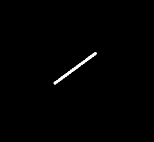

# 图像处理（三）：轮廓、几何拟合与图像分割 {#imgproc3}

## 模板匹配

模板匹配指的是计算图像与指定模板（图像）匹配程度的过程，可以用于在图像中搜索指定内容。主要操作步骤是：

* 确定模板（图像），如果模板中仅有部分区域为待搜索的内容时，可以使用遮罩；  
* 在待匹配的图像上移动模板，模板左上角顶点元素对准的图像像素称为模板匹配的目标像素，计算模板与模板覆盖住的图像区域的匹配程度值，并将该值作为目标图像对应像素的值。目标图像的宽度等于待匹配图像的宽度减去模板（图像）宽度+1，高度等于待匹配图像的高度减去模板（图像）高度+1

OpenCV在**matchTemplate**函数中封装了模板匹配操作，它提供了6种模板匹配程度的计算方法：

* TM_SQDIFF

$$
R(x,y) = \sum_{r,c}(T(r,c)-I(y+r,x+c))^2
$$

其中$T(r,c)$表示模板（图像）中的元素（像素），$I(y+r,x+c)$表示待匹配图像中以$(x,y)$位置为目标像素的模板覆盖区域中的像素。

```{r}
#生成矩阵
set.seed(123)
img_mat = matrix(sample(1:5,100,replace = T),nr=10,nc=10)

#直接以img_mat的前3行前3列元素为模板
templ_mat = img_mat[1:3,1:3]

#将img_mat转变为图像矩阵
img = Mat(10,10,CV_8UC1)
img[] = img_mat
#将templ_mat也转变为图像矩阵
templ = Mat(3,3,CV_8UC1)
templ[] = templ_mat

#按TM_SQDIFF匹配方法依照templ对img进行模板匹配，结果保存在res中
res = cv_matchTemplate(img, templ, TM_SQDIFF)

#查看结果
as_array(res, numeric = TRUE)
```


从结果可以看到，第1行第1列的匹配值为0，即图像的前3行前3列像素区域与模板完全匹配，这符合预期。也可以用如下代码来验证这个结果：

```{r}
#生成矩阵
set.seed(123)
img_mat = matrix(sample(1:5,100,replace = T),nr=10,nc=10)

#直接以img_mat的前3行前3列元素为模板
templ_mat = img_mat[1:3,1:3]

#按公式计算匹配程度值，结果保存在res.mat中
res_mat = matrix(0,dim(img_mat)[1]-dim(templ_mat)[1]+1,
                 dim(img_mat)[2]-dim(templ_mat)[2]+1)
for(i in 1:nrow(res_mat)){
  for(j in 1:ncol(res_mat)){
    res_mat[i,j] = sum((templ_mat - img_mat[i:(i+2),j:(j+2)])^2)
  }
}

#查看结果
res_mat
```

TM_SQDIFF方法形成的最小值点位置是模板匹配的最佳位置。

* TM_SQDIFF_NORMED

$$
R(x,y) = \frac{\sum_{r,c}(T(r,c)-I(y+r,x+c))^2}{\sqrt {\sum_{r,c}T(r,c)^2 \cdot \sum_{r,c}I(y+r,x+c)^2}}
$$ 

```{r}
#生成矩阵
set.seed(123)
img_mat = matrix(sample(1:5,100,replace = T),nr=10,nc=10)

#直接以img_mat的前3行前3列元素为模板
templ_mat = img_mat[1:3,1:3]

#将img_mat转变为图像矩阵
img = Mat(10,10,CV_8UC1)
img[] = img_mat
#将templ_mat也转变为图像矩阵
templ = Mat(3,3,CV_8UC1)
templ[] = templ_mat

#按TM_SQDIFF_NORMED匹配方法依照templ对img进行模板匹配，结果保存在res中
res = cv_matchTemplate(img, templ, TM_SQDIFF_NORMED)

#查看结果
round(as_array(res, numeric = TRUE),2)

```


可以用如下代码来验证这个结果：

```{r}
#生成矩阵
set.seed(123)
img_mat = matrix(sample(1:5,100,replace = T),nr=10,nc=10)

#直接以img_mat的前3行前3列元素为模板
templ_mat = img_mat[1:3,1:3]

#按公式计算匹配程度值，结果保存在res_mat中
res_mat = matrix(0,dim(img_mat)[1]-dim(templ_mat)[1]+1,
                 dim(img_mat)[2]-dim(templ_mat)[2]+1)
for(i in 1:nrow(res_mat)){
  for(j in 1:ncol(res_mat)){
    numer = sum((templ_mat - img_mat[i:(i+2),j:(j+2)])^2)
    denom = sqrt(sum(templ_mat^2) * sum(img_mat[i:(i+2),j:(j+2)]^2))
    res_mat[i,j] = numer/denom
  }
}

#查看结果
round(res_mat,2)
```

TM_SQDIFF_NORMED方法形成的最小值点位置是模板匹配的最佳位置。

* TM_CCORR

$$
R(x,y) = \sum_{r,c}(T(r,c) \times I(y+r,x+c))
$$ 

```{r}
#生成矩阵
set.seed(123)
img_mat = matrix(sample(1:5,100,replace = T),nr=10,nc=10)

#直接以img.mat的前3行前3列元素为模板
templ_mat = img_mat[1:3,1:3]

#将img_mat转变为图像矩阵
img = Mat(10,10,CV_8UC1)
img[] = img_mat
#将templ_mat也转变为图像矩阵
templ = Mat(3,3,CV_8UC1)
templ[] = templ_mat

#按TM_CCORR匹配方法依照templ对img进行模板匹配，结果保存在res中
res = cv_matchTemplate(img, templ, TM_CCORR)

#查看结果
as_array(res, numeric = TRUE)
```

可以用如下代码来验证这个结果：

```{r}
#生成矩阵
set.seed(123)
img_mat = matrix(sample(1:5,100,replace = T),nr=10,nc=10)

#直接以img.mat的前3行前3列元素为模板
templ_mat = img_mat[1:3,1:3]

#按公式计算匹配程度值，结果保存在res.mat中
res_mat = matrix(0,dim(img_mat)[1]-dim(templ_mat)[1]+1,
                 dim(img_mat)[2]-dim(templ_mat)[2]+1)
for(i in 1:nrow(res_mat)){
  for(j in 1:ncol(res_mat)){
    res_mat[i,j] = sum(templ_mat * img_mat[i:(i+2),j:(j+2)])
  }
}

#查看结果
res_mat

```

* TM_CCORR_NORMED

$$
R(x,y) = \frac{\sum_{r,c}(T(r,c) \cdot I(y+r,x+c))}{\sqrt {\sum_{r,c}T(r,c)^2 \cdot \sum_{r,c}I(y+r,x+c)^2}}
$$ 

```{r}
#生成矩阵
set.seed(123)
img_mat = matrix(sample(1:5,100,replace = T),nr=10,nc=10)

#直接以img_mat的前3行前3列元素为模板
templ_mat = img_mat[1:3,1:3]

#将img_mat转变为图像矩阵
img = Mat(10,10,CV_8UC1)
img[] = img_mat
#将templ_mat也转变为图像矩阵
templ = Mat(3,3,CV_8UC1)
templ[] = templ_mat

#按TM_CCORR_NORMED匹配方法依照templ对img进行模板匹配，结果保存在res中
res = cv_matchTemplate(img, templ, TM_CCORR_NORMED)

#查看结果
round(as_array(res, numeric = TRUE),2)
```

可以用如下代码来验证这个结果：

```{r}
#生成矩阵
set.seed(123)
img_mat = matrix(sample(1:5,100,replace = T),nr=10,nc=10)

#直接以img_mat的前3行前3列元素为模板
templ_mat = img_mat[1:3,1:3]

#按公式计算匹配程度值，结果保存在res_mat中
res_mat = matrix(0,dim(img_mat)[1]-dim(templ_mat)[1]+1,
                 dim(img_mat)[2]-dim(templ_mat)[2]+1)
for(i in 1:nrow(res_mat)){
  for(j in 1:ncol(res_mat)){
    numer = sum(templ_mat * img_mat[i:(i+2),j:(j+2)])
    denom = sqrt(sum(templ_mat^2) * sum(img_mat[i:(i+2),j:(j+2)]^2))
    res_mat[i,j] = numer/denom
  }
}

#查看结果
round(res_mat,2)
```

TM_CCORR_NORMED方法形成的最大值点位置是模板匹配的最佳位置。

* TM_CCOEFF

$$
R(x,y) = \sum_{r,c}(T'(r,c) \cdot I'(y+r,x+c))
$$

其中：

$$
\begin{aligned}
&T'(r,c) = T(r,c)-\frac {1}{w \cdot h} \cdot \sum_{r_1,c_1}T(r_1,c_1) \\
&I'(y+r,x+c)=I(y+r,x+c)-\frac {1}{w \cdot h} \cdot \sum_{r_1,c_1} I(y+r_1,x+c_1)
\end{aligned}
$$
其中，$w$和$h$为模板（图像）的宽度和高度，$\displaystyle \frac {1}{w \cdot h} \cdot \sum_{r_1,c_1}T(r_1,c_1)$表示模板（图像）的元素值（像素值）的平均值。

```{r}
#生成矩阵
set.seed(123)
img_mat = matrix(sample(1:5,100,replace = T),nr=10,nc=10)

#直接以img_mat的前3行前3列元素为模板
templ_mat = img_mat[1:3,1:3]

#将img_mat转变为图像矩阵
img = Mat(10,10,CV_8UC1)
img[] = img_mat
#将templ_mat也转变为图像矩阵
templ = Mat(3,3,CV_8UC1)
templ[] = templ_mat

#按TM_CCOEFF匹配方法依照templ对img进行模板匹配，结果保存在res中
res = cv_matchTemplate(img, templ, TM_CCOEFF)

#查看结果
round(as_array(res, numeric = TRUE),2)
```

可以用如下代码来验证这个结果：

```{r}
#生成矩阵
set.seed(123)
img_mat = matrix(sample(1:5,100,replace = T),nr=10,nc=10)

#直接以img_mat的前3行前3列元素为模板
templ_mat = img_mat[1:3,1:3]

#按公式计算匹配程度值，结果保存在res_mat中
res_mat = matrix(0,dim(img_mat)[1]-dim(templ_mat)[1]+1,
                 dim(img_mat)[2]-dim(templ_mat)[2]+1)
for(i in 1:nrow(res_mat)){
  for(j in 1:ncol(res_mat)){
    res_mat[i,j] = sum((templ_mat - mean(templ_mat)) * 
                         (img_mat[i:(i+2),j:(j+2)] - 
                            mean(img_mat[i:(i+2),j:(j+2)])))
  }
}

#查看结果
round(as_array(res, numeric = TRUE),2)
```


* TM_CCOEFF_NORMED

$$
R(x,y) = \frac{\sum_{r,c}(T'(r,c) \cdot I'(y+r,x+c))}{\sqrt {\sum_{r,c}T'(r,c)^2 \cdot \sum_{r,c}I'(y+r,x+c)^2}}
$$

其中：

$$
\begin{aligned}
&T'(r,c) = T(r,c)-\frac {1}{w \cdot h} \cdot \sum_{r_1,c_1}T(r_1,c_1) \\
&I'(y+r,x+c)=I(y+r,x+c)-\frac {1}{w \cdot h} \cdot \sum_{r_1,c_1} I(y+r_1,x+c_1)
\end{aligned}
$$
```{r}
#生成矩阵
set.seed(123)
img_mat = matrix(sample(1:5,100,replace = T),nr=10,nc=10)

#直接以img_mat的前3行前3列元素为模板
templ_mat = img_mat[1:3,1:3]

#将img_mat转变为图像矩阵
img = Mat(10,10,CV_8UC1)
img[] = img_mat
#将templ_mat也转变为图像矩阵
templ = Mat(3,3,CV_8UC1)
templ[] = templ_mat

#按TM_CCOEFF_NORMED匹配方法依照templ对img进行模板匹配，结果保存在res中
res = cv_matchTemplate(img, templ, TM_CCOEFF_NORMED)

#查看结果
round(as_array(res, numeric = TRUE),2)
```

可以用如下代码来验证这个结果：

```{r}
#生成矩阵
set.seed(123)
img_mat = matrix(sample(1:5,100,replace = T),nr=10,nc=10)

#直接以img_mat的前3行前3列元素为模板
templ_mat = img_mat[1:3,1:3]

#按公式计算匹配程度值，结果保存在res_mat中
res_mat = matrix(0,dim(img_mat)[1]-dim(templ_mat)[1]+1,
                 dim(img_mat)[2]-dim(templ_mat)[2]+1)
for(i in 1:nrow(res_mat)){
  for(j in 1:ncol(res_mat)){
    numer = sum((templ_mat - mean(templ_mat)) * 
                  (img_mat[i:(i+2),j:(j+2)] - 
                     mean(img_mat[i:(i+2),j:(j+2)])))
    denom = sqrt(sum((templ_mat - mean(templ_mat))^2) * 
                   sum((img_mat[i:(i+2),j:(j+2)] - 
                          mean(img_mat[i:(i+2),j:(j+2)]))^2))
    res_mat[i,j] = numer / denom
  }
}

#查看结果
round(res_mat,2)
```

TM_CCOEFF_NORMED方法形成的最大值点位置是模板匹配的最佳位置。

**示例**

下图中左边为模板（图像），中间为模板遮罩，右边为待匹配图像：

```{r echo=FALSE}
img = cv_imread("images/LinuxLogo1.png")
tmpl = cv_imread("images/xTempl.png")
mask = cv_imread("images/xTemplMask.png")
op = par(mfrow=c(1,3), mar=c(1,1,2,1))
plot(tmpl); title(main="template")
plot(mask); title(main="mask")
plot(img);  title(main="image")
par(op)
```

以下代码演示了使用遮罩对模板匹配准确度的影响：

```{r}
#读取图像文件
img = cv_imread("images/LinuxLogo1.png")
#读取模板图像文件
tmpl = cv_imread("images/xTempl.png")
#获得模板图像基本信息：dim() 返回 c(高度, 宽度, 通道数)
tmpl_info = dim(tmpl)

#读取遮罩文件
mask = cv_imread("images/xTemplMask.png")
#use_mask为FALSE，不使用遮罩，如果为TRUE，则使用遮罩
use_mask = FALSE

#按TM_CCORR_NORMED匹配方法依照tmpl对img进行模板匹配，结果保存在res中
if(use_mask){
  #使用遮罩进行模板匹配
  res = cv_matchTemplate(img, tmpl, TM_CCORR_NORMED, mask)
}else{
  #不使用遮罩进行模板匹配
  res = cv_matchTemplate(img, tmpl, TM_CCORR_NORMED)
}

#对res进行归一化（最大最小值方式）
res = cv_normalize(res, alpha = 0, beta = 255, norm_type = NORM_MINMAX)

#minMaxLoc 一次性返回最小/最大值及其位置
ml = cv_minMaxLoc(res)

#由于使用的是TM_CCORR_NORMED方法，所以最大像素值出现的位置是最佳匹配位置
matchLoc = ml$maxLoc
#依据最佳匹配位置和模板的尺寸绘制最佳模板匹配区域
img = cv_rectangle(
    img,
    matchLoc,
    matchLoc + c(tmpl_info[2], tmpl_info[1]),
    c(0, 0, 255),
    2
  )

#res是浮点图，plot() 只认 [0,1] 的浮点或 CV_8U，所以画矩形前先转成 8 位
res8 = cv_mat_convert(res, CV_8U)
res8 = cv_rectangle(
    res8,
    matchLoc,
    matchLoc + c(tmpl_info[2], tmpl_info[1]),
    c(255),
    2
  )
# cv_imshow("result", res8)
# cv_imshow("matched", img)
```

当不使用遮罩时，匹配结果不准确

```{r echo=FALSE}
cv_destroyAllWindows()
op = par(mfrow=c(1,2), mar=c(1,1,2,1))
plot(res8); title(main="response (no mask)")
plot(img);  title(main="matched (no mask)")
par(op)
```

当把代码中的use_mask设置为TRUE时（即使用遮罩时），匹配结果符合预期。

```{r echo=FALSE}
#读取图像文件
img = cv_imread("images/LinuxLogo1.png")
#读取模板图像文件
tmpl = cv_imread("images/xTempl.png")
#获得模板图像基本信息：dim() 返回 c(高度, 宽度, 通道数)
tmpl_info = dim(tmpl)

#读取遮罩文件
mask = cv_imread("images/xTemplMask.png")
#use_mask为FALSE，不使用遮罩，如果为TRUE，则使用遮罩
use_mask = TRUE

#按TM_CCORR_NORMED匹配方法依照tmpl对img进行模板匹配，结果保存在res1中
if(use_mask){
  #使用遮罩进行模板匹配
  res1 = cv_matchTemplate(img, tmpl, TM_CCORR_NORMED, mask)
}else{
  #不使用遮罩进行模板匹配
  res1 = cv_matchTemplate(img, tmpl, TM_CCORR_NORMED)
}

#对res1进行归一化（最大最小值方式）
res1 = cv_normalize(res1, alpha = 0, beta = 255, norm_type = NORM_MINMAX)

#minMaxLoc 一次性返回最小/最大值及其位置
ml = cv_minMaxLoc(res1)

#由于使用的是TM_CCORR_NORMED方法，所以最大像素值出现的位置是最佳匹配位置
matchLoc = ml$maxLoc
#依据最佳匹配位置和模板的尺寸绘制最佳模板匹配区域
img = cv_rectangle(
    img,
    matchLoc,
    matchLoc + c(tmpl_info[2], tmpl_info[1]),
    c(0, 0, 255),
    2
  )

res1_8 = cv_mat_convert(res1, CV_8U)
res1_8 = cv_rectangle(
    res1_8,
    matchLoc,
    matchLoc + c(tmpl_info[2], tmpl_info[1]),
    c(255),
    2
  )
```

```{r echo=FALSE}
cv_destroyAllWindows()
op = par(mfrow=c(1,2), mar=c(1,1,2,1))
plot(res1_8); title(main="response (with mask)")
plot(img);    title(main="matched (with mask)")
par(op)
```

> 遮罩到底改变了什么，可以直接量出来：`LinuxLogo1.png` 是 240×320，模板
> `xTempl.png` 是 67×73（所以响应图是 174×248）。
>
> | `use_mask` | 最佳匹配位置 `maxLoc` |
> | --- | --- |
> | `FALSE` | `(113, 73)` |
> | `TRUE`  | `(206, 77)` |
>
> 两个位置差了 90 多个像素。不带遮罩时，模板里那块**灰色背景**也参与了
> `TM_CCORR_NORMED` 的相关运算，而灰色背景在图中到处都是，于是「最像」的地方
> 反而落到了 `Linu` 这几个白字上；带上遮罩后，只有 X 形笔画参与计算，框才落到
> 真正的 X 上。这正是原书「不使用遮罩时匹配结果不准确」那句话的定量版本。
>


```{r echo=FALSE,eval=FALSE}
ret = cv_threshold(mask,mask,0,255,
                   THRESH_BINARY+THRESH_OTSU)
cv_imwrite("images/xTempl.png",mask)

img = cv.imread("images/LinuxLogo.jpg")
cv_threshold(img,img,150,255,THRESH_BINARY)
cv_imwrite("images/LinuxLogo1.png",img)
```


```{r echo=FALSE,eval=FALSE}
use_mask = FALSE
image_window = "Source Image"
result_window = "Result window"
match_method = 0
max_Trackbar = 5

MatchingMethod = function(val, param)
{
  match_method <<- cv_getTrackbarPos(trackbar_label, image_window)

  #img_display 是 img 的副本，用来在上面画框，不动原图
  img_display = Mat(dim(img)[1], dim(img)[2], CV_8UC3)
  cv_copyTo(img, dst = img_display)

  #dim() 返回 c(高度, 宽度, 通道数)
  img_info   = dim(img)
  templ_info = dim(templ)

  #只有 TM_SQDIFF 和 TM_CCORR_NORMED 支持遮罩
  method_accepts_mask = (match_method == TM_SQDIFF || match_method == TM_CCORR_NORMED)

  if (use_mask && method_accepts_mask){
    result = cv_matchTemplate(img, templ, match_method, mask)
  }
  else{
    result = cv_matchTemplate(img, templ, match_method)
  }
  #归一化到 [0,1]，方便直接 cv_imshow
  result = cv_normalize(result, alpha = 0, beta = 1, norm_type = NORM_MINMAX)

  #注意：这里必须对 result 求极值，原书写成了 res1（上一段代码残留的变量）
  ml = cv_minMaxLoc(result)
  if (match_method == TM_SQDIFF || match_method == TM_SQDIFF_NORMED){
    matchLoc = ml$minLoc
  }
  else{
    matchLoc = ml$maxLoc
  }

  img_display = cv_rectangle(
    img_display,
    matchLoc,
    matchLoc + c(templ_info[2], templ_info[1]),
    c(0, 0, 0),
    2
  )
  result = cv_rectangle(
    result,
    matchLoc,
    matchLoc + c(templ_info[2], templ_info[1]),
    c(0),
    2
  )

  cv_imshow(image_window, img_display)
  cv_imshow(result_window, result)
}

img = cv_imread("images/Template_Matching_Original_Image.jpg")
templ = cv_imread("images/Template_Matching_Template_Image1.jpg")
use_mask = FALSE

cv_namedWindow(image_window, WINDOW_AUTOSIZE)
cv_namedWindow(result_window, WINDOW_AUTOSIZE)
trackbar_label = "Method: \n 0: SQDIFF \n 1: SQDIFF NORMED \n 2: TM CCORR \n 3: TM CCORR NORMED \n 4: TM COEFF \n 5: TM COEFF NORMED"
cv_createTrackbar(trackbar_label,
                  image_window,
                  match_method,
                  max_Trackbar,
                  MatchingMethod)
MatchingMethod(0, 0)
```


**示例**

```{r}
#读取图像文件
img = cv_imread("images/orangetree.jpg")
#读取模板图像文件
tmpl = cv_imread("images/orange_templ.jpg")
#获得模板图像基本信息：dim() 返回 c(高度, 宽度, 通道数)
tmpl_info = dim(tmpl)

#按TM_CCORR_NORMED匹配方法依照tmpl对img进行模板匹配，结果保存在res中
res = cv_matchTemplate(img, tmpl, TM_CCORR_NORMED)

#对res进行归一化（最大最小值方式），并转成8位（便于画框和展示）
res = cv_normalize(res, alpha = 0, beta = 255, norm_type = NORM_MINMAX)
res = cv_mat_convert(res, CV_8U)

#res比原图小一圈，铺到一张与原图同尺寸的画布上，方便并排对照
img_info = dim(img)
res_info = dim(res)
res1 = Mat(img_info[1], img_info[2], CV_8UC1, 0)
#cv_mat_roi 返回的是「视图」，cv_copyTo 写进去会直接反映到 res1 上
roi = cv_mat_roi(res1, c(0, 0, res_info[2], res_info[1]))
cv_copyTo(res, dst = roi)

#minMaxLoc 一次性返回最小/最大值及其位置
ml = cv_minMaxLoc(res1)

#由于使用的是TM_CCORR_NORMED方法，所以最大像素值出现的位置是最佳匹配位置
matchLoc = ml$maxLoc
#依据最佳匹配位置和模板的尺寸绘制最佳模板匹配区域
img = cv_rectangle(
    img,
    matchLoc,
    matchLoc + c(tmpl_info[2], tmpl_info[1]),
    c(0, 0, 255),
    2
  )

res1 = cv_rectangle(
    res1,
    matchLoc,
    matchLoc + c(tmpl_info[2], tmpl_info[1]),
    c(255),
    2
  )
# cv_imshow("result", res1)
# cv_imshow("matched", img)
```


```{r echo=FALSE}
cv_destroyAllWindows()
op = par(mfrow=c(1,2), mar=c(1,1,2,1))
plot(res1); title(main="response (padded)")
plot(img);  title(main="best match")
par(op)
```


可以试着匹配多个结果：

```{r}
#本想匹配多个结果，但感觉失败了
#读取图像文件
img = cv_imread("images/orangetree.jpg")
#读取模板图像文件
tmpl = cv_imread("images/orange_templ.jpg")
#获得模板图像基本信息
tmpl_info = dim(tmpl)

#按TM_CCORR_NORMED匹配方法依照tmpl对img进行模板匹配，结果保存在res中
res = cv_matchTemplate(img, tmpl, TM_CCORR_NORMED)

#对res进行归一化（最大最小值方式），并转成8位
res = cv_normalize(res, alpha = 0, beta = 255, norm_type = NORM_MINMAX)
res = cv_mat_convert(res, CV_8U)

#由于res的尺寸与原图像有差异，不好对比结果
img_info = dim(img)
res_info = dim(res)
res1 = Mat(img_info[1], img_info[2], CV_8UC1, 0)
roi = cv_mat_roi(res1, c(0, 0, res_info[2], res_info[1]))
cv_copyTo(res, dst = roi)

# #匹配前1000个结果
res1_mat = as_array(res1, numeric = TRUE)
# max_1000_pos = head(order(res1.mat,decreasing=T),1000)
# for(pos in max_10_pos){
#   #计算相应的行、列位置
#   rr = pos %% nrow(res1.mat)
#   if(rr==0) rr=nrow(res1.mat)
#   cc = (pos - rr) / nrow(res1.mat) +1
#   cv.rectangle01(
#     img,
#     c(cc-1,rr-1),
#     c(cc -1 + tmpl.info$width , rr-1 + tmpl.info$height),
#     c(0,0,255),
#     2,
#     8,
#     0
#   )
# }

#匹配值为255的（注意：归一化后可能有多个像素被截断到255）
pos = which(res1_mat==255, arr.ind=TRUE)[1,]
img = cv_rectangle(
  img,
  c(pos[2], pos[1]),
  c(pos[2] - 1 + tmpl_info[2], pos[1] - 1 + tmpl_info[1]),
  c(0, 0, 255),
  2
)

#匹配值为200的
pos = which(res1_mat==200, arr.ind=TRUE)[1,]
img = cv_rectangle(
  img,
  c(pos[2], pos[1]),
  c(pos[2] - 1 + tmpl_info[2], pos[1] - 1 + tmpl_info[1]),
  c(0, 0, 255),
  2
)


```

```{r echo=FALSE}
cv_destroyAllWindows()
plot(img)
```


## 查找轮廓


OpenCV封装的**cv_findContours**函数可以针对二值图像查找轮廓，而**cv_findContours**函数

**示例**

```{r echo=FALSE,eval=FALSE}
#读取图像文件
img = cv_imread("images/contour.png")
#使用Canny函数提取边缘，结果保存在edges中
edges = cv_Canny(img, 100, 200)
cv_imshow('edges', edges)

#在edges中查找轮廓，轮廓点保存在contours中，层次结构保存在hierarchy中
#轮廓查找模式为RETR_EXTERNAL，即只检测外轮廓
#轮廓查找方法为CHAIN_APPROX_NONE，即要保存物体边界上所有连续的轮廓点
r = cv_findContours(edges, RETR_EXTERNAL, CHAIN_APPROX_NONE)
contours  = r$contours
hierarchy = r$hierarchy

#第一个轮廓的全部点转成数据框
contours_daf = contour_df(contours[[1]])
range(contours_daf$x)
range(contours_daf$y)

plot(0:300, type="n")
lines(contours_daf)
```


```{r}
#读取图像文件
img = cv_imread("images/contour.png")
#使用Canny函数提取边缘，结果保存在edges中
edges = cv_Canny(img, 100, 200)
#显示edges，会发现存在6条边缘线
cv_imshow('edges', edges)

#在edges中查找轮廓，轮廓点保存在contours中，轮廓的层次结构保存在hierarchy中
#轮廓查找模式为RETR_EXTERNAL，即只检测外轮廓
#轮廓查找方法为CHAIN_APPROX_NONE，即要保存物体边界上所有连续的轮廓点
r = cv_findContours(edges, RETR_EXTERNAL, CHAIN_APPROX_NONE)
contours  = r$contours
hierarchy = r$hierarchy

#查看contours：共有几个轮廓、第1个轮廓有多少个点
length(contours)
nrow(contours[[1]])
#第1个轮廓的前几个点（x, y）
head(contour_df(contours[[1]]))

#查看层次结构：每行是 c(next, prev, firstChild, parent)
hierarchy_df(hierarchy)
```

结果表明，contours中只包含一个轮廓（即最外层轮廓），所以hierarchy中也只有1条数据，且所有元素都是-1（即不存在前后关系、父子关系和嵌套关系）。实测 `length(contours)` 为 1、`nrow(contours[[1]])` 为 840、层次结构一行 `-1 -1 -1 -1`，与书上一致。


```{r}
#在img上绘制contours中的轮廓
#第三个参数（即contourIdx）为-1时，意味着绘制contours中的所有轮廓
img = cv_drawContours(img, contours, -1, c(0, 0, 255), 3)
# cv_imshow('img', img)
```

```{r echo=FALSE}
cv_destroyAllWindows()
plot(img)
```

从结果可以看出，contours中的轮廓数据确实是外层轮廓。

将上面代码中的轮廓查找方法为CHAIN_APPROX_SIMPLE，则返回的contours结果中会仅仅包含轮廓的拐点信息，数据量会大大减少（从840个点减少为7个点）：

```{r echo=FALSE}
#读取图像文件
img = cv_imread("images/contour.png")
#使用Canny函数提取边缘，结果保存在edges中
edges = cv_Canny(img, 100, 200)

#在edges中查找轮廓，轮廓点保存在contours中，轮廓的层次结构保存在hierarchy中
#轮廓查找模式为RETR_EXTERNAL，即只检测外轮廓
#轮廓查找方法为CHAIN_APPROX_SIMPLE，即仅保存轮廓的拐点信息
r = cv_findContours(edges, RETR_EXTERNAL, CHAIN_APPROX_SIMPLE)
contours  = r$contours
hierarchy = r$hierarchy
```

可以将contours转变为数据框，便于查看7个点的坐标：
```{r}
#把轮廓上的点转成数据框：一列 x，一列 y
contours_daf = contour_df(contours[[1]])
contours_daf
```

```{r echo=FALSE,eval=FALSE}
#在img上绘制contours中的轮廓
#第三个参数（即contourIdx）为-1时，意味着绘制contours中的所有轮廓
img = cv_drawContours(img, contours, -1, c(0, 0, 255), 3)
plot(img)
```

**示例**

以下代码演示使用RETR_LIST来查找所有的轮廓，包括内围、外围轮廓。在这种查找模式下，不对查找到的轮廓建立父子关系和嵌套关系，也即轮廓层次结构中所有元素的第3、第4个分量都会被置为-1。

```{r eval=FALSE,echo=FALSE}
img = cv_imread("images/contour.png")
edges = cv_Canny(img, 100, 200)
cv_imshow('edges', edges)
r = cv_findContours(edges, RETR_LIST, CHAIN_APPROX_NONE)
contours  = r$contours
hierarchy = r$hierarchy

contours_list = lapply(contours, contour_df)

plot(0:300, type="n")
for(i in seq(2, length(contours_list), 2)){
  tmp = contours_list[[i]]
  text(tmp[1,1], tmp[1,2], i)
  lines(tmp)
}
```

```{r}
#读取图像文件
img = cv_imread("images/contour.png")
#使用Canny函数提取边缘，结果保存在edges中
edges = cv_Canny(img, 100, 200)

#在edges中查找轮廓，轮廓点保存在contours中，轮廓的层次结构保存在hierarchy中
#轮廓查找模式为RETR_LIST，即检测所有的轮廓，包括内围、外围轮廓
#轮廓查找方法为CHAIN_APPROX_SIMPLE，即仅保存轮廓的拐点信息
r = cv_findContours(edges, RETR_LIST, CHAIN_APPROX_SIMPLE)
contours  = r$contours
hierarchy = r$hierarchy

#查看contours：共有几个轮廓，每个轮廓各有几个点
length(contours)
sapply(contours, nrow)

#查看层次结构
nrow(hierarchy_df(hierarchy))
hierarchy_df(hierarchy)
```

结果表明，contours中包含12个轮廓（6条边缘都有内外两个轮廓），这些轮廓的前后顺序体现在hierarchy中——从hierarchy的第2个元素可以看出，contours的第2个轮廓的next值为2，所以其后一个轮廓是第3个，而previous的值为0，所以其前一个轮廓是第1个。

进一步，可以通过如下代码标注一下这12个轮廓在原图的位置：

```{r}
#获取图像的基本信息：dim() 返回 c(高度, 宽度, 通道数)
img_info = dim(img)

#获取每个轮廓上的点
contours_list = lapply(contours, contour_df)

#绘制每条轮廓线，标注其编号
plot(0:max(img_info[1], img_info[2]), type="n",
     xlim=c(0, img_info[2]), ylim=c(0, img_info[1]),
     xlab="", ylab="")
for(i in 1:length(contours_list)){
  #将每个轮廓点数据转变为数据框
  contours_daf = contours_list[[i]]
  #绘制轮廓
  lines(contours_daf)
  #按i的奇偶性控制标注文本的横向偏移（以便看出同一条边缘的两个轮廓编号）
  if(i %% 2==0){
    #i为偶数，标注文本向右偏移
    hadj = c(-0.5,0.5)
  }else{
    #i为奇数，标注文本不偏移
    hadj = c(1,0.5)
  }
  #标注轮廓的编号
  text(contours_daf[1,1], contours_daf[1,2], i-1, adj=hadj)
}
```

```{r echo=FALSE}
cv_destroyAllWindows()
# plot(img)
```

由于绘制的结果是在笛卡尔坐标系中，需要将绘制结果上下颠倒之后再与原图形对照观察。如果希望直接采用图像的像素坐标系，可以使用如下代码：

```{r}
#获取图像的基本信息
img_info = dim(img)

#绘制每条轮廓线，标注其编号
plot(0:max(img_info[1], img_info[2]), type="n",
     xlim=c(0, img_info[2]), ylim=c(0, img_info[1]),
     xlab="", ylab="", xaxt="n", yaxt="n")
axis(side=2, at=seq(0,250,by=50), labels=(img_info[1] - seq(0,250,by=50)))
axis(side=3)
for(i in 1:length(contours_list)){
  #将每个轮廓点数据转变为数据框
  contours_daf = contours_list[[i]]
  #调整点的纵坐标值（像素坐标系，纵轴正向指向下方）
  contours_daf$y = img_info[1] - contours_daf$y
  #绘制轮廓
  lines(contours_daf)
  #按i的奇偶性控制标注文本的横向偏移（以便看出同一条边缘的两个轮廓编号）
  if(i %% 2==0){
    #i为偶数，标注文本向右偏移
    hadj = c(-0.5,0.5)
  }else{
    #i为奇数，标注文本不偏移
    hadj = c(1,0.5)
  }
  #标注轮廓的编号
  text(contours_daf[1,1],contours_daf[1,2],i-1,adj=hadj)
}
```

**示例**

以下代码演示了动态调整Canny函数的上下阈值时，轮廓查找结果也会跟着变化：


```{r eval=FALSE}

#定义滑动条滑动事件的响应函数
thresh_callback = function(val, param)
{
  #获取控制下阈值的滑动条的当前取值，存入thresh中，上阈值设定为下阈值的2倍
  thresh = cv_getTrackbarPos("Canny thresh:", source_window)
  #对src_gray进行边缘检测，结果保存在canny_output中
  canny_output = cv_Canny(src_gray, thresh, thresh * 2)
  #获取canny_output的基本信息
  canny_output_info = dim(canny_output)

  #在canny_output中查找轮廓，轮廓点保存在contours，轮廓层次保存在hierarchy中
  r = cv_findContours(canny_output, RETR_TREE, CHAIN_APPROX_SIMPLE)
  contours  = r$contours
  hierarchy = r$hierarchy

  #按canny_ouput的尺寸生成8位无符号3通道图像矩阵drawing，
  #所有像素的值都为黑色c(0,0,0)
  drawing = Mat(canny_output_info[1], canny_output_info[2], CV_8UC3, 0)
  #在drawing中绘制每个轮廓
  for(i in 1:length(contours))
  {
    #随机设定轮廓绘制颜色
    ccolor = c(runif(1, 0, 255), runif(1, 0, 255), runif(1, 0, 255))
    #绘制第i个轮廓
    drawing = cv_drawContours(drawing, contours, i-1, ccolor, 2, LINE_8, hierarchy, 0)
  }
  #将drawing显示在标题为contours的图形窗口中
  cv_imshow("Contours", drawing)
}

#读取图像文件
src = cv_imread("images/HappyFish.jpg")
#将src转变为灰度图，结果保存在src_gray中
src_gray = cv_cvtColor(src, COLOR_BGR2GRAY)
#对src_gray进行归一化盒子滤波，结果保存在src_gray中
src_gray = cv_blur(src_gray, c(3, 3))

#生成标题为Source的图形窗口，并显示src
source_window = "Source"
cv_namedWindow(source_window)
cv_imshow(source_window, src)

#在标题为Source的图形窗口中创建控制下阈值的滑动条
cv_createTrackbar("Canny thresh:",
                  source_window,
                  30,
                  255,
                  thresh_callback)
#调用thresh_callback函数
thresh_callback(0, 0)
```

## 计算最小包含凸集（凸包）

在图像处理过程中，常常需要寻找图像中能包含一个物体的最小凸集——是所有能包含这个物体的凸集的交集。

```{r echo=FALSE}
img = cv_imread("images/star1.png")

img_canny = cv_Canny(img, 300, 600)

r = cv_findContours(img_canny, RETR_EXTERNAL, CHAIN_APPROX_SIMPLE)
contours  = r$contours
hierarchy = r$hierarchy

#挑出点数最多的那个轮廓
pos = which.max(sapply(contours, nrow))
hull = cv_convexHull(contours[[pos]])
img = cv_polylines(img, hull, TRUE, c(0, 0, 255), 3)

plot(img)
```

在上图中，红色线条所包围的区域即为黄色海星的凸包。


OpenCV在**cv::convexHull**函数中封装了凸包计算操作。主要步骤：

* 对图像进行边缘检测，形成边缘数据  
* 对边缘数据进行轮廓检测，形成轮廓数据（是点的集合） 
* 对轮廓（点集）进行凸包计算

**示例**

以下代码演示了如何计算一个点集的凸包：

```{r eval=FALSE,echo=FALSE}
set.seed(123)
pnts = data.frame(x=rnorm(70,mean=150,sd=60),y=rnorm(70,mean=150,sd=60))
plot(0:300,type="n")
points(pnts)

#点集写成 N×2 的整数矩阵即可；convexHull 只接受 CV_32S / CV_32F
pnts_mat = matrix(as.integer(round(c(pnts$x, pnts$y))), ncol = 2)
hull = cv_convexHull(pnts_mat)
hull_daf = contour_df(hull)

polygon(hull_daf)
```


```{r}
#生成一个包含70个点坐标的数据框，第1列为点的横坐标，第2列为点纵坐标
set.seed(123)
pnts = data.frame(x=rnorm(70,mean=150,sd=60),y=rnorm(70,mean=150,sd=60))

#生成一个300行300列的8位无符号三通道图像矩阵img，所有像素值都为(0,0,0)
img = Mat(300,300,CV_8UC3, 0)
for(i in 1:nrow(pnts)){
  #在img上，分别以70个点为圆心，3为半径的黄色填充小圆
  img = cv_circle(img, c(pnts$x[i], pnts$y[i]), 3, c(0,255,255), -1)
}

#依据数据框中的点数据，生成一个 N×2 的整数矩阵，
#以便作为convexHull函数的points参数（它只接受 CV_32S / CV_32F）
pnts_mat = matrix(as.integer(round(c(pnts$x, pnts$y))), ncol = 2)

#针对pnts_mat的点集，计算其凸包（点集）
hull = cv_convexHull(pnts_mat)
#使用多边形绘制函数在img上绘制凸包
img = cv_polylines(img, hull, TRUE, c(255,0,0), 2)
```


```{r echo=FALSE}
plot(img)
```


**示例**

```{r}
#读取图像文件
img = cv_imread("images/palm.png")

#使用Canny函数对img提取边缘，结果保存在img_canny中
img_canny = cv_Canny(img, 300, 600)

#在img_canny中查找轮廓，轮廓点保存在contours中，轮廓的层次结构保存在hierarchy中
r = cv_findContours(img_canny, RETR_TREE, CHAIN_APPROX_SIMPLE)
contours  = r$contours
hierarchy = r$hierarchy

#对contours的每个轮廓（点集）计算凸包，并绘制在img上
for(i in 1:length(contours)){
  hull = cv_convexHull(contours[[i]])
  img = cv_polylines(img, hull, TRUE, c(0,0,255), 3)
}

#查看结果
# cv_imshow('img', img)
```

```{r echo=FALSE}
cv_destroyAllWindows()
plot(img)
```


进一步，可以只针对contours中包含点数最多的轮廓计算凸包：

```{r}
#读取图像文件
img = cv_imread("images/palm.png")

#使用Canny函数对img提取边缘，结果保存在img_canny中
img_canny = cv_Canny(img, 300, 600)

#在img_canny中查找轮廓，轮廓点保存在contours中，轮廓的层次结构保存在hierarchy中
r = cv_findContours(img_canny, RETR_TREE, CHAIN_APPROX_SIMPLE)
contours  = r$contours
hierarchy = r$hierarchy

#对contours中包含点数最多的轮廓计算凸包，并绘制在img上
pos = which.max(sapply(contours, nrow))
hull = cv_convexHull(contours[[pos]])
img = cv_polylines(img, hull, TRUE, c(0,0,255), 3)

#查看结果
# cv_imshow('img', img)
```


```{r echo=FALSE}
cv_destroyAllWindows()
plot(img)
```


```{r eval=FALSE,echo=FALSE}
#定义滑动条滑动事件的响应函数
thresh_callback = function(val, param)
{
  thresh <<- cv_getTrackbarPos("Canny thresh:", source_window)
  canny_output = cv_Canny(src_gray, thresh, thresh * 2)
  canny_output_info = dim(canny_output)
  r = cv_findContours(canny_output, RETR_TREE, CHAIN_APPROX_SIMPLE)
  contours = r$contours
  if(length(contours) <= 0){
    return(0)
  }
  #每个轮廓单独算一个凸包
  hull_list = lapply(contours, cv_convexHull)

  drawing = Mat(canny_output_info[1], canny_output_info[2], CV_8UC3, 0)
  for(i in 1:length(contours)){
    ccolor = c(runif(1, 0, 255), runif(1, 0, 255), runif(1, 0, 255))
    drawing = cv_drawContours(drawing, contours, i-1, ccolor)
    drawing = cv_polylines(drawing, hull_list[[i]], TRUE, ccolor, 1)
  }
  cv_imshow("Hull demo", drawing)
}

src = cv_imread("images/palm.png")
src_gray = cv_cvtColor(src, COLOR_BGR2GRAY)
src_gray = cv_blur(src_gray, c(3, 3))
source_window = "Source"

cv_namedWindow(source_window)
cv_imshow(source_window, src)
thresh = 100
max_thresh = 255

cv_createTrackbar("Canny thresh:",
                  source_window,
                  thresh,
                  max_thresh,
                  thresh_callback)
cv_setTrackbarPos("Canny thresh:",
                  source_window,
                  thresh)
thresh_callback(0, 0)
```

## 计算最小包含矩形、圆形或者三角形

OpenCV在**cv::boundingRect**函数、**cv::minEnclosingCircle**函数和**cv.minEnclosingTriangle**函数中分别封装了计算能够包含一个物体的最小矩形、最小圆形和最小三角形。

**示例**

以下代码演示了如何计算包含一个点集的最小矩形：

```{r}
#生成一个包含70个点坐标的数据框，第1列为点的横坐标，第2列为点纵坐标
set.seed(123)
pnts = data.frame(x=rnorm(70,mean=150,sd=30),y=rnorm(70,mean=150,sd=20))

#生成一个300行300列的8位无符号三通道图像矩阵img，所有像素值都为(0,0,0)
img = Mat(300,300,CV_8UC3, 0)
for(i in 1:nrow(pnts)){
  #在img上，分别以70个点为圆心，1为半径的黄色填充小圆
  img = cv_circle(img, c(pnts$x[i], pnts$y[i]), 1, c(0,255,255), -1)
}

#依据数据框中的点数据，生成一个 N×2 的整数矩阵
#cv_boundingRect 和 cv_convexHull 一样，只接受 CV_32S / CV_32F 的点集
pnts_mat = matrix(as.integer(round(c(pnts$x, pnts$y))), ncol = 2)

#针对pnts_mat的点集，计算其最小包含矩形
#返回值是一个长度为4的整数向量 c(x, y, width, height)
brect = cv_boundingRect(pnts_mat)
brect

#在img上绘制包含点集的最小矩形
img = cv_rectangle(img, brect, c(0,0,255), 2)
```

```{r echo=FALSE}
plot(img)
```

最小包含矩形的左上角在 $(91, 104)$，宽 125、高 91。

也可以通过 `cv_approxPolyDP` 先把点集近似成一个多边形，再对近似多边形求最小包含矩形，结果几乎一样（顶点数从 70 个降到 65 个）：

```{r}
set.seed(123)
pnts = data.frame(x=rnorm(70,mean=150,sd=30),y=rnorm(70,mean=150,sd=20))

img = Mat(300,300,CV_8UC1, 0)
for(i in 1:nrow(pnts)){
  img = cv_circle(img, c(pnts$x[i], pnts$y[i]), 1, c(255), -1)
}

pnts_mat = matrix(as.integer(round(c(pnts$x, pnts$y))), ncol = 2)

#用近似多边形寻求boundingRect，结果差不多。近似多边形可以和findContours的结果联用
contourPoly = cv_approxPolyDP(pnts_mat, 3, TRUE)
nrow(contourPoly)

brect2 = cv_boundingRect(contourPoly)
brect2

#绿色是近似多边形，蓝色是它的最小包含矩形
img = cv_polylines(img, contourPoly, TRUE, c(0,255,0), 1)
img = cv_rectangle(img, brect2, c(255,0,0), 1)
```

```{r echo=FALSE}
plot(img)
```

**示例**

以下代码演示了如何计算包含一个点集的最小圆形：

```{r}
#生成一个包含70个点坐标的数据框，第1列为点的横坐标，第2列为点纵坐标
set.seed(123)
pnts = data.frame(x=rnorm(70,mean=150,sd=30),y=rnorm(70,mean=150,sd=20))

#生成一个300行300列的8位无符号三通道图像矩阵img，所有像素值都为(0,0,0)
img = Mat(300,300,CV_8UC3, 0)
for(i in 1:nrow(pnts)){
  #在img上，分别以70个点为圆心，1为半径的黄色填充小圆
  img = cv_circle(img, c(pnts$x[i], pnts$y[i]), 1, c(0,255,255), -1)
}

pnts_mat = matrix(as.integer(round(c(pnts$x, pnts$y))), ncol = 2)

#针对pnts_mat的点集，计算其最小包含圆形
#返回值是一个列表：center 是圆心 c(x, y)，radius 是半径
circ = cv_minEnclosingCircle(pnts_mat)
circ$center
circ$radius

#在img上绘制包含点集的最小圆形
img = cv_circle(img, circ$center, round(circ$radius), c(0,0,255), 2)
```

```{r echo=FALSE}
plot(img)
```

圆心在 $(152.00, 141.59)$，半径 63.44。

**示例**

以下代码演示了如何计算包含一个点集的最小三角形：

```{r}
#生成一个包含70个点坐标的数据框，第1列为点的横坐标，第2列为点纵坐标
set.seed(123)
pnts = data.frame(x=rnorm(70,mean=150,sd=30),y=rnorm(70,mean=150,sd=20))

#生成一个300行300列的8位无符号三通道图像矩阵img，所有像素值都为(0,0,0)
img = Mat(300,300,CV_8UC3, 0)
for(i in 1:nrow(pnts)){
  #在img上，分别以70个点为圆心，1为半径的黄色填充小圆
  img = cv_circle(img, c(pnts$x[i], pnts$y[i]), 1, c(0,255,255), -1)
}

pnts_mat = matrix(as.integer(round(c(pnts$x, pnts$y))), ncol = 2)

#针对pnts_mat的点集，计算其最小包含三角形
#返回值是一个 1×3 的 CV_32FC2 矩阵，三个顶点按列排列
tri = cv_minEnclosingTriangle(pnts_mat)
dim(tri)
contour_df(tri)

#cv_polylines 只接受 CV_32S 的点集，所以先用 cv_mat_convert 转一次
img = cv_polylines(img, cv_mat_convert(tri, CV_32S), TRUE, c(0,0,255), 2)
```

```{r echo=FALSE}
plot(img)
```

`cv_minEnclosingTriangle()` 返回的是 `CV_32F` 的浮点坐标，取整后三个顶点分别是
$(239, 85)$、$(31, 126)$、$(191, 213)$。

**示例**

```{r}
#读取图像文件
img = cv_imread("images/balloon.png")

#检测img的边缘，结果保存在canny_output中
canny_output = cv_Canny(img, 200, 200 * 2)

#查找canny_output中的轮廓
r = cv_findContours(canny_output, RETR_EXTERNAL, CHAIN_APPROX_SIMPLE)
contours  = r$contours
hierarchy = r$hierarchy

#图中共检测到7个气球
length(contours)
sapply(contours, nrow)

#计算每个轮廓（点集）的最小包含矩形、最小包含圆形和最小包含三角形，且绘制在img上
for(i in 1:length(contours)){
  #计算第i个轮廓（点集）的最小包含矩形，返回 c(x, y, width, height)
  brect = cv_boundingRect(contours[[i]])
  #在img上绘制最小包含矩形（红色）
  img = cv_rectangle(img, brect, c(0,0,255), 2)

  #计算第i个轮廓（点集）的最小包含圆形，返回 list(center, radius)
  circ = cv_minEnclosingCircle(contours[[i]])
  #在img上绘制最小圆形（绿色）
  img = cv_circle(img, circ$center, round(circ$radius), c(0,255,0), 2)

  #计算第i个轮廓（点集）的最小包含三角形，返回 1×3 的 CV_32FC2
  tri = cv_minEnclosingTriangle(contours[[i]])
  #转成 CV_32S 后在img上绘制最小三角形（蓝色）
  img = cv_polylines(img, cv_mat_convert(tri, CV_32S), TRUE, c(255,0,0), 2)
}
```

```{r echo=FALSE}
plot(img)
```

红框、绿圆、蓝三角都恰好贴住气球：矩形是正放的（不旋转）外接框，圆形是外接圆，三角形则是面积最小的外接三角形，所以它的边会明显斜着切过去。

```{r echo=FALSE,eval=FALSE}
thresh = 100
source_window = "Source"

src = cv_imread("images/balloon.png")
src_gray = cv_cvtColor(src, COLOR_BGR2GRAY)
src_gray = cv_blur(src_gray, c(3, 3))

thresh_callback = function(val, param)
{
  thresh <<- cv_getTrackbarPos("Canny thresh:", source_window)
  canny_output = cv_Canny(src_gray, thresh, thresh * 2)

  r = cv_findContours(canny_output, RETR_TREE, CHAIN_APPROX_SIMPLE)
  contours = r$contours

  n = length(contours)
  contours_poly_list = vector("list", n)
  boundRect_list     = vector("list", n)
  centers_list       = vector("list", n)
  radius_list        = vector("numeric",  n)

  for(i in 1:n)
  {
    contours_poly_list[[i]] = cv_approxPolyDP(contours[[i]], 3, TRUE)
    boundRect_list[[i]]     = cv_boundingRect(contours_poly_list[[i]])
    circ = cv_minEnclosingCircle(contours_poly_list[[i]])
    centers_list[[i]] = circ$center
    radius_list[[i]]  = circ$radius
  }

  drawing = Mat(dim(canny_output)[1], dim(canny_output)[2], CV_8UC3, 0)
  for(i in 1:n)
  {
    ccolor = c(runif(1, 0, 255), runif(1, 0, 255), runif(1, 0, 255))
    #contourIdx 是 0 起始的，画第 i 个轮廓要传 i-1
    drawing = cv_drawContours(drawing, contours, i - 1, ccolor)
    drawing = cv_rectangle(drawing, boundRect_list[[i]], ccolor, 2)
    drawing = cv_circle(drawing, centers_list[[i]], round(radius_list[[i]]), ccolor, 2)
  }
  cv_imshow("Contours", drawing)
}

cv_namedWindow(source_window)
cv_imshow(source_window, src)

max_thresh = 255

cv_createTrackbar("Canny thresh:",
                  source_window,
                  thresh,
                  max_thresh,
                  thresh_callback)
cv_setTrackbarPos("Canny thresh:",
                  source_window,
                  thresh)
thresh_callback(0, 0)
```


## 计算最小包含旋转矩形或者椭圆

OpenCV在**cv::minAreaRect**函数和**cv.fitEllipse**函数中分别封装了计算能够包含一个物体的最小旋转矩形和最小椭圆形。


**示例**

以下代码演示了如何计算包含一个点集的最小矩形和最小旋转矩形：

```{r}
#生成一个包含70个点坐标的数据框，第1列为点的横坐标，第2列为点纵坐标
set.seed(123)
pnts = data.frame(x=rnorm(70,mean=150,sd=30),y=rnorm(70,mean=150,sd=20))

#生成一个300行300列的8位无符号三通道图像矩阵img，所有像素值都为(0,0,0)
img = Mat(300,300,CV_8UC3, 0)
for(i in 1:nrow(pnts)){
  #在img上，分别以70个点为圆心，1为半径的黄色填充小圆
  img = cv_circle(img, c(pnts$x[i], pnts$y[i]), 1, c(0,255,255), -1)
}

pnts_mat = matrix(as.integer(round(c(pnts$x, pnts$y))), ncol = 2)

#针对pnts_mat的点集，计算其最小包含矩形（正放的），返回 c(x, y, width, height)
brect = cv_boundingRect(pnts_mat)
#在img上绘制包含点集的最小矩形（绿色）
img = cv_rectangle(img, brect, c(0,255,0), 2)

#针对pnts_mat的点集，计算其最小包含旋转矩形
#返回 c(center_x, center_y, width, height, angle)，angle 的单位是度
bminAreaRect = cv_minAreaRect(pnts_mat)
bminAreaRect

#获取旋转矩形的4个顶点，得到一个 4×2 的 CV_32FC2 矩阵
vtx = cv_boxPoints(bminAreaRect)
as_array(vtx, numeric = TRUE)

#在img上绘制最小旋转矩形（红色）
#cv_boxPoints 返回 CV_32F，而 cv_polylines 只吃 CV_32S，所以先转一次
img = cv_polylines(img, cv_mat_convert(vtx, CV_32S), TRUE, c(0,0,255), 2)
```

```{r echo=FALSE}
plot(img)
```

旋转矩形的中心在 $(154.40, 148.31)$，宽 118.01、高 80.59，逆时针旋转 13.84°。四个顶点依次是
$(87.47, 173.32)$、$(106.75, 95.07)$、$(221.33, 123.30)$、$(202.05, 201.55)$。
和正放的绿色矩形相比，红色旋转矩形的面积明显更小——这正是「最小包含**旋转**矩形」的意义：
它允许框跟着点集的走向一起倾斜。

**示例**

以下代码演示了如何计算包含一个点集的最小圆形和最小椭圆形：

```{r}
#生成一个包含70个点坐标的数据框，第1列为点的横坐标，第2列为点纵坐标
set.seed(123)
pnts = data.frame(x=rnorm(70,mean=150,sd=30),y=rnorm(70,mean=150,sd=20))

#生成一个300行300列的8位无符号三通道图像矩阵img，所有像素值都为(0,0,0)
img = Mat(300,300,CV_8UC3, 0)
for(i in 1:nrow(pnts)){
  #在img上，分别以70个点为圆心，1为半径的黄色填充小圆
  img = cv_circle(img, c(pnts$x[i], pnts$y[i]), 1, c(0,255,255), -1)
}

pnts_mat = matrix(as.integer(round(c(pnts$x, pnts$y))), ncol = 2)

#针对pnts_mat的点集，计算其最小包含圆形，返回 list(center, radius)
circ = cv_minEnclosingCircle(pnts_mat)
circ$center
circ$radius
#在img上绘制包含点集的最小圆形（绿色）
img = cv_circle(img, circ$center, round(circ$radius), c(0,255,0), 2)

#针对pnts_mat的点集，计算其拟合椭圆
#返回 c(center_x, center_y, MA, ma, angle)：长轴、短轴和倾角
bellipse = cv_fitEllipse(pnts_mat)
bellipse
#在img上绘制椭圆（红色）。cv_ellipse 可以直接吃这 5 个数，不用自己拆开
img = cv_ellipse(img, bellipse, c(0,0,255), 2)
```

```{r echo=FALSE}
plot(img)
```

椭圆中心 $(155.15, 149.42)$，长轴 70.01、短轴 103.41，倾角 102.15°。

注意这里函数名虽然叫「最小椭圆」，但 `cv_fitEllipse()` 做的是**最小二乘拟合**，不是「包含」——
它求的是让所有点到椭圆距离平方和最小的那条椭圆，所以边缘上的点跑到椭圆外面是正常的。
从图里能看出来：绿圆是真正的「最小包含圆」（所有点都在里面），红椭圆则会有一两个点漏在外面。

**示例**

`fitEllipse` 有三种实现，OpenCV 分别封装成 `cv_fitEllipse()`、`cv_fitEllipseAMS()` 和
`cv_fitEllipseDirect()`，对同一组点拟合出来的椭圆可能略有差异：

```{r}
set.seed(123)
pnts = data.frame(x=rnorm(70,mean=150,sd=30),y=rnorm(70,mean=150,sd=20))

img = Mat(300,300,CV_8UC3, 0)
for(i in 1:nrow(pnts)){
  img = cv_circle(img, c(pnts$x[i], pnts$y[i]), 1, c(0,255,255), -1)
}

pnts_mat = matrix(as.integer(round(c(pnts$x, pnts$y))), ncol = 2)

#三种拟合算法，结果按行拼在一起对比
e1 = cv_fitEllipse(pnts_mat)        #默认算法
e2 = cv_fitEllipseAMS(pnts_mat)     #AMS 算法
e3 = cv_fitEllipseDirect(pnts_mat)  #直接最小二乘
rbind(fitEllipse = e1, AMS = e2, Direct = e3)

img = cv_ellipse(img, e1, c(0,0,255), 2)   #红色：fitEllipse
img = cv_ellipse(img, e2, c(0,255,0), 2)   #绿色：fitEllipseAMS
img = cv_ellipse(img, e3, c(255,0,0), 2)   #蓝色：fitEllipseDirect
```

```{r echo=FALSE}
plot(img)
```

在这组点上，`AMS` 和 `Direct` 给出的结果完全一致（$155.03, 149.36, 52.41, 76.95, 99.39$），
默认的 `fitEllipse` 则拟合出一个更「胖」的椭圆（$155.15, 149.42, 70.01, 103.41, 102.15$），
所以图里红椭圆和绿蓝椭圆能看出明显差别，而绿蓝两条则完全重合。

**示例**

```{r}
#读取图像文件
img = cv_imread("images/palm.png")

#检测img的边缘，结果保存在canny_output中
canny_output = cv_Canny(img, 100, 200 * 2)

#查找canny_output中的轮廓
r = cv_findContours(canny_output, RETR_EXTERNAL, CHAIN_APPROX_SIMPLE)
contours  = r$contours
hierarchy = r$hierarchy

#手掌是一个连通的整体，所以只有一个外轮廓，共905个点
length(contours)
sapply(contours, nrow)

#计算每个轮廓（点集）的最小包含旋转矩形和最小包含椭圆，且绘制在img上
for(i in 1:length(contours)){
  #计算第i个轮廓（点集）的最小包含旋转矩形
  bminAreaRect = cv_minAreaRect(contours[[i]])
  #取4个顶点，转成 CV_32S 后在img上绘制（红色）
  vtx = cv_boxPoints(bminAreaRect)
  img = cv_polylines(img, cv_mat_convert(vtx, CV_32S), TRUE, c(0,0,255), 2)

  #计算第i个轮廓（点集）的拟合椭圆
  #fitEllipse 至少需要5个点，点数不够时会直接报错，所以先判断一下
  if(nrow(contours[[i]]) >= 5){
    bellipse = cv_fitEllipse(contours[[i]])
    #在img上绘制椭圆（蓝色）
    img = cv_ellipse(img, bellipse, c(255,0,0), 2)
  }
}
```

```{r echo=FALSE}
plot(img)
```

手掌本身是斜着放的，所以旋转矩形也跟着斜过来，紧紧贴住五根手指的外缘；椭圆则是把整个手掌
轮廓「抹圆」的结果。

```{r echo=FALSE,eval=FALSE}
thresh = 100
source_window = "Source"

src = cv_imread("images/balloon.png")
src_gray = cv_cvtColor(src, COLOR_BGR2GRAY)
src_gray = cv_blur(src_gray, c(3, 3))

thresh_callback = function(val, param)
{
  thresh <<- cv_getTrackbarPos("Canny thresh:", source_window)
  canny_output = cv_Canny(src_gray, thresh, thresh * 2)

  r = cv_findContours(canny_output, RETR_TREE, CHAIN_APPROX_SIMPLE)
  contours = r$contours

  n = length(contours)
  minRect_list    = vector("list", n)
  minEllipse_list = vector("list", n)
  for(i in 1:n)
  {
    minRect_list[[i]] = cv_minAreaRect(contours[[i]])

    #fitEllipse 至少需要5个点，点数不够时留空
    if (nrow(contours[[i]]) >= 5) {
      minEllipse_list[[i]] = cv_fitEllipse(contours[[i]])
    }
  }

  drawing = Mat(dim(canny_output)[1], dim(canny_output)[2], CV_8UC3, 0)
  for(i in 1:n)
  {
    ccolor = c(runif(1, 0, 255), runif(1, 0, 255), runif(1, 0, 255))
    #contourIdx 是 0 起始的，画第 i 个轮廓要传 i-1
    drawing = cv_drawContours(drawing, contours, i - 1, ccolor)

    if(!is.null(minEllipse_list[[i]])){
      drawing = cv_ellipse(drawing, minEllipse_list[[i]], ccolor, 2)
    }

    #旋转矩形没有现成的绘制重载，取4个顶点连成闭合折线
    rect_points = cv_mat_convert(cv_boxPoints(minRect_list[[i]]), CV_32S)
    drawing = cv_polylines(drawing, rect_points, TRUE, ccolor, 1)
  }
  cv_imshow("Contours", drawing)
  cv_waitKey(200)
}

cv_namedWindow(source_window)
cv_imshow(source_window, src)

max_thresh = 255

cv_createTrackbar("Canny thresh:",
                  source_window,
                  thresh,
                  max_thresh,
                  thresh_callback)
cv_setTrackbarPos("Canny thresh:",
                  source_window,
                  thresh)
thresh_callback(0, 0)
```


## 图像的矩


一幅$M \times N$的数字图像$f(i,j)$，其$p+q$阶几何矩$m_{pq}$和中心矩$μ_{pq}$为：

$$
m_{pq}=\sum_{i=0}^{M-1} \sum_{j=0}^{N-1} i^q j^p f(i,j)
$$

$$
\mu_{pq}=\sum_{i=0}^{M-1} \sum_{j=0}^{N-1} (i− \bar i)^q (j− \bar j)^p f(i,j)
$$
其中$f(i,j)$为图像在坐标点$(i,j)$处的灰度值。$\bar i=m_{01}/m_{00}$, $\bar j=m_{10}/m_{00}$


```{r}
#造一张 4×3 的小图，灰度值取 0~5 的随机整数
set.seed(123)
img_mat = matrix(sample(0:5,12,repl=TRUE),nr=4,nc=3)
img_mat

#行下标 i、列下标 j（都从 0 开始），用 row()/col() 直接生成
i_idx = row(img_mat) - 1
j_idx = col(img_mat) - 1

#按公式 m_pq = sum(i^p * j^q * f(i,j)) 算前 10 个几何矩
m = function(p, q) sum(i_idx^p * j_idx^q * img_mat)
man = c(m00 = m(0,0), m10 = m(0,1), m01 = m(1,0),
        m20 = m(0,2), m11 = m(1,1), m02 = m(2,0),
        m30 = m(0,3), m21 = m(1,2), m12 = m(2,1), m03 = m(3,0))
man

#用 cv_moments 再算一遍
#注意：cv_moments 只接受 CV_8U / CV_16U / CV_16S / CV_32F / CV_64F
#由整数矩阵构造出来的 Mat 是 CV_32S，要先转成 CV_8U，否则会报
#(-210:Unsupported format or combination of formats) in function 'moments'
img = cv_mat_convert(Mat(img_mat), CV_8U)
cv_m = cv_moments(img)
cv_m

#逐个对比，差值为 0 说明两者完全一致
cv_m[names(man)] - man

#质心 (m10/m00, m01/m00)
c(cx = cv_m[["m10"]]/cv_m[["m00"]], cy = cv_m[["m01"]]/cv_m[["m00"]])
```

`cv_moments()` 返回的是一个**带名字的数值向量，长度 24**，依次是 10 个几何矩
（`m00`~`m03`）、7 个中心矩（`mu20`~`mu03`）和 7 个归一化中心矩（`nu20`~`nu03`）。
用 `m["m00"]` 或 `m[["m00"]]` 取值即可——注意**不能**再写 `m$m00`，
那会报 `$ operator is invalid for atomic vectors`。

上面手工算的 10 个几何矩和 `cv_moments()` 的结果**逐项完全相等**（差值全为 0）：
`m00=35`、`m10=38`、`m01=48`、`m20=64`、`m11=51`、`m02=96`、`m30=116`、`m21=81`、`m12=99`、`m03=222`。
质心在 $(1.0857, 1.3714)$。

如果把左上角那个像素改成一个很大的值，质心就会被它「拽」过去：

```{r}
set.seed(123)
img_mat = matrix(sample(0:5,12,repl=TRUE),nr=4,nc=3)
#把(0,0)处的灰度值改成1000
img_mat[1,1] = 1000

m = cv_moments(cv_mat_convert(Mat(img_mat), CV_8U))
#m00 从 35 涨到 288，质心从 (1.09, 1.37) 一下跳到左上角
c(m00 = m[["m00"]], cx = m[["m10"]]/m[["m00"]], cy = m[["m01"]]/m[["m00"]])
```

质心变成了 $(0.1319, 0.1667)$——因为这一个像素的灰度就占了 `m00` 的绝大部分。

对整幅图像求矩也是一样的：

```{r}
#读入图像文件，第二个参数 0 表示按灰度读入
img = cv_imread("images/lena.jpg",0)
m = cv_moments(img)

#图像大小、零阶矩（等于所有像素灰度值之和）和质心
dim(img)
m[["m00"]]
c(cx = m[["m10"]]/m[["m00"]], cy = m[["m01"]]/m[["m00"]])
```

`lena.jpg` 是 $512 \times 512$ 的图，`m00 = 32558442`，质心在 $(266.52, 247.46)$——
比图像的正中心 $(255.5, 255.5)$ 略偏右下，因为左下角的头发区域比较暗。

`cv_moments()` 也可以直接作用在轮廓（点集）上，这时算的是**多边形的矩**：

```{r}
img = cv_imread("images/contour.png", IMREAD_GRAYSCALE)

#查找轮廓，用 RETR_LIST 把所有轮廓都取出来
r = cv_findContours(img, RETR_LIST, CHAIN_APPROX_SIMPLE)
contours = r$contours
hierarchy = r$hierarchy

#共有6条轮廓
length(contours)
sapply(contours, nrow)

#对每条轮廓算矩，并把 m00 和 contourArea 对照
res = data.frame(
  i     = 1:length(contours),
  m00   = sapply(contours, function(ct) cv_moments(ct)["m00"]),
  area  = sapply(contours, cv_contourArea),
  len   = sapply(contours, function(ct) cv_arcLength(ct, TRUE)),
  cx    = sapply(contours, function(ct) { z = cv_moments(ct); z["m10"]/z["m00"] }),
  cy    = sapply(contours, function(ct) { z = cv_moments(ct); z["m01"]/z["m00"] })
)
res
```

对轮廓（多边形）而言，`m00` 就等于轮廓所围的面积，所以它和 `cv_contourArea()` 的结果
应该一致。实测 6 条轮廓的 `m00` 分别是 `969 / 1776 / 706 / 15792 / 12812 / 44051`，
和 `cv_contourArea()` 完全相同。

> 这里留意：`cv_moments()` 把**普通的 R 矩阵当成「图像」**，而不是「点集」。
> 也就是说，一个 `N×2` 的矩阵会被理解成一张「N 行 2 列的单通道图像」，而不是 N 个点。
> 下面这个例子可以看出来：书上原本想对点集求矩，结果全是 0。

```{r}
#书上的点集例子
pnts = data.frame(x=c(1,4,4,4,1),y=c(1,1,4,1,1))
pnts_mat = matrix(as.integer(round(c(pnts$x, pnts$y))), ncol = 2)
pnts_mat

#整数矩阵 -> CV_32S，cv_moments 不支持这种格式，静默返回全 0
cv_moments(pnts_mat)

#换成双精度矩阵会变成 CV_64F，此时被当成 5×2 的图像处理，
#m00 就是所有坐标值之和（1+4+4+4+1 + 1+1+4+1+1 = 22），也不是我们想要的
cv_moments(matrix(as.double(pnts_mat), ncol = 2))[["m00"]]
```

> 想让「任意点集」也能求矩，正确做法是先把多边形**栅格化**成一张图，再对图求矩：

```{r}
pnts = data.frame(x=c(1,4,4,4,1),y=c(1,1,4,1,1))
pnts_mat = matrix(as.integer(round(c(pnts$x, pnts$y))), ncol = 2)

#在一张 8×8 的黑图上把这个多边形填成白色
canvas = Mat(8,8,CV_8UC1, 0)
canvas = cv_fillPoly(canvas, pnts_mat, c(255))
#单通道图像 as_array() 出来是二维矩阵；末尾的 [,] 只是顺手把 attr(,"depth") 去掉
as_array(canvas, numeric = TRUE)[,]

#现在对图像求矩，m00 就是白色像素的灰度值之和（7 个像素 × 255 = 1785）
mm = cv_moments(canvas)
c(m00 = mm[["m00"]], cx = mm[["m10"]]/mm[["m00"]], cy = mm[["m01"]]/mm[["m00"]])
```


**示例**

```{r}
#读入图像文件
img = cv_imread("images/arrow.png")

#对img进行灰度化，结果保存在img_gray中
img_gray = cv_cvtColor(img,COLOR_BGR2GRAY)

#在img_gray中查找轮廓
r = cv_findContours(img_gray, RETR_EXTERNAL, CHAIN_APPROX_SIMPLE)
contours  = r$contours
hierarchy = r$hierarchy

#把轮廓描出来
img = cv_drawContours(img, contours, -1, c(0,0,255), 2)

#图中共5个箭头
length(contours)

for(i in 1:length(contours)){
  #计算第i条轮廓（点集）的矩
  m = cv_moments(contours[[i]])
  #计算第i条轮廓（点集）的质心坐标，加 1e-10 防止 m00 为 0 时除零
  mass_center = c(m["m10"]/(m["m00"]+1e-10), m["m01"]/(m["m00"]+1e-10))
  #在img上以质心为圆心，4为半径，绘制一个红色填充圆
  img = cv_circle(img, mass_center, 4, c(0,0,255), -1)

  #计算第i个轮廓（点集）的拟合椭圆
  if(nrow(contours[[i]]) >= 5){
    bellipse = cv_fitEllipse(contours[[i]])
    #在img上绘制椭圆
    img = cv_ellipse(img, bellipse, c(255,0,0), 2)
  }
}
```

```{r echo=FALSE}
cv_destroyAllWindows()
plot(img)
```

5 个箭头的质心分别落在 $(334.13, 280.72)$、$(92.00, 281.89)$、$(212.97, 192.71)$、
$(332.69, 92.98)$、$(91.95, 89.75)$，正好在各自箭头图形的中间位置。

<!--**示例** -->


```{r echo=FALSE,eval=FALSE}
滑动条实时显示每条轮廓的质心、面积和周长：
thresh = 100
source_window = "Source"

src = cv_imread("images/ghosts.png")
src_gray = cv_cvtColor(src, COLOR_BGR2GRAY)
src_gray = cv_blur(src_gray, c(3, 3))

#定义滑动条控制响应函数
thresh_callback = function(val, param)
{
  #获取控制Canny算子阈值的滑动条的当前值
  #同样要 as.numeric()：integer 的 thresh 配上 double 的 thresh*2 会误选重载
  thresh = as.numeric(cv_getTrackbarPos("Canny thresh:", source_window))

  #对src_gray进行边缘检查，结果保存在canny_output中
  canny_output = cv_Canny(src_gray, thresh, thresh * 2, 3)

  #检查canny_output的轮廓
  r = cv_findContours(canny_output, RETR_TREE, CHAIN_APPROX_SIMPLE)
  contours = r$contours

  n = length(contours)

  #计算图像的矩
  mu_list = vector("list", n)
  for (i in 1:n)
  {
    mu_list[[i]] = cv_moments(contours[[i]])
  }

  #计算质心坐标
  mc_list = vector("list", n)
  for (i in 1:n)
  {
    mtmp = mu_list[[i]]
    #add 1e-5 to avoid division by zero
    mc_list[[i]] = c(mtmp["m10"] / (mtmp["m00"] + 1e-5),
                     mtmp["m01"] / (mtmp["m00"] + 1e-5))
  }

  #绘制轮廓并标注质心点
  drawing = Mat(dim(canny_output)[1], dim(canny_output)[2], CV_8UC3, 0)
  for (i in 1:n)
  {
    ccolor = c(runif(1, 0, 255), runif(1, 0, 255), runif(1, 0, 255))
    #contourIdx 是 0 起始的
    drawing = cv_drawContours(drawing, contours, i - 1, ccolor, 2)
    drawing = cv_circle(drawing, mc_list[[i]], 4, ccolor, -1)
  }
  #显示绘制结果
  cv_imshow("Contours", drawing)

  #在控制台中输出轮廓面积和轮廓长度
  cat("\t Info: Area and Contour Length \n")
  for (i in 1:n)
  {
    mtmp = mu_list[[i]]
    cat(
      " * Contour[" ,
      i ,
      "] - Area (M_00) = " ,
      mtmp["m00"] ,
      " - Area OpenCV: " ,
      cv_contourArea(contours[[i]]) ,
      " - Length: " ,
      cv_arcLength(contours[[i]], TRUE) ,
      "\n"
    )
  }
}

cv_namedWindow(source_window)
cv_imshow(source_window, src)

max_thresh = 255

#在图形窗口上创建控制Canny算子阈值的滑动条
cv_createTrackbar("Canny thresh:",
                  source_window,
                  thresh,
                  max_thresh,
                  thresh_callback)
cv_setTrackbarPos("Canny thresh:",
                  source_window,
                  thresh)
#调用thresh_callback函数
thresh_callback(0, 0)
```


```{r echo=FALSE,eval=FALSE}
#Hu 不变矩对平移、旋转、缩放都不敏感
img = cv_imread("images/contour.png", IMREAD_GRAYSCALE)
r = cv_findContours(img, RETR_LIST, CHAIN_APPROX_SIMPLE)
h = cv_HuMoments(cv_moments(r$contours[[4]]))
as_array(h)[,]
```

## Point Polygon测试

Point Polygon测试指的是测试图像上一个点（像素）是否在给定的多边形内部，边缘或者外部：返回负数时，表明点在多边形外，返回0时，表明点在多边形上，返回正数时，表明点在多边形内。OpenCV在**cv.pointPolygonTest**函数中封装了此操作，该函数的measureDist参数为TRUE时，可以计算并返回点到多边形的最短距离（这里的距离指的是符号距离，即依据点与多边形的位置关系取正取负）。

**示例**

```{r}
#生成黑色图像
img = Mat(11,11,CV_8UC1, 0)
#在img上绘制一个白色矩形（该矩形将被识别为一个轮廓）
img = cv_rectangle(img,c(2,2),c(8,8),c(255))

#在img上检测轮廓（只有一个轮廓，就是上面绘制的矩形）
r = cv_findContours(img, RETR_EXTERNAL, CHAIN_APPROX_SIMPLE)
contours = r$contours
#矩形的4个顶点
contour_df(contours[[1]])

#测试像素(0,0)与矩形的位置关系：只返回 -1/0/1
cv_pointPolygonTest(contours[[1]], c(0,0), FALSE)

#测试像素(0,1)与矩形的位置关系，并返回最短距离
cv_pointPolygonTest(contours[[1]], c(0,1), TRUE)

#测试矩形内部一点(5,5)：距离为正，等于到最近边界的距离
cv_pointPolygonTest(contours[[1]], c(5,5), TRUE)

#计算图像中所有像素与矩形的最短距离
#outer() 的两个下标分别对应 y（行）和 x（列），所以传给 cv_pointPolygonTest 时要写成 c(x, y)
distMat = outer(0:10, 0:10,
                Vectorize(function(yy, xx) cv_pointPolygonTest(contours[[1]], c(xx, yy), TRUE)))
#查看结果
round(distMat,2)
```

结果矩阵的每一行对应一个 `y`、每一列对应一个 `x`：矩形内部为正（中心 `(5,5)` 处最大，等于 3），
边界上为 0，外部为负（四个角 `-2.83` 最远）。图像中位于矩形中心的点具有最大正向距离，
而图像的边缘点中存在最小负向距离。

**示例**

```{r}
#读取图像文件
src = cv_imread("images/pointpolygon.png")
h = dim(src)[1]
w = dim(src)[2]

#使用Canny函数提取边缘
edges = cv_Canny(src,100,200)

#在edges中查找轮廓
r = cv_findContours(edges, RETR_TREE, CHAIN_APPROX_SIMPLE)
contours = r$contours

#计算图像中所有像素与第1个轮廓所代表的多边形的最短距离
distMat = outer(0:(h-1), 0:(w-1),
                Vectorize(function(yy, xx) cv_pointPolygonTest(contours[[1]], c(xx, yy), TRUE)))

#获取distMat中的最小值和最大值，以及最大值出现的位置
minVal = min(distMat)
maxVal = max(distMat)
maxValLoc = which(distMat == maxVal, arr.ind = TRUE)
c(minVal = minVal, maxVal = maxVal)
maxValLoc

#依据distMat生成三维数组drawing_arr（三个切片依次是蓝色、绿色和红色分量）
#当点在多边形外，越远离多边形，则颜色越暗，越靠近多边形，则颜色越蓝；
#当点在多边形内，越远离多边形，则颜色越暗，越靠近多边形，则颜色越红；
#当点在多边形上，则颜色为白色
drawing_arr = array(0, dim = c(h, w, 3))
drawing_arr[,,1] = ifelse(distMat < 0, round(255 - abs(distMat * 255 / minVal)), 0)
drawing_arr[,,3] = ifelse(distMat > 0, round(255 - distMat * 255 / maxVal), 0)
drawing_arr[,,1][distMat == 0] = 255
drawing_arr[,,2][distMat == 0] = 255
drawing_arr[,,3][distMat == 0] = 255

#将drawing_arr转变为图像drawing
#Mat() 可以直接托起三维数组，但得到的是 CV_64F，要转成 CV_8UC3 才能画图
drawing = cv_mat_convert(Mat(drawing_arr), CV_8U)

#在drawing中以最大距离点为圆心，最大距离为半径绘制一个灰色的内切圆
#注意：which(arr.ind=TRUE) 返回的是 (行, 列)，而 Point 要的是 (x, y) = (列, 行)，顺序要换过来
drawing = cv_circle(drawing, c(maxValLoc[1,2], maxValLoc[1,1]), round(maxVal), c(128,128,128), 1)
```

```{r echo=FALSE}
cv_destroyAllWindows()
plot(drawing)
```

最小距离 `-144.27`，最大距离 `75.58`。图中蓝色区域是多边形外部（越靠近边界越亮），
红色区域是内部（越靠近边界越亮，中心最暗），灰色圆正好内切于六边形的六条边。

**示例**

```{r}
r = 100
src = Mat(4 * r, 4 * r, CV_8UC1, 0)

#六边形的6个顶点，注意这里用 c(x, y) 表示一个点
vert = list(c(3 * r / 2, round(1.34 * r)),
            c(1 * r,     2 * r),
            c(3 * r / 2, round(2.866 * r)),
            c(5 * r / 2, round(2.866 * r)),
            c(3 * r,     2 * r),
            c(5 * r / 2, round(1.34 * r)))

#依次连线，最后一条边回到第1个顶点
for (i in 1:6){
  src = cv_line(src, vert[[i]], vert[[ifelse(i + 1 > 6, (i + 1) %% 6, i + 1)]], c(255), 3)
}

r2 = cv_findContours(src, RETR_TREE, CHAIN_APPROX_SIMPLE)
contours = r2$contours

#计算每个像素到多边形的符号距离
raw_dist_mat = outer(0:(4*r-1), 0:(4*r-1),
                     Vectorize(function(yy, xx) cv_pointPolygonTest(contours[[1]], c(xx, yy), TRUE)))

#用 cv_minMaxLoc 求极值和最大值的位置
#返回 list(minVal, maxVal, minLoc, maxLoc)，其中 maxLoc 是 c(x, y)，且是 0 起始的
raw_dist = cv_mat_convert(Mat(raw_dist_mat), CV_32F)
mm = cv_minMaxLoc(raw_dist)
mm[c("minVal","maxVal","maxLoc")]

minVal   = mm$minVal
maxVal   = mm$maxVal
maxDistPt = mm$maxLoc   # 内切圆的圆心

drawing_arr = array(0, dim = c(4 * r, 4 * r, 3))
drawing_arr[,,1] = ifelse(raw_dist_mat < 0, round(255 - abs(raw_dist_mat * 255 / minVal)), 0)
drawing_arr[,,3] = ifelse(raw_dist_mat > 0, round(255 - raw_dist_mat * 255 / maxVal), 0)
drawing_arr[,,1][raw_dist_mat == 0] = 255
drawing_arr[,,2][raw_dist_mat == 0] = 255
drawing_arr[,,3][raw_dist_mat == 0] = 255

drawing = cv_mat_convert(Mat(drawing_arr), CV_8U)
drawing = cv_circle(drawing, maxDistPt, round(maxVal), c(128, 128, 128), 2)
```

```{r echo=FALSE}
cv_destroyAllWindows()
plot(drawing)
```

`minVal = -198.98`、`maxVal = 78`，`maxLoc = (194, 210)`——这就是内切圆的圆心。


## 基于距离变换和分水岭算法的图像分割

分水岭算法是一种图像区域分割法，在分割的过程中，它会把跟临近像素间的相似性作为重要的参考依据，从而将在空间位置上相近并且灰度值相近的像素点互相连接起来构成一个封闭的轮廓，封闭性是分水岭算法的一个重要特征。


**示例**

```{r}
#读取图像文件
img = cv_imread("images/catoon.png")
h = dim(img)[1]
w = dim(img)[2]

#将img灰度化，结果保存在img_gray中
img_gray = cv_cvtColor(img,COLOR_BGR2GRAY)

#对img_gray进行高斯平滑，结果保存在img_gray中
img_gray = cv_GaussianBlur(img_gray,c(5,5),2)

#对img_gray进行边缘检测，结果保存在img_canny中
img_canny = cv_Canny(img_gray,80,150)

#对img_canny提取轮廓，结果保存在contours和hierarchy中
r = cv_findContours(img_canny, RETR_TREE, CHAIN_APPROX_SIMPLE)
contours  = r$contours
hierarchy = r$hierarchy

#轮廓层次结构：每行是 c(next, prev, firstChild, parent)，-1 表示「没有」
hier = hierarchy_df(hierarchy)
length(contours)
head(hier)

#生成与img相同尺寸的全黑图像imgContours（用来画轮廓）
imgContours = Mat(h,w,CV_8UC1, 0)
#生成与img相同尺寸的全黑图像marks（用来存区域编号）
#分水岭的标记图必须是 CV_32S 单通道
marks = Mat(h,w,CV_32SC1, 0)

#index中存放轮廓编号（0 起始），compCount中存放已经标注的区域数量
index = 0
compCount = 0

#沿着 hierarchy 的 next 链遍历所有顶层轮廓
#注意 hier 是 1 起始的 R 矩阵，取第 index 个轮廓要写 hier[index + 1, ]
while(index >= 0){
  #在marks中绘制编号为index的轮廓，颜色取 compCount+1，也就是区域编号
  ccolor = c(compCount+1,compCount+1,compCount+1)
  marks = cv_drawContours(marks,contours,index,ccolor,1)
  #在imgContours中绘制编号为index的轮廓，颜色为白色
  imgContours = cv_drawContours(imgContours,contours,index,c(255),1)

  #依据轮廓层次hierarchy，取出下一个轮廓的编号
  #若取到的编号为负数，则表明轮廓遍历结束，循环终止
  index = hier[index + 1, "next"]
  #compCount的值累加1
  compCount = compCount + 1
}
compCount

#对img进行分水岭分割（以marks中的轮廓作为区域分割的初始点）
#cv_watershed 会原地修改 marks，同时把 marks 返回
marks = cv_watershed(img,marks)

#对每一个分割区域进行颜色填充：
#先将marks转变为R语言的矩阵
marks_mat = as_array(marks, numeric = TRUE)
#再生成与img同尺寸的R语言三维数组perspectiveImg_arr
perspectiveImg_arr = array(0,dim=c(h,w,3))

#对于取值为-1的点（区域之间的分水岭边界），取白色
pos1 = which(marks_mat==-1,arr.ind=T)
perspectiveImg_arr[cbind(pos1[,1],pos1[,2],1)] = 255
perspectiveImg_arr[cbind(pos1[,1],pos1[,2],2)] = 255
perspectiveImg_arr[cbind(pos1[,1],pos1[,2],3)] = 255

#对于取值不为-1的点，依据区域编号算一个颜色
pos2 = which(marks_mat!=-1,arr.ind=T)
value = marks_mat[cbind(pos2[,1],pos2[,2])] %% 255
perspectiveImg_arr[cbind(pos2[,1],pos2[,2],1)] = value
perspectiveImg_arr[cbind(pos2[,1],pos2[,2],2)] = 255 - value
perspectiveImg_arr[cbind(pos2[,1],pos2[,2],3)] = 255 - value

#将perspectiveImg_arr转变为图像
perspectiveImg = cv_mat_convert(Mat(perspectiveImg_arr), CV_8U)

#融合img与perspectiveImg，结果保存在wshed中
wshed = cv_addWeighted(img,0.4,perspectiveImg,0.6,0)
```

```{r echo=FALSE}
cv_destroyAllWindows()
plot(wshed)
```

图中白色线条就是分水岭边界，把画面切成了 95 个互不重叠的区域。`compCount` 最后等于 95，
说明 `RETR_TREE` 找到的 96 条轮廓里有 95 条挂在顶层链表上，剩下 1 条是某条轮廓的子轮廓。

**示例**

说明距离变换


```{r}
#一张 3×3 的图，只有左上角是 0（背景），其余都是 2（前景）
img_mat = matrix(2,nr=3,nc=3)
img_mat[1,1] = 0
img_mat

img = cv_mat_convert(Mat(img_mat), CV_8U)

#计算每个非零像素到最近的零像素的距离
#DIST_L2 是欧氏距离，maskSize = 3 表示用 3×3 的近似掩码
ddist = cv_distanceTransform(img,DIST_L2,3)
round(as_array(ddist)[,], 4)
```

`(0,0)` 处距离为 0，其余按 3×3 掩码的近似系数递增：水平/垂直相邻是 `0.955`，
对角相邻是 `1.369`，再往外是 `1.91`、`2.324`、`2.739`——正好对应文档里
`DIST_L2` 的 `a = 0.955`、`b = 1.3693`。

```{r}
#读取图像文件
img = cv_imread("images/shape1.png")
h = dim(img)[1]
w = dim(img)[2]

img_gray = cv_cvtColor(img,COLOR_BGR2GRAY)

#反色，让形状变成白色前景、黑色背景
img_gray = cv_bitwise_not(img_gray)

img_gray = cv_GaussianBlur(img_gray,c(5,5),2)
img_gray = cv_threshold(img_gray,120,200,THRESH_BINARY)

#距离变换：形状内部离边界越远，值越大
imgThin = cv_distanceTransform(img_gray,DIST_L2,3)

#归一化到 0~255 并转成 CV_8U 才能显示
imgThin4show = cv_normalize(imgThin, alpha = 0, beta = 255, norm_type = NORM_MINMAX)
imgThin4show = cv_mat_convert(imgThin4show, CV_8U)

#找出距离最大的位置，那就是形状的「内切圆圆心」
mm = cv_minMaxLoc(imgThin)
mm[c("minVal","maxVal","maxLoc")]

#以最大距离为半径，在img上画一个绿色的内切圆
img = cv_circle(img, mm$maxLoc, round(mm$maxVal), c(0,255,0), 3)
img = cv_circle(img, mm$maxLoc, 3, c(0,255,0), 3)
```

```{r echo=FALSE}
plot(img)
```

最大距离 `115.78` 出现在 `(234, 199)`，绿色圆正好内切于那个形状。
（`shape1.png` 里的形状接近圆形，所以内切圆几乎就是外接圆。）

**示例**

总的概括一下watershed图像自动分割的实现步骤：

1. 图像灰度化、滤波、Canny边缘检测

2. 查找轮廓，并且把轮廓信息按照不同的编号绘制到watershed的第二个入参merkers上，相当于标记注水点。

3. watershed分水岭运算

4. 绘制分割出来的区域，视觉控还可以使用随机颜色填充，或者跟原始图像融合以下，以得到更好的显示效果。

这个示例用于说明分水岭对如下图像进行区域分割：

```{r echo=FALSE}
#读取图像文件（按灰度图模式）
img = cv_imread("images/desertwater1.png")
plot(img)
```

```{r}
#读取图像文件
img = cv_imread("images/desertwater.png")
h = dim(img)[1]
w = dim(img)[2]

#将img灰度化，结果保存在img_gray中
img_gray = cv_cvtColor(img,COLOR_BGR2GRAY)

#对img_gray进行边缘检测，结果保存在img_canny中
img_canny = cv_Canny(img_gray,80,150)

#检测img_canny的轮廓
r = cv_findContours(img_canny, RETR_EXTERNAL, CHAIN_APPROX_SIMPLE)
contours = r$contours
length(contours)

#生成与img相同尺寸的全黑图像marks
marks = Mat(h,w,CV_32SC1, 0)
#在marks中绘制轮廓，第i条轮廓填上编号 i
for (i in 1:length(contours))
{
  marks = cv_drawContours(marks, contours, i - 1, c(i), 1)
}

#对img进行分水岭区域分割（marks 会被原地修改）
marks = cv_watershed(img, marks)

#把 CV_32S 的标记图缩放到 0~255 显示出来
afterWarterShed = cv_normalize(marks, alpha = 0, beta = 255, norm_type = NORM_MINMAX)
afterWarterShed = cv_mat_convert(afterWarterShed, CV_8U)

#对每一个分割区域填上随机颜色
marks_mat = as_array(marks, numeric = TRUE)
perspectiveImg_arr = array(0,dim=c(h,w,3))
#先准备 256 种随机颜色
ccolors = matrix(sample(0:255, 256*3, replace = TRUE), nrow = 256, ncol = 3)

#取值为-1的点是分水岭边界，填白色
pos1 = which(marks_mat==-1,arr.ind=T)
perspectiveImg_arr[cbind(pos1[,1],pos1[,2],1)] = 255
perspectiveImg_arr[cbind(pos1[,1],pos1[,2],2)] = 255
perspectiveImg_arr[cbind(pos1[,1],pos1[,2],3)] = 255

#其余点按区域编号去 ccolors 里取颜色
pos2 = which(marks_mat!=-1,arr.ind=T)
idx = marks_mat[cbind(pos2[,1],pos2[,2])] %% 255 + 1
perspectiveImg_arr[cbind(pos2[,1],pos2[,2],1)] = ccolors[idx,1]
perspectiveImg_arr[cbind(pos2[,1],pos2[,2],2)] = ccolors[idx,2]
perspectiveImg_arr[cbind(pos2[,1],pos2[,2],3)] = ccolors[idx,3]

perspectiveImg = cv_mat_convert(Mat(perspectiveImg_arr), CV_8U)

#融合img与perspectiveImg，结果保存在wshed中
wshed = cv_addWeighted(img,0.4,perspectiveImg,0.6,0)
```

```{r echo=FALSE}
plot(wshed)
```

**示例**


```{r}
#读取图像文件
img = cv_imread("images/cards.png")
h = dim(img)[1]
w = dim(img)[2]

#为了在进行距离变换时获得更好的效果，需要将图像中的白色背景变为黑色
#注意：不能写成 img_arr[img_arr == c(255,255,255)] = 0
#那是按列循环比较，效果等同于只把「红色分量等于 255」的像素置零，并不是找白色像素
img_arr = as_array(img, numeric = TRUE)
isWhite = img_arr[,,1] == 255 & img_arr[,,2] == 255 & img_arr[,,3] == 255
for (k in 1:3) img_arr[,,k][isWhite] = 0
img = cv_mat_convert(Mat(img_arr), CV_8U)

#生成可以获得图像锐化效果的内核
ker_mat = matrix(c(1,  1, 1,
                   1, -8, 1,
                   1,  1, 1),
                 nr = 3,
                 nc = 3,
                 byrow = TRUE)
ker = cv_mat_convert(Mat(ker_mat), CV_32F)

#对img进行拉普拉斯滤波
#内核里有负值，所以输出深度必须用 CV_32F，用 CV_8U 会把负数截断
imgLaplacian = cv_filter2D(img, CV_32F, ker)

#把 img 也转成 CV_32F，再减去 imgLaplacian，得到锐化后的图
sharp = cv_mat_convert(img, CV_32F)
imgResult = cv_subtract(sharp, imgLaplacian)

#再转回 8 位
imgResult = cv_mat_convert(imgResult, CV_8UC3)
imgLaplacian = cv_mat_convert(imgLaplacian, CV_8UC3)

#将imgResult灰度化，结果保存在bw中
bw = cv_cvtColor(imgResult, COLOR_BGR2GRAY)
#对bw进行二值化（Otsu 自动阈值）
bw = cv_threshold(bw, 40, 255, THRESH_BINARY + THRESH_OTSU)

#对bw进行距离变换
#https://www.cnblogs.com/mtcnn/p/9411967.html
ddist = cv_distanceTransform(bw, DIST_L2, 3)

#归一化到 [0,1]，方便显示和取阈值
#注意 cv_normalize 的第二个位置是 dst，所以这里必须用 alpha= / beta= / norm_type= 命名传参
ddist = cv_normalize(ddist, alpha = 0, beta = 1, norm_type = NORM_MINMAX)

#取阈值得到距离的峰值区域，这些就是前景物体的种子
ddist = cv_threshold(ddist, 0.7, 1.0, THRESH_BINARY)

#再膨胀一下，让种子更结实
ker1 = Mat(3, 3, CV_8UC1, 1)
ddist = cv_dilate(ddist, ker1)

#转成 CV_8U 才能 findContours
#留意这里的 255：转换前的取值范围是 0 和 1
dist_8u = cv_mat_convert(ddist, CV_8U, 255, 0)

#在dist_8u中检测轮廓，每条轮廓就是一个种子的外边界
r = cv_findContours(dist_8u, RETR_EXTERNAL, CHAIN_APPROX_SIMPLE)
contours = r$contours
length(contours)

#生成标记图：第 i 条轮廓填上编号 i
markers = Mat(h,w,CV_32SC1, 0)
for (i in 1:length(contours))
{
  markers = cv_drawContours(markers, contours, i - 1, c(i), 1)
}

#依据标记对imgResult做分水岭
markers = cv_watershed(imgResult, markers)

#为每个区域填充随机颜色
markers_mat = as_array(markers, numeric = TRUE)
dst_arr = array(0, dim = c(h, w, 3))
ccolors = matrix(sample(0:255, 256*3, replace = TRUE), nrow = 256, ncol = 3)

pos1 = which(markers_mat == -1, arr.ind = TRUE)
dst_arr[cbind(pos1[,1], pos1[,2], 1)] = 255
dst_arr[cbind(pos1[,1], pos1[,2], 2)] = 255
dst_arr[cbind(pos1[,1], pos1[,2], 3)] = 255

pos2 = which(markers_mat != -1, arr.ind = TRUE)
idx = markers_mat[cbind(pos2[,1], pos2[,2])] %% 255 + 1
dst_arr[cbind(pos2[,1], pos2[,2], 1)] = ccolors[idx,1]
dst_arr[cbind(pos2[,1], pos2[,2], 2)] = ccolors[idx,2]
dst_arr[cbind(pos2[,1], pos2[,2], 3)] = ccolors[idx,3]

dst = cv_mat_convert(Mat(dst_arr), CV_8U)
```

```{r echo=FALSE}
plot(dst)
```

每张扑克牌被分水岭分割成一块独立区域，并填上了随机颜色。


### 模糊（退化）图像

以下是频域中表示图像退化的数学模型：

$$
S=H \cdot U+N
$$

其中$S$是模糊（退化）图像的频谱，$U$是原始真实（未退化）图像的频谱，$H$是点扩展函数（PSF: Point Spread Functioin）的频率响应，$N$是加性噪声的频谱。

圆形PSF能很好逼近离焦失真，这样的PSF只由一个参数半径$R$指定。


### 图像去模糊

恢复（去模糊）的目的是获得原始图像的近似结果。频域恢复公式为：

$$
U'=H_w \cdot S
$$

其中$U′$是原始图像$U$的估计谱，$H_w$是恢复滤波器（或者去模糊滤波器），例如维纳(Wiener)滤波器。

### 维纳滤波器

维纳滤波器是一种恢复模糊图像的方法。当PSF是实对称信号，而原始图像和噪声的功率谱未知时，简化的Wiener公式为：

$$
H_w= \frac{H} {|H|^2+\frac{1}{SNR}}
$$

其中SNR是信噪比。

***因此，为了利用维纳滤波恢复离焦图像，需要知道圆PSF的SNR和R。***

**示例**

```{r}
#计算PSF（点扩展函数）的函数
#filterSize 是一个长度为2的向量 c(width, height)
calcPSF = function(filterSize, R)
{
  #生成全黑图像h（单通道 32 位浮点）
  h = Mat(filterSize[2], filterSize[1], CV_32F, 0)
  #获取h的中心点
  p = c(filterSize[1] %/% 2, filterSize[2] %/% 2)
  #以中心点为圆心，半径为R在h上绘制白色填充圆
  h = cv_circle(h, p, R, c(255), -1)
  #h中各像素值均一化，让总和等于 1（转化为R语言的矩阵操作）
  h_mat = as_array(h)
  h_mat = h_mat / sum(h_mat)

  #转换回 CV_32F 的 Mat 返回
  cv_mat_convert(Mat(h_mat), CV_32F)
}

#fftshift函数对离散傅里叶变换的模矩阵进行频谱中心化
fftshift = function(inputImg)
{
  #获取inputImg的基本信息
  hh = dim(inputImg)[1]
  ww = dim(inputImg)[2]
  #获取中心点坐标(cx,cy)
  cx = ww %/% 2
  cy = hh %/% 2

  #将inputImg转化为R语言的矩阵
  m = as_array(inputImg)
  #依据中心点行、列位置为水平轴和竖直轴，将m划分为四个区域
  #q1为左上区域
  q1 = m[1:cy,1:cx]
  #q2为左下区域
  q2 = m[(cy+1):(2*cy),1:cx]
  #q3为右下区域
  q3 = m[(cy+1):(2*cy),(cx+1):(2*cx)]
  #q4为右上区域
  q4 = m[1:cy,(cx+1):(2*cx)]

  #频谱中心化
  #先交换q1与q3
  m[1:cy,1:cx] = q3
  m[(cy+1):(2*cy),(cx+1):(2*cx)] = q1
  #再交换q2与q4
  m[1:cy,(cx+1):(2*cx)] = q2
  m[(cy+1):(2*cy),1:cx] = q4

  cv_mat_convert(Mat(m), CV_32F)
}

#进行频域滤波
filter2DFreq = function(inputImg, H)
{
  hh = dim(inputImg)[1]
  ww = dim(inputImg)[2]

  #把输入图像和一张全 0 的实部/虚部平面合成一个双通道复数矩阵
  m1   = cv_mat_convert(inputImg, CV_32F)
  zero = Mat(hh, ww, CV_32F, 0)
  complexI = cv_merge(list(m1, zero))
  #对complexI进行离散傅里叶变换
  complexI = cv_dft(complexI, DFT_SCALE)

  #同样把滤波器 H 也变成双通道复数矩阵
  h1    = cv_mat_convert(H, CV_32F)
  zeroH = Mat(dim(H)[1], dim(H)[2], CV_32F, 0)
  complexH = cv_merge(list(h1, zeroH))

  #两个频谱逐点相乘
  complexIH = cv_mulSpectrums(complexI, complexH, 0)
  #再逆变换回空间域
  complexIH = cv_idft(complexIH)

  #拆开双通道，取实部就是滤波结果
  planes = cv_split(complexIH)
  planes[[1]]
}

#计算维纳滤波器
calcWnrFilter = function(input_h_PSF, nsr)
{
  #频谱中心化
  h_PSF_shifted = fftshift(input_h_PSF)

  #把 PSF 变成双通道复数矩阵并做离散傅里叶变换
  planes = list(cv_mat_convert(h_PSF_shifted, CV_32F),
                Mat(dim(h_PSF_shifted)[1], dim(h_PSF_shifted)[2], CV_32F, 0))
  complexI = cv_merge(planes)
  complexI = cv_dft(complexI)
  #取实部作为 H
  planes = cv_split(complexI)

  #依据公式 Hw = H / (|H|^2 + 1/SNR) 计算维纳滤波器
  #这里 nsr 就是 1/SNR
  plane1_mat  = as_array(planes[[1]])
  denorm_mat  = abs(plane1_mat) ^ 2
  denorm_mat  = denorm_mat + nsr
  output_G_mat = plane1_mat / denorm_mat
  cv_mat_convert(Mat(output_G_mat), CV_32F)
}

#确定计算PSF的圆形光斑半径
R = 10
#确定信噪比
SNR = 150
#以灰度图模式读取图像文件
# imgIn = cv_imread("images/text_defocus.jpg", IMREAD_GRAYSCALE)
# imgIn = cv_imread("images/original.jpg", IMREAD_GRAYSCALE)
# imgIn = cv_imread("images/sanjiaoblur.jpg", IMREAD_GRAYSCALE) #R=5,SNR=35
imgIn = cv_imread("images/lostfocustext.png", IMREAD_GRAYSCALE) #R=10,SNR=60(150)

#缩放图像尺寸
imgIn = cv_resize(imgIn, c(600, 400))
dim(imgIn)

#获取imgIn的基本信息
hh = dim(imgIn)[1]
ww = dim(imgIn)[2]

#计算PSF，结果保存在h中
h = calcPSF(c(ww, hh), R)
#PSF 归一化后总和为 1
sum(as_array(h))

#计算维纳滤波器，结果保存在Hw中
Hw = calcWnrFilter(h, 1.0 / SNR)
dim(Hw)

#应用维纳滤波器，处理结果保存在imgOut中
imgOut = filter2DFreq(imgIn, Hw)

#将imgOut转变为8位无符号类型
imgOut = cv_mat_convert(imgOut, CV_8U, 1, 0)

#将imgOut的像素值映射到[0,255]区间
imgOut = cv_normalize(imgOut, alpha = 0, beta = 255, norm_type = NORM_MINMAX)
imgOut = cv_mat_convert(imgOut, CV_8U)
range(as_array(imgOut, numeric = TRUE))
```

```{r echo=FALSE}
par(mfrow = c(1, 2))
plot(imgIn)
plot(imgOut)
```

左边是离焦模糊的原图，右边是维纳滤波恢复之后的结果——文字边缘重新变得锐利，可以辨认了。


## 运动去模糊滤波器


运动模糊是我们在日常生活中很常见的一种模糊。当按下快门拍照时，如果照片里的事物（或者相机本身）正在运动的话，那么拍出的照片就会产生运动模糊。

### 生成运动模糊

通过**filter2D**函数在时域上生成运动模糊：

```{r eval=FALSE,echo=FALSE}
img = cv_imread("images/lena.jpg",IMREAD_GRAYSCALE)

# 实现单方向卷积：空域卷积
h = dim(img)[1]
w = dim(img)[2]
wk = 24 #卷积核的长度（是1行wk列的全1向量）

kernel_mat = matrix(1,nrow=1,ncol=wk)/wk

#只在右侧补 wk 列边界，这样 bm[i, j:(j+wk-1)] 取邻居时不会越界
borderimg = cv_copyMakeBorder(img, 0, 0, 0, wk, BORDER_DEFAULT)

#留意opencv mat在内存中的排列模式，进而可以加强理解opencv mat中的一些指针操作
borderimg_mat = as_array(borderimg, numeric = TRUE)
dst_mat = matrix(0,nrow=h,ncol=w)
for(i in 1:h){
  for(j in 1:w){
    dst_mat[i,j] = sum(borderimg_mat[i,j:(j+wk-1)] * kernel_mat)
  }
}
dst = cv_mat_convert(Mat(dst_mat), CV_8U)
```

```{r echo=FALSE,eval=FALSE}
par(mfrow = c(1, 2))
plot(img)
plot(dst)
```


横向右移模糊：

```{r}
#按灰度模式读取图像文件
img = cv_imread("images/lena.jpg",IMREAD_GRAYSCALE)
#生成内核矩阵（1行24列的全1向量，除以24做归一化）
#新版没有 Mat_ones()，直接在 R 里造矩阵再托成 CV_32F
kernel = cv_mat_convert(Mat(matrix(1/24, nrow = 1, ncol = 24)), CV_32F)
#利用kernel对img进行滤波，结果保留在dst_hori中
dst_hori = cv_filter2D(img,-1,kernel)
```

纵向下移模糊：

```{r}
#按灰度模式读取图像文件
img = cv_imread("images/lena.jpg",IMREAD_GRAYSCALE)
#生成内核矩阵（24行1列）
kernel = cv_mat_convert(Mat(matrix(1/24, nrow = 24, ncol = 1)), CV_32F)
#利用kernel对img进行滤波，结果保留在dst_vert中
dst_vert = cv_filter2D(img,-1,kernel)
```

右下角45度移动模糊：

```{r}
#按灰度模式读取图像文件
img = cv_imread("images/lena.jpg",IMREAD_GRAYSCALE)
#生成内核矩阵（24行24列的对角阵，对角线上的元素都是 1/24）
kernel = cv_mat_convert(Mat(diag(1/24, 24)), CV_32F)
#利用kernel对img进行滤波，结果保留在dst_diag中
dst_diag = cv_filter2D(img,-1,kernel)
```

```{r echo=FALSE}
par(mfrow = c(2, 2))
plot(img)
plot(dst_hori); title("horizontal")
plot(dst_vert); title("vertical")
plot(dst_diag); title("45 degree")
```

左上角是原图，其余三张分别是横向、纵向和 $45^\circ$ 方向的运动模糊。内核的「长度」决定
拖影的长度，「方向」决定拖影的方向——横着的全 1 向量糊出横向拖影，竖着的糊出纵向拖影，
对角阵糊出斜向拖影。


通过离散傅里叶变换在频域上生成运动模糊，可以参见

https://zhuanlan.zhihu.com/p/127947417

https://zhuanlan.zhihu.com/p/126580277


### 运动模糊图像的PSF

线性运动模糊失真的点扩展函数（PSF）是一个线段。这种PSF由两个参数指定：LEN是模糊的长度，THETA是运动的角度。



**示例**


```{r}
#计算PSF的函数
#filterSize 是一个长度为2的向量 c(width, height)
calcPSF = function(filterSize, len, theta)
{
  #生成全黑图像h（单通道 32 位浮点）
  h = Mat(filterSize[2], filterSize[1], CV_32F, 0)
  #获取h的中心点
  p = c(filterSize[1] %/% 2, filterSize[2] %/% 2)
  #在h上绘制一条线段，体现出运动模糊的方向和长度
  #长短轴取 c(0, len/2)、厚度取 -1（填充），就得到一条长度为 len 的线段
  h = cv_ellipse(h, p, c(0, round(len/2)), 90-theta, 0, 360, c(255), -1)
  #h中各像素值均一化，让总和等于 1
  h_mat = as_array(h)
  h_mat = h_mat / sum(h_mat)
  cv_mat_convert(Mat(h_mat), CV_32F)
}

#fftshift函数对离散傅里叶变换的模矩阵进行频谱中心化
fftshift = function(inputImg)
{
  #获取中心点坐标(cx,cy)
  hh = dim(inputImg)[1]
  ww = dim(inputImg)[2]
  cx = ww %/% 2
  cy = hh %/% 2

  #将inputImg转化为R语言的矩阵
  m = as_array(inputImg)
  #依据中心点行、列位置为水平轴和竖直轴，将m划分为四个区域
  q1 = m[1:cy,1:cx]
  q2 = m[(cy+1):(2*cy),1:cx]
  q3 = m[(cy+1):(2*cy),(cx+1):(2*cx)]
  q4 = m[1:cy,(cx+1):(2*cx)]

  #频谱中心化：先交换q1与q3，再交换q2与q4
  m[1:cy,1:cx] = q3
  m[(cy+1):(2*cy),(cx+1):(2*cx)] = q1
  m[1:cy,(cx+1):(2*cx)] = q2
  m[(cy+1):(2*cy),1:cx] = q4

  cv_mat_convert(Mat(m), CV_32F)
}

#进行频域滤波
filter2DFreq = function(inputImg, H)
{
  hh = dim(inputImg)[1]
  ww = dim(inputImg)[2]

  #把输入图像和一张全 0 的虚部平面合成一个双通道复数矩阵
  complexI = cv_merge(list(cv_mat_convert(inputImg, CV_32F), Mat(hh, ww, CV_32F, 0)))
  #对complexI进行离散傅里叶变换
  complexI = cv_dft(complexI, DFT_SCALE)

  #同样把滤波器 H 也变成双通道复数矩阵
  complexH = cv_merge(list(cv_mat_convert(H, CV_32F), Mat(dim(H)[1], dim(H)[2], CV_32F, 0)))

  #两个频谱逐点相乘，再逆变换回空间域
  complexIH = cv_mulSpectrums(complexI, complexH, 0)
  complexIH = cv_idft(complexIH)

  #拆开双通道，取实部就是滤波结果
  cv_split(complexIH)[[1]]
}

#计算维纳滤波器
calcWnrFilter = function(input_h_PSF, nsr)
{
  #频谱中心化
  h_PSF_shifted = fftshift(input_h_PSF)

  #把 PSF 变成双通道复数矩阵并做离散傅里叶变换
  complexI = cv_merge(list(cv_mat_convert(h_PSF_shifted, CV_32F),
                           Mat(dim(h_PSF_shifted)[1], dim(h_PSF_shifted)[2], CV_32F, 0)))
  complexI = cv_dft(complexI)
  #取实部作为 H
  plane1_mat = as_array(cv_split(complexI)[[1]])

  #依据公式 Hw = H / (|H|^2 + 1/SNR) 计算维纳滤波器
  denorm_mat = abs(plane1_mat) ^ 2
  denorm_mat = denorm_mat + nsr
  cv_mat_convert(Mat(plane1_mat / denorm_mat), CV_32F)
}

#设定PSF的长度（即速度）
LEN = 24*sqrt(2)
#设定PSF的方向，水平取0，垂直取90，右下方45度取-45
THETA = -45
#设定信噪比
snr = 45

#读取图像文件
imgIn = cv_imread("images/lenamotionblur_45.jpg",IMREAD_GRAYSCALE)
dim(imgIn)

#在imgIn上设定感兴趣区域（尺寸取偶数，方便做傅里叶变换）
hh = dim(imgIn)[1] - dim(imgIn)[1] %% 2
ww = dim(imgIn)[2] - dim(imgIn)[2] %% 2
imgIn_roi = cv_mat_roi(imgIn, c(0, 0, ww, hh))
dim(imgIn_roi)

#计算PSF，结果保存在h中
h = calcPSF(c(ww, hh), LEN, THETA)
sum(as_array(h))

#计算维纳滤波器，结果保存在Hw中
Hw = calcWnrFilter(h, 1/snr)

#应用维纳滤波器，结果保存在imgOut中
imgOut = filter2DFreq(imgIn_roi, Hw)

#将imgOut转变为8位无符号类型
imgOut = cv_mat_convert(imgOut, CV_8U, 1, 0)

#将imgOut的像素值映射到[0,255]区间
imgOut = cv_normalize(imgOut, alpha = 0, beta = 255, norm_type = NORM_MINMAX)
imgOut = cv_mat_convert(imgOut, CV_8U)
range(as_array(imgOut, numeric = TRUE))
```

```{r echo=FALSE}
par(mfrow = c(1, 2))
plot(imgIn)
plot(imgOut)
```

左边是沿着 $-45^\circ$（右下方向）拖影的模糊图，右边是恢复结果——Lena 的轮廓和五官重新
清晰起来，说明只要 `LEN` 和 `THETA` 估得准，维纳滤波对运动模糊同样有效。


## 基于梯度结构张量的各向异性图像分割


在数学中，梯度结构张量（也称为二阶矩矩阵、二阶矩张量、惯性张量等）是由函数的梯度导出的矩阵。它体现了在一个点的指定邻域中梯度的主要方向，以及这些方向的相干程度（相干性）。梯度结构张量广泛应用于图像处理和计算机视觉中，用于二维/三维图像分割、运动检测、自适应滤波、局部图像特征检测等。

各向异性图像的重要特征包括局部各向异性的方向性和相干性。本文将介绍如何估计方向和相干度，以及如何用梯度结构张量分割具有单个局部方向的各向异性图像。

图像的梯度结构张量是一个2x2对称矩阵。梯度结构张量的特征向量表示局部方向，而特征值则表示相干（一种各向异性的度量）。

图像Z的梯度结构张量J可以写成：

$$
J = \left[ \begin{matrix} J_{11}&J_{12} \\ J_{12}&J_{22} \end{matrix} \right]
$$

其中：$J_{11}=M[Z_x^2]$，$J_{22}=M[Z_y^2]$，$J_{12}=M[Z_xZ_y]$

M[]是数学期望的符号（我们可以将此操作视为窗口w中的平均值），Zx和Zy是图像Z相对于x和y的偏导数。M[]是数学期望的符号（我们可以将此操作视为窗口w中的平均值），Zx和Zy是图像Z相对于x和y的偏导数。

张量的特征值可以在下面的公式中找到：

$$
\lambda_{1,2}=J_{11}+J_{22} \pm \sqrt {(J_{11}-J_{22})^2+4J_{12}^2}
$$

其中，$λ_1$-最大特征值，$λ_2$-最小特征值。

如何利用梯度结构张量估计各向异性图像的方向性和相干性？

各向异性图像的方向：

$$
\alpha = 0.5 arctg \frac{2J_{12}}{J_{22}-J_{11}} 
$$

相干性：

$$
C = \frac{\lambda_1-\lambda_2}{\lambda_1+\lambda_2}
$$

**示例**

```{r}
#计算梯度结构张量（GST）的函数
#返回 list(相干性图, 方向图)
calcGST = function(inputImg,w)
{
  #将inputImg转变为32位浮点数类型
  img = cv_mat_convert(inputImg, CV_32F, 1, 0)

  #GST components calculation (start)
  #J =  (J11 J12; J12 J22) - GST
  imgDiffX = cv_Sobel(img, CV_32F, 1, 0, 3)
  imgDiffY = cv_Sobel(img, CV_32F, 0, 1, 3)

  imgDiffXY = cv_multiply(imgDiffX, imgDiffY)
  imgDiffXX = cv_multiply(imgDiffX, imgDiffX)
  imgDiffYY = cv_multiply(imgDiffY, imgDiffY)

  #J11 = M[Zx^2]、J22 = M[Zy^2]、J12 = M[Zx*Zy]
  #M[] 就是窗口 w 内的平均值，用 boxFilter 实现
  J11 = cv_boxFilter(imgDiffXX, CV_32F, c(w, w))
  J22 = cv_boxFilter(imgDiffYY, CV_32F, c(w, w))
  J12 = cv_boxFilter(imgDiffXY, CV_32F, c(w, w))
  # GST components calculation (stop)

  # eigenvalue calculation (start)
  # lambda1 = J11 + J22 + sqrt((J11-J22)^2 + 4*J12^2)
  # lambda2 = J11 + J22 - sqrt((J11-J22)^2 + 4*J12^2)
  tmp1 = cv_add(J11, J22)

  tmp2 = cv_subtract(J11, J22)
  tmp2 = cv_multiply(tmp2, tmp2)

  tmp3 = cv_multiply(J12, J12)

  tmp4 = cv_scaleAdd(tmp3, 4.0, tmp2)
  tmp4 = cv_sqrt(tmp4)

  lambda1 = cv_addWeighted(tmp1, 0.5, tmp4, 0.5, 0)   # biggest eigenvalue
  lambda2 = cv_addWeighted(tmp1, 0.5, tmp4, -0.5, 0)  # smallest eigenvalue
  # eigenvalue calculation (stop)

  # Coherency calculation (start)
  # Coherency = (lambda1 - lambda2)/(lambda1 + lambda2) - measure of anisotropism
  # Coherency is anisotropy degree (consistency of local orientation)
  lambda1Minus2 = cv_subtract(lambda1, lambda2)
  lambda1Plus2  = cv_add(lambda1, lambda2)
  imgCoherencyOut = cv_divide(lambda1Minus2, lambda1Plus2)
  # Coherency calculation (stop)

  # orientation angle calculation (start)
  # tan(2*Alpha) = 2*J12/(J22 - J11)
  # Alpha = 0.5 atan2(2*J12, (J22 - J11))
  J22Minus11 = cv_subtract(J22, J11)
  #把 J12 乘以 2
  J12Scale2 = cv_mat_convert(J12, -1, 2, 0)
  #cv_phase 内部算的是 atan2(y, x)，所以 x 放 (J22-J11)、y 放 2*J12
  imgOrientationOut = cv_phase(J22Minus11, J12Scale2, TRUE)
  #再乘 0.5，得到最终的角度
  imgOrientationOut = cv_addWeighted(imgOrientationOut, 0.5, imgOrientationOut, 0, 0)
  # orientation angle calculation (stop)

  list(imgCoherencyOut,imgOrientationOut)
}


W = 52          # window size is WxW
C_Thr = 0.43    # threshold for coherency
LowThr = 35     # threshold1 for orientation, it ranges from 0 to 180
HighThr = 57    # threshold2 for orientation, it ranges from 0 to 180

imgIn = cv_imread("images/gst_input.jpg",IMREAD_GRAYSCALE)
dim(imgIn)

#计算梯度结构张量，返回相干性图和方向图
res = calcGST(imgIn, W)
imgCoherency   = res[[1]]
imgOrientation = res[[2]]

#相干性取值范围是 0~1，方向取值范围是 0~180 度
range(as_array(imgCoherency))
range(as_array(imgOrientation))

#相干性大于 C_Thr 的像素算「有结构」
imgCoherency_mat = as_array(imgCoherency)
imgCoherencyBin = cv_mat_convert(Mat((imgCoherency_mat > C_Thr) * 255), CV_8UC1)

#方向落在 [LowThr, HighThr] 区间内的像素才算「方向对」
imgOrientationBin = cv_inRange(imgOrientation, c(LowThr), c(HighThr))

#两个条件同时满足的像素就是要分割出来的区域
imgBin = cv_bitwise_and(imgCoherencyBin, imgOrientationBin)

#把相干性图和方向图都归一化到 0~255，方便观察
imgCoherencyShow = cv_normalize(imgCoherency, alpha = 0, beta = 255, norm_type = NORM_MINMAX)
imgCoherencyShow = cv_mat_convert(imgCoherencyShow, CV_8U)
imgOrientationShow = cv_normalize(imgOrientation, alpha = 0, beta = 255, norm_type = NORM_MINMAX)
imgOrientationShow = cv_mat_convert(imgOrientationShow, CV_8U)

#把分割结果半透明地叠加到原图上
result = cv_addWeighted(imgIn, 0.5, cv_mat_convert(imgBin, CV_8U), 0.5, 0)
```

```{r echo=FALSE}
op = par(mfrow = c(1, 3))
plot(imgIn);           title("input")
plot(imgCoherencyShow); title("coherency")
plot(imgOrientationShow); title("orientation")
par(op)
```

```{r echo=FALSE}
plot(result)
```

中间那张是相干性图：越亮表示该处的梯度方向越一致（越「各向异性」）。右边那张是方向图：
灰度对应局部纹理的走向，取值铺满 $0 \sim 180^\circ$。最后一张是分割结果叠加在原图上——
只保留了「相干性 $> 0.43$ 且方向落在 $35^\circ \sim 57^\circ$ 之间」的区域，
正好框住中间那片带斜向层理的岩石，而左右两侧杂乱的碎石和右上角的平坦水面都被排除了。


## 周期去噪滤波器

周期性噪声在傅里叶域产生尖峰，通常可以通过视觉分析检测到。

如何去除傅里叶域中的周期性噪声？

通过频域滤波可以显著降低周期性噪声。在这一页上，我们使用一个具有适当半径的陷波抑制滤波器来完全封闭傅里叶域中的噪声尖峰。陷波滤波器抑制围绕中心频率的预定义邻域中的频率。陷波器的数目是任意的。切口区域的形状也可以是任意的（例如矩形或圆形）。利用图像的功率谱密度对噪声尖峰进行视觉检测。

**示例**

先准备四个小工具函数：`fftshift()` 把直流分量搬到图像正中，`calcPSD()` 算功率谱密度，`synthesizeFilterH()` 在滤波器上挖陷波孔，`filter2DFreq()` 在频域完成滤波。

```{r}
# 把频谱的四个象限两两对调，让直流分量（DC）落到图像正中，方便用肉眼找噪声尖峰。
# cv_mat_roi() 返回的是「视图」，和原图共享像素缓冲区，所以这里的交换是原地完成的。
fftshift = function(inputImg)
{
  hh = dim(inputImg)[1]; ww = dim(inputImg)[2]
  cy = hh %/% 2; cx = ww %/% 2
  q0 = cv_mat_roi(inputImg, c(0,  0,  cx, cy))
  q1 = cv_mat_roi(inputImg, c(cx, 0,  cx, cy))
  q2 = cv_mat_roi(inputImg, c(0,  cy, cx, cy))
  q3 = cv_mat_roi(inputImg, c(cx, cy, cx, cy))
  # cv_mat_convert(x, -1) 是同类型复制，用它先把 q0、q1 存下来
  tmp = cv_mat_convert(q0, -1)
  cv_copyTo(q3, dst = q0)
  cv_copyTo(tmp, dst = q3)
  tmp = cv_mat_convert(q1, -1)
  cv_copyTo(q2, dst = q1)
  cv_copyTo(tmp, dst = q2)
  inputImg
}

# 计算功率谱密度 PSD = |DFT(I)|^2
# flag = 0 返回 PSD 本身；flag = 1 返回 log(1 + PSD)，动态范围被压扁，适合显示
calcPSD = function(inputImg, flag = 0)
{
  hh = dim(inputImg)[1]; ww = dim(inputImg)[2]
  # 把单通道实图扩成双通道复数图：实部是原图，虚部全 0
  complexI = cv_merge(list(cv_mat_convert(inputImg, CV_32F), Mat(hh, ww, CV_32F, 0)))
  complexI = cv_dft(complexI)
  planes = cv_split(complexI)              # planes[[1]] = Re, planes[[2]] = Im
  re = as_array(planes[[1]]); im = as_array(planes[[2]])
  re[1, 1] = 0; im[1, 1] = 0               # 直流分量太亮会淹没其它峰，先挖掉
  planes[[1]] = cv_mat_convert(Mat(re), CV_32F)
  planes[[2]] = cv_mat_convert(Mat(im), CV_32F)
  imgPSD = cv_magnitude(planes[[1]], planes[[2]])   # |DFT(I)|
  imgPSD = cv_pow(imgPSD, 2)                        # ^2 才是功率谱
  m = as_array(imgPSD)
  if (flag) m = log(m + 1)
  cv_mat_convert(Mat(m), CV_32F)
}

# 在滤波器 H 上挖陷波孔。
# 只给一个圆心，函数会同时在「上下、左右、中心对称」的 4 个位置各挖一个圆孔——
# 实图像的频谱本来就是中心对称的，一个噪声尖峰必然伴随 4 个镜像。
synthesizeFilterH = function(H, center, radius)
{
  hh = dim(H)[1]; ww = dim(H)[2]
  cx = center[1]; cy = center[2]
  H = cv_circle(H, c(cx, cy),            radius, c(0), -1)
  H = cv_circle(H, c(cx, hh - cy),       radius, c(0), -1)
  H = cv_circle(H, c(ww - cx, cy),       radius, c(0), -1)
  H = cv_circle(H, c(ww - cx, hh - cy),  radius, c(0), -1)
  H
}

# 频域滤波：out = IDFT( DFT(I) * H )
filter2DFreq = function(inputImg, H)
{
  hh = dim(inputImg)[1]; ww = dim(inputImg)[2]
  complexI = cv_merge(list(cv_mat_convert(inputImg, CV_32F), Mat(hh, ww, CV_32F, 0)))
  complexI = cv_dft(complexI, DFT_SCALE)
  complexH = cv_merge(list(cv_mat_convert(H, CV_32F), Mat(dim(H)[1], dim(H)[2], CV_32F, 0)))
  complexIH = cv_mulSpectrums(complexI, complexH, 0)
  complexIH = cv_idft(complexIH)
  cv_split(complexIH)[[1]]                 # 取实部就是滤波后的图像
}
```

读入带周期性噪声的图像。`fftshift()` 要把图像四等分，所以高、宽都必须是偶数，先裁一下：

```{r}
imgIn = cv_imread("images/period_input1.jpg", IMREAD_GRAYSCALE)
imgIn = cv_mat_convert(imgIn, CV_32F, 1, 0)

hh = dim(imgIn)[1]; ww = dim(imgIn)[2]
newRows = hh - hh %% 2
newCols = ww - ww %% 2
imgIn = cv_mat_roi(imgIn, c(0, 0, newCols, newRows))
dim(imgIn)
```

先把 PSD 算出来、移位、归一化成 8 位图，才能用 `plot()` 看。下图中四个亮点就是噪声尖峰：

```{r}
imgPSD = calcPSD(imgIn, 1)
imgPSD = fftshift(imgPSD)
imgPSD = cv_normalize(imgPSD, alpha = 0, beta = 255, norm_type = NORM_MINMAX)
imgPSD = cv_mat_convert(imgPSD, CV_8U)
```

```{r echo=FALSE}
plot(imgPSD)
```

移位后的频谱图上能直接看到 4 个亮点，它们在图上大约落在 `(369, 303)`、`(655, 304)`、`(371, 170)`、`(657, 171)`。但 `H` 是直接乘在**未移位**的频谱上的，所以真正要挖的位置得反算回去：

$$x' = (x - w/2) \bmod w, \qquad y' = (y - h/2) \bmod h$$

对 `(369, 303)` 就是 `((369 - 512) mod 1024, (303 - 236) mod 472) = (881, 67)`。4 个亮点反算完分别落在 `(881, 67)`、`(143, 68)`、`(883, 406)`、`(145, 407)` 附近——它们本来就是一组关于图像中心对称的点，取整成 `(143, 67)`、`(881, 67)`、`(143, 405)`、`(881, 405)` 就够用了（峰本身有 2–3 个像素宽，差一两像素不影响）。

顺手写个小函数，直接量一下这 4 个位置的功率（取 `±3` 邻域最大值，避免被一两个像素的取整偏差影响）：

```{r}
# 噪声尖峰在未移位频谱上的 4 个对称位置
peaks = list(c(143, 67), c(881, 67), c(143, 405), c(881, 405))

# 取 (x, y) 附近 ±r 邻域里的最大值
peakVal = function(m, x, y, r = 3) max(m[(y + 1 - r):(y + 1 + r), (x + 1 - r):(x + 1 + r)])

psd = as_array(calcPSD(imgIn, 0))
sapply(peaks, function(p) peakVal(psd, p[1], p[2]))
```

4 个尖峰的功率都在 `3e13` 量级，比周围高出一大截，这就是棋盘格噪声的来源。

现在造一个全 1 的滤波器 `H`，在 `(143, 67)` 处挖一个半径 21 的圆孔，再滤波：

```{r}
H = Mat(newRows, newCols, CV_32F, 1)
H = synthesizeFilterH(H, c(143, 67), 21)
imgOut = filter2DFreq(imgIn, H)

# 滤波后这 4 个尖峰是否真的被削掉了
psdOut = as_array(calcPSD(cv_mat_convert(imgOut, CV_32F), 0))
sapply(peaks, function(p) peakVal(psdOut, p[1], p[2]))
```

四个峰的功率从 `3e13` 量级掉到 `1e-3` 量级，小了 16 个数量级，尖峰被彻底削平。

把结果转成 8 位图，和原图对比：

```{r}
imgOut = cv_normalize(imgOut, alpha = 0, beta = 255, norm_type = NORM_MINMAX)
imgOut = cv_mat_convert(imgOut, CV_8U)
```

```{r echo=FALSE}
imgIn8 = cv_mat_convert(imgIn, CV_8U)
op = par(mfrow = c(2, 1), mar = c(1, 1, 2, 1))
plot(imgIn8); title("原始图像（周期性噪声）")
plot(imgOut); title("陷波滤波后")
par(op)
```

棋盘格状的周期性噪声被完全去掉了。`H` 本身长这样——白底上的 4 个黑孔就是被抑制掉的频率（`H` 里 1 表示「通过」、0 表示「阻断」，所以画出来是白底黑点）：

```{r echo=FALSE}
op = par(mfrow = c(1, 1), mar = c(1, 1, 1, 1))
plot(H)
par(op)
```


