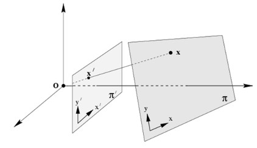
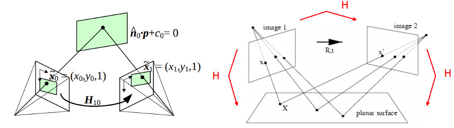
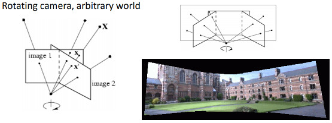
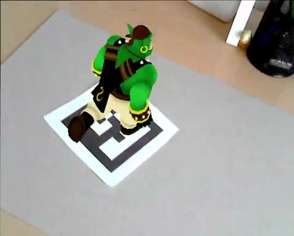
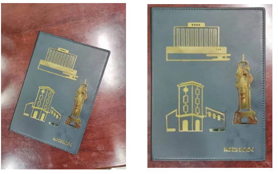

# 摄像机标定和三维重建（calib3d模块） {#calib}

```{r echo=FALSE}
library(ROpenCV)
```

本章反复要把「点的列表」交给 OpenCV，而 OpenCV 那边的类型是 `vector<Point2f>`、
`vector<Point3f>`，到了 R 侧必须变成**多通道 Mat**。先定义两个小工具，后面一直用：

```{r}
#把 n×2 的 R 矩阵（每行一个 (x,y)）转成 OpenCV 要的 CV_32FC2 Mat
pts2f = function(m){
  out = Mat(nrow(m),1,CV_32FC2)
  #注意这一行：多通道 Mat 的 [] 赋值是**按通道**铺开的，
  #先写完全部 x、再写完全部 y，不是 (x1,y1,x2,y2) 那样交错
  out[] = c(m[,1],m[,2])
  out
}

#把 n×3 的 R 矩阵（每行一个 (x,y,z)）转成 CV_32FC3 Mat
pts3f = function(m){
  out = Mat(nrow(m),1,CV_32FC3)
  out[] = c(m[,1],m[,2],m[,3])
  out
}
```

> **为什么不能直接传 R 矩阵？**
>
> `matrix(...,ncol=2)` 建出来是 `CV_64FC1` 的 4×2 矩阵，不是一个「点集」。
> `calibrateCamera`、`solvePnP`、`findHomography` 这一族要的是
> `CV_32FC2` 且 `checkVector(2, CV_32F) == 点数`，类型或布局。
>
> 而 `cv_findChessboardCorners` 这类**输出**角点的函数，交回来的是
> `1 × N × 2` 的 cvMat，取数据要用
> `matrix(as_array(x, numeric = TRUE), ncol = 2)` 才能变成「每行一个点」。


## 创建校准模式（绘制棋盘格）

标定要用棋盘格。可以不用图像矩阵，直接在 R 里画：

```{r}
#设置棋盘宽度
w = 600
#设置棋盘高度
h = 600
#设置横向内连接交错点
ptsnum_horiz = 7
#设置纵向内连接交错点
ptsnum_vert = 9
#计算每个棋盘单元格的宽度和高度
cell_w = floor(w/(ptsnum_horiz+2))
cell_h = floor(h/(ptsnum_vert+2))

#生成空图
plot(0:h,type = "n",xlim = c(0,w),ylim = c(0,h),bty = "n",
     xlab = "",ylab = "",xaxt = "n",yaxt = "n")

#isWhite为TRUE时，棋盘单元格为白色，否则为黑色
isWhite = TRUE
for(i in 1:(ptsnum_horiz+2)){
  for(j in 1:(ptsnum_vert+2)){
    #通过循环绘制各个单元格
    rect((i-1)*cell_w,(j-1)*cell_h,i*cell_w,j*cell_h,
         col = ifelse(isWhite,"white","black"),border = "white")
    isWhite = !isWhite
  }
  if(ptsnum_vert %% 2 == 0){
    #当纵向内连接交错点为偶数时，需要切换单元格颜色状态
    isWhite = !isWhite
  }
}
```

也可以生成一张图像矩阵，用 `cv_rectangle` 一格一格填：

```{r}
#设置棋盘宽度
w = 600
#设置棋盘高度
h = 600
#设置横向内连接交错点
ptsnum_horiz = 7
#设置纵向内连接交错点
ptsnum_vert = 9
#计算每个棋盘单元格的宽度和高度
cell_w = floor(w/(ptsnum_horiz+2))
cell_h = floor(h/(ptsnum_vert+2))

#生成全白图像矩阵（Mat 的第 4 个参数是初始值）
img = Mat(h,w,CV_8UC1,255)

#isWhite为TRUE时，棋盘单元格为白色，否则为黑色
isWhite = TRUE
for(i in 1:(ptsnum_horiz+2)){
  for(j in 1:(ptsnum_vert+2)){
    #通过循环绘制各个单元格：Rect 就是 c(x, y, width, height)
    rct = c((i-1)*cell_w,(j-1)*cell_h,cell_w,cell_h)
    if(isWhite){
      invisible(cv_rectangle(img,rct,c(255),-1))
    }else{
      invisible(cv_rectangle(img,rct,c(0),-1))
    }
    isWhite = !isWhite
  }
  if(ptsnum_vert %% 2 == 0){
    #当纵向内连接交错点为偶数时，需要切换单元格颜色状态
    isWhite = !isWhite
  }
}
```

```{r echo=FALSE}
plot(img)
title(main = "用 cv_rectangle 画出来的棋盘格")
```


## 方棋盘摄像机标定

**示例**

基于以下方棋盘图像进行相机标定（`images/calib/` 下有 13 张）：

```{r echo=FALSE}
#设定用于标定的棋盘文件所在的路径
image_path = "images/calib"
#获取路径下的棋盘文件名称
imgfiles = list.files(image_path)

#读取每个图像文件，依次存放在img_list列表中
img_list = list()
for(i in 1:length(imgfiles)){
  img_list[[i]] = cv_imread(paste0(image_path,"/",imgfiles[i]),IMREAD_GRAYSCALE)
}

#13 张图铺成 4 列
op = par(mfrow = c(4,4),mar = c(1,1,2,1))
for(i in 1:length(img_list)) plot(img_list[[i]],main = imgfiles[i])
par(op)
```

接下来做标定。分四步：造世界坐标 → 找角点 → 标定 → 存参数。

**第一步：世界坐标**

棋盘是平面，所以每个角点的三维坐标可以取 $z=0$ 的整数格点：

```{r}
#棋盘横向角点个数（即棋盘每行上黑色棋盘格之间的交点数）
ptsnum_perrow = 6
#棋盘纵向角点个数（即棋盘每列上黑色棋盘格之间的交点数）
ptsnum_percolumn = 9

#obj_world_pts各个角点的三维坐标：形如(0,0,0), (1,0,0),..., (8,5,0)
#外层走 x（行），内层走 y（列），和 findChessboardCorners 的返回顺序一致
obj_world_pts = do.call(rbind,lapply(0:(ptsnum_perrow-1),function(x){
  do.call(rbind,lapply(0:(ptsnum_percolumn-1),function(y) c(y,x,0)))
}))

dim(obj_world_pts)
head(obj_world_pts,3)
tail(obj_world_pts,2)
```

> 一共 `6 × 9 = 54` 个点，坐标从 `(0,0,0)` 到 `(8,5,0)`。
>
> **顺序不能随便改。** `findChessboardCorners` 返回的角点是按「逐行、从左到右」
> 排的，世界坐标必须按同样的顺序排，否则解出来的位姿是转了个身的。
> 这里外层 `x`、内层 `y` 正是原书 `for(x...) for(y...)` 的顺序。

**第二步：逐张找角点**

```{r}
#指定棋盘文件的路径以及棋盘文件名称
image_path = "images/calib"
imgfiles = list.files(image_path)

#对于每个棋盘图像文件，若能找寻到角点，则将其依次存入img_points列表中
img_points = list()
#对应的三维坐标（每张图都一样，就是 obj_world_pts）
obj_points = list()

#先把世界坐标转成 CV_32FC3 的 Mat，13 张图共用这一个
obj_world_mat = pts3f(obj_world_pts)

#迭代终止条件，用于寻找亚像素级别的角点：c(类型, 最大次数, 精度)
#EPS + MAX_ITER = 2 + 1 = 3，即 COUNT|EPS
criteria = c(EPS+MAX_ITER,30,0.001)

#循环处理每个棋盘文件
for(i in 1:length(imgfiles)){
  img = cv_imread(paste0(image_path,"/",imgfiles[i]),IMREAD_GRAYSCALE)

  #检测棋盘角点：patternSize 是 c(每行角点数, 每列角点数)
  r = cv_findChessboardCorners(img,c(ptsnum_percolumn,ptsnum_perrow),0L)
  #「找到没有」不在返回值上，在 attr(, "value") 上
  found_success = attr(r,"value")

  if(isTRUE(found_success)){
    #把 1×54×2 的 cvMat 摊成 54×2 的矩阵，再转回 CV_32FC2 交给 cornerSubPix
    corners = matrix(as_array(r,numeric = TRUE),ncol = 2)
    #进一步取得亚像素棋盘角点
    corners = cv_cornerSubPix(img,pts2f(corners),c(11,11),c(-1,-1),criteria)

    #将棋盘角点的三维坐标存入obj_points中
    obj_points[[length(obj_points)+1]] = obj_world_mat
    #将棋盘角点的二维坐标存入img_points中
    img_points[[length(img_points)+1]] = corners
  }else{
    message("没找到角点：",imgfiles[i])
  }
}

length(obj_points)
length(img_points)
```


把检测结果画出来看看：

```{r}
#挑一张有角点的图，把角点画上去
img_draw = cv_imread("images/calib/left01.jpg")
r = cv_findChessboardCorners(cv_cvtColor(img_draw,COLOR_BGR2GRAY),
                             c(ptsnum_percolumn,ptsnum_perrow),0L)
corners = matrix(as_array(r,numeric = TRUE),ncol = 2)
corners = cv_cornerSubPix(cv_cvtColor(img_draw,COLOR_BGR2GRAY),pts2f(corners),
                          c(11,11),c(-1,-1),criteria)
img_draw = cv_drawChessboardCorners(img_draw,c(ptsnum_percolumn,ptsnum_perrow),
                                    corners,TRUE)
```

```{r echo=FALSE}
plot(img_draw)
title(main = "检测到的棋盘角点")
```

**第三步：标定**

```{r}
#获取图像的尺寸（mat_info 返回 c(行, 列, 通道, 类型码, 深度码)）
img_info = mat_info(cv_imread("images/calib/left01.jpg"))

#计算内参和畸变系数；rvecs/tvecs 不传就一并返回
calib = cv_calibrateCamera(obj_points,img_points,c(img_info[2],img_info[1]))

#RMS 重投影误差，越小越好
calib$value

#相机内参
as_array(calib$cameraMatrix,numeric = TRUE)

#畸变系数 k1 k2 p1 p2 k3
as_array(calib$distCoeffs,numeric = TRUE)

#每张图的旋转向量、平移向量
length(calib$rvecs)
length(calib$tvecs)
```


内参的物理含义，对照着看：

```{r}
K = as_array(calib$cameraMatrix,numeric = TRUE)
c(fx = K[1,1],fy = K[2,2],cx = K[1,3],cy = K[2,3])
```

`fx`、`fy` 是焦距（以像素为单位），`cx`、`cy` 是主点，理论上应该接近图像中心。
图像是 640×480，中心是 `(320,240)`——上面这几个数正好在附近。

把每张图的位姿列出来：

```{r echo=FALSE}
rvec_df = t(vapply(calib$rvecs,function(m) as.vector(as_array(m,numeric = TRUE)),numeric(3)))
tvec_df = t(vapply(calib$tvecs,function(m) as.vector(as_array(m,numeric = TRUE)),numeric(3)))
knitr::kable(data.frame(view = imgfiles,
                        round(rvec_df,3),round(tvec_df,2)),
             col.names = c("图像","rx","ry","rz","tx","ty","tz"))
```


**第四步：保存参数**

```{r}
#把标定结果存起来，后面几节直接用
dir.create("data",showWarnings = FALSE)

#注意：存的是**普通 R 数组**，不是 cvMat 本身
cam_cfg = list(
  cameraMatrix = as_array(calib$cameraMatrix,numeric = TRUE),
  distCoeffs   = as_array(calib$distCoeffs,numeric = TRUE),
  rvecs        = lapply(calib$rvecs,function(m) as_array(m,numeric = TRUE)),
  tvecs        = lapply(calib$tvecs,function(m) as_array(m,numeric = TRUE)),
  rms          = calib$value
)
saveRDS(cam_cfg,"data/camera.rds")
file.info("data/camera.rds")$size
```


**校正图像**

```{r}
img_test = cv_imread("images/calib/left11.jpg")
img_test_info = mat_info(img_test)
h = img_test_info[1]
w = img_test_info[2]

#计算「最优新内参」：alpha = 1 表示保留所有有效像素
cameraMatrix_new = cv_getOptimalNewCameraMatrix(
  calib$cameraMatrix,calib$distCoeffs,c(w,h),1)

#去畸变
img_undistort = cv_undistort(img_test,calib$cameraMatrix,calib$distCoeffs,
                             cameraMatrix_new)

dim(img_test)
dim(img_undistort)
```

```{r echo=FALSE}
op = par(mfrow = c(1,2),mar = c(1,1,2,1))
plot(img_test);       title(main = "原始图像（桶形畸变）")
plot(img_undistort);  title(main = "去畸变结果")
par(op)
```

> `cv_getOptimalNewCameraMatrix` 在 C++ 里还有一个 `roi` 输出参数（有效区域），
> 当前的版本没有把它暴露出来，只返回新内参，后面再设法改进。


```{r echo=FALSE,eval=FALSE}
#尝试先做透视变换，再做畸变纠正处理。结果并不好

#读取测试图像文件
img_test = cv_imread("images/calib_radial.jpg")

#指定图像中棋盘区域的四个顶点坐标
pts1 = rbind(c(57,40),c(329,23),c(374,407),c(15,407))
#指定棋盘区域要映射到的区域（通过四个顶点坐标指定）
pts2 = rbind(c(0,0),c(400,0),c(400,450),c(0,450))
#依据pts1和pts2进行透视变换，获得变换矩阵M
M = cv_getPerspectiveTransform(pts2f(pts1),pts2f(pts2))

#依据M对img_test进行透视变换
img_pers = cv_warpPerspective(img_test,M,c(400,450))

#继续进行畸变校正
img_undistort = cv_undistort(img_pers,calib$cameraMatrix,calib$distCoeffs)

plot(img_pers)
plot(img_undistort)


# > 这段默认不执行。结论是：**先透视后去畸变是错的顺序**。
# > 透视变换假设成像已经满足针孔模型，而畸变恰恰破坏了这个前提；
# > 正确的顺序永远是「先去畸变，再做几何变换」。
```


## 单应性矩阵

简单地说，平面单应关系到两个平面之间的变换（取决于一个比例因子）：

$$
s \left[ \begin{matrix} x'\\y'\\1 \end{matrix} \right] = H \left[ \begin{matrix} x\\y\\1 \end{matrix} \right] = \left[ \begin{matrix} h_{11}&h_{12}&h_{13}\\h_{21}&h_{22}&h_{23}\\h_{31}&h_{32}&h_{33} \end{matrix} \right] \left[ \begin{matrix} x\\y\\1 \end{matrix} \right]
$$

单应矩阵 $H$ 是一个 3×3 矩阵，有 8 个自由度。通常取 $h_{33}=1$，或者约束：

$$
\sum_{i,j=1,2,3} h_{ij}^2=1
$$

opencv 中 **cv::getPerspectiveTransform** 可以获取单应矩阵：

```{r}
#原图像上的四个点
pts1 = rbind(c(92,68),c(262,116),c(180,364),c(18,304))
#透视校正目标区域（也由四个顶点坐标构成）
pts2 = rbind(c(10,10),c(300,10),c(300,400),c(10,400))

#依据pts1和pts2进行透视变换，获得变换矩阵M
M = cv_getPerspectiveTransform(pts2f(pts1),pts2f(pts2))
as_array(M,numeric = TRUE)
```

> 注意这里用的是 `cv_getPerspectiveTransform`（4 点精确解），
> 不是 `cv_findHomography`（多点最小二乘 + RANSAC）。四个点用前者，
> 多于四个点用后者，两者都要求 `CV_32FC2` 的点集。

以下示例显示了不同类型单应变换：

* 在一个相机下，真实世界平面 $\pi$ 与其相机成像平面 $\pi'$ 之间的变换关系



* 在两个相机下，包含着多个变换关系：真实世界平面与每个相机各自的成像平面之间的变换关系，两个相机成像平面之间的变换关系



* 在一个旋转相机下，真实世界中"无限远"的平面与各成像平面之间的变换关系




### 单应变换的用途？

基于共面点的增强现实摄像机姿态估计



* 透视图校正



把笔记本封面「拉平」：

```{r}
#读取图像文件
img = cv_imread("images/notebook.jpg")

#原图像透视校正区域（由四个顶点坐标构成）
pts1 = rbind(c(92,68),c(262,116),c(180,364),c(18,304))
#透视校正目标区域
pts2 = rbind(c(10,10),c(300,10),c(300,400),c(10,400))

#依据pts1和pts2进行透视变换，获得变换矩阵M
M = cv_getPerspectiveTransform(pts2f(pts1),pts2f(pts2))
#依据M对img进行透视变换
img_pers = cv_warpPerspective(img,M,c(320,420))
```

```{r echo=FALSE}
op = par(mfrow = c(1,2),mar = c(1,1,2,1))
plot(img);        title(main = "原始图像")
plot(img_pers);   title(main = "透视校正结果")
par(op)
```


### 共面点的姿态估计

例如，可以使用直接线性变换（DLT）算法来估计单应性。由于物体是平面的，物体帧中表示的点和投影到归一化相机帧中表示的图像平面的点之间的变换是单应的。正是因为对象是平面的，所以可以从单应性中检索相机姿势，前提是相机的内在参数已知。当使用棋盘对象和 `findChessboardCorners()` 获得图像中角点位置时，可以很容易地测试这一点。

先读回上一节存下来的内参：

```{r}
#读取相机参数：存的是数值数组，读回来要重建 Mat
stopifnot(file.exists("data/camera.rds"))
cam_cfg = readRDS("data/camera.rds")
cameraMatrix = Mat(cam_cfg$cameraMatrix)
distCoeffs   = Mat(cam_cfg$distCoeffs)

dim(cameraMatrix)
dim(distCoeffs)
```


估计姿态，并把坐标轴画上去：

```{r}
#确定三个数轴端点的三维坐标（z 取负，让轴朝相机方向伸出来）
obj_points_new = rbind(c(3,0,0),c(0,3,0),c(0,0,-3))

#读取位姿估计图像文件
img = cv_imread("images/calib/left14.jpg")
img_gray = cv_cvtColor(img,COLOR_BGR2GRAY)

#寻找棋盘角点
r = cv_findChessboardCorners(img_gray,c(ptsnum_percolumn,ptsnum_perrow),0L)
found = attr(r,"value")
corners = matrix(as_array(r,numeric = TRUE),ncol = 2)
corners = cv_cornerSubPix(img_gray,pts2f(corners),c(11,11),c(-1,-1),criteria)

#计算旋转向量和平移向量
pn = cv_solvePnPRansac(pts3f(obj_world_pts),corners,cameraMatrix,distCoeffs)

#将真实三维点投影到对应的图像平面上
imgpts = cv_projectPoints(pts3f(obj_points_new),pn$rvec,pn$tvec,
                          cameraMatrix,distCoeffs)$imagePoints
xyz = matrix(as_array(imgpts,numeric = TRUE),ncol = 2)

#棋盘第一个角点，作为三根轴的公共起点
origin = corners[1,]
#BGR：c(255,0,0) 蓝、c(0,255,0) 绿、c(0,0,255) 红
img = cv_line(img,origin,xyz[1,],c(255,0,0),5)
img = cv_line(img,origin,xyz[2,],c(0,255,0),5)
img = cv_line(img,origin,xyz[3,],c(0,0,255),5)
```

```{r echo=FALSE}
plot(img)
title(main = "估计出的相机姿态：X蓝 Y绿 Z红")
```


进一步，可以基于姿态估计结果渲染一个立方体：

```{r}
#立方体的 8 个顶点：底面 4 个 z=0，顶面 4 个 z=-3
cube = rbind(c(0,0,0),c(0,3,0),c(3,3,0),c(3,0,0),
             c(0,0,-3),c(0,3,-3),c(3,3,-3),c(3,0,-3))

#投影到图像平面
imgpts = cv_projectPoints(pts3f(cube),pn$rvec,pn$tvec,
                          cameraMatrix,distCoeffs)$imagePoints
xy = matrix(as_array(imgpts,numeric = TRUE),ncol = 2)

#绘制绿色底面（填充）
img = cv_drawContours(img,list(xy[1:4,]),-1L,c(0,255,0),-1L)
#绘制蓝色柱子（四条侧棱）
for(i in 1:4){
  img = cv_line(img,xy[i,],xy[i+4,],c(255,0,0),3)
}
#绘制红色顶面（只描边）
img = cv_drawContours(img,list(xy[5:8,]),-1L,c(0,0,255),3L)
```

```{r echo=FALSE}
plot(img)
title(main = "在棋盘上渲染的立方体")
```


### 图像融合

基于单应矩阵，把一张图「贴」到另一张图指定的四边形区域里：

```{r echo=FALSE}
#读取待植入广告牌的文件
img1 = cv_imread("images/catoon.jpg")
#读取广告牌文件
img2 = cv_imread("images/advert.jpg")

op = par(mfrow = c(1,2),mar = c(1,1,2,1))
plot(img1); title(main = "要贴上去的图")
plot(img2); title(main = "底图（广告牌）")
par(op)
```

```{r}
#读取待植入广告牌的文件
img1 = cv_imread("images/catoon.jpg")
#读取广告牌文件
img2 = cv_imread("images/advert.jpg")

#获取img1和img2的基本信息
img1_info = mat_info(img1)
img2_info = mat_info(img2)

#对img1进行边缘扩充，使其尺寸与img2保持一致
img1 = cv_copyMakeBorder(img1,
                         0,img2_info[1]-img1_info[1],
                         0,img2_info[2]-img1_info[2],
                         BORDER_CONSTANT)

#img1 边界上的四个顶点（用扩充后的尺寸）
pts1 = rbind(c(0,0),c(img1_info[2],0),
             c(img1_info[2],img1_info[1]),c(0,img1_info[1]))
#广告牌上要植入的区域
pts2 = rbind(c(190,100),c(390,120),c(380,414),c(180,440))

#依据pts1和pts2计算单应矩阵M
M = cv_findHomography(pts2f(pts1),pts2f(pts2))

#对img1进行单应变换
dst = cv_warpPerspective(img1,M,c(0,0))

#灰度化后二值化，形成遮罩：有内容的地方为 255
dst_gray = cv_cvtColor(dst,COLOR_BGR2GRAY)
mask = cv_threshold(dst_gray,0,255,THRESH_BINARY)

#把 dst 中遮罩覆盖的内容复制到 img2 上
img2 = cv_copyTo(dst,mask,img2)

dim(mask)
```

```{r echo=FALSE}
plot(img2)
title(main = "融合结果")
```


