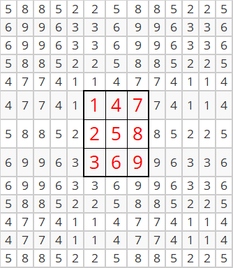

--- 
title: "ROpenCV — R与OpenCV之间的桥梁 — 之基础教程"
author: "zpy"
date: "`r Sys.Date()`"
documentclass: ctexbook
bibliography: [book.bib, packages.bib]
biblio-style: apalike
link-citations: yes
colorlinks: yes
lot: yes
lof: yes
#geometry: [b5paper, tmargin=2.5cm, bmargin=2.5cm, lmargin=3.5cm, rmargin=2.5cm]
geometry: [b5paper, tmargin=0.5cm, bmargin=0.5cm, lmargin=0.5cm, rmargin=0.5cm]
site: bookdown::bookdown_site
description: "ROpenCV — R用户也能直接使用OpenCV做图像处理实验了。"
github-repo: Judy-ZQ/ROpenCV-Tutorial
#cover-image: images/cover.jpg
editor_options: 
  chunk_output_type: console
---

```{r setup, include=FALSE,message=FALSE,warning=FALSE}
options(
  htmltools.dir.version = FALSE, formatR.indent = 2, width = 60, digits = 4
)

# 填上你需要用到的包，如 c('ggplot2', 'dplyr')
lapply(c('ROpenCV'), function(pkg) {
  if (system.file(package = pkg) == '') install.packages(pkg)
})
# library(magick)
# library(imager)
# library(imagerExtra)
# library(OpenImageR)
# library(imagefluency)
# library(colorfindr)
# library(opencv)
# library(EBImage)
library(ROpenCV)
```

# 前言 {-}


这几年，大学生创新实践中心的同学时不时会讨论图像处理方面的问题，我也爱跟着一起讨论并尝试做一些实验。我个人很喜欢R，但很可惜的是R目前封装的关于图像处理的工具包功能很有限，这让我不得不时而用matlab，或时而Python，或时而用Visual Studio集成开发环境来做实验，感觉很不顺手。

在去年年底，我突然间坚定了要在R中使用OpenCV各种功能的想法，打算自己实现一个连接R和OpenCV的桥梁——称之为ROpenCV，并为此做了初步尝试，发现效果还不错，也就不断坚持到了现在，且因此积攒下了一些资料。比如实现通过滑动条对蓝、绿、红三种颜色分量的合成控制，进而形成一个调色板功能。

```{r}
#实现滑动条滑块拖动时的响应函数
colPallete <- function(val, param){
  #获取蓝色滑动条的刻度值，作为蓝色分量b
  b = cv_getTrackbarPos('B','image')
  #获取绿色滑动条的刻度值，作为绿色分量g
  g = cv_getTrackbarPos('G','image')
  #获取红色滑动条的刻度值，作为红色分量r
  r = cv_getTrackbarPos('R','image')
  #生成512行512列的8位无符号3通道图像img，所有像素值都为(b,g,r)
  img = Mat(512,512,CV_8UC3,c(b,g,r))
  #将img图像显示在标题为image的图形窗口上
  cv_imshow('image',img)
}

#生成标题为image的图形窗口
cv_namedWindow('image')
#在标题为image的图形窗口上生成名为B、G、R的滑动条，最小值都为0，最大值都为255，
#滑动条拖动的相应函数都为colPallete
#B、G、R滑动条的刻度分别代表蓝色、绿色和红色分量值
cv_createTrackbar("B",'image',0,255,colPallete)
cv_createTrackbar("G",'image',0,255,colPallete)
cv_createTrackbar("R",'image',0,255,colPallete)


#启用colPallete函数
colPallete(0,0)
```

在拖动滑动条改变颜色分量时，可以看到相应的蓝、绿、红三种颜色的合成效果：


当只有一个颜色分量为255，其余两个颜色分量都为0时，可以得到纯色效果，比如(255,0,0)对应着纯蓝、(0,255,0)对应着纯绿，而(0,0,255)对应着纯红（见下图）。

```{r echo=FALSE, fig.width=9, fig.height=3}
img1 = cv_imread("images/palletePureBlue.png")
img2 = cv_imread("images/palletePureGreen.png")
img3 = cv_imread("images/palletePureRed.png")

#plot.cvMat 一次只画一张，多张并排要自己摆版面
imgs = list(img1,img2,img3)
labs = c("(255,0,0) 纯蓝","(0,255,0) 纯绿","(0,0,255) 纯红")
old = par(mfrow = c(1,3), mar = c(1,1,2,1))
for (k in seq_along(imgs)) {
  plot(imgs[[k]])
  title(main = labs[k], cex.main = 0.9)
}
par(old)
```


又比如，OpenCV的**cvtColor**函数可以实现图像从BGR颜色空间到HSV颜色空间的转换，而通过如下代码则可以快速查看BGR中的纯蓝(255,0,0)映射到HSV颜色空间后的色彩值为(120,255,255)。

```{r}
#生成只含一个像素的OpenCV图像矩阵img
img= Mat(1,1,CV_8UC3)
#将像素值设定为纯蓝色（[ 是 1 起始，不是 OpenCV 的 0）
img[1,1] = c(255,0,0)

#将img的颜色空间从BGR转为HSV，结果保存在res中
res = cv_cvtColor(img,COLOR_BGR2HSV)

#查看像素的值，结果表明：
#BGR颜色空间中的蓝色映射到HSV颜色空间后为c(120,255,255)，
#即H分量为120，S和V分量都为255
as_array(res, numeric = TRUE)
```

再比如，OpenCV中在进行诸如边缘检测等图像处理时，会首先扩展图像边缘，而扩展边缘的方式包括BORDER_CONSTANT、BORDER_REPLICATE、BORDER_REFLECT等9种，尽管OpenCV的帮助文档也说明了每种方式的边缘扩展效果，但还是希望能够在R语言中直接观察到相应效果（如下代码展示了BORDER_REFLECT边缘扩展情况）。

```{r eval=FALSE}
#生成3行3列的矩阵img_mat
img_mat = matrix(1:9,nr=3,nc=3)
#通过r2cv函数将img_mat转变为OpenCV图像矩阵img
img = Mat(3,3,CV_8UC1)
img[] = img_mat

#设定图像上、下、左、右四侧需要扩展的像素个数
sz = 5
#扩展图像边缘，扩展结果存入img_borderadded
img_borderadded = cv_copyMakeBorder(img,sz,sz,sz,sz,BORDER_REFLECT)

#取出img_borderadded的像素值，存入img_borderadded_mat
img_borderadded_mat = as_array(img_borderadded, numeric = TRUE)
img_borderadded_mat
```


```{r echo=FALSE,eval=FALSE}
#生成3行3列的矩阵img.mat
img_mat = matrix(1:9,nr=3,nc=3)
#通过r2cv函数将img_mat转变为OpenCV图像矩阵img
img = Mat(3,3,CV_8UC1)
img$r2cv(img_mat)

#设定图像上、下、左、右四侧需要扩展的像素个数
sz = 5
#扩展图像边缘，扩展结果存入img.borderadded
img_borderadded = Mat()
cv_copyMakeBorder(img,img_borderadded,sz,sz,sz,sz,BORDER_REFLECT)

#通过cv2r函数，获得img_borderadded的像素值，存入img_borderadded_mat
img_borderadded_mat = img_borderadded$cv2r()
img_borderadded_mat
```



本书中有很多这样的例子，这里就不再枚举了。总之，于我而言，能够在R中使用OpenCV做各种图像处理实验，是一件令人开心的事情。

原本打算再积累一阵子才成书的，但一则有感于很多学习R的同学因不能在R中完成图像处理实验而不得不倒腾切换各种工具的窘况，二则有感于个人力量难以高效率、高质量完成OpenCV函数的封装，所以想以此书抛砖引玉，吸引R中众多有志于图像处理的用户一起完成ROpenCV的搭建和扩展工作。

此外，这几年我总是不断吆喝中心的同学加强积累，冷静思考之后发现自己好像只是一个吆喝者而已，而不是一个践行者。这里也以此书，向中心的同学表明我不仅仅是吆喝而已，也在尽力跑着。


<!-- 我用了两个 R 包编译这本书，分别是 **knitr**\index{knitr} [@xie2015] 和 **bookdown**\index{bookdown} [@R-bookdown]。以下是我的 R 进程信息： -->

```{r}
sessionInfo()
```

## 致谢 {-}

非常感谢谁谁以及谁谁对我的帮助。艾玛，要不是他们神一样的队友，我两年前就写完这本书了。

```{block2, type='flushright', html.tag='p'}
张三  
于 A 村某角落
```

